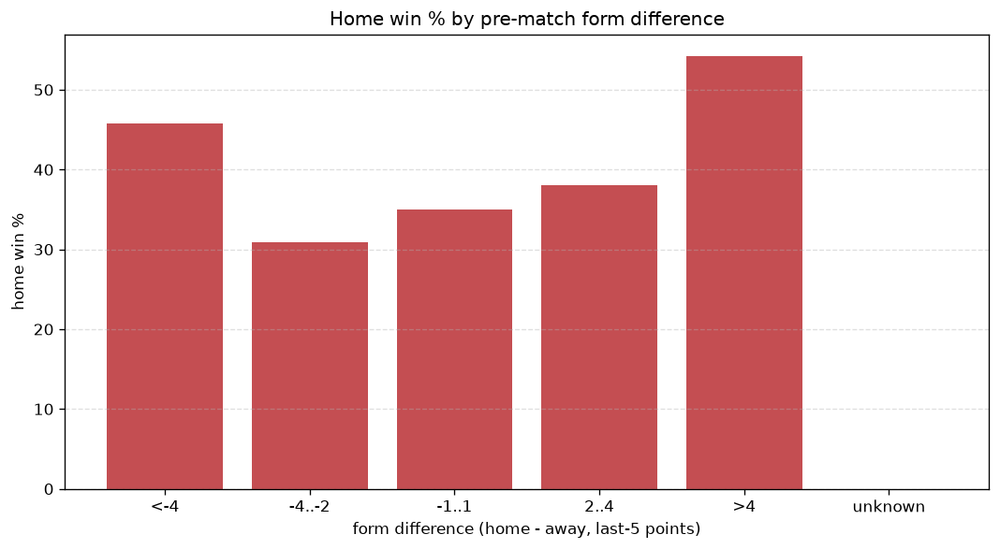
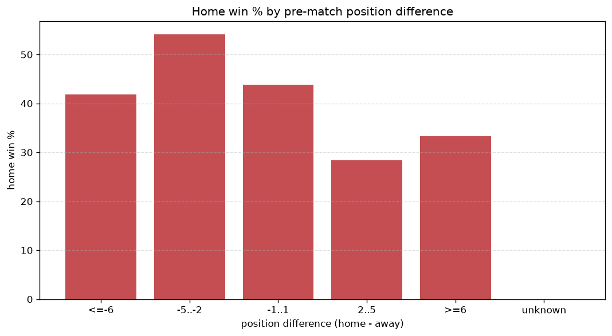

# Relationships Analysis
- Report: `relationships`
- Generated: 2026-10-30T03:58:37+00:00
- Script: `backend/scripts/analyze_relationships.py` v1.0.0
- League: Primavera 1 (Italy)
- Scope: league `italy19`

- Matches analysed: **1920** (23 leakage-safe pre-match features).

## 1. Correlation matrix
_Pearson correlation of each pre-match feature with observed goals; sorted by |corr(total goals)|._

| feature | corr(home) | corr(away) | corr(total) |
|---|---|---|---|
| away_team_away_conceded_avg | 0.132 | -0.001 | 0.097 |
| away_team_goals_conceded_last_5 | 0.127 | -0.063 | 0.050 |
| points_difference | 0.221 | -0.168 | 0.048 |
| away_team_away_win_rate | -0.120 | 0.063 | -0.045 |
| away_team_points_last_5 | -0.121 | 0.081 | -0.034 |
| away_team_away_goals_avg | -0.047 | 0.097 | 0.032 |
| home_team_home_conceded_avg | -0.052 | 0.098 | 0.029 |
| position_difference | -0.180 | 0.154 | -0.028 |
| away_team_wins_last_5 | -0.101 | 0.073 | -0.024 |
| away_position_before_match | 0.142 | -0.119 | 0.023 |
| away_points_before_match | -0.089 | 0.069 | -0.018 |
| home_team_goals_conceded_last_5 | -0.039 | 0.068 | 0.018 |
| home_team_home_win_rate | 0.054 | -0.082 | -0.016 |
| home_team_points_last_5 | 0.051 | -0.078 | -0.016 |
| home_position_before_match | -0.106 | 0.092 | -0.015 |
| home_points_before_match | 0.065 | -0.048 | 0.015 |
| away_rest_days | -0.009 | 0.030 | 0.013 |
| home_rest_days | -0.010 | 0.029 | 0.012 |
| home_team_goals_scored_last_5 | 0.067 | -0.060 | 0.008 |
| home_team_home_goals_avg | 0.052 | -0.045 | 0.007 |
| away_team_goals_scored_last_5 | -0.064 | 0.078 | 0.006 |
| rest_days_difference | -0.004 | -0.004 | -0.006 |
| home_team_wins_last_5 | 0.051 | -0.063 | -0.005 |

## 2. Form vs outcome
_Home win/draw/away % per bucket of `home_team_points_last_5 - away_team_points_last_5`._

| bucket | matches | home | draw | away | home % | draw % | away % |
|---|---|---|---|---|---|---|---|
| <-4 | 303 | 102 | 79 | 122 | 33.7% | 26.1% | 40.3% |
| -4..-2 | 409 | 154 | 110 | 145 | 37.7% | 26.9% | 35.5% |
| -1..1 | 554 | 236 | 135 | 183 | 42.6% | 24.4% | 33.0% |
| 2..4 | 387 | 185 | 98 | 104 | 47.8% | 25.3% | 26.9% |
| >4 | 267 | 152 | 64 | 51 | 56.9% | 24.0% | 19.1% |
| unknown | 0 | 0 | 0 | 0 | - | - | - |

## 3. Position vs outcome
_Home win/draw/away % per bucket of `position_difference` (home position - away position; negative favours the home team)._

| bucket | matches | home | draw | away | home % | draw % | away % |
|---|---|---|---|---|---|---|---|
| <=-6 | 439 | 236 | 109 | 94 | 53.8% | 24.8% | 21.4% |
| -5..-2 | 373 | 194 | 86 | 93 | 52.0% | 23.1% | 24.9% |
| -1..1 | 292 | 125 | 64 | 103 | 42.8% | 21.9% | 35.3% |
| 2..5 | 347 | 134 | 104 | 109 | 38.6% | 30.0% | 31.4% |
| >=6 | 469 | 140 | 123 | 206 | 29.9% | 26.2% | 43.9% |
| unknown | 0 | 0 | 0 | 0 | - | - | - |

## 4. Rest advantage
_Home win/draw/away % per bucket of `rest_days_difference` (home rest - away rest). Matches with unknown rest are bucketed separately._

| bucket | matches | home | draw | away | home % | draw % | away % |
|---|---|---|---|---|---|---|---|
| <-1 | 175 | 74 | 43 | 58 | 42.3% | 24.6% | 33.1% |
| -1..0 | 427 | 177 | 111 | 139 | 41.5% | 26.0% | 32.6% |
| 0 | 669 | 300 | 161 | 208 | 44.8% | 24.1% | 31.1% |
| 1..2 | 546 | 237 | 143 | 166 | 43.4% | 26.2% | 30.4% |
| >2 | 48 | 18 | 16 | 14 | 37.5% | 33.3% | 29.2% |
| unknown | 55 | 23 | 12 | 20 | 41.8% | 21.8% | 36.4% |
- *55 match(es) had unknown rest difference (missing rest data on at least one side).*

## 5. Home team quality
_Home win rate by `home_team_home_win_rate` tier (split at 0.5)._

- `< 0.5` tier: **39.4%** home win (435/1105)
- `>= 0.5` tier: **48.3%** home win (394/815)
- Home-win gap (>= split minus < split): **+8.9 pp**

| tier | label | matches | home | draw | away | home % |
|---|---|---|---|---|---|---|
| low | < 0.5 | 1105 | 435 | 279 | 391 | 39.4% |
| high | >= 0.5 | 815 | 394 | 207 | 214 | 48.3% |

## 6. Feature averages by result
_Mean feature value per outcome; `range` is home-minus-away spread of the group means._

| feature | home mean | draw mean | away mean | range |
|---|---|---|---|---|
| points_difference | 2.654 | -0.811 | -3.438 | 6.092 |
| position_difference | -1.486 | 0.475 | 2.053 | 3.539 |
| away_points_before_match | 21.989 | 24.045 | 25.139 | 3.150 |
| home_points_before_match | 24.643 | 23.235 | 21.701 | 2.942 |
| away_position_before_match | 10.881 | 9.687 | 9.046 | 1.834 |
| home_position_before_match | 9.394 | 10.163 | 11.099 | 1.705 |
| home_team_points_last_5 | 6.515 | 6.356 | 5.583 | 0.932 |
| away_team_points_last_5 | 5.924 | 6.681 | 6.744 | 0.820 |
| away_team_goals_conceded_last_5 | 7.117 | 6.377 | 6.312 | 0.805 |
| home_team_goals_scored_last_5 | 7.012 | 6.660 | 6.226 | 0.786 |
| home_team_goals_conceded_last_5 | 6.551 | 6.679 | 7.301 | 0.750 |
| home_rest_days | 7.684 | 7.983 | 8.326 | 0.643 |
| away_rest_days | 7.746 | 7.920 | 8.347 | 0.601 |
| away_team_goals_scored_last_5 | 6.525 | 7.021 | 7.091 | 0.566 |
| home_team_wins_last_5 | 1.774 | 1.737 | 1.488 | 0.287 |
| away_team_wins_last_5 | 1.610 | 1.815 | 1.843 | 0.233 |
| home_team_home_conceded_avg | 1.190 | 1.253 | 1.364 | 0.174 |
| away_team_away_conceded_avg | 1.622 | 1.495 | 1.498 | 0.127 |
| rest_days_difference | -0.062 | 0.063 | -0.021 | 0.125 |
| away_team_away_goals_avg | 1.198 | 1.298 | 1.320 | 0.121 |
| home_team_home_goals_avg | 1.586 | 1.569 | 1.484 | 0.103 |
| home_team_home_win_rate | 0.429 | 0.416 | 0.364 | 0.064 |
| away_team_away_win_rate | 0.271 | 0.329 | 0.316 | 0.057 |

---
*All features are leakage-safe pre-match values built by `ml.features.build_features.build_rows` from strictly prior matches. Run with `python backend/scripts/analyze_relationships.py` to regenerate.*

## Charts

