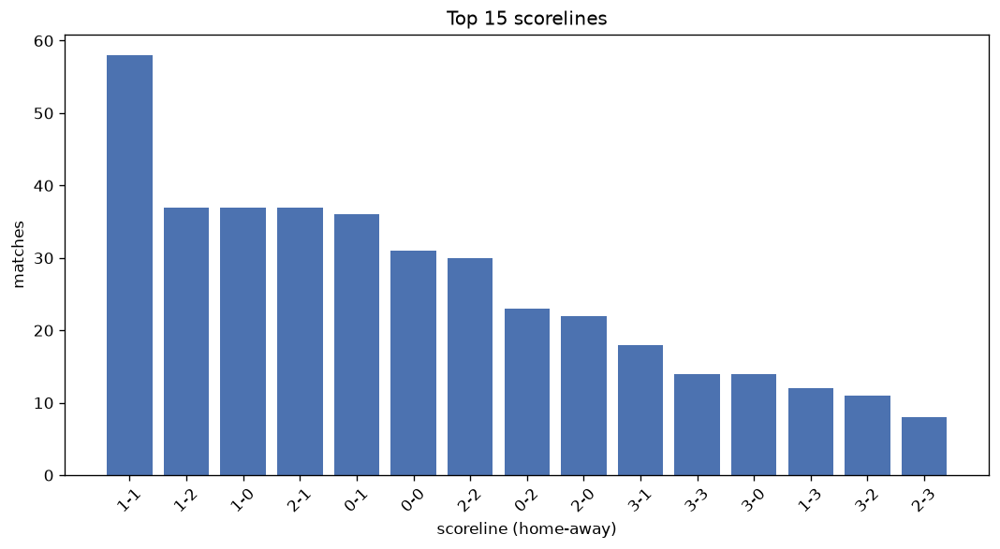
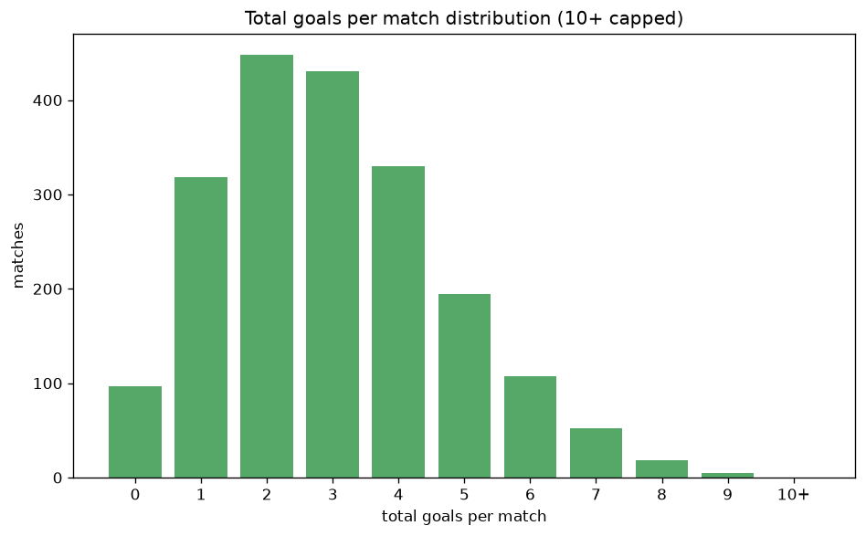

# Scoreline Analysis
- Report: `scoreline_analysis`
- Generated: 2026-10-30T03:58:35+00:00
- Script: `backend/scripts/analyze_scorelines.py` v1.0.0
- League: Primavera 1 (Italy)
- Scope: league `italy19`

## 1. Scoreline frequency
- Matches analysed: **2000** across **7** seasons.
- Distinct scorelines seen: **45**.

| scoreline | count | pct |
|---|---|---|
| 1-1 | 247 | 12.3% |
| 1-0 | 179 | 8.9% |
| 2-1 | 173 | 8.7% |
| 1-2 | 154 | 7.7% |
| 0-1 | 139 | 7.0% |
| 2-2 | 131 | 6.5% |
| 2-0 | 119 | 6.0% |
| 0-0 | 97 | 4.8% |
| 3-1 | 88 | 4.4% |
| 0-2 | 82 | 4.1% |
| 3-0 | 75 | 3.8% |
| 1-3 | 61 | 3.0% |
| 3-2 | 60 | 3.0% |
| 2-3 | 58 | 2.9% |
| 4-0 | 38 | 1.9% |
| 3-3 | 35 | 1.8% |
| 4-1 | 31 | 1.6% |
| 0-3 | 29 | 1.4% |
| 1-4 | 28 | 1.4% |
| 2-4 | 24 | 1.2% |

## 2. Scoreline frequency per season

### 2020-2021
| scoreline | count | pct |
|---|---|---|
| 1-1 | 28 | 11.7% |
| 1-2 | 20 | 8.3% |
| 1-0 | 18 | 7.5% |
| 0-1 | 17 | 7.1% |
| 2-2 | 15 | 6.2% |

### 2021-2022
| scoreline | count | pct |
|---|---|---|
| 1-0 | 37 | 12.1% |
| 1-1 | 32 | 10.5% |
| 1-2 | 29 | 9.5% |
| 2-1 | 29 | 9.5% |
| 2-0 | 23 | 7.5% |

### 2022-2023
| scoreline | count | pct |
|---|---|---|
| 1-1 | 37 | 12.1% |
| 2-1 | 31 | 10.1% |
| 1-0 | 28 | 9.2% |
| 0-1 | 24 | 7.8% |
| 2-2 | 21 | 6.9% |

### 2023-2024
| scoreline | count | pct |
|---|---|---|
| 1-1 | 40 | 13.1% |
| 1-0 | 30 | 9.8% |
| 1-2 | 24 | 7.8% |
| 2-1 | 23 | 7.5% |
| 2-2 | 22 | 7.2% |

### 2024-2025
| scoreline | count | pct |
|---|---|---|
| 1-1 | 48 | 12.6% |
| 2-1 | 34 | 8.9% |
| 0-1 | 32 | 8.4% |
| 1-0 | 27 | 7.1% |
| 1-2 | 26 | 6.8% |

### 2025-2026
| scoreline | count | pct |
|---|---|---|
| 1-1 | 52 | 13.6% |
| 1-0 | 36 | 9.4% |
| 2-1 | 34 | 8.9% |
| 1-2 | 33 | 8.6% |
| 0-0 | 29 | 7.6% |

### 2026-2027
| scoreline | count | pct |
|---|---|---|
| 2-2 | 12 | 15.0% |
| 1-1 | 10 | 12.5% |
| 0-1 | 8 | 10.0% |
| 2-1 | 7 | 8.8% |
| 1-2 | 5 | 6.2% |

## 3. Total-goal histogram
_10+ groups all matches with 10 or more total goals._

| total goals | matches | pct |
|---|---|---|
| 0 | 97 | 4.8% |
| 1 | 318 | 15.9% |
| 2 | 448 | 22.4% |
| 3 | 431 | 21.6% |
| 4 | 330 | 16.5% |
| 5 | 194 | 9.7% |
| 6 | 107 | 5.3% |
| 7 | 52 | 2.6% |
| 8 | 18 | 0.9% |
| 9 | 5 | 0.2% |
| 10+ | 0 | 0.0% |

## 4. Extreme scorelines
- Matches with 7+ total goals: **75**

| season | date | scoreline | total goals |
|---|---|---|---|
| 2023-2024 | 2024-02-04 | 6-3 | 9 |
| 2024-2025 | 2025-01-23 | 4-5 | 9 |
| 2024-2025 | 2025-04-22 | 9-0 | 9 |
| 2025-2026 | 2025-10-25 | 7-2 | 9 |
| 2025-2026 | 2026-02-20 | 5-4 | 9 |
| 2020-2021 | 2021-02-10 | 2-6 | 8 |
| 2020-2021 | 2021-05-16 | 3-5 | 8 |
| 2020-2021 | 2021-05-26 | 5-3 | 8 |
| 2021-2022 | 2021-10-23 | 5-3 | 8 |
| 2021-2022 | 2022-04-25 | 4-4 | 8 |
| 2022-2023 | 2022-08-20 | 3-5 | 8 |
| 2022-2023 | 2023-04-08 | 5-3 | 8 |
| 2023-2024 | 2024-01-06 | 6-2 | 8 |
| 2023-2024 | 2024-05-19 | 3-5 | 8 |
| 2024-2025 | 2024-09-16 | 5-3 | 8 |
| 2024-2025 | 2024-09-23 | 4-4 | 8 |
| 2024-2025 | 2025-01-04 | 4-4 | 8 |
| 2024-2025 | 2025-01-31 | 5-3 | 8 |
| 2025-2026 | 2026-02-15 | 2-6 | 8 |
| 2025-2026 | 2026-05-02 | 3-5 | 8 |
| 2025-2026 | 2026-05-02 | 3-5 | 8 |
| 2026-2027 | 2026-08-29 | 6-2 | 8 |
| 2026-2027 | 2026-09-12 | 5-3 | 8 |
| 2020-2021 | 2020-10-03 | 3-4 | 7 |
| 2020-2021 | 2021-04-03 | 5-2 | 7 |
| 2020-2021 | 2021-05-08 | 6-1 | 7 |
| 2020-2021 | 2021-06-06 | 4-3 | 7 |
| 2021-2022 | 2021-09-11 | 1-6 | 7 |
| 2021-2022 | 2021-09-18 | 3-4 | 7 |
| 2021-2022 | 2022-01-29 | 3-4 | 7 |
| 2021-2022 | 2022-02-09 | 2-5 | 7 |
| 2021-2022 | 2022-02-21 | 3-4 | 7 |
| 2021-2022 | 2022-04-02 | 3-4 | 7 |
| 2021-2022 | 2022-04-09 | 5-2 | 7 |
| 2021-2022 | 2022-05-07 | 4-3 | 7 |
| 2021-2022 | 2022-05-07 | 4-3 | 7 |
| 2021-2022 | 2022-05-15 | 5-2 | 7 |
| 2022-2023 | 2022-08-30 | 2-5 | 7 |
| 2022-2023 | 2022-10-01 | 3-4 | 7 |
| 2022-2023 | 2022-10-07 | 5-2 | 7 |
| 2022-2023 | 2022-11-12 | 5-2 | 7 |
| 2022-2023 | 2023-02-26 | 6-1 | 7 |
| 2022-2023 | 2023-03-11 | 5-2 | 7 |
| 2022-2023 | 2023-04-01 | 5-2 | 7 |
| 2022-2023 | 2023-05-26 | 2-5 | 7 |
| 2023-2024 | 2023-08-25 | 4-3 | 7 |
| 2023-2024 | 2023-08-28 | 3-4 | 7 |
| 2023-2024 | 2023-10-08 | 6-1 | 7 |
| 2023-2024 | 2023-12-02 | 5-2 | 7 |
| 2023-2024 | 2023-12-04 | 4-3 | 7 |
| 2023-2024 | 2024-02-03 | 7-0 | 7 |
| 2023-2024 | 2024-02-10 | 3-4 | 7 |
| 2023-2024 | 2024-03-10 | 1-6 | 7 |
| 2023-2024 | 2024-03-16 | 4-3 | 7 |
| 2023-2024 | 2024-05-11 | 4-3 | 7 |
| 2024-2025 | 2024-08-24 | 3-4 | 7 |
| 2024-2025 | 2024-09-01 | 1-6 | 7 |
| 2024-2025 | 2024-09-15 | 3-4 | 7 |
| 2024-2025 | 2024-12-07 | 4-3 | 7 |
| 2024-2025 | 2024-12-14 | 1-6 | 7 |
| 2024-2025 | 2025-02-16 | 3-4 | 7 |
| 2024-2025 | 2025-02-20 | 4-3 | 7 |
| 2024-2025 | 2025-03-01 | 4-3 | 7 |
| 2024-2025 | 2025-03-02 | 3-4 | 7 |
| 2024-2025 | 2025-04-27 | 2-5 | 7 |
| 2024-2025 | 2025-05-09 | 4-3 | 7 |
| 2024-2025 | 2025-05-11 | 3-4 | 7 |
| 2025-2026 | 2025-12-13 | 4-3 | 7 |
| 2025-2026 | 2026-03-07 | 5-2 | 7 |
| 2025-2026 | 2026-03-14 | 5-2 | 7 |
| 2025-2026 | 2026-03-14 | 7-0 | 7 |
| 2025-2026 | 2026-05-02 | 5-2 | 7 |
| 2025-2026 | 2026-05-10 | 6-1 | 7 |
| 2026-2027 | 2026-09-13 | 6-1 | 7 |
| 2026-2027 | 2026-10-16 | 5-2 | 7 |

## 5. Margin-of-victory distribution (decided matches)
- Decided matches: **1487** (draws: **513**)
- Average winning margin: **1.78**

| margin | matches | pct |
|---|---|---|
| 1 | 790 | 53.1% |
| 2 | 405 | 27.2% |
| 3+ | 292 | 19.6% |

## 6. Margin by outcome

### Home wins
- Matches: **858** | avg margin: **1.88** | max margin: **9**
| margin | matches | pct |
|---|---|---|
| 1 | 425 | 49.5% |
| 2 | 233 | 27.2% |
| 3+ | 200 | 23.3% |
- *Full match-by-match list available in `scoreline_analysis.json`.*

### Away wins
- Matches: **629** | avg margin: **1.63** | max margin: **6**
| margin | matches | pct |
|---|---|---|
| 1 | 365 | 58.0% |
| 2 | 172 | 27.3% |
| 3+ | 92 | 14.6% |
- *Full match-by-match list available in `scoreline_analysis.json`.*

## 7. Most common exact score by outcome type
| outcome | matches | most common score | count | pct |
|---|---|---|---|---|
| home | 858 | 1-0 | 179 | 20.9% |
| draw | 513 | 1-1 | 247 | 48.1% |
| away | 629 | 1-2 | 154 | 24.5% |

---
*All statistics are computed from PostgreSQL tables (read-only). Run with `python backend/scripts/analyze_scorelines.py` to regenerate.*

## Charts

