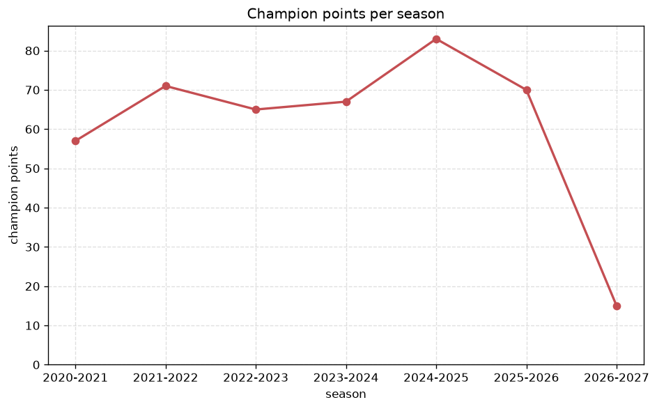
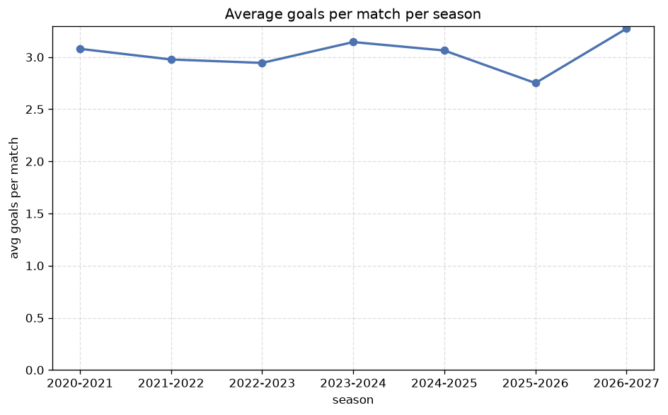

# Season Trends Analysis
- Report: `season_trends`
- Generated: 2026-10-26T01:37:46+00:00
- Script: `backend/scripts/analyze_seasons.py` v1.0.0
- League: Primavera 1 (Italy)
- Scope: league `italy19`

## 1. Champions per season
| season | champion | pts | runner-up | margin |
|---|---|---|---|---|
| 2020-2021 | Sampdoria U19 | 57 | Juventus U19 | 0 pts |
| 2021-2022 | AS Roma U19 | 71 | Inter U19 | 7 pts |
| 2022-2023 | Lecce U19 | 65 | Fiorentina U19 | 2 pts |
| 2023-2024 | Inter U19 | 67 | AS Roma U19 | 2 pts |
| 2024-2025 | AS Roma U20 | 83 | Inter U20 | 9 pts |
| 2025-2026 | Cesena U20 | 70 | Fiorentina U20 | 2 pts |
| 2026-2027 | Inter U20 | 15 | Parma U20 | 0 pts |

## 2. Title-race tightness
- Tight races (margin <= 3 pts): **5** of 7 seasons
- Tightest race: **2020-2021** - Sampdoria U19 beat Juventus U19 by **0** pts

| season | margin | tight |
|---|---|---|
| 2020-2021 | 0 pts | yes |
| 2021-2022 | 7 pts |  |
| 2022-2023 | 2 pts | yes |
| 2023-2024 | 2 pts | yes |
| 2024-2025 | 9 pts |  |
| 2025-2026 | 2 pts | yes |
| 2026-2027 | 0 pts | yes |

## 3. Points thresholds
_Position-specific points per season. Key: 1 = champion, 2 = runner-up, 4 = CL line, 6 = Europa, 17 = last safe, 20 = bottom._

| season | pos 1 | pos 2 | pos 4 | pos 6 | pos 17 | pos 20 |
|---|---|---|---|---|---|---|
| 2020-2021 | 57 | 57 | 55 | 49 | - | - |
| 2021-2022 | 71 | 64 | 58 | 53 | 26 | - |
| 2022-2023 | 65 | 63 | 57 | 55 | 19 | - |
| 2023-2024 | 67 | 65 | 55 | 51 | 32 | - |
| 2024-2025 | 83 | 74 | 69 | 61 | 40 | 14 |
| 2025-2026 | 70 | 68 | 65 | 59 | 40 | 24 |
| 2026-2027 | 15 | 15 | 15 | 12 | 7 | 4 |

## 4. Relegation battle
| season | safe pos | safe pts | drop pos | drop pts | gap |
|---|---|---|---|---|---|
| 2020-2021 | 17 | - | 18 | - | - |
| 2021-2022 | 17 | 26 | 18 | 19 | 7 pts |
| 2022-2023 | 17 | 19 | 18 | 11 | 8 pts |
| 2023-2024 | 17 | 32 | 18 | 26 | 6 pts |
| 2024-2025 | 17 | 40 | 18 | 37 | 3 pts |
| 2025-2026 | 17 | 40 | 18 | 39 | 1 pts |
| 2026-2027 | 17 | 7 | 18 | 7 | 0 pts |

## 5. League-level trends
| season | matches | total goals | avg goals | home win | draw | away win | goalless | avg pts/team |
|---|---|---|---|---|---|---|---|---|
| 2020-2021 | 240 | 739 | 3.079 | 40.4% | 25.4% | 34.2% | 5.0% | 41.19 |
| 2021-2022 | 306 | 911 | 2.977 | 46.1% | 22.2% | 31.7% | 3.6% | 47.22 |
| 2022-2023 | 306 | 901 | 2.944 | 44.8% | 24.5% | 30.7% | 5.2% | 46.83 |
| 2023-2024 | 306 | 962 | 3.144 | 45.8% | 27.1% | 27.1% | 3.9% | 46.39 |
| 2024-2025 | 380 | 1164 | 3.063 | 42.6% | 21.6% | 35.8% | 3.9% | 52.9 |
| 2025-2026 | 382 | 1051 | 2.751 | 39.8% | 30.6% | 29.6% | 7.6% | 51.45 |
| 2026-2027 | 77 | 252 | 3.273 | 35.1% | 33.8% | 31.2% | 2.6% | 10.25 |

## 6. View divergence
- Largest divergence: **2023-2024** (goals view, avg abs position diff = 6.667)

_Avg absolute position difference between classic view and alternative view per season._

| season | classic vs luck | classic vs goals |
|---|---|---|
| 2020-2021 | 1.750 | 6.250 |
| 2021-2022 | 3.222 | 5.889 |
| 2022-2023 | 2.667 | 6.556 |
| 2023-2024 | 3.111 | 6.667 |
| 2024-2025 | 3.200 | 6.400 |
| 2025-2026 | 2.600 | 5.500 |
| 2026-2027 | 2.300 | 6.400 |

---
*All statistics are computed from PostgreSQL tables (read-only). Run with `python backend/scripts/analyze_seasons.py` to regenerate.*

## Charts

