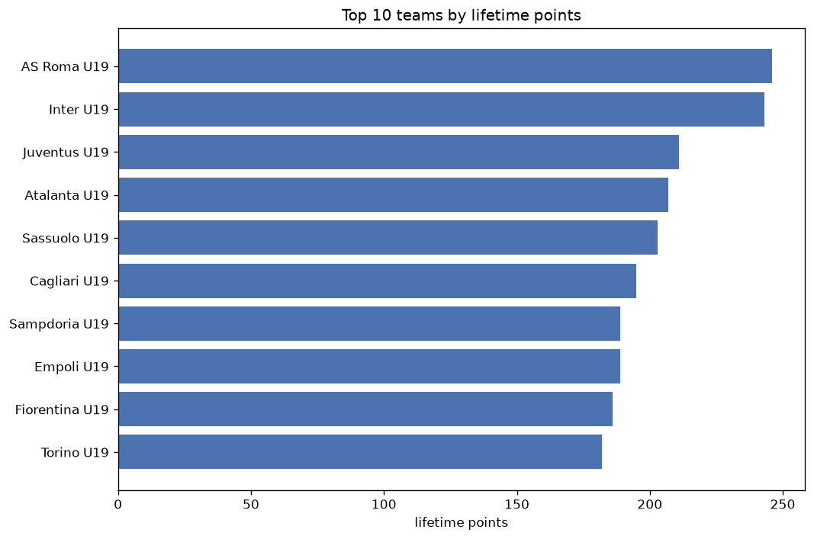
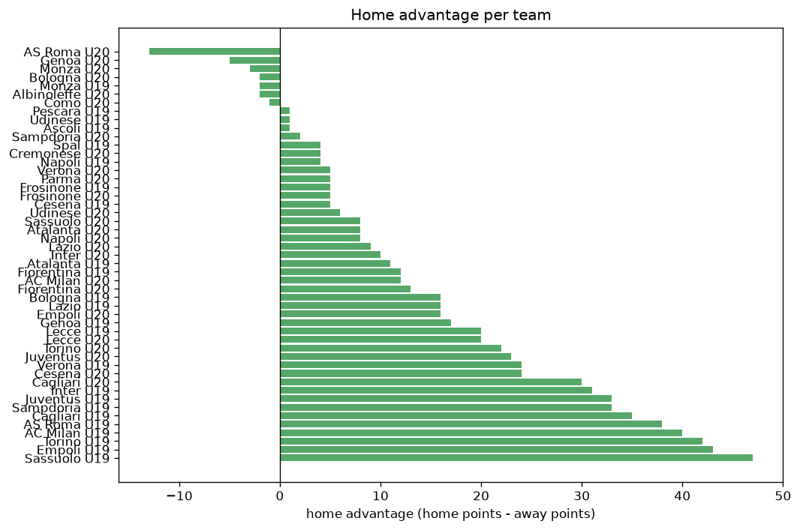

# Team Analysis
- Report: `teams_analysis`
- Generated: 2026-10-26T01:37:45+00:00
- Script: `backend/scripts/analyze_teams.py` v1.0.0
- League: Primavera 1 (Italy)
- Scope: league `italy19`

- Teams: **49** | Seasons: **7** | Matches: **1997**

## 1. Team standings (lifetime)
| team | seasons | played | W | D | L | pts | GF | GA | GD | avg pts/season | best pos | worst pos | titles |
|---|---|---|---|---|---|---|---|---|---|---|---|---|---|
| AS Roma U19 | 4 | 132 | 71 | 33 | 28 | 246 | 262 | 160 | 102 | 61.5 | 1 | 6 | 1 |
| Inter U19 | 4 | 132 | 67 | 42 | 23 | 243 | 233 | 132 | 101 | 60.75 | 1 | 7 | 1 |
| Juventus U19 | 4 | 132 | 60 | 31 | 41 | 211 | 238 | 189 | 49 | 52.75 | 2 | 13 | 0 |
| Atalanta U19 | 4 | 132 | 58 | 33 | 41 | 207 | 233 | 191 | 42 | 51.75 | 4 | 15 | 0 |
| Sassuolo U19 | 4 | 132 | 54 | 41 | 37 | 203 | 209 | 178 | 31 | 50.75 | 4 | 8 | 0 |
| Cagliari U19 | 4 | 132 | 54 | 33 | 45 | 195 | 213 | 205 | 8 | 48.75 | 3 | 14 | 0 |
| Sampdoria U19 | 4 | 132 | 51 | 36 | 45 | 189 | 219 | 190 | 29 | 47.25 | 1 | 17 | 1 |
| Empoli U19 | 4 | 132 | 51 | 36 | 45 | 189 | 203 | 190 | 13 | 47.25 | 6 | 11 | 0 |
| Fiorentina U19 | 4 | 132 | 54 | 24 | 54 | 186 | 202 | 197 | 5 | 46.5 | 2 | 14 | 0 |
| Torino U19 | 4 | 132 | 49 | 35 | 48 | 182 | 193 | 205 | -12 | 45.5 | 3 | 14 | 0 |
| AC Milan U19 | 4 | 132 | 52 | 24 | 56 | 180 | 193 | 192 | 1 | 45.0 | 6 | 13 | 0 |
| AS Roma U20 | 3 | 85 | 46 | 21 | 18 | 159 | 164 | 94 | 70 | 53.0 | 1 | 5 | 1 |
| Bologna U19 | 4 | 132 | 44 | 26 | 62 | 158 | 177 | 230 | -53 | 39.5 | 9 | 15 | 0 |
| Inter U20 | 3 | 84 | 42 | 22 | 20 | 148 | 158 | 113 | 45 | 49.33 | 1 | 6 | 1 |
| Fiorentina U20 | 3 | 84 | 43 | 18 | 23 | 147 | 159 | 108 | 51 | 49.0 | 2 | 8 | 0 |
| Lecce U19 | 3 | 102 | 39 | 29 | 34 | 146 | 147 | 135 | 12 | 48.67 | 1 | 14 | 1 |
| Verona U19 | 3 | 102 | 34 | 34 | 34 | 136 | 160 | 161 | -1 | 45.33 | 9 | 13 | 0 |
| Cesena U20 | 3 | 85 | 35 | 25 | 25 | 130 | 147 | 131 | 16 | 43.33 | 1 | 13 | 1 |
| Juventus U20 | 3 | 84 | 35 | 22 | 27 | 127 | 135 | 124 | 11 | 42.33 | 5 | 15 | 0 |
| Genoa U19 | 3 | 98 | 34 | 25 | 39 | 127 | 141 | 138 | 3 | 42.33 | 9 | 16 | 0 |
| Sassuolo U20 | 3 | 84 | 33 | 23 | 28 | 122 | 128 | 121 | 7 | 40.67 | 4 | 16 | 0 |
| AC Milan U20 | 3 | 84 | 32 | 24 | 28 | 120 | 126 | 108 | 18 | 40.0 | 6 | 11 | 0 |
| Bologna U20 | 3 | 85 | 33 | 21 | 31 | 120 | 125 | 120 | 5 | 40.0 | 3 | 17 | 0 |
| Verona U20 | 3 | 83 | 31 | 22 | 30 | 115 | 119 | 115 | 4 | 38.33 | 8 | 17 | 0 |
| Lazio U20 | 3 | 84 | 29 | 28 | 27 | 115 | 107 | 108 | -1 | 38.33 | 7 | 14 | 0 |
| Lecce U20 | 3 | 84 | 29 | 27 | 28 | 114 | 123 | 122 | 1 | 38.0 | 9 | 12 | 0 |
| Genoa U20 | 3 | 84 | 30 | 23 | 31 | 113 | 124 | 125 | -1 | 37.67 | 6 | 11 | 0 |
| Atalanta U20 | 3 | 84 | 28 | 26 | 30 | 110 | 121 | 119 | 2 | 36.67 | 7 | 18 | 0 |
| Torino U20 | 3 | 84 | 29 | 21 | 34 | 108 | 124 | 128 | -4 | 36.0 | 10 | 13 | 0 |
| Cagliari U20 | 3 | 83 | 29 | 21 | 33 | 108 | 104 | 114 | -10 | 36.0 | 7 | 18 | 0 |
| Monza U20 | 3 | 84 | 26 | 23 | 35 | 101 | 113 | 132 | -19 | 33.67 | 15 | 19 | 0 |
| Parma U20 | 2 | 45 | 23 | 14 | 8 | 83 | 76 | 46 | 30 | 41.5 | 2 | 3 | 0 |
| Lazio U19 | 2 | 64 | 20 | 18 | 26 | 78 | 87 | 111 | -24 | 39.0 | 3 | 15 | 0 |
| Spal U19 | 2 | 64 | 20 | 14 | 30 | 74 | 77 | 113 | -36 | 37.0 | 7 | 17 | 0 |
| Frosinone U19 | 2 | 68 | 19 | 16 | 33 | 73 | 87 | 115 | -28 | 36.5 | 11 | 18 | 0 |
| Napoli U19 | 2 | 68 | 19 | 15 | 34 | 72 | 75 | 108 | -33 | 36.0 | 15 | 16 | 0 |
| Cremonese U20 | 2 | 76 | 18 | 18 | 40 | 72 | 84 | 118 | -34 | 36.0 | 14 | 20 | 0 |
| Empoli U20 | 2 | 46 | 13 | 13 | 20 | 52 | 54 | 71 | -17 | 26.0 | 4 | 18 | 0 |
| Napoli U20 | 1 | 38 | 10 | 10 | 18 | 40 | 39 | 55 | -16 | 40.0 | 17 | 17 | 0 |
| Frosinone U20 | 1 | 38 | 8 | 11 | 19 | 35 | 47 | 76 | -29 | 35.0 | 19 | 19 | 0 |
| Monza U19 | 1 | 34 | 7 | 13 | 14 | 34 | 51 | 66 | -15 | 34.0 | 16 | 16 | 0 |
| Sampdoria U20 | 1 | 38 | 6 | 8 | 24 | 26 | 45 | 76 | -31 | 26.0 | 19 | 19 | 0 |
| Udinese U19 | 1 | 34 | 5 | 4 | 25 | 19 | 26 | 66 | -40 | 19.0 | 17 | 17 | 0 |
| Pescara U19 | 1 | 34 | 5 | 4 | 25 | 19 | 35 | 79 | -44 | 19.0 | 18 | 18 | 0 |
| Udinese U20 | 1 | 38 | 3 | 5 | 30 | 14 | 30 | 118 | -88 | 14.0 | 20 | 20 | 0 |
| Cesena U19 | 1 | 34 | 2 | 5 | 27 | 11 | 30 | 84 | -54 | 11.0 | 18 | 18 | 0 |
| Como U20 | 1 | 7 | 2 | 3 | 2 | 9 | 9 | 8 | 1 | 9.0 | 12 | 12 | 0 |
| Ascoli U19 | 1 | 30 | 2 | 3 | 25 | 9 | 22 | 78 | -56 | 9.0 | 16 | 16 | 0 |
| Albinoleffe U20 | 1 | 7 | 1 | 1 | 5 | 4 | 6 | 17 | -11 | 4.0 | 20 | 20 | 0 |

## 2. Home vs away split
| team | home P | H-W | H-D | H-L | H-pts | away P | A-W | A-D | A-L | A-pts | adv |
|---|---|---|---|---|---|---|---|---|---|---|---|
| Sassuolo U19 | 66 | 34 | 23 | 9 | 125 | 66 | 20 | 18 | 28 | 78 | 47 |
| Empoli U19 | 66 | 33 | 17 | 16 | 116 | 66 | 18 | 19 | 29 | 73 | 43 |
| Torino U19 | 66 | 32 | 16 | 18 | 112 | 66 | 17 | 19 | 30 | 70 | 42 |
| AC Milan U19 | 66 | 33 | 11 | 22 | 110 | 66 | 19 | 13 | 34 | 70 | 40 |
| AS Roma U19 | 66 | 42 | 16 | 8 | 142 | 66 | 29 | 17 | 20 | 104 | 38 |
| Cagliari U19 | 66 | 33 | 16 | 17 | 115 | 66 | 21 | 17 | 28 | 80 | 35 |
| Juventus U19 | 66 | 36 | 14 | 16 | 122 | 66 | 24 | 17 | 25 | 89 | 33 |
| Sampdoria U19 | 66 | 31 | 18 | 17 | 111 | 66 | 20 | 18 | 28 | 78 | 33 |
| Inter U19 | 66 | 39 | 20 | 7 | 137 | 66 | 28 | 22 | 16 | 106 | 31 |
| Cagliari U20 | 41 | 19 | 12 | 10 | 69 | 42 | 10 | 9 | 23 | 39 | 30 |
| Verona U19 | 51 | 21 | 17 | 13 | 80 | 51 | 13 | 17 | 21 | 56 | 24 |
| Cesena U20 | 43 | 22 | 11 | 10 | 77 | 42 | 13 | 14 | 15 | 53 | 24 |
| Juventus U20 | 42 | 22 | 9 | 11 | 75 | 42 | 13 | 13 | 16 | 52 | 23 |
| Torino U20 | 42 | 18 | 11 | 13 | 65 | 42 | 11 | 10 | 21 | 43 | 22 |
| Lecce U19 | 51 | 23 | 14 | 14 | 83 | 51 | 16 | 15 | 20 | 63 | 20 |
| Lecce U20 | 42 | 18 | 13 | 11 | 67 | 42 | 11 | 14 | 17 | 47 | 20 |
| Genoa U19 | 49 | 20 | 12 | 17 | 72 | 49 | 14 | 13 | 22 | 55 | 17 |
| Bologna U19 | 66 | 26 | 9 | 31 | 87 | 66 | 18 | 17 | 31 | 71 | 16 |
| Lazio U19 | 32 | 13 | 8 | 11 | 47 | 32 | 7 | 10 | 15 | 31 | 16 |
| Empoli U20 | 23 | 10 | 4 | 9 | 34 | 23 | 3 | 9 | 11 | 18 | 16 |
| Fiorentina U20 | 42 | 24 | 8 | 10 | 80 | 42 | 19 | 10 | 13 | 67 | 13 |
| Fiorentina U19 | 66 | 28 | 15 | 23 | 99 | 66 | 26 | 9 | 31 | 87 | 12 |
| AC Milan U20 | 42 | 18 | 12 | 12 | 66 | 42 | 14 | 12 | 16 | 54 | 12 |
| Atalanta U19 | 66 | 31 | 16 | 19 | 109 | 66 | 27 | 17 | 22 | 98 | 11 |
| Inter U20 | 41 | 23 | 10 | 8 | 79 | 43 | 19 | 12 | 12 | 69 | 10 |
| Lazio U20 | 42 | 16 | 14 | 12 | 62 | 42 | 13 | 14 | 15 | 53 | 9 |
| Sassuolo U20 | 42 | 18 | 11 | 13 | 65 | 42 | 15 | 12 | 15 | 57 | 8 |
| Atalanta U20 | 42 | 16 | 11 | 15 | 59 | 42 | 12 | 15 | 15 | 51 | 8 |
| Napoli U20 | 19 | 6 | 6 | 7 | 24 | 19 | 4 | 4 | 11 | 16 | 8 |
| Udinese U20 | 19 | 2 | 4 | 13 | 10 | 19 | 1 | 1 | 17 | 4 | 6 |
| Verona U20 | 42 | 16 | 12 | 14 | 60 | 41 | 15 | 10 | 16 | 55 | 5 |
| Parma U20 | 23 | 12 | 8 | 3 | 44 | 22 | 11 | 6 | 5 | 39 | 5 |
| Frosinone U19 | 34 | 10 | 9 | 15 | 39 | 34 | 9 | 7 | 18 | 34 | 5 |
| Frosinone U20 | 19 | 5 | 5 | 9 | 20 | 19 | 3 | 6 | 10 | 15 | 5 |
| Cesena U19 | 17 | 1 | 5 | 11 | 8 | 17 | 1 | 0 | 16 | 3 | 5 |
| Spal U19 | 32 | 11 | 6 | 15 | 39 | 32 | 9 | 8 | 15 | 35 | 4 |
| Cremonese U20 | 38 | 10 | 8 | 20 | 38 | 38 | 8 | 10 | 20 | 34 | 4 |
| Napoli U19 | 34 | 10 | 8 | 16 | 38 | 34 | 9 | 7 | 18 | 34 | 4 |
| Sampdoria U20 | 19 | 3 | 5 | 11 | 14 | 19 | 3 | 3 | 13 | 12 | 2 |
| Pescara U19 | 17 | 2 | 4 | 11 | 10 | 17 | 3 | 0 | 14 | 9 | 1 |
| Udinese U19 | 17 | 2 | 4 | 11 | 10 | 17 | 3 | 0 | 14 | 9 | 1 |
| Ascoli U19 | 15 | 1 | 2 | 12 | 5 | 15 | 1 | 1 | 13 | 4 | 1 |
| Como U20 | 3 | 1 | 1 | 1 | 4 | 4 | 1 | 2 | 1 | 5 | -1 |
| Bologna U20 | 42 | 16 | 11 | 15 | 59 | 43 | 17 | 10 | 16 | 61 | -2 |
| Monza U19 | 17 | 3 | 7 | 7 | 16 | 17 | 4 | 6 | 7 | 18 | -2 |
| Albinoleffe U20 | 4 | 0 | 1 | 3 | 1 | 3 | 1 | 0 | 2 | 3 | -2 |
| Monza U20 | 42 | 13 | 10 | 19 | 49 | 42 | 13 | 13 | 16 | 52 | -3 |
| Genoa U20 | 42 | 14 | 12 | 16 | 54 | 42 | 16 | 11 | 15 | 59 | -5 |
| AS Roma U20 | 43 | 19 | 16 | 8 | 73 | 42 | 27 | 5 | 10 | 86 | -13 |

## 3. Top performers
### Best points per game (PPG)
| rank | team | PPG |
|---|---|---|
| 1 | AS Roma U20 | 1.87 |
| 2 | AS Roma U19 | 1.86 |
| 3 | Parma U20 | 1.84 |
| 4 | Inter U19 | 1.84 |
| 5 | Inter U20 | 1.76 |

### Most goals scored
| rank | team | goals |
|---|---|---|
| 1 | AS Roma U19 | 262 |
| 2 | Juventus U19 | 238 |
| 3 | Inter U19 | 233 |
| 4 | Atalanta U19 | 233 |
| 5 | Sampdoria U19 | 219 |

### Best goal difference
| rank | team | GD |
|---|---|---|
| 1 | AS Roma U19 | 102 |
| 2 | Inter U19 | 101 |
| 3 | AS Roma U20 | 70 |
| 4 | Fiorentina U20 | 51 |
| 5 | Juventus U19 | 49 |

### Best defence (goals against per match, standings)
| rank | team | GA/match |
|---|---|---|
| 1 | Inter U19 | 1.000 |
| 2 | Parma U20 | 1.022 |
| 3 | AS Roma U20 | 1.106 |
| 4 | Como U20 | 1.143 |
| 5 | AS Roma U19 | 1.212 |

## 4. Team consistency
- Teams present in all **7** seasons: **0**

## 5. Head-to-head dominance
- Distinct fixtures: **509** (showing the 15 most frequent)

| fixture | meetings | home wins | draws | away wins | home pct | draw pct | away pct |
|---|---|---|---|---|---|---|---|
| Juventus U19 vs Cagliari U19 | 8 | 7 | 0 | 1 | 87.5% | 0.0% | 12.5% |
| AC Milan U19 vs Torino U19 | 8 | 6 | 2 | 0 | 75.0% | 25.0% | 0.0% |
| Empoli U19 vs AC Milan U19 | 8 | 6 | 1 | 1 | 75.0% | 12.5% | 12.5% |
| Empoli U19 vs Sassuolo U19 | 8 | 6 | 0 | 2 | 75.0% | 0.0% | 25.0% |
| AC Milan U19 vs Bologna U19 | 8 | 5 | 0 | 3 | 62.5% | 0.0% | 37.5% |
| AS Roma U19 vs Bologna U19 | 8 | 5 | 0 | 3 | 62.5% | 0.0% | 37.5% |
| AS Roma U19 vs Empoli U19 | 8 | 5 | 2 | 1 | 62.5% | 25.0% | 12.5% |
| AS Roma U19 vs Fiorentina U19 | 8 | 5 | 1 | 2 | 62.5% | 12.5% | 25.0% |
| AS Roma U19 vs Sassuolo U19 | 8 | 5 | 2 | 1 | 62.5% | 25.0% | 12.5% |
| Atalanta U19 vs Cagliari U19 | 8 | 5 | 0 | 3 | 62.5% | 0.0% | 37.5% |
| Bologna U19 vs Torino U19 | 8 | 5 | 3 | 0 | 62.5% | 37.5% | 0.0% |
| Cagliari U19 vs Fiorentina U19 | 8 | 5 | 2 | 1 | 62.5% | 25.0% | 12.5% |
| Cagliari U19 vs Torino U19 | 8 | 5 | 2 | 1 | 62.5% | 25.0% | 12.5% |
| Inter U19 vs Sassuolo U19 | 8 | 5 | 1 | 2 | 62.5% | 12.5% | 25.0% |
| Inter U19 vs Torino U19 | 8 | 5 | 2 | 1 | 62.5% | 25.0% | 12.5% |

## 6. Position per season (classic view)
_Cells show final position; '-' when the team was absent from that season._

| team | 2020-2021 | 2021-2022 | 2022-2023 | 2023-2024 | 2024-2025 | 2025-2026 | 2026-2027 |
|---|---|---|---|---|---|---|---|
| AS Roma U19 | 4 | 1 | 6 | 2 | - | - | - |
| Inter U19 | 3 | 2 | 7 | 1 | - | - | - |
| Juventus U19 | 2 | 5 | 5 | 13 | - | - | - |
| Atalanta U19 | 5 | 4 | 15 | 4 | - | - | - |
| Sassuolo U19 | 8 | 8 | 4 | 5 | - | - | - |
| Cagliari U19 | 11 | 3 | 14 | 7 | - | - | - |
| Sampdoria U19 | 1 | 6 | 10 | 17 | - | - | - |
| Empoli U19 | 6 | 10 | 8 | 11 | - | - | - |
| Fiorentina U19 | 12 | 7 | 2 | 14 | - | - | - |
| Torino U19 | 14 | 12 | 3 | 8 | - | - | - |
| AC Milan U19 | 10 | 13 | 12 | 6 | - | - | - |
| AS Roma U20 | - | - | - | - | 1 | 5 | 5 |
| Bologna U19 | 13 | 11 | 9 | 15 | - | - | - |
| Inter U20 | - | - | - | - | 2 | 6 | 1 |
| Fiorentina U20 | - | - | - | - | 3 | 2 | 8 |
| Lecce U19 | - | 14 | 1 | 12 | - | - | - |
| Verona U19 | - | 9 | 13 | 10 | - | - | - |
| Cesena U20 | - | - | - | - | 13 | 1 | 10 |
| Juventus U20 | - | - | - | - | 5 | 8 | 15 |
| Genoa U19 | 9 | 16 | - | 9 | - | - | - |
| Sassuolo U20 | - | - | - | - | 4 | 16 | 14 |
| AC Milan U20 | - | - | - | - | 6 | 11 | 11 |
| Bologna U20 | - | - | - | - | 17 | 4 | 3 |
| Verona U20 | - | - | - | - | 8 | 12 | 17 |
| Lazio U20 | - | - | - | - | 9 | 14 | 7 |
| Lecce U20 | - | - | - | - | 12 | 9 | 9 |
| Genoa U20 | - | - | - | - | 11 | 10 | 6 |
| Atalanta U20 | - | - | - | - | 16 | 7 | 18 |
| Torino U20 | - | - | - | - | 10 | 13 | 13 |
| Cagliari U20 | - | - | - | - | 7 | 18 | 16 |
| Monza U20 | - | - | - | - | 15 | 15 | 19 |
| Parma U20 | - | - | - | - | - | 3 | 2 |
| Lazio U19 | 15 | - | - | 3 | - | - | - |
| Spal U19 | 7 | 17 | - | - | - | - | - |
| Frosinone U19 | - | - | 11 | 18 | - | - | - |
| Napoli U19 | - | 15 | 16 | - | - | - | - |
| Cremonese U20 | - | - | - | - | 14 | 20 | - |
| Empoli U20 | - | - | - | - | 18 | - | 4 |
| Napoli U20 | - | - | - | - | - | 17 | - |
| Frosinone U20 | - | - | - | - | - | 19 | - |
| Monza U19 | - | - | - | 16 | - | - | - |
| Sampdoria U20 | - | - | - | - | 19 | - | - |
| Udinese U19 | - | - | 17 | - | - | - | - |
| Pescara U19 | - | 18 | - | - | - | - | - |
| Udinese U20 | - | - | - | - | 20 | - | - |
| Cesena U19 | - | - | 18 | - | - | - | - |
| Como U20 | - | - | - | - | - | - | 12 |
| Ascoli U19 | 16 | - | - | - | - | - | - |
| Albinoleffe U20 | - | - | - | - | - | - | 20 |

---
*All statistics are computed from PostgreSQL tables (read-only). Run with `python backend/scripts/analyze_teams.py` to regenerate.*

## Charts

