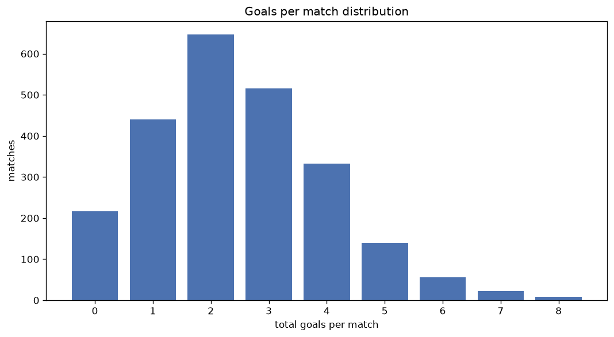
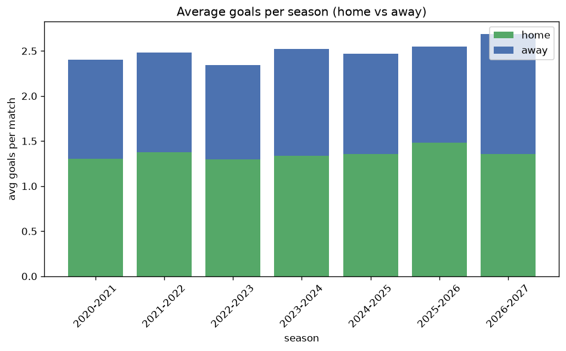

# Goal Analysis
- Report: `goals_analysis`
- Generated: 2026-10-30T03:58:49+00:00
- Script: `backend/scripts/analyze_goals.py` v1.0.0
- League: Serie B (Italy)
- Scope: league `italy2`

## 1. Goals per match distribution
| goals | matches | pct |
|---|---|---|
| 0 | 217 | 9.1% |
| 1 | 440 | 18.5% |
| 2 | 647 | 27.2% |
| 3 | 516 | 21.7% |
| 4 | 333 | 14.0% |
| 5 | 140 | 5.9% |
| 6 | 56 | 2.4% |
| 7 | 22 | 0.9% |
| 8 | 9 | 0.4% |

## 2. Goals per match per season
| season | matches | total goals | avg home | avg away | avg total |
|---|---|---|---|---|---|
| 2020-2021 | 380 | 913 | 1.303 | 1.1 | 2.403 |
| 2021-2022 | 380 | 942 | 1.379 | 1.1 | 2.479 |
| 2022-2023 | 380 | 891 | 1.295 | 1.05 | 2.345 |
| 2023-2024 | 380 | 958 | 1.339 | 1.182 | 2.521 |
| 2024-2025 | 380 | 937 | 1.353 | 1.113 | 2.466 |
| 2025-2026 | 390 | 993 | 1.479 | 1.067 | 2.546 |
| 2026-2027 | 90 | 242 | 1.356 | 1.333 | 2.689 |

## 3. Home vs away goal share
- Home goals: **3233** (55.0%)
- Away goals: **2643** (45.0%)
- Home/away ratio: **1.223**

| season | home goals | away goals | total | home pct | away pct |
|---|---|---|---|---|---|
| 2020-2021 | 495 | 418 | 913 | 54.2% | 45.8% |
| 2021-2022 | 524 | 418 | 942 | 55.6% | 44.4% |
| 2022-2023 | 492 | 399 | 891 | 55.2% | 44.8% |
| 2023-2024 | 509 | 449 | 958 | 53.1% | 46.9% |
| 2024-2025 | 514 | 423 | 937 | 54.9% | 45.1% |
| 2025-2026 | 577 | 416 | 993 | 58.1% | 41.9% |
| 2026-2027 | 122 | 120 | 242 | 50.4% | 49.6% |

## 4. BTTS (Both Teams To Score)
- Overall: **1256** of `2380` (52.8%)

| season | matches | BTTS | pct |
|---|---|---|---|
| 2020-2021 | 380 | 191 | 50.3% |
| 2021-2022 | 380 | 197 | 51.8% |
| 2022-2023 | 380 | 187 | 49.2% |
| 2023-2024 | 380 | 213 | 56.1% |
| 2024-2025 | 380 | 205 | 53.9% |
| 2025-2026 | 390 | 208 | 53.3% |
| 2026-2027 | 90 | 55 | 61.1% |

## 5. Clean sheets
- Home clean sheets: **761** (32.0%)
- Away clean sheets: **580** (24.4%)
- Total clean sheets recorded: **1341**
- Matches with at least one clean sheet: **1124** (47.2%)
- Both teams kept clean sheets (0-0): **217**

| season | matches | home CS | away CS | total CS | matches w/ CS |
|---|---|---|---|---|---|
| 2020-2021 | 380 | 127 | 100 | 227 | 189 (49.7%) |
| 2021-2022 | 380 | 122 | 88 | 210 | 183 (48.2%) |
| 2022-2023 | 380 | 130 | 105 | 235 | 193 (50.8%) |
| 2023-2024 | 380 | 110 | 94 | 204 | 167 (43.9%) |
| 2024-2025 | 380 | 121 | 94 | 215 | 175 (46.1%) |
| 2025-2026 | 390 | 133 | 79 | 212 | 182 (46.7%) |
| 2026-2027 | 90 | 18 | 20 | 38 | 35 (38.9%) |

## 6. Scoring intensity
- First-half goals: **2661** (45.3%)
- Second-half goals: **3209** (54.7%)
- Avg first-half goals per match: **1.119**
- Avg second-half goals per match: **1.349**
- Second-half-only scoring (HT 0-0, FT goals >= 1): **523** (22.0%)
- *2 match(es) excluded (no HT score recorded).*

| season | matches | 1st half | 2nd half | 1st half pct | 2nd half pct |
|---|---|---|---|---|---|
| 2020-2021 | 380 | 405 | 505 | 44.5% | 55.5% |
| 2021-2022 | 380 | 450 | 492 | 47.8% | 52.2% |
| 2022-2023 | 380 | 408 | 483 | 45.8% | 54.2% |
| 2023-2024 | 380 | 424 | 534 | 44.3% | 55.7% |
| 2024-2025 | 380 | 438 | 496 | 46.9% | 53.1% |
| 2025-2026 | 390 | 440 | 553 | 44.3% | 55.7% |
| 2026-2027 | 90 | 96 | 146 | 39.7% | 60.3% |

## 7. First-goal timing
- Matches with first-goal time recorded: `2161` of `2380` (90.8%)
- Goalless matches: `219`
- Min `1` | Max `97` | Mean `31.53` | Median (p50) `27`

| bucket | count | % of matches | % of scoring matches |
|---|---|---|---|
| 1-15 | 652 | 27.4% | 30.2% |
| 16-30 | 561 | 23.6% | 26.0% |
| 31-45 | 375 | 15.8% | 17.4% |
| 46-60 | 299 | 12.6% | 13.8% |
| 61-75 | 140 | 5.9% | 6.5% |
| 76-90 | 110 | 4.6% | 5.1% |
| 91-120 | 24 | 1.0% | 1.1% |

---
*All statistics are computed from PostgreSQL tables (read-only). Run with `python backend/scripts/analyze_goals.py` to regenerate.*

## Charts

