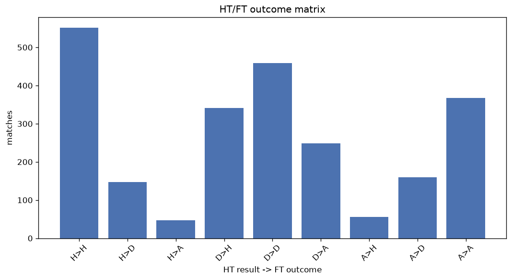
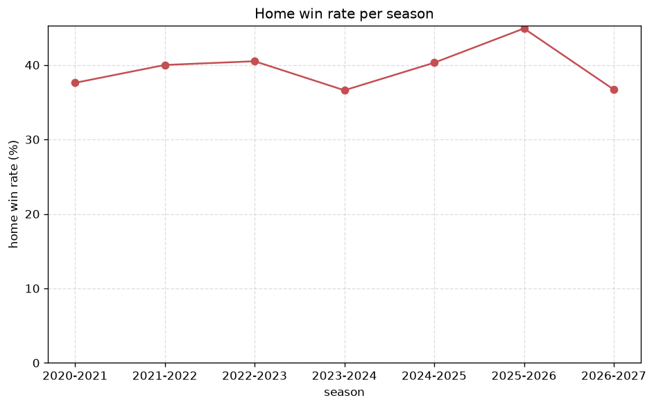

# Match Analysis
- Report: `matches_analysis`
- Generated: 2026-10-30T03:58:48+00:00
- Script: `backend/scripts/analyze_matches.py` v1.0.0
- League: Serie B (Italy)
- Scope: league `italy2`

## 1. Overall summary
| metric | value |
|---|---|
| Matches | 2380 |
| Home wins | 949 (39.9%) |
| Draws | 766 (32.2%) |
| Away wins | 665 (27.9%) |
| Total goals | 5876 |
| Average goals per match | 2.469 |
| Goalless matches | 217 (9.1%) |

## 2. Per-season breakdown
| season | matches | home wins | draws | away wins | total goals | avg goals | goalless |
|---|---|---|---|---|---|---|---|
| 2020-2021 | 380 | 143 (37.6%) | 131 (34.5%) | 106 (27.9%) | 913 | 2.403 | 38 (10.0%) |
| 2021-2022 | 380 | 152 (40.0%) | 117 (30.8%) | 111 (29.2%) | 942 | 2.479 | 27 (7.1%) |
| 2022-2023 | 380 | 154 (40.5%) | 122 (32.1%) | 104 (27.4%) | 891 | 2.345 | 42 (11.1%) |
| 2023-2024 | 380 | 139 (36.6%) | 122 (32.1%) | 119 (31.3%) | 958 | 2.521 | 37 (9.7%) |
| 2024-2025 | 380 | 153 (40.3%) | 128 (33.7%) | 99 (26.1%) | 937 | 2.466 | 40 (10.5%) |
| 2025-2026 | 390 | 175 (44.9%) | 121 (31.0%) | 94 (24.1%) | 993 | 2.546 | 30 (7.7%) |
| 2026-2027 | 90 | 33 (36.7%) | 25 (27.8%) | 32 (35.6%) | 242 | 2.689 | 3 (3.3%) |

## 3. HT/FT outcome matrix
| HT result \ FT result | Home | Draw | Away | total |
|---|---|---|---|---|
| HT home lead | 551 (74.0%) | 147 (19.7%) | 47 (6.3%) | 745 |
| HT draw | 341 (32.5%) | 459 (43.8%) | 249 (23.7%) | 1049 |
| HT away lead | 56 (9.6%) | 160 (27.4%) | 368 (63.0%) | 584 |
- *2 match(es) excluded (no HT score recorded).*

## 4. Comeback matches
- Home comebacks (trailing at HT, won at FT): **56** (2.4%)
- Away comebacks (trailing at HT, won at FT): **47** (2.0%)

### Home comebacks
| season | home | away | HT | FT |
|---|---|---|---|---|
| 2020-2021 | Empoli | Spal | 0-1 | 2-1 |
| 2020-2021 | Venezia | Ascoli | 0-1 | 2-1 |
| 2020-2021 | Frosinone | Chievo | 1-2 | 3-2 |
| 2020-2021 | Salernitana | Entella | 0-1 | 2-1 |
| 2020-2021 | Lecce | L.R. Vicenza | 0-1 | 2-1 |
| 2020-2021 | Ascoli | Reggina | 0-1 | 2-1 |
| 2020-2021 | Ascoli | Brescia | 0-1 | 2-1 |
| 2020-2021 | Venezia | Entella | 1-2 | 3-2 |
| 2020-2021 | Salernitana | Venezia | 0-1 | 2-1 |
| 2020-2021 | Empoli | Lecce | 0-1 | 2-1 |
| 2021-2022 | Reggina | Ternana | 0-1 | 3-2 |
| 2021-2022 | Parma | Pordenone | 0-1 | 4-1 |
| 2021-2022 | Cosenza | Alessandria | 0-1 | 2-1 |
| 2021-2022 | Brescia | Perugia | 0-1 | 2-1 |
| 2022-2023 | Cosenza | Modena | 0-1 | 2-1 |
| 2022-2023 | Cagliari | Cittadella | 0-1 | 2-1 |
| 2022-2023 | Cittadella | Reggina | 0-2 | 3-2 |
| 2022-2023 | Pisa | Perugia | 0-1 | 2-1 |
| 2022-2023 | Cosenza | Reggina | 0-1 | 2-1 |
| 2022-2023 | Cagliari | Ascoli | 0-1 | 4-1 |
| 2022-2023 | Palermo | Modena | 1-2 | 5-2 |
| 2022-2023 | Ternana | Pisa | 0-1 | 2-1 |
| 2022-2023 | Parma | Cagliari | 0-1 | 2-1 |
| 2022-2023 | Como | Ternana | 0-1 | 3-1 |
| 2022-2023 | Perugia | Benevento | 0-1 | 3-2 |
| 2023-2024 | Sudtirol | Ascoli | 0-1 | 3-1 |
| 2023-2024 | Palermo | Sudtirol | 0-1 | 2-1 |
| 2023-2024 | Cittadella | Lecco | 0-1 | 2-1 |
| 2023-2024 | Palermo | Cremonese | 1-2 | 3-2 |
| 2023-2024 | Catanzaro | Lecco | 1-2 | 5-3 |
| 2023-2024 | Catanzaro | Ascoli | 1-2 | 3-2 |
| 2023-2024 | Parma | Brescia | 0-1 | 2-1 |
| 2023-2024 | Sampdoria | Ascoli | 0-1 | 2-1 |
| 2023-2024 | Pisa | Palermo | 0-2 | 4-3 |
| 2023-2024 | Venezia | Cremonese | 0-1 | 2-1 |
| 2023-2024 | Sudtirol | Ternana | 1-2 | 4-3 |
| 2023-2024 | Spezia | Venezia | 0-1 | 2-1 |
| 2024-2025 | Salernitana | Cittadella | 0-1 | 2-1 |
| 2024-2025 | Spezia | Frosinone | 0-1 | 2-1 |
| 2024-2025 | Salernitana | Sampdoria | 1-2 | 3-2 |
| 2024-2025 | Spezia | Cesena | 0-1 | 2-1 |
| 2024-2025 | Sassuolo | Sudtirol | 1-2 | 5-3 |
| 2024-2025 | Cittadella | Bari | 0-1 | 3-1 |
| 2025-2026 | Padova | Entella | 0-1 | 2-1 |
| 2025-2026 | Modena | Pescara | 0-1 | 2-1 |
| 2025-2026 | Sampdoria | Pescara | 0-1 | 4-1 |
| 2025-2026 | Cesena | Mantova | 1-2 | 3-2 |
| 2025-2026 | Monza | Juve Stabia | 0-1 | 2-1 |
| 2025-2026 | Mantova | Sampdoria | 0-1 | 2-1 |
| 2025-2026 | Catanzaro | Empoli | 0-2 | 3-2 |
| 2025-2026 | Cesena | Catanzaro | 0-1 | 3-1 |
| 2025-2026 | Palermo | Catanzaro | 1-2 | 3-2 |
| 2026-2027 | Sampdoria | Catanzaro | 0-1 | 2-1 |
| 2026-2027 | Ascoli | Avellino | 0-1 | 3-1 |
| 2026-2027 | Modena | Empoli | 0-1 | 2-1 |
| 2026-2027 | Modena | Verona | 1-2 | 3-2 |

### Away comebacks
| season | home | away | HT | FT |
|---|---|---|---|---|
| 2020-2021 | Monza | Chievo | 1-0 | 1-2 |
| 2020-2021 | Reggina | Pisa | 1-0 | 1-2 |
| 2020-2021 | Entella | Empoli | 1-0 | 2-5 |
| 2020-2021 | Reggina | Venezia | 1-0 | 1-2 |
| 2020-2021 | Spal | Brescia | 1-0 | 2-3 |
| 2020-2021 | Entella | Cosenza | 1-0 | 1-2 |
| 2020-2021 | Brescia | Cremonese | 1-0 | 1-2 |
| 2021-2022 | Ascoli | Brescia | 2-1 | 2-3 |
| 2021-2022 | Reggina | Cremonese | 1-0 | 1-2 |
| 2021-2022 | Pisa | Frosinone | 1-0 | 1-3 |
| 2021-2022 | Benevento | Ternana | 1-0 | 1-2 |
| 2022-2023 | Parma | Ternana | 1-0 | 2-3 |
| 2022-2023 | Cagliari | Venezia | 1-0 | 1-4 |
| 2022-2023 | Ascoli | Modena | 1-0 | 1-2 |
| 2022-2023 | Venezia | Frosinone | 1-0 | 1-3 |
| 2022-2023 | Benevento | Ternana | 2-0 | 2-3 |
| 2022-2023 | Ternana | Genoa | 1-0 | 1-2 |
| 2022-2023 | Spal | Benevento | 1-0 | 1-2 |
| 2022-2023 | Venezia | Reggina | 1-0 | 1-2 |
| 2022-2023 | Ternana | Cittadella | 1-0 | 1-2 |
| 2022-2023 | Ternana | Frosinone | 2-1 | 2-3 |
| 2023-2024 | Sampdoria | Cittadella | 1-0 | 1-2 |
| 2023-2024 | Brescia | Bari | 1-0 | 1-2 |
| 2023-2024 | Venezia | Sudtirol | 2-1 | 2-3 |
| 2023-2024 | Lecco | Ternana | 2-0 | 2-3 |
| 2023-2024 | Catanzaro | Brescia | 2-0 | 2-3 |
| 2023-2024 | Venezia | Reggiana | 2-1 | 2-3 |
| 2023-2024 | Catanzaro | Como | 1-0 | 1-2 |
| 2023-2024 | Lecco | Venezia | 1-0 | 1-2 |
| 2023-2024 | Palermo | Reggiana | 1-0 | 1-2 |
| 2024-2025 | Sampdoria | Juve Stabia | 1-0 | 1-2 |
| 2024-2025 | Brescia | Mantova | 1-0 | 1-2 |
| 2024-2025 | Modena | Reggiana | 2-1 | 2-3 |
| 2024-2025 | Palermo | Sudtirol | 1-0 | 1-2 |
| 2025-2026 | Sudtirol | Empoli | 1-0 | 1-2 |
| 2025-2026 | Mantova | Catanzaro | 1-0 | 1-3 |
| 2025-2026 | Modena | Catanzaro | 1-0 | 1-2 |
| 2025-2026 | Modena | Monza | 1-0 | 1-2 |
| 2025-2026 | Frosinone | Venezia | 1-0 | 1-2 |
| 2025-2026 | Empoli | Juve Stabia | 1-0 | 1-2 |
| 2025-2026 | Pescara | Sampdoria | 1-0 | 1-2 |
| 2025-2026 | Modena | Frosinone | 1-0 | 1-2 |
| 2026-2027 | Avellino | Arezzo | 1-0 | 1-2 |
| 2026-2027 | Benevento | Modena | 1-0 | 1-2 |
| 2026-2027 | Verona | Ascoli | 1-0 | 1-2 |
| 2026-2027 | Sampdoria | Juve Stabia | 1-0 | 1-2 |
| 2026-2027 | Padova | Entella | 1-0 | 1-2 |

## 5. HT lead conversion
| HT state | matches | converted to win | held as draw | collapsed to loss |
|---|---|---|---|---|
| Home lead | 745 | 551 (74.0%) | 147 (19.7%) | 47 (6.3%) |
| Away lead | 584 | 368 (63.0%) | 160 (27.4%) | 56 (9.6%) |

### Matches level at half-time
| FT result | count | pct |
|---|---|---|
| Home win | 341 | 32.5% |
| Draw | 459 | 43.8% |
| Away win | 249 | 23.7% |
- *2 match(es) excluded (no HT score recorded).*

## 6. First-goal timing
- Matches with a first-goal time recorded: `2161` of `2380` (90.8%)

Outcome distribution by first-goal timing bucket:
| bucket | matches | % of matches | home | draw | away |
|---|---|---|---|---|---|
| 1-15 | 652 | 27.4% | 287 (44.0%) | 172 (26.4%) | 193 (29.6%) |
| 16-30 | 561 | 23.6% | 235 (41.9%) | 159 (28.3%) | 167 (29.8%) |
| 31-45 | 375 | 15.8% | 170 (45.3%) | 100 (26.7%) | 105 (28.0%) |
| 46-60 | 299 | 12.6% | 133 (44.5%) | 74 (24.7%) | 92 (30.8%) |
| 61-75 | 140 | 5.9% | 51 (36.4%) | 32 (22.9%) | 57 (40.7%) |
| 76-90 | 110 | 4.6% | 60 (54.5%) | 12 (10.9%) | 38 (34.5%) |
| 91-120 | 24 | 1.0% | 12 (50.0%) | 0 (0.0%) | 12 (50.0%) |

## 7. Goalless matches
- Overall: **217** of `2380` (9.1%)

| season | matches | goalless | pct |
|---|---|---|---|
| 2020-2021 | 380 | 38 | 10.0% |
| 2021-2022 | 380 | 27 | 7.1% |
| 2022-2023 | 380 | 42 | 11.1% |
| 2023-2024 | 380 | 37 | 9.7% |
| 2024-2025 | 380 | 40 | 10.5% |
| 2025-2026 | 390 | 30 | 7.7% |
| 2026-2027 | 90 | 3 | 3.3% |

---
*All statistics are computed from PostgreSQL tables (read-only). Run with `python backend/scripts/analyze_matches.py` to regenerate.*

## Charts

