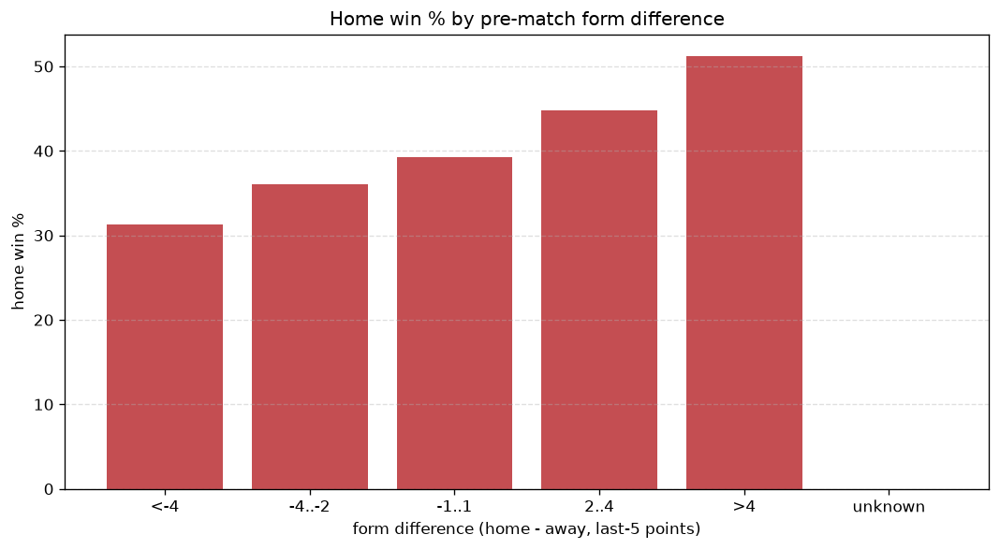
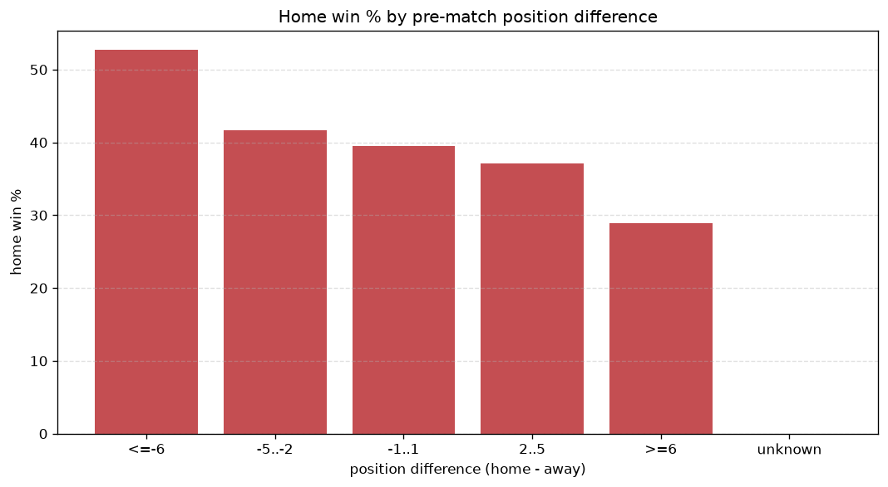

# Relationships Analysis
- Report: `relationships`
- Generated: 2026-10-27T01:57:15+00:00
- Script: `backend/scripts/analyze_relationships.py` v1.0.0
- League: Serie B (Italy)
- Scope: league `italy2`

- Matches analysed: **2290** (23 leakage-safe pre-match features).

## 1. Correlation matrix
_Pearson correlation of each pre-match feature with observed goals; sorted by |corr(total goals)|._

| feature | corr(home) | corr(away) | corr(total) |
|---|---|---|---|
| away_rest_days | 0.047 | 0.053 | 0.070 |
| home_rest_days | 0.050 | 0.048 | 0.069 |
| position_difference | -0.202 | 0.131 | -0.062 |
| home_position_before_match | -0.150 | 0.076 | -0.060 |
| points_difference | 0.197 | -0.140 | 0.053 |
| home_points_before_match | 0.101 | -0.050 | 0.042 |
| home_team_points_last_5 | 0.107 | -0.059 | 0.040 |
| home_team_home_conceded_avg | -0.068 | 0.021 | -0.036 |
| home_team_wins_last_5 | 0.101 | -0.059 | 0.036 |
| home_team_goals_scored_last_5 | 0.093 | -0.051 | 0.035 |
| home_team_goals_conceded_last_5 | -0.075 | 0.037 | -0.031 |
| away_team_away_win_rate | -0.091 | 0.059 | -0.028 |
| home_team_home_win_rate | 0.078 | -0.047 | 0.027 |
| away_position_before_match | 0.131 | -0.107 | 0.026 |
| home_team_home_goals_avg | 0.070 | -0.046 | 0.021 |
| away_team_wins_last_5 | -0.051 | 0.041 | -0.011 |
| away_team_goals_conceded_last_5 | 0.047 | -0.062 | -0.006 |
| away_team_away_goals_avg | -0.040 | 0.036 | -0.005 |
| away_points_before_match | -0.034 | 0.045 | 0.005 |
| away_team_points_last_5 | -0.055 | 0.054 | -0.005 |
| away_team_goals_scored_last_5 | -0.043 | 0.043 | -0.004 |
| away_team_away_conceded_avg | 0.075 | -0.089 | -0.003 |
| rest_days_difference | 0.007 | -0.009 | -0.001 |

## 2. Form vs outcome
_Home win/draw/away % per bucket of `home_team_points_last_5 - away_team_points_last_5`._

| bucket | matches | home | draw | away | home % | draw % | away % |
|---|---|---|---|---|---|---|---|
| <-4 | 364 | 114 | 112 | 138 | 31.3% | 30.8% | 37.9% |
| -4..-2 | 475 | 171 | 173 | 131 | 36.0% | 36.4% | 27.6% |
| -1..1 | 684 | 269 | 219 | 196 | 39.3% | 32.0% | 28.7% |
| 2..4 | 478 | 214 | 160 | 104 | 44.8% | 33.5% | 21.8% |
| >4 | 289 | 148 | 77 | 64 | 51.2% | 26.6% | 22.1% |
| unknown | 0 | 0 | 0 | 0 | - | - | - |

## 3. Position vs outcome
_Home win/draw/away % per bucket of `position_difference` (home position - away position; negative favours the home team)._

| bucket | matches | home | draw | away | home % | draw % | away % |
|---|---|---|---|---|---|---|---|
| <=-6 | 575 | 303 | 161 | 111 | 52.7% | 28.0% | 19.3% |
| -5..-2 | 410 | 171 | 138 | 101 | 41.7% | 33.7% | 24.6% |
| -1..1 | 311 | 123 | 97 | 91 | 39.5% | 31.2% | 29.3% |
| 2..5 | 391 | 145 | 152 | 94 | 37.1% | 38.9% | 24.0% |
| >=6 | 603 | 174 | 193 | 236 | 28.9% | 32.0% | 39.1% |
| unknown | 0 | 0 | 0 | 0 | - | - | - |

## 4. Rest advantage
_Home win/draw/away % per bucket of `rest_days_difference` (home rest - away rest). Matches with unknown rest are bucketed separately._

| bucket | matches | home | draw | away | home % | draw % | away % |
|---|---|---|---|---|---|---|---|
| <-1 | 56 | 23 | 17 | 16 | 41.1% | 30.4% | 28.6% |
| -1..0 | 398 | 153 | 127 | 118 | 38.4% | 31.9% | 29.6% |
| 0 | 1321 | 537 | 425 | 359 | 40.7% | 32.2% | 27.2% |
| 1..2 | 417 | 160 | 140 | 117 | 38.4% | 33.6% | 28.1% |
| >2 | 36 | 17 | 11 | 8 | 47.2% | 30.6% | 22.2% |
| unknown | 62 | 26 | 21 | 15 | 41.9% | 33.9% | 24.2% |
- *62 match(es) had unknown rest difference (missing rest data on at least one side).*

## 5. Home team quality
_Home win rate by `home_team_home_win_rate` tier (split at 0.5)._

- `< 0.5` tier: **36.6%** home win (577/1575)
- `>= 0.5` tier: **47.4%** home win (339/715)
- Home-win gap (>= split minus < split): **+10.8 pp**

| tier | label | matches | home | draw | away | home % |
|---|---|---|---|---|---|---|
| low | < 0.5 | 1575 | 577 | 541 | 457 | 36.6% |
| high | >= 0.5 | 715 | 339 | 200 | 176 | 47.4% |

## 6. Feature averages by result
_Mean feature value per outcome; `range` is home-minus-away spread of the group means._

| feature | home mean | draw mean | away mean | range |
|---|---|---|---|---|
| points_difference | 2.711 | -1.074 | -3.308 | 6.019 |
| home_points_before_match | 26.979 | 23.799 | 22.701 | 4.278 |
| position_difference | -1.705 | 0.615 | 2.280 | 3.985 |
| away_position_before_match | 11.525 | 10.372 | 9.452 | 2.073 |
| home_position_before_match | 9.820 | 10.988 | 11.731 | 1.912 |
| away_points_before_match | 24.269 | 24.873 | 26.009 | 1.741 |
| home_team_points_last_5 | 6.415 | 5.911 | 5.641 | 0.773 |
| home_team_goals_scored_last_5 | 5.879 | 5.412 | 5.319 | 0.560 |
| away_team_points_last_5 | 6.046 | 6.283 | 6.580 | 0.534 |
| home_team_goals_conceded_last_5 | 5.513 | 5.730 | 6.041 | 0.528 |
| away_team_goals_conceded_last_5 | 5.767 | 5.470 | 5.348 | 0.420 |
| away_team_goals_scored_last_5 | 5.561 | 5.713 | 5.937 | 0.376 |
| home_team_wins_last_5 | 1.633 | 1.476 | 1.374 | 0.259 |
| away_team_wins_last_5 | 1.519 | 1.595 | 1.665 | 0.147 |
| away_team_away_conceded_avg | 1.334 | 1.243 | 1.191 | 0.143 |
| home_team_home_goals_avg | 1.315 | 1.256 | 1.222 | 0.093 |
| rest_days_difference | 0.063 | -0.025 | -0.003 | 0.088 |
| home_team_home_conceded_avg | 1.006 | 1.078 | 1.090 | 0.084 |
| away_rest_days | 6.935 | 6.963 | 7.016 | 0.081 |
| home_rest_days | 7.000 | 6.938 | 7.016 | 0.079 |
| away_team_away_goals_avg | 1.020 | 1.060 | 1.093 | 0.073 |
| away_team_away_win_rate | 0.242 | 0.273 | 0.296 | 0.054 |
| home_team_home_win_rate | 0.394 | 0.355 | 0.349 | 0.045 |

---
*All features are leakage-safe pre-match values built by `ml.features.build_features.build_rows` from strictly prior matches. Run with `python backend/scripts/analyze_relationships.py` to regenerate.*

## Charts

