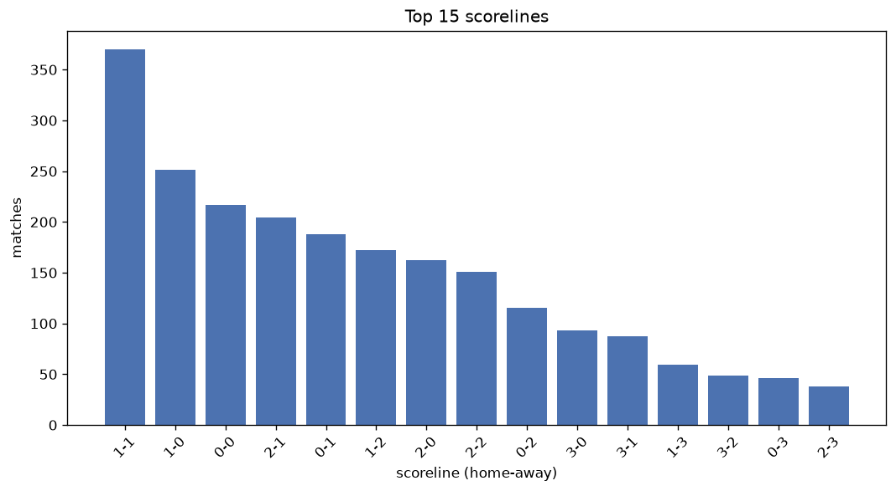
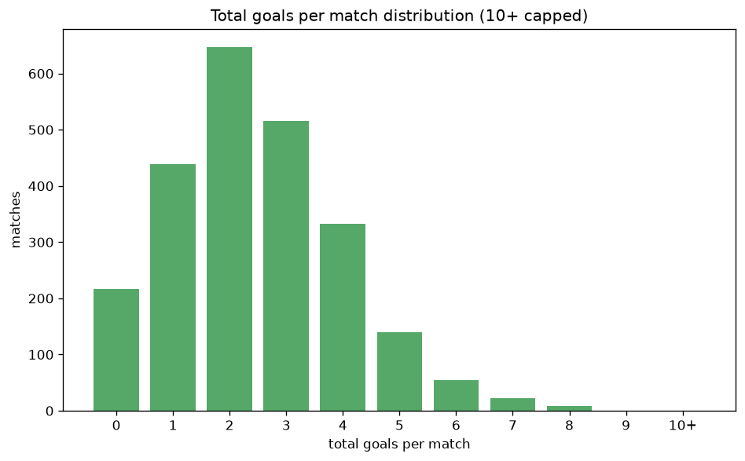

# Scoreline Analysis
- Report: `scoreline_analysis`
- Generated: 2026-10-29T02:05:25+00:00
- Script: `backend/scripts/analyze_scorelines.py` v1.0.0
- League: Serie B (Italy)
- Scope: league `italy2`

## 1. Scoreline frequency
- Matches analysed: **2377** across **7** seasons.
- Distinct scorelines seen: **37**.

| scoreline | count | pct |
|---|---|---|
| 1-1 | 370 | 15.6% |
| 1-0 | 251 | 10.6% |
| 0-0 | 217 | 9.1% |
| 2-1 | 204 | 8.6% |
| 0-1 | 188 | 7.9% |
| 1-2 | 172 | 7.2% |
| 2-0 | 162 | 6.8% |
| 2-2 | 151 | 6.4% |
| 0-2 | 115 | 4.8% |
| 3-0 | 93 | 3.9% |
| 3-1 | 87 | 3.7% |
| 1-3 | 59 | 2.5% |
| 3-2 | 49 | 2.1% |
| 0-3 | 46 | 1.9% |
| 2-3 | 38 | 1.6% |
| 3-3 | 25 | 1.1% |
| 4-0 | 25 | 1.1% |
| 4-1 | 23 | 1.0% |
| 1-4 | 15 | 0.6% |
| 4-2 | 15 | 0.6% |

## 2. Scoreline frequency per season

### 2020-2021
| scoreline | count | pct |
|---|---|---|
| 1-1 | 61 | 16.1% |
| 1-0 | 40 | 10.5% |
| 0-0 | 38 | 10.0% |
| 2-2 | 28 | 7.4% |
| 1-2 | 28 | 7.4% |

### 2021-2022
| scoreline | count | pct |
|---|---|---|
| 1-1 | 68 | 17.9% |
| 1-0 | 43 | 11.3% |
| 0-1 | 35 | 9.2% |
| 2-0 | 29 | 7.6% |
| 0-0 | 27 | 7.1% |

### 2022-2023
| scoreline | count | pct |
|---|---|---|
| 1-1 | 56 | 14.7% |
| 1-0 | 45 | 11.8% |
| 0-0 | 42 | 11.1% |
| 2-1 | 40 | 10.5% |
| 0-1 | 36 | 9.5% |

### 2023-2024
| scoreline | count | pct |
|---|---|---|
| 1-1 | 56 | 14.7% |
| 1-2 | 38 | 10.0% |
| 0-0 | 37 | 9.7% |
| 1-0 | 34 | 8.9% |
| 0-1 | 33 | 8.7% |

### 2024-2025
| scoreline | count | pct |
|---|---|---|
| 1-1 | 53 | 13.9% |
| 1-0 | 40 | 10.5% |
| 2-1 | 40 | 10.5% |
| 0-0 | 40 | 10.5% |
| 2-2 | 31 | 8.2% |

### 2025-2026
| scoreline | count | pct |
|---|---|---|
| 1-1 | 60 | 15.4% |
| 1-0 | 43 | 11.0% |
| 2-1 | 34 | 8.7% |
| 2-0 | 30 | 7.7% |
| 0-0 | 30 | 7.7% |

### 2026-2027
| scoreline | count | pct |
|---|---|---|
| 1-1 | 16 | 18.4% |
| 1-2 | 9 | 10.3% |
| 0-1 | 8 | 9.2% |
| 2-1 | 8 | 9.2% |
| 1-0 | 6 | 6.9% |

## 3. Total-goal histogram
_10+ groups all matches with 10 or more total goals._

| total goals | matches | pct |
|---|---|---|
| 0 | 217 | 9.1% |
| 1 | 439 | 18.5% |
| 2 | 647 | 27.2% |
| 3 | 515 | 21.7% |
| 4 | 333 | 14.0% |
| 5 | 140 | 5.9% |
| 6 | 55 | 2.3% |
| 7 | 22 | 0.9% |
| 8 | 9 | 0.4% |
| 9 | 0 | 0.0% |
| 10+ | 0 | 0.0% |

## 4. Extreme scorelines
- Matches with 7+ total goals: **31**

| season | date | scoreline | total goals |
|---|---|---|---|
| 2020-2021 | 2020-10-31 | 4-4 | 8 |
| 2020-2021 | 2020-11-21 | 7-1 | 8 |
| 2021-2022 | 2022-04-18 | 4-4 | 8 |
| 2022-2023 | 2022-10-01 | 6-2 | 8 |
| 2023-2024 | 2024-01-12 | 5-3 | 8 |
| 2023-2024 | 2024-01-14 | 5-3 | 8 |
| 2024-2025 | 2024-10-20 | 3-5 | 8 |
| 2024-2025 | 2025-01-19 | 5-3 | 8 |
| 2024-2025 | 2025-04-06 | 5-3 | 8 |
| 2020-2021 | 2020-12-12 | 2-5 | 7 |
| 2020-2021 | 2021-05-07 | 4-3 | 7 |
| 2021-2022 | 2021-08-22 | 4-3 | 7 |
| 2021-2022 | 2022-04-06 | 4-3 | 7 |
| 2022-2023 | 2022-08-13 | 4-3 | 7 |
| 2022-2023 | 2023-02-04 | 3-4 | 7 |
| 2022-2023 | 2023-02-24 | 3-4 | 7 |
| 2022-2023 | 2023-03-17 | 5-2 | 7 |
| 2022-2023 | 2023-04-01 | 4-3 | 7 |
| 2022-2023 | 2023-05-19 | 4-3 | 7 |
| 2023-2024 | 2023-09-03 | 3-4 | 7 |
| 2023-2024 | 2024-04-01 | 4-3 | 7 |
| 2023-2024 | 2024-04-20 | 2-5 | 7 |
| 2023-2024 | 2024-05-01 | 4-3 | 7 |
| 2024-2025 | 2024-10-05 | 6-1 | 7 |
| 2024-2025 | 2024-10-19 | 2-5 | 7 |
| 2025-2026 | 2025-09-21 | 3-4 | 7 |
| 2025-2026 | 2025-11-01 | 4-3 | 7 |
| 2025-2026 | 2026-01-24 | 2-5 | 7 |
| 2025-2026 | 2026-04-18 | 6-1 | 7 |
| 2025-2026 | 2026-05-08 | 3-4 | 7 |
| 2026-2027 | 2026-10-24 | 1-6 | 7 |

## 5. Margin-of-victory distribution (decided matches)
- Decided matches: **1612** (draws: **765**)
- Average winning margin: **1.64**

| margin | matches | pct |
|---|---|---|
| 1 | 916 | 56.8% |
| 2 | 447 | 27.7% |
| 3+ | 249 | 15.4% |

## 6. Margin by outcome

### Home wins
- Matches: **948** | avg margin: **1.71** | max margin: **6**
| margin | matches | pct |
|---|---|---|
| 1 | 513 | 54.1% |
| 2 | 268 | 28.3% |
| 3+ | 167 | 17.6% |
- *Full match-by-match list available in `scoreline_analysis.json`.*

### Away wins
- Matches: **664** | avg margin: **1.55** | max margin: **5**
| margin | matches | pct |
|---|---|---|
| 1 | 403 | 60.7% |
| 2 | 179 | 27.0% |
| 3+ | 82 | 12.3% |
- *Full match-by-match list available in `scoreline_analysis.json`.*

## 7. Most common exact score by outcome type
| outcome | matches | most common score | count | pct |
|---|---|---|---|---|
| home | 948 | 1-0 | 251 | 26.5% |
| draw | 765 | 1-1 | 370 | 48.4% |
| away | 664 | 0-1 | 188 | 28.3% |

---
*All statistics are computed from PostgreSQL tables (read-only). Run with `python backend/scripts/analyze_scorelines.py` to regenerate.*

## Charts

