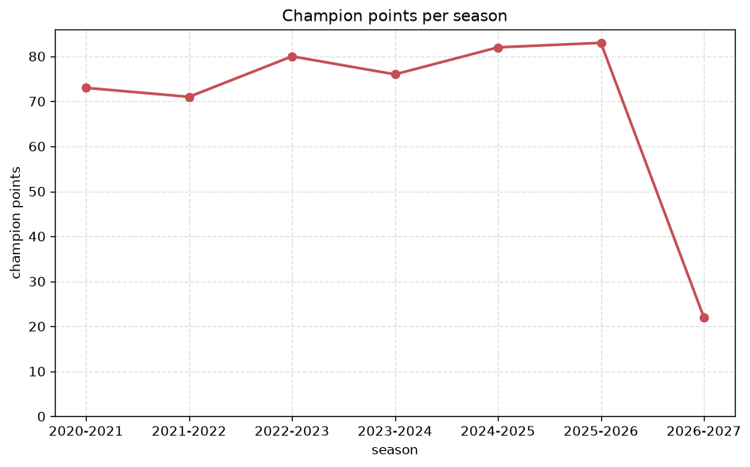
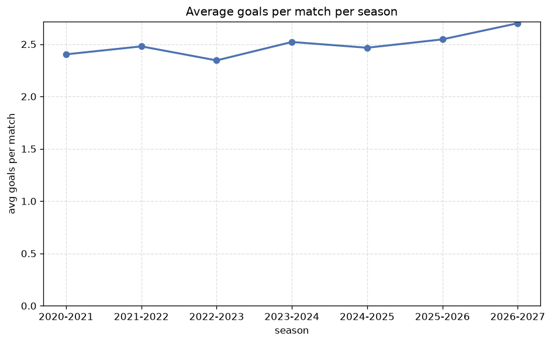

# Season Trends Analysis
- Report: `season_trends`
- Generated: 2026-10-27T01:57:06+00:00
- Script: `backend/scripts/analyze_seasons.py` v1.0.0
- League: Serie B (Italy)
- Scope: league `italy2`

## 1. Champions per season
| season | champion | pts | runner-up | margin |
|---|---|---|---|---|
| 2020-2021 | Empoli | 73 | Salernitana | 4 pts |
| 2021-2022 | Lecce | 71 | Cremonese | 2 pts |
| 2022-2023 | Frosinone | 80 | Genoa | 6 pts |
| 2023-2024 | Parma | 76 | Como | 3 pts |
| 2024-2025 | Sassuolo | 82 | Pisa | 6 pts |
| 2025-2026 | Monza | 83 | Venezia | 1 pts |
| 2026-2027 | Palermo | 22 | Mantova | 5 pts |

## 2. Title-race tightness
- Tight races (margin <= 3 pts): **3** of 7 seasons
- Tightest race: **2025-2026** - Monza beat Venezia by **1** pts

| season | margin | tight |
|---|---|---|
| 2020-2021 | 4 pts |  |
| 2021-2022 | 2 pts | yes |
| 2022-2023 | 6 pts |  |
| 2023-2024 | 3 pts | yes |
| 2024-2025 | 6 pts |  |
| 2025-2026 | 1 pts | yes |
| 2026-2027 | 5 pts |  |

## 3. Points thresholds
_Position-specific points per season. Key: 1 = champion, 2 = runner-up, 4 = CL line, 6 = Europa, 17 = last safe, 20 = bottom._

| season | pos 1 | pos 2 | pos 4 | pos 6 | pos 17 | pos 20 |
|---|---|---|---|---|---|---|
| 2020-2021 | 73 | 69 | 62 | 57 | 35 | 23 |
| 2021-2022 | 71 | 69 | 67 | 65 | 34 | 18 |
| 2022-2023 | 80 | 74 | 61 | 58 | 40 | 35 |
| 2023-2024 | 76 | 73 | 67 | 57 | 41 | 26 |
| 2024-2025 | 82 | 76 | 61 | 53 | 42 | 34 |
| 2025-2026 | 83 | 82 | 75 | 55 | 41 | 35 |
| 2026-2027 | 22 | 17 | 15 | 14 | 7 | 4 |

## 4. Relegation battle
| season | safe pos | safe pts | drop pos | drop pts | gap |
|---|---|---|---|---|---|
| 2020-2021 | 17 | 35 | 18 | 34 | 1 pts |
| 2021-2022 | 17 | 34 | 18 | 34 | 0 pts |
| 2022-2023 | 17 | 40 | 18 | 39 | 1 pts |
| 2023-2024 | 17 | 41 | 18 | 41 | 0 pts |
| 2024-2025 | 17 | 42 | 18 | 41 | 1 pts |
| 2025-2026 | 17 | 41 | 18 | 37 | 4 pts |
| 2026-2027 | 17 | 7 | 18 | 6 | 1 pts |

## 5. League-level trends
| season | matches | total goals | avg goals | home win | draw | away win | goalless | avg pts/team |
|---|---|---|---|---|---|---|---|---|
| 2020-2021 | 380 | 913 | 2.403 | 37.6% | 34.5% | 27.9% | 10.0% | 50.45 |
| 2021-2022 | 380 | 942 | 2.479 | 40.0% | 30.8% | 29.2% | 7.1% | 51.15 |
| 2022-2023 | 380 | 891 | 2.345 | 40.5% | 32.1% | 27.4% | 11.1% | 50.9 |
| 2023-2024 | 380 | 958 | 2.521 | 36.6% | 32.1% | 31.3% | 9.7% | 50.9 |
| 2024-2025 | 380 | 937 | 2.466 | 40.3% | 33.7% | 26.1% | 10.5% | 50.6 |
| 2025-2026 | 390 | 993 | 2.546 | 44.9% | 31.0% | 24.1% | 7.7% | 52.45 |
| 2026-2027 | 80 | 216 | 2.7 | 36.2% | 27.5% | 36.2% | 3.8% | 10.9 |

## 6. View divergence
- Largest divergence: **2021-2022** (goals view, avg abs position diff = 8.400)

_Avg absolute position difference between classic view and alternative view per season._

| season | classic vs luck | classic vs goals |
|---|---|---|
| 2020-2021 | 3.300 | 6.600 |
| 2021-2022 | 2.400 | 8.400 |
| 2022-2023 | 2.400 | 6.600 |
| 2023-2024 | 2.100 | 5.400 |
| 2024-2025 | 3.300 | 4.200 |
| 2025-2026 | 3.200 | 6.300 |
| 2026-2027 | 1.900 | 6.200 |

---
*All statistics are computed from PostgreSQL tables (read-only). Run with `python backend/scripts/analyze_seasons.py` to regenerate.*

## Charts

