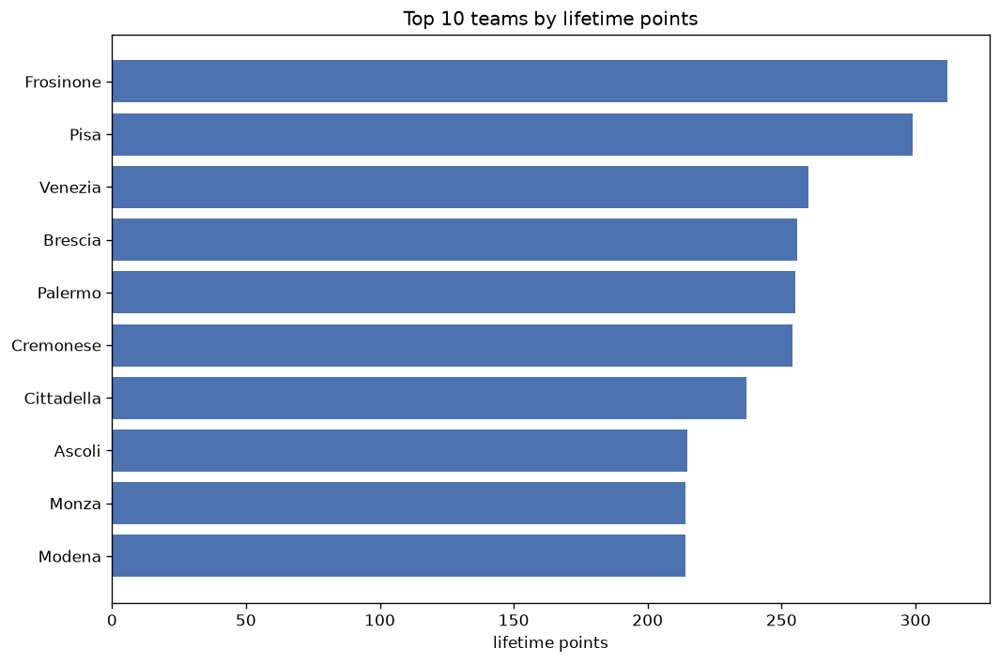
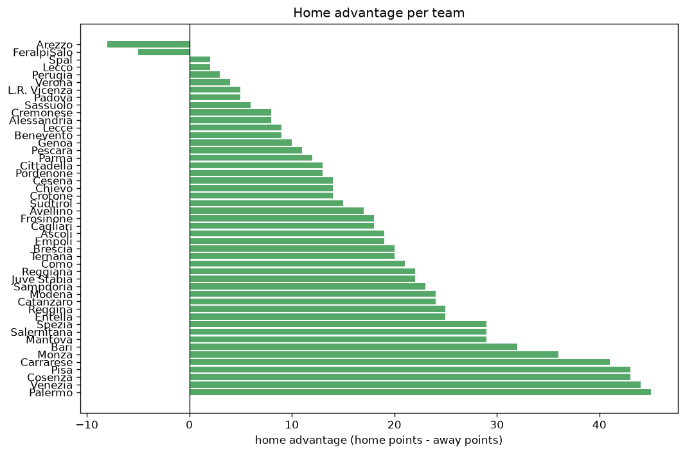

# Team Analysis
- Report: `teams_analysis`
- Generated: 2026-10-30T03:58:51+00:00
- Script: `backend/scripts/analyze_teams.py` v1.0.0
- League: Serie B (Italy)
- Scope: league `italy2`

- Teams: **47** | Seasons: **7** | Matches: **2380**

## 1. Team standings (lifetime)
| team | seasons | played | W | D | L | pts | GF | GA | GD | avg pts/season | best pos | worst pos | titles |
|---|---|---|---|---|---|---|---|---|---|---|---|---|---|
| Frosinone | 5 | 190 | 83 | 63 | 44 | 312 | 272 | 197 | 75 | 62.4 | 1 | 16 | 1 |
| Pisa | 6 | 199 | 78 | 65 | 56 | 299 | 283 | 239 | 44 | 49.83 | 2 | 13 | 0 |
| Venezia | 4 | 152 | 73 | 41 | 38 | 260 | 250 | 166 | 84 | 65.0 | 2 | 8 | 0 |
| Brescia | 5 | 190 | 62 | 70 | 58 | 256 | 238 | 233 | 5 | 51.2 | 5 | 16 | 0 |
| Palermo | 5 | 163 | 68 | 51 | 44 | 255 | 246 | 192 | 54 | 51.0 | 1 | 9 | 1 |
| Cremonese | 5 | 161 | 69 | 47 | 45 | 254 | 223 | 170 | 53 | 50.8 | 2 | 16 | 0 |
| Cittadella | 5 | 190 | 58 | 63 | 69 | 237 | 190 | 219 | -29 | 47.4 | 6 | 19 | 0 |
| Ascoli | 5 | 161 | 56 | 47 | 58 | 215 | 183 | 185 | -2 | 43.0 | 3 | 17 | 0 |
| Monza | 3 | 118 | 60 | 34 | 24 | 214 | 178 | 108 | 70 | 71.33 | 1 | 3 | 1 |
| Modena | 5 | 162 | 54 | 52 | 56 | 214 | 202 | 196 | 6 | 42.8 | 2 | 11 | 0 |
| Sudtirol | 5 | 163 | 49 | 60 | 54 | 207 | 182 | 196 | -14 | 41.4 | 6 | 14 | 0 |
| Bari | 4 | 154 | 45 | 61 | 48 | 196 | 175 | 186 | -11 | 49.0 | 3 | 18 | 0 |
| Cosenza | 5 | 190 | 41 | 68 | 81 | 191 | 174 | 257 | -83 | 38.2 | 9 | 20 | 0 |
| Parma | 3 | 114 | 49 | 39 | 26 | 186 | 162 | 117 | 45 | 62.0 | 1 | 12 | 1 |
| Catanzaro | 4 | 128 | 47 | 45 | 36 | 186 | 190 | 171 | 19 | 46.5 | 5 | 20 | 0 |
| Como | 3 | 114 | 42 | 41 | 31 | 167 | 154 | 142 | 12 | 55.67 | 2 | 14 | 0 |
| Reggiana | 4 | 152 | 39 | 45 | 68 | 162 | 147 | 210 | -63 | 40.5 | 12 | 18 | 0 |
| Reggina | 3 | 114 | 42 | 27 | 45 | 153 | 122 | 139 | -17 | 51.0 | 7 | 13 | 0 |
| Sampdoria | 4 | 123 | 36 | 39 | 48 | 147 | 134 | 165 | -31 | 36.75 | 6 | 19 | 0 |
| Spezia | 3 | 114 | 34 | 43 | 37 | 145 | 138 | 141 | -3 | 48.33 | 3 | 20 | 0 |
| Ternana | 3 | 114 | 37 | 29 | 48 | 140 | 138 | 163 | -25 | 46.67 | 10 | 16 | 0 |
| Spal | 3 | 114 | 31 | 43 | 40 | 136 | 131 | 147 | -16 | 45.33 | 9 | 19 | 0 |
| Lecce | 2 | 76 | 35 | 28 | 13 | 133 | 127 | 78 | 49 | 66.5 | 1 | 4 | 1 |
| Juve Stabia | 3 | 88 | 29 | 35 | 24 | 122 | 99 | 99 | 0 | 40.67 | 5 | 11 | 0 |
| Empoli | 3 | 85 | 30 | 31 | 24 | 121 | 123 | 104 | 19 | 40.33 | 1 | 18 | 1 |
| Benevento | 3 | 85 | 29 | 26 | 30 | 113 | 109 | 96 | 13 | 37.67 | 5 | 20 | 0 |
| Salernitana | 2 | 76 | 30 | 21 | 25 | 111 | 83 | 81 | 2 | 55.5 | 2 | 17 | 0 |
| Cesena | 3 | 85 | 28 | 26 | 31 | 110 | 101 | 116 | -15 | 36.67 | 7 | 12 | 0 |
| Mantova | 3 | 85 | 28 | 23 | 34 | 107 | 106 | 123 | -17 | 35.67 | 4 | 13 | 0 |
| Carrarese | 3 | 85 | 24 | 27 | 34 | 99 | 95 | 111 | -16 | 33.0 | 12 | 14 | 0 |
| Perugia | 2 | 76 | 24 | 25 | 27 | 97 | 80 | 84 | -4 | 48.5 | 9 | 18 | 0 |
| L.R. Vicenza | 3 | 85 | 22 | 25 | 38 | 91 | 98 | 129 | -31 | 30.33 | 14 | 17 | 0 |
| Sassuolo | 1 | 38 | 25 | 7 | 6 | 82 | 78 | 38 | 40 | 82.0 | 1 | 1 | 1 |
| Entella | 3 | 85 | 16 | 27 | 42 | 75 | 77 | 125 | -48 | 25.0 | 13 | 20 | 0 |
| Genoa | 1 | 38 | 21 | 11 | 6 | 74 | 53 | 28 | 25 | 74.0 | 2 | 2 | 0 |
| Pescara | 2 | 76 | 14 | 25 | 37 | 67 | 80 | 126 | -46 | 33.5 | 19 | 19 | 0 |
| Pordenone | 2 | 76 | 13 | 24 | 39 | 63 | 69 | 110 | -41 | 31.5 | 15 | 20 | 0 |
| Avellino | 2 | 48 | 16 | 13 | 19 | 61 | 56 | 68 | -12 | 30.5 | 8 | 10 | 0 |
| Cagliari | 1 | 38 | 15 | 15 | 8 | 60 | 50 | 34 | 16 | 60.0 | 5 | 5 | 0 |
| Padova | 2 | 47 | 16 | 11 | 20 | 59 | 48 | 59 | -11 | 29.5 | 8 | 9 | 0 |
| Chievo | 1 | 38 | 14 | 14 | 10 | 56 | 50 | 37 | 13 | 56.0 | 7 | 7 | 0 |
| Alessandria | 1 | 38 | 8 | 10 | 20 | 34 | 37 | 59 | -22 | 34.0 | 18 | 18 | 0 |
| FeralpiSalo | 1 | 38 | 8 | 9 | 21 | 33 | 44 | 65 | -21 | 33.0 | 19 | 19 | 0 |
| Crotone | 1 | 38 | 4 | 14 | 20 | 26 | 41 | 61 | -20 | 26.0 | 19 | 19 | 0 |
| Lecco | 1 | 38 | 6 | 8 | 24 | 26 | 35 | 74 | -39 | 26.0 | 20 | 20 | 0 |
| Verona | 1 | 9 | 3 | 3 | 3 | 12 | 16 | 13 | 3 | 12.0 | 9 | 9 | 0 |
| Arezzo | 1 | 9 | 3 | 1 | 5 | 10 | 9 | 19 | -10 | 10.0 | 15 | 15 | 0 |

## 2. Home vs away split
| team | home P | H-W | H-D | H-L | H-pts | away P | A-W | A-D | A-L | A-pts | adv |
|---|---|---|---|---|---|---|---|---|---|---|---|
| Palermo | 81 | 43 | 21 | 17 | 150 | 82 | 25 | 30 | 27 | 105 | 45 |
| Venezia | 76 | 47 | 11 | 18 | 152 | 76 | 26 | 30 | 20 | 108 | 44 |
| Pisa | 100 | 45 | 36 | 19 | 171 | 99 | 33 | 29 | 37 | 128 | 43 |
| Cosenza | 95 | 28 | 33 | 34 | 117 | 95 | 13 | 35 | 47 | 74 | 43 |
| Carrarese | 43 | 19 | 13 | 11 | 70 | 42 | 5 | 14 | 23 | 29 | 41 |
| Monza | 59 | 37 | 14 | 8 | 125 | 59 | 23 | 20 | 16 | 89 | 36 |
| Bari | 77 | 27 | 33 | 17 | 114 | 77 | 18 | 28 | 31 | 82 | 32 |
| Spezia | 57 | 23 | 18 | 16 | 87 | 57 | 11 | 25 | 21 | 58 | 29 |
| Salernitana | 38 | 20 | 10 | 8 | 70 | 38 | 10 | 11 | 17 | 41 | 29 |
| Mantova | 43 | 19 | 11 | 13 | 68 | 42 | 9 | 12 | 21 | 39 | 29 |
| Reggina | 57 | 27 | 8 | 22 | 89 | 57 | 15 | 19 | 23 | 64 | 25 |
| Entella | 43 | 12 | 14 | 17 | 50 | 42 | 4 | 13 | 25 | 25 | 25 |
| Modena | 81 | 31 | 26 | 24 | 119 | 81 | 23 | 26 | 32 | 95 | 24 |
| Catanzaro | 63 | 28 | 21 | 14 | 105 | 65 | 19 | 24 | 22 | 81 | 24 |
| Sampdoria | 60 | 23 | 16 | 21 | 85 | 63 | 13 | 23 | 27 | 62 | 23 |
| Reggiana | 76 | 21 | 29 | 26 | 92 | 76 | 18 | 16 | 42 | 70 | 22 |
| Juve Stabia | 43 | 19 | 15 | 9 | 72 | 45 | 10 | 20 | 15 | 50 | 22 |
| Como | 57 | 25 | 19 | 13 | 94 | 57 | 17 | 22 | 18 | 73 | 21 |
| Brescia | 95 | 34 | 36 | 25 | 138 | 95 | 28 | 34 | 33 | 118 | 20 |
| Ternana | 57 | 22 | 14 | 21 | 80 | 57 | 15 | 15 | 27 | 60 | 20 |
| Ascoli | 81 | 30 | 27 | 24 | 117 | 80 | 26 | 20 | 34 | 98 | 19 |
| Empoli | 42 | 17 | 19 | 6 | 70 | 43 | 13 | 12 | 18 | 51 | 19 |
| Frosinone | 95 | 44 | 33 | 18 | 165 | 95 | 39 | 30 | 26 | 147 | 18 |
| Cagliari | 19 | 11 | 6 | 2 | 39 | 19 | 4 | 9 | 6 | 21 | 18 |
| Avellino | 24 | 11 | 6 | 7 | 39 | 24 | 5 | 7 | 12 | 22 | 17 |
| Sudtirol | 82 | 26 | 33 | 23 | 111 | 81 | 23 | 27 | 31 | 96 | 15 |
| Cesena | 43 | 15 | 17 | 11 | 62 | 42 | 13 | 9 | 20 | 48 | 14 |
| Chievo | 19 | 10 | 5 | 4 | 35 | 19 | 4 | 9 | 6 | 21 | 14 |
| Crotone | 19 | 4 | 8 | 7 | 20 | 19 | 0 | 6 | 13 | 6 | 14 |
| Cittadella | 95 | 31 | 32 | 32 | 125 | 95 | 27 | 31 | 37 | 112 | 13 |
| Pordenone | 38 | 7 | 17 | 14 | 38 | 38 | 6 | 7 | 25 | 25 | 13 |
| Parma | 57 | 27 | 18 | 12 | 99 | 57 | 22 | 21 | 14 | 87 | 12 |
| Pescara | 38 | 9 | 12 | 17 | 39 | 38 | 5 | 13 | 20 | 28 | 11 |
| Genoa | 19 | 12 | 6 | 1 | 42 | 19 | 9 | 5 | 5 | 32 | 10 |
| Lecce | 38 | 19 | 14 | 5 | 71 | 38 | 16 | 14 | 8 | 62 | 9 |
| Benevento | 44 | 16 | 13 | 15 | 61 | 41 | 13 | 13 | 15 | 52 | 9 |
| Cremonese | 80 | 35 | 26 | 19 | 131 | 81 | 34 | 21 | 26 | 123 | 8 |
| Alessandria | 19 | 5 | 6 | 8 | 21 | 19 | 3 | 4 | 12 | 13 | 8 |
| Sassuolo | 19 | 14 | 2 | 3 | 44 | 19 | 11 | 5 | 3 | 38 | 6 |
| L.R. Vicenza | 42 | 11 | 15 | 16 | 48 | 43 | 11 | 10 | 22 | 43 | 5 |
| Padova | 24 | 8 | 8 | 8 | 32 | 23 | 8 | 3 | 12 | 27 | 5 |
| Verona | 5 | 2 | 2 | 1 | 8 | 4 | 1 | 1 | 2 | 4 | 4 |
| Perugia | 38 | 12 | 14 | 12 | 50 | 38 | 12 | 11 | 15 | 47 | 3 |
| Spal | 57 | 16 | 21 | 20 | 69 | 57 | 15 | 22 | 20 | 67 | 2 |
| Lecco | 19 | 4 | 2 | 13 | 14 | 19 | 2 | 6 | 11 | 12 | 2 |
| FeralpiSalo | 19 | 3 | 5 | 11 | 14 | 19 | 5 | 4 | 10 | 19 | -5 |
| Arezzo | 4 | 0 | 1 | 3 | 1 | 5 | 3 | 0 | 2 | 9 | -8 |

## 3. Top performers
### Best points per game (PPG)
| rank | team | PPG |
|---|---|---|
| 1 | Sassuolo | 2.16 |
| 2 | Genoa | 1.95 |
| 3 | Monza | 1.81 |
| 4 | Lecce | 1.75 |
| 5 | Venezia | 1.71 |

### Most goals scored
| rank | team | goals |
|---|---|---|
| 1 | Pisa | 283 |
| 2 | Frosinone | 272 |
| 3 | Venezia | 250 |
| 4 | Palermo | 246 |
| 5 | Brescia | 238 |

### Best goal difference
| rank | team | GD |
|---|---|---|
| 1 | Venezia | 84 |
| 2 | Frosinone | 75 |
| 3 | Monza | 70 |
| 4 | Palermo | 54 |
| 5 | Cremonese | 53 |

### Best defence (goals against per match, standings)
| rank | team | GA/match |
|---|---|---|
| 1 | Genoa | 0.737 |
| 2 | Cagliari | 0.895 |
| 3 | Monza | 0.915 |
| 4 | Chievo | 0.974 |
| 5 | Sassuolo | 1.000 |

## 4. Team consistency
- Teams present in all **7** seasons: **0**

## 5. Head-to-head dominance
- Distinct fixtures: **711** (showing the 15 most frequent)

| fixture | meetings | home wins | draws | away wins | home pct | draw pct | away pct |
|---|---|---|---|---|---|---|---|
| Pisa vs Brescia | 10 | 5 | 3 | 2 | 50.0% | 30.0% | 20.0% |
| Pisa vs Cittadella | 10 | 5 | 0 | 5 | 50.0% | 0.0% | 50.0% |
| Brescia vs Cosenza | 10 | 4 | 3 | 3 | 40.0% | 30.0% | 30.0% |
| Cittadella vs Brescia | 10 | 4 | 4 | 2 | 40.0% | 40.0% | 20.0% |
| Pisa vs Cosenza | 10 | 3 | 4 | 3 | 30.0% | 40.0% | 30.0% |
| Bari vs Sudtirol | 10 | 2 | 5 | 3 | 20.0% | 50.0% | 30.0% |
| Cittadella vs Cosenza | 10 | 2 | 7 | 1 | 20.0% | 70.0% | 10.0% |
| Cremonese vs Pisa | 9 | 5 | 3 | 1 | 55.6% | 33.3% | 11.1% |
| Sudtirol vs Modena | 9 | 3 | 5 | 1 | 33.3% | 55.6% | 11.1% |
| Pisa vs Ascoli | 8 | 6 | 1 | 1 | 75.0% | 12.5% | 12.5% |
| Bari vs Palermo | 8 | 5 | 2 | 1 | 62.5% | 25.0% | 12.5% |
| Cremonese vs Cosenza | 8 | 5 | 0 | 3 | 62.5% | 0.0% | 37.5% |
| Bari vs Modena | 8 | 4 | 3 | 1 | 50.0% | 37.5% | 12.5% |
| Cittadella vs Ascoli | 8 | 4 | 4 | 0 | 50.0% | 50.0% | 0.0% |
| Cremonese vs Brescia | 8 | 4 | 2 | 2 | 50.0% | 25.0% | 25.0% |

## 6. Position per season (classic view)
_Cells show final position; '-' when the team was absent from that season._

| team | 2020-2021 | 2021-2022 | 2022-2023 | 2023-2024 | 2024-2025 | 2025-2026 | 2026-2027 |
|---|---|---|---|---|---|---|---|
| Frosinone | 11 | 8 | 1 | - | 16 | 3 | - |
| Pisa | 13 | 4 | 11 | 13 | 2 | - | 6 |
| Venezia | 5 | - | 8 | 3 | - | 2 | - |
| Brescia | 8 | 5 | 16 | 8 | 15 | - | - |
| Palermo | - | - | 9 | 7 | 8 | 4 | 1 |
| Cremonese | 12 | 2 | - | 4 | 4 | - | 16 |
| Cittadella | 6 | 11 | 14 | 14 | 19 | - | - |
| Ascoli | 16 | 6 | 13 | 17 | - | - | 3 |
| Monza | 3 | 3 | - | - | - | 1 | - |
| Modena | - | - | 10 | 11 | 11 | 6 | 2 |
| Sudtirol | - | - | 6 | 10 | 10 | 14 | 7 |
| Bari | - | - | 3 | 18 | 9 | 16 | - |
| Cosenza | 17 | 16 | 17 | 9 | 20 | - | - |
| Parma | - | 12 | 4 | 1 | - | - | - |
| Catanzaro | - | - | - | 5 | 6 | 5 | 20 |
| Como | - | 14 | 12 | 2 | - | - | - |
| Reggiana | 18 | - | - | 12 | 14 | 18 | - |
| Reggina | 10 | 13 | 7 | - | - | - | - |
| Sampdoria | - | - | - | 6 | 18 | 13 | 19 |
| Spezia | - | - | - | 15 | 3 | 20 | - |
| Ternana | - | 10 | 15 | 16 | - | - | - |
| Spal | 9 | 15 | 19 | - | - | - | - |
| Lecce | 4 | 1 | - | - | - | - | - |
| Juve Stabia | - | - | - | - | 5 | 7 | 11 |
| Empoli | 1 | - | - | - | - | 17 | 18 |
| Benevento | - | 7 | 20 | - | - | - | 5 |
| Salernitana | 2 | - | - | - | 17 | - | - |
| Cesena | - | - | - | - | 7 | 10 | 12 |
| Mantova | - | - | - | - | 13 | 11 | 4 |
| Carrarese | - | - | - | - | 12 | 12 | 14 |
| Perugia | - | 9 | 18 | - | - | - | - |
| L.R. Vicenza | 14 | 17 | - | - | - | - | 17 |
| Sassuolo | - | - | - | - | 1 | - | - |
| Entella | 20 | - | - | - | - | 15 | 13 |
| Genoa | - | - | 2 | - | - | - | - |
| Pescara | 19 | - | - | - | - | 19 | - |
| Pordenone | 15 | 20 | - | - | - | - | - |
| Avellino | - | - | - | - | - | 8 | 10 |
| Cagliari | - | - | 5 | - | - | - | - |
| Padova | - | - | - | - | - | 9 | 8 |
| Chievo | 7 | - | - | - | - | - | - |
| Alessandria | - | 18 | - | - | - | - | - |
| FeralpiSalo | - | - | - | 19 | - | - | - |
| Crotone | - | 19 | - | - | - | - | - |
| Lecco | - | - | - | 20 | - | - | - |
| Verona | - | - | - | - | - | - | 9 |
| Arezzo | - | - | - | - | - | - | 15 |

---
*All statistics are computed from PostgreSQL tables (read-only). Run with `python backend/scripts/analyze_teams.py` to regenerate.*

## Charts

