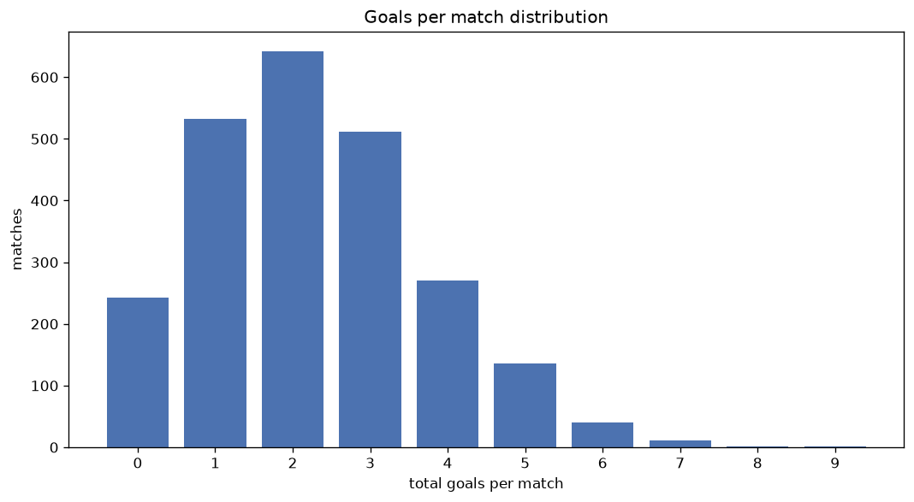
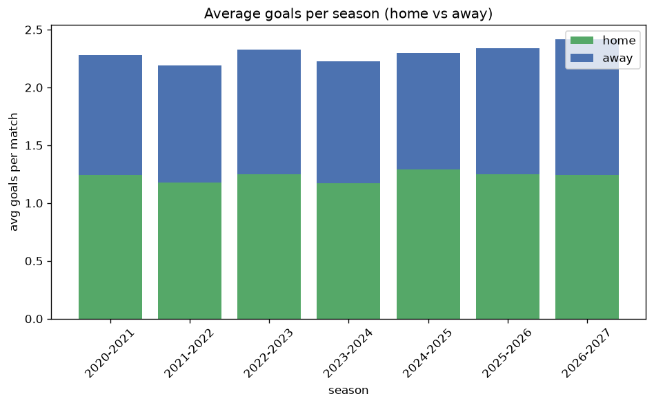

# Goal Analysis
- Report: `goals_analysis`
- Generated: 2026-10-30T03:59:10+00:00
- Script: `backend/scripts/analyze_goals.py` v1.0.0
- League: Serie C - Group A (Italy)
- Scope: league `italy3a`

## 1. Goals per match distribution
| goals | matches | pct |
|---|---|---|
| 0 | 242 | 10.1% |
| 1 | 533 | 22.3% |
| 2 | 642 | 26.9% |
| 3 | 512 | 21.4% |
| 4 | 271 | 11.3% |
| 5 | 136 | 5.7% |
| 6 | 40 | 1.7% |
| 7 | 11 | 0.5% |
| 8 | 2 | 0.1% |
| 9 | 1 | 0.0% |

## 2. Goals per match per season
| season | matches | total goals | avg home | avg away | avg total |
|---|---|---|---|---|---|
| 2020-2021 | 380 | 866 | 1.245 | 1.034 | 2.279 |
| 2021-2022 | 380 | 833 | 1.176 | 1.016 | 2.192 |
| 2022-2023 | 380 | 884 | 1.247 | 1.079 | 2.326 |
| 2023-2024 | 380 | 847 | 1.171 | 1.058 | 2.229 |
| 2024-2025 | 380 | 873 | 1.289 | 1.008 | 2.297 |
| 2025-2026 | 380 | 889 | 1.247 | 1.092 | 2.339 |
| 2026-2027 | 110 | 267 | 1.264 | 1.164 | 2.427 |

## 3. Home vs away goal share
- Home goals: **2942** (53.9%)
- Away goals: **2517** (46.1%)
- Home/away ratio: **1.169**

| season | home goals | away goals | total | home pct | away pct |
|---|---|---|---|---|---|
| 2020-2021 | 473 | 393 | 866 | 54.6% | 45.4% |
| 2021-2022 | 447 | 386 | 833 | 53.7% | 46.3% |
| 2022-2023 | 474 | 410 | 884 | 53.6% | 46.4% |
| 2023-2024 | 445 | 402 | 847 | 52.5% | 47.5% |
| 2024-2025 | 490 | 383 | 873 | 56.1% | 43.9% |
| 2025-2026 | 474 | 415 | 889 | 53.3% | 46.7% |
| 2026-2027 | 139 | 128 | 267 | 52.1% | 47.9% |

## 4. BTTS (Both Teams To Score)
- Overall: **1149** of `2390` (48.1%)

| season | matches | BTTS | pct |
|---|---|---|---|
| 2020-2021 | 380 | 175 | 46.1% |
| 2021-2022 | 380 | 184 | 48.4% |
| 2022-2023 | 380 | 187 | 49.2% |
| 2023-2024 | 380 | 174 | 45.8% |
| 2024-2025 | 380 | 180 | 47.4% |
| 2025-2026 | 380 | 189 | 49.7% |
| 2026-2027 | 110 | 60 | 54.5% |

## 5. Clean sheets
- Home clean sheets: **799** (33.4%)
- Away clean sheets: **684** (28.6%)
- Total clean sheets recorded: **1483**
- Matches with at least one clean sheet: **1241** (51.9%)
- Both teams kept clean sheets (0-0): **242**

| season | matches | home CS | away CS | total CS | matches w/ CS |
|---|---|---|---|---|---|
| 2020-2021 | 380 | 141 | 107 | 248 | 205 (53.9%) |
| 2021-2022 | 380 | 127 | 107 | 234 | 196 (51.6%) |
| 2022-2023 | 380 | 119 | 108 | 227 | 193 (50.8%) |
| 2023-2024 | 380 | 124 | 124 | 248 | 206 (54.2%) |
| 2024-2025 | 380 | 133 | 99 | 232 | 200 (52.6%) |
| 2025-2026 | 380 | 119 | 109 | 228 | 191 (50.3%) |
| 2026-2027 | 110 | 36 | 30 | 66 | 50 (45.5%) |

## 6. Scoring intensity
- First-half goals: **2391** (43.8%)
- Second-half goals: **3068** (56.2%)
- Avg first-half goals per match: **1.0**
- Avg second-half goals per match: **1.284**
- Second-half-only scoring (HT 0-0, FT goals >= 1): **600** (25.1%)

| season | matches | 1st half | 2nd half | 1st half pct | 2nd half pct |
|---|---|---|---|---|---|
| 2020-2021 | 380 | 382 | 484 | 44.1% | 55.9% |
| 2021-2022 | 380 | 377 | 456 | 45.3% | 54.7% |
| 2022-2023 | 380 | 394 | 490 | 44.6% | 55.4% |
| 2023-2024 | 380 | 366 | 481 | 43.2% | 56.8% |
| 2024-2025 | 380 | 378 | 495 | 43.3% | 56.7% |
| 2025-2026 | 380 | 379 | 510 | 42.6% | 57.4% |
| 2026-2027 | 110 | 115 | 152 | 43.1% | 56.9% |

## 7. First-goal timing
- Matches with first-goal time recorded: `2148` of `2390` (89.9%)
- Goalless matches: `242`
- Min `1` | Max `98` | Mean `33.34` | Median (p50) `28.0`

| bucket | count | % of matches | % of scoring matches |
|---|---|---|---|
| 1-15 | 641 | 26.8% | 29.8% |
| 16-30 | 509 | 21.3% | 23.7% |
| 31-45 | 367 | 15.4% | 17.1% |
| 46-60 | 285 | 11.9% | 13.3% |
| 61-75 | 189 | 7.9% | 8.8% |
| 76-90 | 118 | 4.9% | 5.5% |
| 91-120 | 39 | 1.6% | 1.8% |

---
*All statistics are computed from PostgreSQL tables (read-only). Run with `python backend/scripts/analyze_goals.py` to regenerate.*

## Charts

