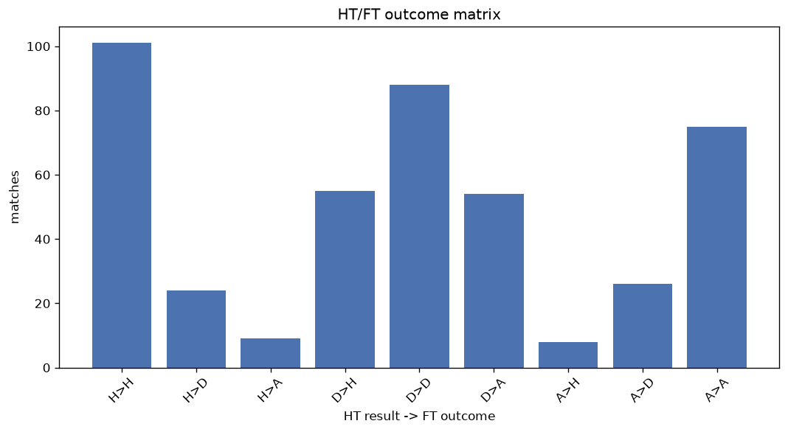
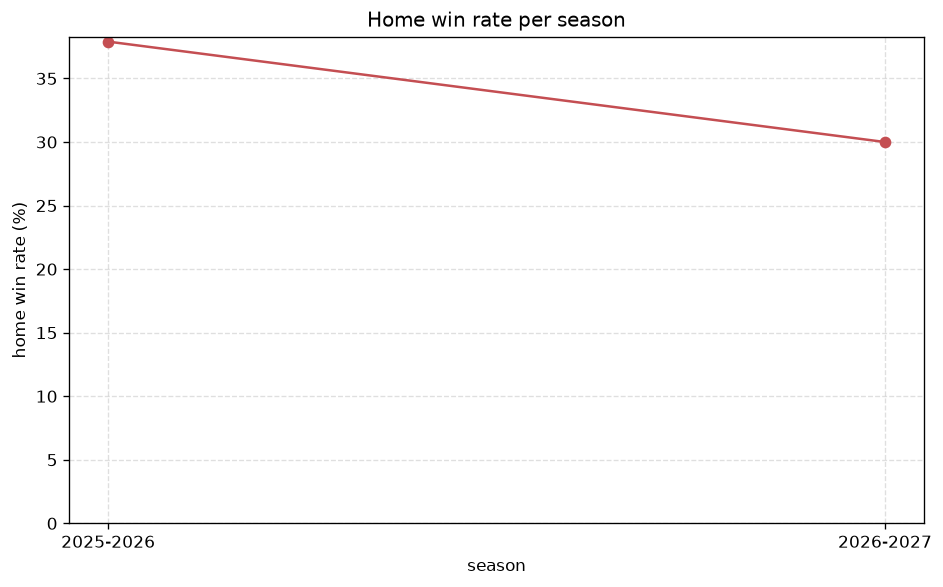

# Match Analysis
- Report: `matches_analysis`
- Generated: 2026-10-30T03:59:08+00:00
- Script: `backend/scripts/analyze_matches.py` v1.0.0
- League: Serie C - Group A (Italy)
- Scope: league `italy3a`

## 1. Overall summary
| metric | value |
|---|---|
| Matches | 2390 |
| Home wins | 935 (39.1%) |
| Draws | 710 (29.7%) |
| Away wins | 745 (31.2%) |
| Total goals | 5459 |
| Average goals per match | 2.284 |
| Goalless matches | 242 (10.1%) |

## 2. Per-season breakdown
| season | matches | home wins | draws | away wins | total goals | avg goals | goalless |
|---|---|---|---|---|---|---|---|
| 2020-2021 | 380 | 150 (39.5%) | 114 (30.0%) | 116 (30.5%) | 866 | 2.279 | 43 (11.3%) |
| 2021-2022 | 380 | 145 (38.2%) | 120 (31.6%) | 115 (30.3%) | 833 | 2.192 | 38 (10.0%) |
| 2022-2023 | 380 | 150 (39.5%) | 108 (28.4%) | 122 (32.1%) | 884 | 2.326 | 34 (8.9%) |
| 2023-2024 | 380 | 141 (37.1%) | 112 (29.5%) | 127 (33.4%) | 847 | 2.229 | 42 (11.1%) |
| 2024-2025 | 380 | 166 (43.7%) | 102 (26.8%) | 112 (29.5%) | 873 | 2.297 | 32 (8.4%) |
| 2025-2026 | 380 | 144 (37.9%) | 115 (30.3%) | 121 (31.8%) | 889 | 2.339 | 37 (9.7%) |
| 2026-2027 | 110 | 39 (35.5%) | 39 (35.5%) | 32 (29.1%) | 267 | 2.427 | 16 (14.5%) |

## 3. HT/FT outcome matrix
| HT result \ FT result | Home | Draw | Away | total |
|---|---|---|---|---|
| HT home lead | 554 (77.2%) | 126 (17.5%) | 38 (5.3%) | 718 |
| HT draw | 331 (30.3%) | 451 (41.3%) | 311 (28.5%) | 1093 |
| HT away lead | 50 (8.6%) | 133 (23.0%) | 396 (68.4%) | 579 |

## 4. Comeback matches
- Home comebacks (trailing at HT, won at FT): **50** (2.1%)
- Away comebacks (trailing at HT, won at FT): **38** (1.6%)

### Home comebacks
| season | home | away | HT | FT |
|---|---|---|---|---|
| 2020-2021 | Juventus U23 | Pro Sesto | 0-1 | 2-1 |
| 2020-2021 | Giana Erminio | Como | 0-1 | 2-1 |
| 2020-2021 | Alessandria | Livorno | 1-2 | 3-2 |
| 2020-2021 | Juventus U23 | Giana Erminio | 1-2 | 3-2 |
| 2020-2021 | Lecco | Renate | 0-1 | 2-1 |
| 2020-2021 | Piacenza | Juventus U23 | 1-2 | 3-2 |
| 2021-2022 | Pergolettese | Pro Sesto | 0-1 | 2-1 |
| 2021-2022 | FeralpiSalo | Juventus U23 | 0-1 | 3-2 |
| 2021-2022 | Padova | Fiorenzuola | 0-1 | 2-1 |
| 2021-2022 | Juventus U23 | Trento | 0-1 | 2-1 |
| 2021-2022 | Pro Patria | Pergolettese | 0-1 | 2-1 |
| 2021-2022 | Padova | Pro Patria | 0-1 | 2-1 |
| 2021-2022 | Mantova | Seregno | 0-1 | 3-1 |
| 2021-2022 | Pro Vercelli | Fiorenzuola | 0-1 | 2-1 |
| 2022-2023 | Novara | Renate | 0-1 | 3-1 |
| 2022-2023 | Pro Patria | Pro Vercelli | 0-1 | 2-1 |
| 2022-2023 | Arzignano | FeralpiSalo | 0-1 | 2-1 |
| 2022-2023 | Mantova | Pergolettese | 0-1 | 2-1 |
| 2022-2023 | Arzignano | Juventus U23 | 0-1 | 2-1 |
| 2022-2023 | Pordenone | Triestina | 0-1 | 2-1 |
| 2022-2023 | Pergolettese | Lecco | 0-2 | 4-2 |
| 2022-2023 | AlbinoLeffe | Pro Sesto | 0-1 | 3-1 |
| 2022-2023 | Virtus Verona | Sangiuliano City | 0-1 | 3-1 |
| 2023-2024 | Novara | Pergolettese | 0-1 | 2-1 |
| 2023-2024 | Giana Erminio | Lumezzane | 0-1 | 2-1 |
| 2023-2024 | Fiorenzuola | Atalanta U23 | 0-1 | 2-1 |
| 2023-2024 | Fiorenzuola | Pro Patria | 0-1 | 3-1 |
| 2024-2025 | Padova | Virtus Verona | 0-1 | 4-1 |
| 2024-2025 | Lecco | Arzignano | 0-2 | 3-2 |
| 2024-2025 | Pro Patria | Lecco | 0-1 | 2-1 |
| 2024-2025 | Trento | FeralpiSalo | 0-1 | 3-2 |
| 2024-2025 | Atalanta U23 | Pro Patria | 0-1 | 2-1 |
| 2024-2025 | Novara | Pro Patria | 0-1 | 2-1 |
| 2024-2025 | Pergolettese | Atalanta U23 | 0-1 | 3-1 |
| 2024-2025 | Lecco | Pro Patria | 0-1 | 2-1 |
| 2024-2025 | Padova | Pergolettese | 0-1 | 2-1 |
| 2024-2025 | Union Clodiense | Novara | 0-1 | 2-1 |
| 2024-2025 | Trento | AlbinoLeffe | 0-1 | 5-1 |
| 2024-2025 | Arzignano | Caldiero Terme | 0-1 | 2-1 |
| 2025-2026 | L.R. Vicenza | Arzignano | 0-1 | 2-1 |
| 2025-2026 | Triestina | Arzignano | 0-1 | 2-1 |
| 2025-2026 | AlbinoLeffe | Novara | 1-2 | 3-2 |
| 2025-2026 | Giana Erminio | Lumezzane | 0-1 | 2-1 |
| 2025-2026 | AlbinoLeffe | Pro Vercelli | 0-1 | 2-1 |
| 2025-2026 | Giana Erminio | Arzignano | 0-1 | 2-1 |
| 2025-2026 | Cittadella | Dolomiti Bellunesi | 0-1 | 2-1 |
| 2025-2026 | Cittadella | Lecco | 0-1 | 2-1 |
| 2026-2027 | Carpi | Lumezzane | 0-1 | 3-1 |
| 2026-2027 | Trento | Juventus U23 | 0-1 | 2-1 |
| 2026-2027 | Pergolettese | Lumezzane | 0-1 | 2-1 |

### Away comebacks
| season | home | away | HT | FT |
|---|---|---|---|---|
| 2020-2021 | Novara | Pro Vercelli | 1-0 | 1-2 |
| 2020-2021 | Olbia | Piacenza | 1-0 | 2-3 |
| 2020-2021 | Carrarese | Novara | 1-0 | 1-2 |
| 2020-2021 | Renate | Olbia | 1-0 | 1-2 |
| 2020-2021 | Livorno | Como | 1-0 | 1-2 |
| 2021-2022 | Pro Patria | AlbinoLeffe | 1-0 | 1-2 |
| 2021-2022 | Pro Patria | Padova | 1-0 | 1-2 |
| 2021-2022 | Pro Sesto | Renate | 1-0 | 1-4 |
| 2021-2022 | AlbinoLeffe | Giana Erminio | 1-0 | 1-2 |
| 2021-2022 | Legnago Salus | Lecco | 1-0 | 1-2 |
| 2021-2022 | Seregno | Pro Vercelli | 1-0 | 1-2 |
| 2021-2022 | Seregno | AlbinoLeffe | 1-0 | 1-3 |
| 2021-2022 | AlbinoLeffe | Padova | 1-0 | 1-2 |
| 2022-2023 | Trento | Sangiuliano City | 2-0 | 2-3 |
| 2022-2023 | Pro Vercelli | AlbinoLeffe | 1-0 | 1-3 |
| 2022-2023 | Renate | Pro Sesto | 2-0 | 3-4 |
| 2022-2023 | L.R. Vicenza | Novara | 1-0 | 1-2 |
| 2022-2023 | Mantova | Virtus Verona | 2-0 | 2-3 |
| 2022-2023 | L.R. Vicenza | Sangiuliano City | 1-0 | 1-3 |
| 2023-2024 | Renate | Pro Patria | 1-0 | 1-2 |
| 2023-2024 | Novara | Atalanta U23 | 1-0 | 2-3 |
| 2023-2024 | Lumezzane | Atalanta U23 | 1-0 | 1-2 |
| 2023-2024 | Alessandria | Giana Erminio | 1-0 | 1-2 |
| 2023-2024 | Triestina | AlbinoLeffe | 2-1 | 2-3 |
| 2023-2024 | Alessandria | L.R. Vicenza | 1-0 | 1-2 |
| 2024-2025 | Virtus Verona | Renate | 1-0 | 1-2 |
| 2024-2025 | Pergolettese | Virtus Verona | 1-0 | 1-2 |
| 2025-2026 | Brescia | Arzignano | 1-0 | 1-2 |
| 2025-2026 | Renate | Brescia | 1-0 | 1-3 |
| 2025-2026 | Lumezzane | Triestina | 1-0 | 1-2 |
| 2025-2026 | Dolomiti Bellunesi | Pro Vercelli | 1-0 | 1-2 |
| 2025-2026 | Arzignano | Ospitaletto | 1-0 | 1-2 |
| 2025-2026 | Renate | L.R. Vicenza | 1-0 | 1-3 |
| 2025-2026 | Dolomiti Bellunesi | Arzignano | 1-0 | 1-2 |
| 2026-2027 | Carpi | Cittadella | 1-0 | 1-2 |
| 2026-2027 | AlbinoLeffe | Arzignano | 1-0 | 1-2 |
| 2026-2027 | Dolomiti Bellunesi | Novara | 1-0 | 1-2 |
| 2026-2027 | Ospitaletto | Pergolettese | 2-0 | 2-3 |

## 5. HT lead conversion
| HT state | matches | converted to win | held as draw | collapsed to loss |
|---|---|---|---|---|
| Home lead | 718 | 554 (77.2%) | 126 (17.5%) | 38 (5.3%) |
| Away lead | 579 | 396 (68.4%) | 133 (23.0%) | 50 (8.6%) |

### Matches level at half-time
| FT result | count | pct |
|---|---|---|
| Home win | 331 | 30.3% |
| Draw | 451 | 41.3% |
| Away win | 311 | 28.5% |

## 6. First-goal timing
- Matches with a first-goal time recorded: `2148` of `2390` (89.9%)

Outcome distribution by first-goal timing bucket:
| bucket | matches | % of matches | home | draw | away |
|---|---|---|---|---|---|
| 1-15 | 641 | 26.8% | 293 (45.7%) | 140 (21.8%) | 208 (32.4%) |
| 16-30 | 509 | 21.3% | 238 (46.8%) | 108 (21.2%) | 163 (32.0%) |
| 31-45 | 367 | 15.4% | 149 (40.6%) | 93 (25.3%) | 125 (34.1%) |
| 46-60 | 285 | 11.9% | 117 (41.1%) | 71 (24.9%) | 97 (34.0%) |
| 61-75 | 189 | 7.9% | 74 (39.2%) | 39 (20.6%) | 76 (40.2%) |
| 76-90 | 118 | 4.9% | 42 (35.6%) | 16 (13.6%) | 60 (50.8%) |
| 91-120 | 39 | 1.6% | 22 (56.4%) | 1 (2.6%) | 16 (41.0%) |

## 7. Goalless matches
- Overall: **242** of `2390` (10.1%)

| season | matches | goalless | pct |
|---|---|---|---|
| 2020-2021 | 380 | 43 | 11.3% |
| 2021-2022 | 380 | 38 | 10.0% |
| 2022-2023 | 380 | 34 | 8.9% |
| 2023-2024 | 380 | 42 | 11.1% |
| 2024-2025 | 380 | 32 | 8.4% |
| 2025-2026 | 380 | 37 | 9.7% |
| 2026-2027 | 110 | 16 | 14.5% |

---
*All statistics are computed from PostgreSQL tables (read-only). Run with `python backend/scripts/analyze_matches.py` to regenerate.*

## Charts

