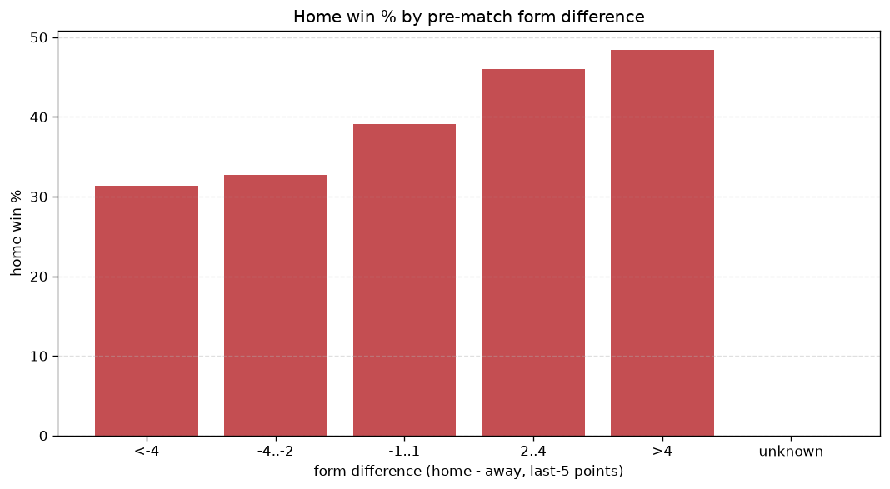
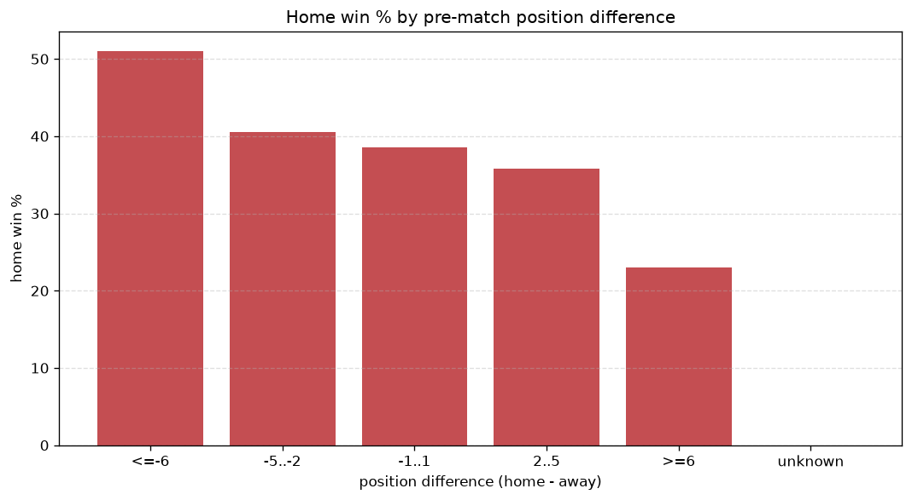

# Relationships Analysis
- Report: `relationships`
- Generated: 2026-10-30T03:59:18+00:00
- Script: `backend/scripts/analyze_relationships.py` v1.0.0
- League: Serie C - Group A (Italy)
- Scope: league `italy3a`

- Matches analysed: **2280** (23 leakage-safe pre-match features).

## 1. Correlation matrix
_Pearson correlation of each pre-match feature with observed goals; sorted by |corr(total goals)|._

| feature | corr(home) | corr(away) | corr(total) |
|---|---|---|---|
| home_team_points_last_5 | 0.034 | -0.095 | -0.039 |
| home_team_goals_conceded_last_5 | -0.026 | 0.083 | 0.036 |
| home_team_wins_last_5 | 0.037 | -0.086 | -0.030 |
| away_points_before_match | -0.064 | 0.029 | -0.029 |
| points_difference | 0.153 | -0.131 | 0.028 |
| position_difference | -0.145 | 0.133 | -0.021 |
| away_position_before_match | 0.096 | -0.078 | 0.021 |
| home_rest_days | 0.005 | 0.024 | 0.020 |
| away_rest_days | 0.015 | 0.010 | 0.018 |
| away_team_points_last_5 | -0.081 | 0.065 | -0.018 |
| away_team_away_win_rate | -0.082 | 0.068 | -0.017 |
| away_team_goals_scored_last_5 | -0.033 | 0.019 | -0.013 |
| away_team_goals_conceded_last_5 | 0.068 | -0.095 | -0.013 |
| home_team_home_win_rate | 0.062 | -0.089 | -0.012 |
| away_team_wins_last_5 | -0.073 | 0.066 | -0.011 |
| home_team_home_goals_avg | 0.052 | -0.042 | 0.011 |
| home_points_before_match | 0.045 | -0.065 | -0.009 |
| home_position_before_match | -0.104 | 0.105 | -0.008 |
| home_team_goals_scored_last_5 | 0.033 | -0.029 | 0.005 |
| away_team_away_goals_avg | -0.056 | 0.058 | -0.004 |
| home_team_home_conceded_avg | -0.056 | 0.058 | -0.003 |
| rest_days_difference | -0.015 | 0.021 | 0.003 |
| away_team_away_conceded_avg | 0.055 | -0.058 | 0.003 |

## 2. Form vs outcome
_Home win/draw/away % per bucket of `home_team_points_last_5 - away_team_points_last_5`._

| bucket | matches | home | draw | away | home % | draw % | away % |
|---|---|---|---|---|---|---|---|
| <-4 | 347 | 109 | 100 | 138 | 31.4% | 28.8% | 39.8% |
| -4..-2 | 489 | 160 | 154 | 175 | 32.7% | 31.5% | 35.8% |
| -1..1 | 645 | 252 | 179 | 214 | 39.1% | 27.8% | 33.2% |
| 2..4 | 487 | 224 | 141 | 122 | 46.0% | 29.0% | 25.1% |
| >4 | 312 | 151 | 97 | 64 | 48.4% | 31.1% | 20.5% |
| unknown | 0 | 0 | 0 | 0 | - | - | - |

## 3. Position vs outcome
_Home win/draw/away % per bucket of `position_difference` (home position - away position; negative favours the home team)._

| bucket | matches | home | draw | away | home % | draw % | away % |
|---|---|---|---|---|---|---|---|
| <=-6 | 575 | 283 | 167 | 125 | 49.2% | 29.0% | 21.7% |
| -5..-2 | 413 | 181 | 109 | 123 | 43.8% | 26.4% | 29.8% |
| -1..1 | 307 | 122 | 107 | 78 | 39.7% | 34.9% | 25.4% |
| 2..5 | 374 | 130 | 117 | 127 | 34.8% | 31.3% | 34.0% |
| >=6 | 611 | 180 | 171 | 260 | 29.5% | 28.0% | 42.6% |
| unknown | 0 | 0 | 0 | 0 | - | - | - |

## 4. Rest advantage
_Home win/draw/away % per bucket of `rest_days_difference` (home rest - away rest). Matches with unknown rest are bucketed separately._

| bucket | matches | home | draw | away | home % | draw % | away % |
|---|---|---|---|---|---|---|---|
| <-1 | 127 | 49 | 38 | 40 | 38.6% | 29.9% | 31.5% |
| -1..0 | 324 | 132 | 93 | 99 | 40.7% | 28.7% | 30.6% |
| 0 | 1311 | 520 | 396 | 395 | 39.7% | 30.2% | 30.1% |
| 1..2 | 370 | 136 | 108 | 126 | 36.8% | 29.2% | 34.1% |
| >2 | 88 | 37 | 19 | 32 | 42.0% | 21.6% | 36.4% |
| unknown | 60 | 22 | 17 | 21 | 36.7% | 28.3% | 35.0% |
- *60 match(es) had unknown rest difference (missing rest data on at least one side).*

## 5. Home team quality
_Home win rate by `home_team_home_win_rate` tier (split at 0.5)._

- `< 0.5` tier: **35.9%** home win (564/1569)
- `>= 0.5` tier: **46.7%** home win (332/711)
- Home-win gap (>= split minus < split): **+10.8 pp**

| tier | label | matches | home | draw | away | home % |
|---|---|---|---|---|---|---|
| low | < 0.5 | 1569 | 564 | 484 | 521 | 35.9% |
| high | >= 0.5 | 711 | 332 | 187 | 192 | 46.7% |

## 6. Feature averages by result
_Mean feature value per outcome; `range` is home-minus-away spread of the group means._

| feature | home mean | draw mean | away mean | range |
|---|---|---|---|---|
| points_difference | 2.507 | -0.189 | -3.412 | 5.919 |
| home_points_before_match | 26.752 | 24.800 | 22.933 | 3.820 |
| position_difference | -1.542 | 0.088 | 2.233 | 3.775 |
| away_points_before_match | 24.246 | 24.990 | 26.345 | 2.099 |
| home_position_before_match | 9.689 | 11.031 | 11.640 | 1.951 |
| away_position_before_match | 11.231 | 10.943 | 9.407 | 1.824 |
| away_team_goals_conceded_last_5 | 5.525 | 5.259 | 4.628 | 0.896 |
| away_team_points_last_5 | 5.938 | 6.148 | 6.826 | 0.889 |
| home_team_points_last_5 | 6.564 | 6.033 | 5.823 | 0.740 |
| home_team_goals_conceded_last_5 | 5.042 | 5.261 | 5.533 | 0.491 |
| home_team_goals_scored_last_5 | 5.377 | 5.079 | 5.025 | 0.352 |
| away_rest_days | 6.280 | 6.560 | 6.234 | 0.326 |
| away_team_wins_last_5 | 1.522 | 1.599 | 1.816 | 0.294 |
| away_team_goals_scored_last_5 | 5.186 | 5.142 | 5.422 | 0.281 |
| home_team_wins_last_5 | 1.728 | 1.551 | 1.499 | 0.228 |
| home_rest_days | 6.285 | 6.505 | 6.344 | 0.220 |
| rest_days_difference | 0.005 | -0.055 | 0.110 | 0.165 |
| away_team_away_conceded_avg | 1.234 | 1.207 | 1.117 | 0.117 |
| home_team_home_conceded_avg | 0.962 | 1.026 | 1.064 | 0.102 |
| home_team_home_goals_avg | 1.245 | 1.146 | 1.149 | 0.099 |
| away_team_away_goals_avg | 0.978 | 0.996 | 1.073 | 0.095 |
| home_team_home_win_rate | 0.403 | 0.351 | 0.340 | 0.063 |
| away_team_away_win_rate | 0.281 | 0.291 | 0.339 | 0.059 |

---
*All features are leakage-safe pre-match values built by `ml.features.build_features.build_rows` from strictly prior matches. Run with `python backend/scripts/analyze_relationships.py` to regenerate.*

## Charts

