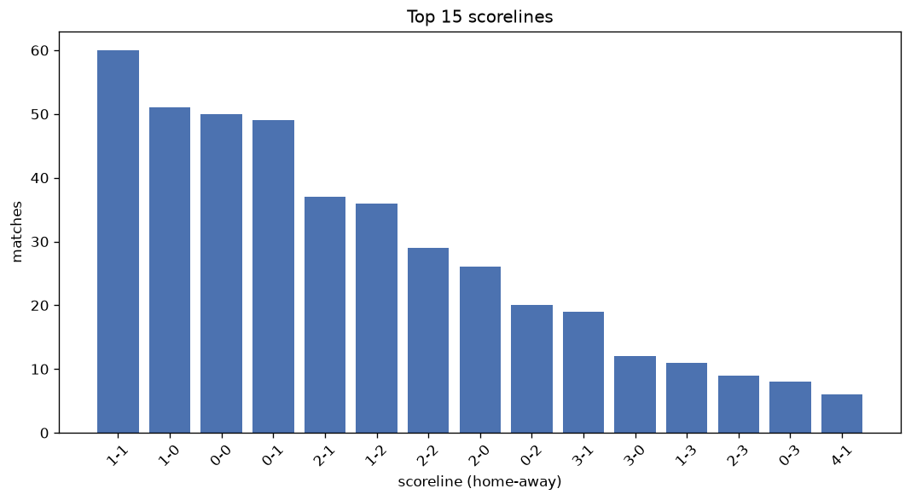
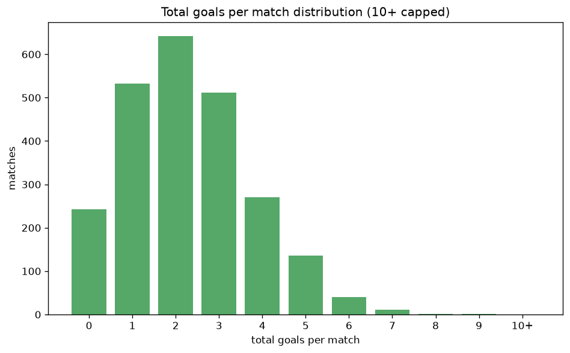

# Scoreline Analysis
- Report: `scoreline_analysis`
- Generated: 2026-10-29T02:05:43+00:00
- Script: `backend/scripts/analyze_scorelines.py` v1.0.0
- League: Serie C - Group A (Italy)
- Scope: league `italy3a`

## 1. Scoreline frequency
- Matches analysed: **2390** across **7** seasons.
- Distinct scorelines seen: **35**.

| scoreline | count | pct |
|---|---|---|
| 1-1 | 342 | 14.3% |
| 1-0 | 291 | 12.2% |
| 0-0 | 242 | 10.1% |
| 0-1 | 242 | 10.1% |
| 2-1 | 211 | 8.8% |
| 1-2 | 183 | 7.7% |
| 2-0 | 162 | 6.8% |
| 0-2 | 138 | 5.8% |
| 2-2 | 111 | 4.6% |
| 3-1 | 82 | 3.4% |
| 3-0 | 67 | 2.8% |
| 0-3 | 51 | 2.1% |
| 1-3 | 49 | 2.1% |
| 2-3 | 44 | 1.8% |
| 3-2 | 33 | 1.4% |
| 4-1 | 30 | 1.3% |
| 4-0 | 22 | 0.9% |
| 3-3 | 15 | 0.6% |
| 1-4 | 14 | 0.6% |
| 5-0 | 11 | 0.5% |

## 2. Scoreline frequency per season

### 2020-2021
| scoreline | count | pct |
|---|---|---|
| 1-0 | 52 | 13.7% |
| 1-1 | 48 | 12.6% |
| 0-0 | 43 | 11.3% |
| 0-1 | 35 | 9.2% |
| 1-2 | 35 | 9.2% |

### 2021-2022
| scoreline | count | pct |
|---|---|---|
| 1-1 | 64 | 16.8% |
| 1-0 | 54 | 14.2% |
| 0-0 | 38 | 10.0% |
| 0-1 | 37 | 9.7% |
| 2-1 | 34 | 8.9% |

### 2022-2023
| scoreline | count | pct |
|---|---|---|
| 1-1 | 58 | 15.3% |
| 0-1 | 43 | 11.3% |
| 1-0 | 40 | 10.5% |
| 2-1 | 39 | 10.3% |
| 0-0 | 34 | 8.9% |

### 2023-2024
| scoreline | count | pct |
|---|---|---|
| 1-1 | 59 | 15.5% |
| 0-1 | 43 | 11.3% |
| 0-0 | 42 | 11.1% |
| 1-0 | 34 | 8.9% |
| 2-0 | 33 | 8.7% |

### 2024-2025
| scoreline | count | pct |
|---|---|---|
| 1-0 | 58 | 15.3% |
| 1-1 | 51 | 13.4% |
| 0-1 | 34 | 8.9% |
| 0-0 | 32 | 8.4% |
| 2-1 | 30 | 7.9% |

### 2025-2026
| scoreline | count | pct |
|---|---|---|
| 1-1 | 53 | 13.9% |
| 1-0 | 43 | 11.3% |
| 0-1 | 43 | 11.3% |
| 0-0 | 37 | 9.7% |
| 2-1 | 33 | 8.7% |

### 2026-2027
| scoreline | count | pct |
|---|---|---|
| 0-0 | 16 | 14.5% |
| 1-2 | 14 | 12.7% |
| 2-1 | 13 | 11.8% |
| 2-2 | 13 | 11.8% |
| 1-0 | 10 | 9.1% |

## 3. Total-goal histogram
_10+ groups all matches with 10 or more total goals._

| total goals | matches | pct |
|---|---|---|
| 0 | 242 | 10.1% |
| 1 | 533 | 22.3% |
| 2 | 642 | 26.9% |
| 3 | 512 | 21.4% |
| 4 | 271 | 11.3% |
| 5 | 136 | 5.7% |
| 6 | 40 | 1.7% |
| 7 | 11 | 0.5% |
| 8 | 2 | 0.1% |
| 9 | 1 | 0.0% |
| 10+ | 0 | 0.0% |

## 4. Extreme scorelines
- Matches with 7+ total goals: **14**

| season | date | scoreline | total goals |
|---|---|---|---|
| 2020-2021 | 2020-11-25 | 4-5 | 9 |
| 2022-2023 | 2023-02-19 | 2-6 | 8 |
| 2026-2027 | 2026-09-20 | 3-5 | 8 |
| 2020-2021 | 2020-12-20 | 3-4 | 7 |
| 2020-2021 | 2021-03-17 | 4-3 | 7 |
| 2020-2021 | 2021-03-28 | 5-2 | 7 |
| 2022-2023 | 2022-09-03 | 6-1 | 7 |
| 2022-2023 | 2022-11-19 | 3-4 | 7 |
| 2023-2024 | 2023-09-04 | 5-2 | 7 |
| 2023-2024 | 2024-04-20 | 4-3 | 7 |
| 2024-2025 | 2024-12-14 | 5-2 | 7 |
| 2024-2025 | 2025-02-17 | 5-2 | 7 |
| 2025-2026 | 2025-12-14 | 5-2 | 7 |
| 2025-2026 | 2026-04-25 | 1-6 | 7 |

## 5. Margin-of-victory distribution (decided matches)
- Decided matches: **1680** (draws: **710**)
- Average winning margin: **1.59**

| margin | matches | pct |
|---|---|---|
| 1 | 1009 | 60.1% |
| 2 | 441 | 26.2% |
| 3+ | 230 | 13.7% |

## 6. Margin by outcome

### Home wins
- Matches: **935** | avg margin: **1.65** | max margin: **6**
| margin | matches | pct |
|---|---|---|
| 1 | 537 | 57.4% |
| 2 | 250 | 26.7% |
| 3+ | 148 | 15.8% |
- *Full match-by-match list available in `scoreline_analysis.json`.*

### Away wins
- Matches: **745** | avg margin: **1.51** | max margin: **5**
| margin | matches | pct |
|---|---|---|
| 1 | 472 | 63.4% |
| 2 | 191 | 25.6% |
| 3+ | 82 | 11.0% |
- *Full match-by-match list available in `scoreline_analysis.json`.*

## 7. Most common exact score by outcome type
| outcome | matches | most common score | count | pct |
|---|---|---|---|---|
| home | 935 | 1-0 | 291 | 31.1% |
| draw | 710 | 1-1 | 342 | 48.2% |
| away | 745 | 0-1 | 242 | 32.5% |

---
*All statistics are computed from PostgreSQL tables (read-only). Run with `python backend/scripts/analyze_scorelines.py` to regenerate.*

## Charts

