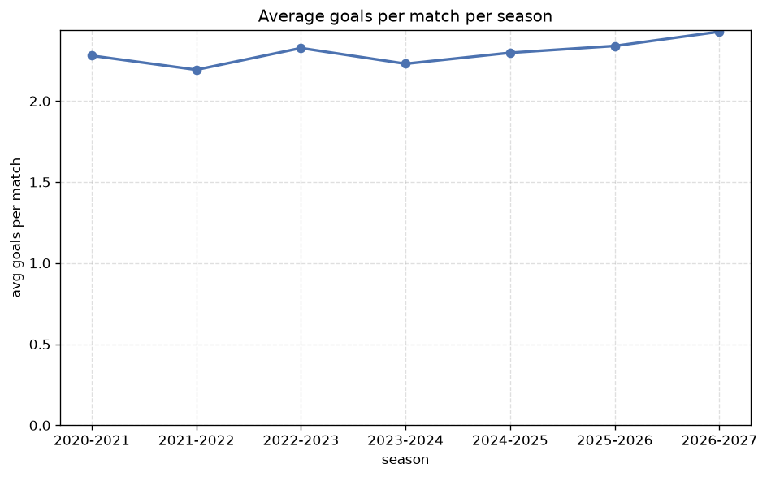

# Season Trends Analysis
- Report: `season_trends`
- Generated: 2026-10-30T03:59:14+00:00
- Script: `backend/scripts/analyze_seasons.py` v1.0.0
- League: Serie C - Group A (Italy)
- Scope: league `italy3a`

## 1. Champions per season
| season | champion | pts | runner-up | margin |
|---|---|---|---|---|
| 2020-2021 | Como | 75 | Alessandria | 7 pts |
| 2021-2022 | Sudtirol | 90 | Padova | 5 pts |
| 2022-2023 | FeralpiSalo | 71 | Pordenone | 9 pts |
| 2023-2024 | Mantova | 80 | Padova | 3 pts |
| 2024-2025 | Padova | 86 | L.R. Vicenza | 3 pts |
| 2025-2026 | L.R. Vicenza | 89 | Brescia | 20 pts |
| 2026-2027 | Cittadella | 27 | Trento | 4 pts |

## 2. Title-race tightness
- Tight races (margin <= 3 pts): **2** of 7 seasons
- Tightest race: **2023-2024** - Mantova beat Padova by **3** pts

| season | margin | tight |
|---|---|---|
| 2020-2021 | 7 pts |  |
| 2021-2022 | 5 pts |  |
| 2022-2023 | 9 pts |  |
| 2023-2024 | 3 pts | yes |
| 2024-2025 | 3 pts | yes |
| 2025-2026 | 20 pts |  |
| 2026-2027 | 4 pts |  |

## 3. Points thresholds
_Position-specific points per season. Key: 1 = champion, 2 = runner-up, 4 = CL line, 6 = Europa, 17 = last safe, 20 = bottom._

| season | pos 1 | pos 2 | pos 4 | pos 6 | pos 17 | pos 20 |
|---|---|---|---|---|---|---|
| 2020-2021 | 75 | 68 | 63 | 60 | 43 | 31 |
| 2021-2022 | 90 | 85 | 62 | 55 | 38 | 30 |
| 2022-2023 | 71 | 62 | 60 | 58 | 42 | 38 |
| 2023-2024 | 80 | 77 | 64 | 56 | 43 | 23 |
| 2024-2025 | 86 | 83 | 60 | 57 | 37 | 21 |
| 2025-2026 | 89 | 69 | 64 | 59 | 40 | 23 |
| 2026-2027 | 27 | 23 | 20 | 18 | 10 | 5 |

## 4. Relegation battle
| season | safe pos | safe pts | drop pos | drop pts | gap |
|---|---|---|---|---|---|
| 2020-2021 | 17 | 43 | 18 | 34 | 9 pts |
| 2021-2022 | 17 | 38 | 18 | 34 | 4 pts |
| 2022-2023 | 17 | 42 | 18 | 39 | 3 pts |
| 2023-2024 | 17 | 43 | 18 | 38 | 5 pts |
| 2024-2025 | 17 | 37 | 18 | 34 | 3 pts |
| 2025-2026 | 17 | 40 | 18 | 36 | 4 pts |
| 2026-2027 | 17 | 10 | 18 | 10 | 0 pts |

## 5. League-level trends
| season | matches | total goals | avg goals | home win | draw | away win | goalless | avg pts/team |
|---|---|---|---|---|---|---|---|---|
| 2020-2021 | 380 | 866 | 2.279 | 39.5% | 30.0% | 30.5% | 11.3% | 51.3 |
| 2021-2022 | 380 | 833 | 2.192 | 38.2% | 31.6% | 30.3% | 10.0% | 51.0 |
| 2022-2023 | 380 | 884 | 2.326 | 39.5% | 28.4% | 32.1% | 8.9% | 51.6 |
| 2023-2024 | 380 | 847 | 2.229 | 37.1% | 29.5% | 33.4% | 11.1% | 51.4 |
| 2024-2025 | 380 | 873 | 2.297 | 43.7% | 26.8% | 29.5% | 8.4% | 51.9 |
| 2025-2026 | 380 | 889 | 2.339 | 37.9% | 30.3% | 31.8% | 9.7% | 51.25 |
| 2026-2027 | 110 | 267 | 2.427 | 35.5% | 35.5% | 29.1% | 14.5% | 14.55 |

## 6. View divergence
- Largest divergence: **2025-2026** (goals view, avg abs position diff = 8.100)

_Avg absolute position difference between classic view and alternative view per season._

| season | classic vs luck | classic vs goals |
|---|---|---|
| 2020-2021 | 2.900 | 6.900 |
| 2021-2022 | 1.600 | 4.900 |
| 2022-2023 | 4.200 | 6.900 |
| 2023-2024 | 2.700 | 4.900 |
| 2024-2025 | 2.800 | 6.900 |
| 2025-2026 | 2.600 | 8.100 |
| 2026-2027 | 1.800 | 7.600 |

---
*All statistics are computed from PostgreSQL tables (read-only). Run with `python backend/scripts/analyze_seasons.py` to regenerate.*

## Charts

