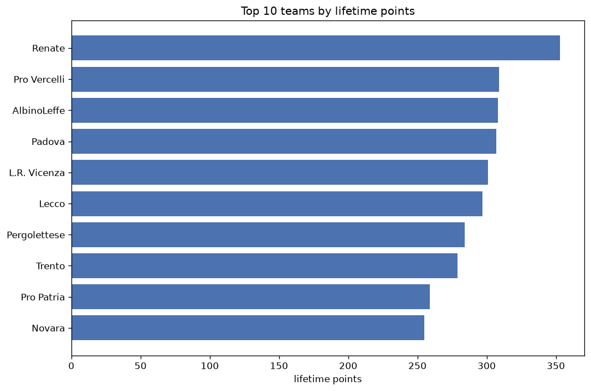
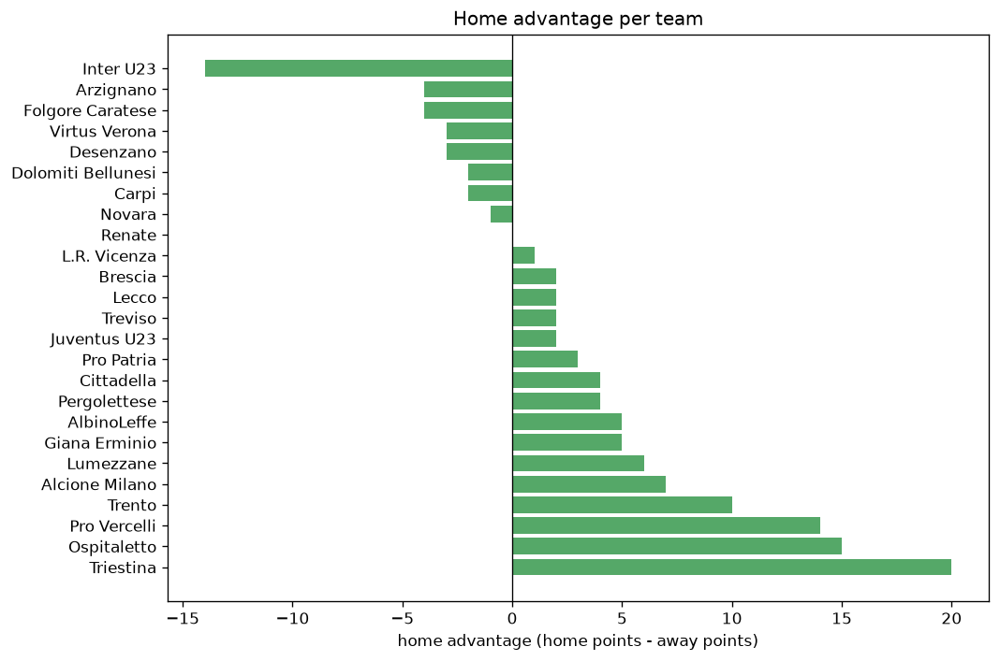

# Team Analysis
- Report: `teams_analysis`
- Generated: 2026-10-29T02:05:40+00:00
- Script: `backend/scripts/analyze_teams.py` v1.0.0
- League: Serie C - Group A (Italy)
- Scope: league `italy3a`

- Teams: **48** | Seasons: **7** | Matches: **2390**

## 1. Team standings (lifetime)
| team | seasons | played | W | D | L | pts | GF | GA | GD | avg pts/season | best pos | worst pos | titles |
|---|---|---|---|---|---|---|---|---|---|---|---|---|---|
| Renate | 7 | 239 | 97 | 63 | 79 | 354 | 287 | 269 | 18 | 50.57 | 3 | 20 | 0 |
| Pro Vercelli | 7 | 239 | 82 | 66 | 91 | 312 | 256 | 294 | -38 | 44.57 | 4 | 17 | 0 |
| AlbinoLeffe | 7 | 239 | 75 | 84 | 80 | 309 | 275 | 272 | 3 | 44.14 | 4 | 19 | 0 |
| Padova | 4 | 152 | 87 | 46 | 19 | 307 | 227 | 118 | 109 | 76.75 | 1 | 5 | 1 |
| L.R. Vicenza | 4 | 152 | 89 | 34 | 29 | 301 | 244 | 127 | 117 | 75.25 | 1 | 6 | 1 |
| Lecco | 6 | 201 | 80 | 58 | 63 | 298 | 243 | 210 | 33 | 49.67 | 3 | 14 | 0 |
| Pergolettese | 7 | 239 | 76 | 59 | 104 | 287 | 257 | 307 | -50 | 41.0 | 7 | 16 | 0 |
| Trento | 6 | 201 | 70 | 72 | 59 | 282 | 227 | 205 | 22 | 47.0 | 2 | 16 | 0 |
| Pro Patria | 6 | 228 | 61 | 76 | 91 | 259 | 215 | 281 | -66 | 43.17 | 5 | 20 | 0 |
| Novara | 6 | 201 | 60 | 75 | 66 | 255 | 227 | 237 | -10 | 42.5 | 10 | 17 | 0 |
| Giana Erminio | 6 | 201 | 64 | 59 | 78 | 251 | 201 | 222 | -21 | 41.83 | 8 | 19 | 0 |
| Triestina | 5 | 190 | 64 | 46 | 80 | 238 | 218 | 234 | -16 | 47.6 | 4 | 18 | 0 |
| Virtus Verona | 5 | 190 | 54 | 69 | 67 | 231 | 202 | 216 | -14 | 46.2 | 7 | 19 | 0 |
| Arzignano | 5 | 163 | 59 | 46 | 58 | 223 | 186 | 180 | 6 | 44.6 | 4 | 16 | 0 |
| FeralpiSalo | 3 | 114 | 61 | 29 | 24 | 212 | 150 | 80 | 70 | 70.67 | 1 | 3 | 1 |
| Pro Sesto | 4 | 152 | 41 | 53 | 58 | 176 | 135 | 176 | -41 | 44.0 | 4 | 19 | 0 |
| Mantova | 3 | 114 | 45 | 32 | 37 | 167 | 157 | 135 | 22 | 55.67 | 1 | 16 | 1 |
| Juventus U23 | 4 | 125 | 44 | 33 | 48 | 165 | 148 | 159 | -11 | 41.25 | 8 | 18 | 0 |
| Lumezzane | 4 | 125 | 41 | 40 | 44 | 163 | 147 | 158 | -11 | 40.75 | 7 | 16 | 0 |
| Piacenza | 3 | 114 | 32 | 41 | 41 | 137 | 133 | 153 | -20 | 45.67 | 9 | 20 | 0 |
| Alcione Milano | 3 | 87 | 31 | 24 | 32 | 117 | 86 | 82 | 4 | 39.0 | 8 | 12 | 0 |
| Atalanta U23 | 2 | 76 | 32 | 20 | 24 | 116 | 108 | 89 | 19 | 58.0 | 5 | 6 | 0 |
| Brescia | 2 | 49 | 25 | 16 | 8 | 91 | 68 | 33 | 35 | 45.5 | 2 | 3 | 0 |
| Alessandria | 2 | 76 | 25 | 16 | 35 | 91 | 68 | 77 | -9 | 45.5 | 2 | 20 | 0 |
| Sudtirol | 1 | 38 | 27 | 9 | 2 | 90 | 49 | 9 | 40 | 90.0 | 1 | 1 | 1 |
| Cittadella | 2 | 49 | 26 | 8 | 15 | 86 | 63 | 49 | 14 | 43.0 | 1 | 6 | 1 |
| Legnago Salus | 2 | 76 | 20 | 26 | 30 | 86 | 78 | 104 | -26 | 43.0 | 6 | 20 | 0 |
| Fiorenzuola | 2 | 76 | 21 | 18 | 37 | 81 | 71 | 110 | -39 | 40.5 | 14 | 18 | 0 |
| Como | 1 | 38 | 23 | 6 | 9 | 75 | 59 | 44 | 15 | 75.0 | 1 | 1 | 1 |
| Ospitaletto | 2 | 49 | 15 | 18 | 16 | 63 | 59 | 54 | 5 | 31.5 | 6 | 15 | 0 |
| Pordenone | 1 | 38 | 16 | 14 | 8 | 62 | 53 | 35 | 18 | 62.0 | 2 | 2 | 0 |
| Pontedera | 1 | 38 | 14 | 13 | 11 | 55 | 47 | 40 | 7 | 55.0 | 8 | 8 | 0 |
| Grosseto | 1 | 38 | 14 | 12 | 12 | 54 | 43 | 41 | 2 | 54.0 | 9 | 9 | 0 |
| Dolomiti Bellunesi | 2 | 49 | 12 | 14 | 23 | 50 | 46 | 75 | -29 | 25.0 | 17 | 17 | 0 |
| Inter U23 | 1 | 38 | 12 | 12 | 14 | 48 | 40 | 41 | -1 | 48.0 | 12 | 12 | 0 |
| Olbia | 1 | 38 | 10 | 17 | 11 | 47 | 47 | 47 | 0 | 47.0 | 13 | 13 | 0 |
| Carrarese | 1 | 38 | 11 | 11 | 16 | 44 | 34 | 40 | -6 | 44.0 | 14 | 14 | 0 |
| Sangiuliano City | 1 | 38 | 12 | 6 | 20 | 42 | 38 | 46 | -8 | 42.0 | 17 | 17 | 0 |
| Livorno | 1 | 38 | 7 | 13 | 18 | 34 | 41 | 53 | -12 | 34.0 | 18 | 18 | 0 |
| Seregno | 1 | 38 | 7 | 13 | 18 | 34 | 41 | 55 | -14 | 34.0 | 18 | 18 | 0 |
| Caldiero Terme | 1 | 38 | 8 | 9 | 21 | 33 | 39 | 64 | -25 | 33.0 | 19 | 19 | 0 |
| Lucchese | 1 | 38 | 6 | 13 | 19 | 31 | 36 | 60 | -24 | 31.0 | 19 | 19 | 0 |
| Pistoiese | 1 | 38 | 8 | 7 | 23 | 31 | 27 | 52 | -25 | 31.0 | 20 | 20 | 0 |
| Union Clodiense | 1 | 38 | 4 | 9 | 25 | 21 | 34 | 67 | -33 | 21.0 | 20 | 20 | 0 |
| Treviso | 1 | 11 | 5 | 4 | 2 | 19 | 12 | 8 | 4 | 19.0 | 5 | 5 | 0 |
| Desenzano | 1 | 11 | 3 | 4 | 4 | 13 | 10 | 13 | -3 | 13.0 | 11 | 11 | 0 |
| Carpi | 1 | 11 | 3 | 3 | 5 | 12 | 16 | 21 | -5 | 12.0 | 13 | 13 | 0 |
| Folgore Caratese | 1 | 11 | 1 | 4 | 6 | 7 | 11 | 17 | -6 | 7.0 | 19 | 19 | 0 |

## 2. Home vs away split
| team | home P | H-W | H-D | H-L | H-pts | away P | A-W | A-D | A-L | A-pts | adv |
|---|---|---|---|---|---|---|---|---|---|---|---|
| Lecco | 101 | 53 | 30 | 18 | 189 | 100 | 27 | 28 | 45 | 109 | 80 |
| Pro Vercelli | 120 | 50 | 31 | 39 | 181 | 119 | 32 | 35 | 52 | 131 | 50 |
| Juventus U23 | 62 | 30 | 15 | 17 | 105 | 63 | 14 | 18 | 31 | 60 | 45 |
| L.R. Vicenza | 76 | 52 | 14 | 10 | 170 | 76 | 37 | 20 | 19 | 131 | 39 |
| Novara | 100 | 37 | 34 | 29 | 145 | 101 | 23 | 41 | 37 | 110 | 35 |
| Mantova | 57 | 28 | 16 | 13 | 100 | 57 | 17 | 16 | 24 | 67 | 33 |
| Pergolettese | 119 | 44 | 27 | 48 | 159 | 120 | 32 | 32 | 56 | 128 | 31 |
| Trento | 101 | 39 | 39 | 23 | 156 | 100 | 31 | 33 | 36 | 126 | 30 |
| FeralpiSalo | 57 | 36 | 13 | 8 | 121 | 57 | 25 | 16 | 16 | 91 | 30 |
| Padova | 76 | 48 | 23 | 5 | 167 | 76 | 39 | 23 | 14 | 140 | 27 |
| Triestina | 95 | 35 | 26 | 34 | 131 | 95 | 29 | 20 | 46 | 107 | 24 |
| Pistoiese | 19 | 7 | 5 | 7 | 26 | 19 | 1 | 2 | 16 | 5 | 21 |
| Giana Erminio | 100 | 35 | 30 | 35 | 135 | 101 | 29 | 29 | 43 | 116 | 19 |
| Atalanta U23 | 38 | 19 | 9 | 10 | 66 | 38 | 13 | 11 | 14 | 50 | 16 |
| Lumezzane | 62 | 24 | 17 | 21 | 89 | 63 | 17 | 23 | 23 | 74 | 15 |
| Piacenza | 57 | 18 | 21 | 18 | 75 | 57 | 14 | 20 | 23 | 62 | 13 |
| Ospitaletto | 25 | 10 | 8 | 7 | 38 | 24 | 5 | 10 | 9 | 25 | 13 |
| Renate | 120 | 53 | 24 | 43 | 183 | 119 | 44 | 39 | 36 | 171 | 12 |
| Pro Patria | 114 | 30 | 45 | 39 | 135 | 114 | 31 | 31 | 52 | 124 | 11 |
| Arzignano | 82 | 30 | 27 | 25 | 117 | 81 | 29 | 19 | 33 | 106 | 11 |
| Fiorenzuola | 38 | 12 | 10 | 16 | 46 | 38 | 9 | 8 | 21 | 35 | 11 |
| Sangiuliano City | 19 | 8 | 2 | 9 | 26 | 19 | 4 | 4 | 11 | 16 | 10 |
| Livorno | 19 | 5 | 6 | 8 | 21 | 19 | 2 | 7 | 10 | 13 | 8 |
| Alcione Milano | 44 | 17 | 11 | 16 | 62 | 43 | 14 | 13 | 16 | 55 | 7 |
| Alessandria | 38 | 14 | 7 | 17 | 49 | 38 | 11 | 9 | 18 | 42 | 7 |
| Brescia | 25 | 14 | 7 | 4 | 49 | 24 | 11 | 9 | 4 | 42 | 7 |
| Pontedera | 19 | 8 | 7 | 4 | 31 | 19 | 6 | 6 | 7 | 24 | 7 |
| Olbia | 19 | 7 | 6 | 6 | 27 | 19 | 3 | 11 | 5 | 20 | 7 |
| Caldiero Terme | 19 | 5 | 5 | 9 | 20 | 19 | 3 | 4 | 12 | 13 | 7 |
| Union Clodiense | 19 | 3 | 5 | 11 | 14 | 19 | 1 | 4 | 14 | 7 | 7 |
| Pordenone | 19 | 9 | 7 | 3 | 34 | 19 | 7 | 7 | 5 | 28 | 6 |
| Como | 19 | 12 | 4 | 3 | 40 | 19 | 11 | 2 | 6 | 35 | 5 |
| Lucchese | 19 | 4 | 6 | 9 | 18 | 19 | 2 | 7 | 10 | 13 | 5 |
| Sudtirol | 19 | 14 | 5 | 0 | 47 | 19 | 13 | 4 | 2 | 43 | 4 |
| Cittadella | 25 | 13 | 6 | 6 | 45 | 24 | 13 | 2 | 9 | 41 | 4 |
| Treviso | 6 | 3 | 2 | 1 | 11 | 5 | 2 | 2 | 1 | 8 | 3 |
| Carrarese | 19 | 6 | 4 | 9 | 22 | 19 | 5 | 7 | 7 | 22 | 0 |
| Grosseto | 19 | 7 | 5 | 7 | 26 | 19 | 7 | 7 | 5 | 28 | -2 |
| Dolomiti Bellunesi | 24 | 6 | 6 | 12 | 24 | 25 | 6 | 8 | 11 | 26 | -2 |
| Carpi | 5 | 1 | 2 | 2 | 5 | 6 | 2 | 1 | 3 | 7 | -2 |
| Desenzano | 5 | 1 | 2 | 2 | 5 | 6 | 2 | 2 | 2 | 8 | -3 |
| Folgore Caratese | 5 | 0 | 1 | 4 | 1 | 6 | 1 | 3 | 2 | 6 | -5 |
| Legnago Salus | 38 | 9 | 13 | 16 | 40 | 38 | 11 | 13 | 14 | 46 | -6 |
| Seregno | 19 | 3 | 5 | 11 | 14 | 19 | 4 | 8 | 7 | 20 | -6 |
| Virtus Verona | 95 | 24 | 38 | 33 | 110 | 95 | 30 | 31 | 34 | 121 | -11 |
| Pro Sesto | 76 | 17 | 30 | 29 | 81 | 76 | 24 | 23 | 29 | 95 | -14 |
| Inter U23 | 19 | 3 | 8 | 8 | 17 | 19 | 9 | 4 | 6 | 31 | -14 |
| AlbinoLeffe | 119 | 32 | 46 | 41 | 142 | 120 | 43 | 38 | 39 | 167 | -25 |

## 3. Top performers
### Best points per game (PPG)
| rank | team | PPG |
|---|---|---|
| 1 | Sudtirol | 2.37 |
| 2 | Padova | 2.02 |
| 3 | L.R. Vicenza | 1.98 |
| 4 | Como | 1.97 |
| 5 | FeralpiSalo | 1.86 |

### Most goals scored
| rank | team | goals |
|---|---|---|
| 1 | Renate | 287 |
| 2 | AlbinoLeffe | 275 |
| 3 | Pergolettese | 257 |
| 4 | Pro Vercelli | 256 |
| 5 | L.R. Vicenza | 244 |

### Best goal difference
| rank | team | GD |
|---|---|---|
| 1 | L.R. Vicenza | 117 |
| 2 | Padova | 109 |
| 3 | FeralpiSalo | 70 |
| 4 | Sudtirol | 40 |
| 5 | Brescia | 35 |

### Best defence (goals against per match, standings)
| rank | team | GA/match |
|---|---|---|
| 1 | Sudtirol | 0.237 |
| 2 | Brescia | 0.673 |
| 3 | FeralpiSalo | 0.702 |
| 4 | Treviso | 0.727 |
| 5 | Padova | 0.776 |

## 4. Team consistency
- Teams present in all **7** seasons: **4**

AlbinoLeffe, Pergolettese, Pro Vercelli, Renate

## 5. Head-to-head dominance
- Distinct fixtures: **652** (showing the 15 most frequent)

| fixture | meetings | home wins | draws | away wins | home pct | draw pct | away pct |
|---|---|---|---|---|---|---|---|
| Renate vs AlbinoLeffe | 13 | 2 | 4 | 7 | 15.4% | 30.8% | 53.8% |
| Pro Vercelli vs Pergolettese | 12 | 9 | 2 | 1 | 75.0% | 16.7% | 8.3% |
| AlbinoLeffe vs Pergolettese | 12 | 8 | 3 | 1 | 66.7% | 25.0% | 8.3% |
| Pro Patria vs Pergolettese | 12 | 7 | 1 | 4 | 58.3% | 8.3% | 33.3% |
| Pro Vercelli vs AlbinoLeffe | 12 | 5 | 2 | 5 | 41.7% | 16.7% | 41.7% |
| Pro Vercelli vs Pro Patria | 12 | 5 | 5 | 2 | 41.7% | 41.7% | 16.7% |
| Renate vs Pergolettese | 12 | 5 | 2 | 5 | 41.7% | 16.7% | 41.7% |
| Renate vs Pro Patria | 12 | 5 | 2 | 5 | 41.7% | 16.7% | 41.7% |
| Renate vs Pro Vercelli | 12 | 5 | 5 | 2 | 41.7% | 41.7% | 16.7% |
| Pro Patria vs AlbinoLeffe | 12 | 1 | 5 | 6 | 8.3% | 41.7% | 50.0% |
| Lecco vs Pergolettese | 11 | 8 | 3 | 0 | 72.7% | 27.3% | 0.0% |
| Pro Vercelli vs Trento | 11 | 6 | 3 | 2 | 54.5% | 27.3% | 18.2% |
| Renate vs Giana Erminio | 11 | 6 | 2 | 3 | 54.5% | 18.2% | 27.3% |
| Renate vs Novara | 11 | 5 | 2 | 4 | 45.5% | 18.2% | 36.4% |
| Lecco vs Pro Vercelli | 11 | 4 | 3 | 4 | 36.4% | 27.3% | 36.4% |

## 6. Position per season (classic view)
_Cells show final position; '-' when the team was absent from that season._

| team | 2020-2021 | 2021-2022 | 2022-2023 | 2023-2024 | 2024-2025 | 2025-2026 | 2026-2027 |
|---|---|---|---|---|---|---|---|
| Renate | 3 | 4 | 9 | 15 | 5 | 3 | 20 |
| Pro Vercelli | 4 | 6 | 15 | 7 | 17 | 14 | 14 |
| AlbinoLeffe | 7 | 11 | 19 | 13 | 4 | 11 | 10 |
| Padova | - | 2 | 5 | 2 | 1 | - | - |
| L.R. Vicenza | - | - | 6 | 3 | 2 | 1 | - |
| Lecco | 6 | 5 | 3 | - | 14 | 4 | 9 |
| Pergolettese | 15 | 10 | 11 | 14 | 15 | 16 | 7 |
| Trento | - | 16 | 14 | 10 | 7 | 5 | 2 |
| Pro Patria | 5 | 13 | 12 | 12 | 18 | 20 | - |
| Novara | 11 | - | 10 | 17 | 10 | 13 | 16 |
| Giana Erminio | 16 | 19 | - | 8 | 8 | 10 | 15 |
| Triestina | - | 7 | 18 | 4 | 13 | 18 | - |
| Virtus Verona | - | 12 | 7 | 11 | 9 | 19 | - |
| Arzignano | - | - | 8 | 16 | 11 | 9 | 4 |
| FeralpiSalo | - | 3 | 1 | - | 3 | - | - |
| Pro Sesto | 17 | 17 | 4 | 19 | - | - | - |
| Mantova | - | 15 | 16 | 1 | - | - | - |
| Juventus U23 | 10 | 8 | 13 | - | - | - | 18 |
| Lumezzane | - | - | - | 9 | 16 | 7 | 12 |
| Piacenza | 12 | 9 | 20 | - | - | - | - |
| Alcione Milano | - | - | - | - | 12 | 8 | 8 |
| Atalanta U23 | - | - | - | 5 | 6 | - | - |
| Brescia | - | - | - | - | - | 2 | 3 |
| Alessandria | 2 | - | - | 20 | - | - | - |
| Sudtirol | - | 1 | - | - | - | - | - |
| Cittadella | - | - | - | - | - | 6 | 1 |
| Legnago Salus | - | 20 | - | 6 | - | - | - |
| Fiorenzuola | - | 14 | - | 18 | - | - | - |
| Como | 1 | - | - | - | - | - | - |
| Ospitaletto | - | - | - | - | - | 15 | 6 |
| Pordenone | - | - | 2 | - | - | - | - |
| Pontedera | 8 | - | - | - | - | - | - |
| Grosseto | 9 | - | - | - | - | - | - |
| Dolomiti Bellunesi | - | - | - | - | - | 17 | 17 |
| Inter U23 | - | - | - | - | - | 12 | - |
| Olbia | 13 | - | - | - | - | - | - |
| Carrarese | 14 | - | - | - | - | - | - |
| Sangiuliano City | - | - | 17 | - | - | - | - |
| Livorno | 18 | - | - | - | - | - | - |
| Seregno | - | 18 | - | - | - | - | - |
| Caldiero Terme | - | - | - | - | 19 | - | - |
| Lucchese | 19 | - | - | - | - | - | - |
| Pistoiese | 20 | - | - | - | - | - | - |
| Union Clodiense | - | - | - | - | 20 | - | - |
| Treviso | - | - | - | - | - | - | 5 |
| Desenzano | - | - | - | - | - | - | 11 |
| Carpi | - | - | - | - | - | - | 13 |
| Folgore Caratese | - | - | - | - | - | - | 19 |

---
*All statistics are computed from PostgreSQL tables (read-only). Run with `python backend/scripts/analyze_teams.py` to regenerate.*

## Charts

