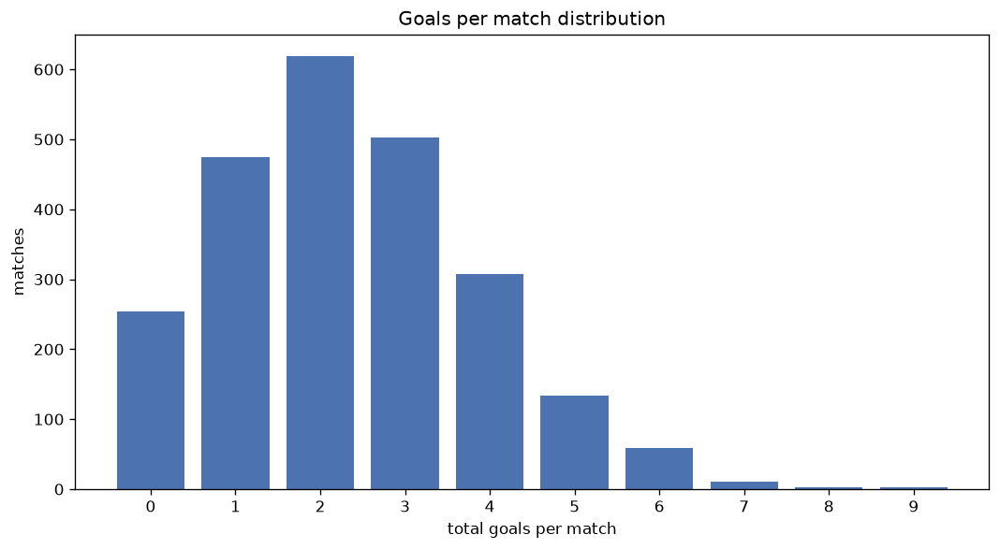
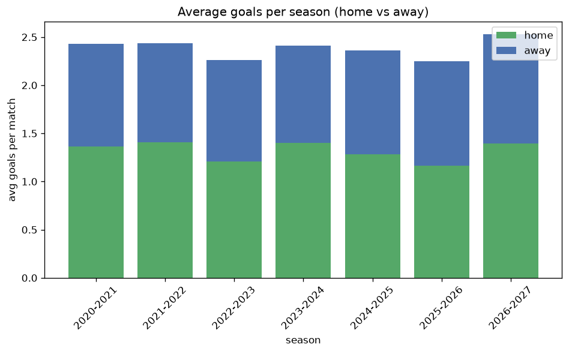

# Goal Analysis
- Report: `goals_analysis`
- Generated: 2026-10-30T03:59:32+00:00
- Script: `backend/scripts/analyze_goals.py` v1.0.0
- League: Serie C - Group B (Italy)
- Scope: league `italy3b`

## 1. Goals per match distribution
| goals | matches | pct |
|---|---|---|
| 0 | 254 | 10.7% |
| 1 | 475 | 20.1% |
| 2 | 619 | 26.1% |
| 3 | 502 | 21.2% |
| 4 | 308 | 13.0% |
| 5 | 134 | 5.7% |
| 6 | 59 | 2.5% |
| 7 | 11 | 0.5% |
| 8 | 3 | 0.1% |
| 9 | 3 | 0.1% |

## 2. Goals per match per season
| season | matches | total goals | avg home | avg away | avg total |
|---|---|---|---|---|---|
| 2020-2021 | 380 | 924 | 1.361 | 1.071 | 2.432 |
| 2021-2022 | 380 | 925 | 1.405 | 1.029 | 2.434 |
| 2022-2023 | 380 | 859 | 1.205 | 1.055 | 2.261 |
| 2023-2024 | 380 | 915 | 1.4 | 1.008 | 2.408 |
| 2024-2025 | 380 | 897 | 1.284 | 1.076 | 2.361 |
| 2025-2026 | 357 | 802 | 1.165 | 1.081 | 2.246 |
| 2026-2027 | 111 | 281 | 1.396 | 1.135 | 2.532 |

## 3. Home vs away goal share
- Home goals: **3100** (55.3%)
- Away goals: **2503** (44.7%)
- Home/away ratio: **1.239**

| season | home goals | away goals | total | home pct | away pct |
|---|---|---|---|---|---|
| 2020-2021 | 517 | 407 | 924 | 56.0% | 44.0% |
| 2021-2022 | 534 | 391 | 925 | 57.7% | 42.3% |
| 2022-2023 | 458 | 401 | 859 | 53.3% | 46.7% |
| 2023-2024 | 532 | 383 | 915 | 58.1% | 41.9% |
| 2024-2025 | 488 | 409 | 897 | 54.4% | 45.6% |
| 2025-2026 | 416 | 386 | 802 | 51.9% | 48.1% |
| 2026-2027 | 155 | 126 | 281 | 55.2% | 44.8% |

## 4. BTTS (Both Teams To Score)
- Overall: **1151** of `2368` (48.6%)

| season | matches | BTTS | pct |
|---|---|---|---|
| 2020-2021 | 380 | 183 | 48.2% |
| 2021-2022 | 380 | 185 | 48.7% |
| 2022-2023 | 380 | 179 | 47.1% |
| 2023-2024 | 380 | 180 | 47.4% |
| 2024-2025 | 380 | 191 | 50.3% |
| 2025-2026 | 357 | 173 | 48.5% |
| 2026-2027 | 111 | 60 | 54.1% |

## 5. Clean sheets
- Home clean sheets: **820** (34.6%)
- Away clean sheets: **651** (27.5%)
- Total clean sheets recorded: **1471**
- Matches with at least one clean sheet: **1217** (51.4%)
- Both teams kept clean sheets (0-0): **254**

| season | matches | home CS | away CS | total CS | matches w/ CS |
|---|---|---|---|---|---|
| 2020-2021 | 380 | 126 | 111 | 237 | 197 (51.8%) |
| 2021-2022 | 380 | 143 | 101 | 244 | 195 (51.3%) |
| 2022-2023 | 380 | 128 | 116 | 244 | 201 (52.9%) |
| 2023-2024 | 380 | 151 | 85 | 236 | 200 (52.6%) |
| 2024-2025 | 380 | 119 | 112 | 231 | 189 (49.7%) |
| 2025-2026 | 357 | 115 | 104 | 219 | 184 (51.5%) |
| 2026-2027 | 111 | 38 | 22 | 60 | 51 (45.9%) |

## 6. Scoring intensity
- First-half goals: **2537** (45.3%)
- Second-half goals: **3058** (54.7%)
- Avg first-half goals per match: **1.073**
- Avg second-half goals per match: **1.293**
- Second-half-only scoring (HT 0-0, FT goals >= 1): **573** (24.2%)
- *3 match(es) excluded (no HT score recorded).*

| season | matches | 1st half | 2nd half | 1st half pct | 2nd half pct |
|---|---|---|---|---|---|
| 2020-2021 | 380 | 422 | 496 | 46.0% | 54.0% |
| 2021-2022 | 380 | 404 | 521 | 43.7% | 56.3% |
| 2022-2023 | 380 | 404 | 455 | 47.0% | 53.0% |
| 2023-2024 | 380 | 421 | 494 | 46.0% | 54.0% |
| 2024-2025 | 380 | 395 | 502 | 44.0% | 56.0% |
| 2025-2026 | 357 | 358 | 444 | 44.6% | 55.4% |
| 2026-2027 | 111 | 133 | 146 | 47.7% | 52.3% |

## 7. First-goal timing
- Matches with first-goal time recorded: `2111` of `2368` (89.1%)
- Goalless matches: `257`
- Min `1` | Max `97` | Mean `32.85` | Median (p50) `28`

| bucket | count | % of matches | % of scoring matches |
|---|---|---|---|
| 1-15 | 636 | 26.9% | 30.1% |
| 16-30 | 512 | 21.6% | 24.3% |
| 31-45 | 349 | 14.7% | 16.5% |
| 46-60 | 290 | 12.2% | 13.7% |
| 61-75 | 184 | 7.8% | 8.7% |
| 76-90 | 102 | 4.3% | 4.8% |
| 91-120 | 38 | 1.6% | 1.8% |

---
*All statistics are computed from PostgreSQL tables (read-only). Run with `python backend/scripts/analyze_goals.py` to regenerate.*

## Charts

