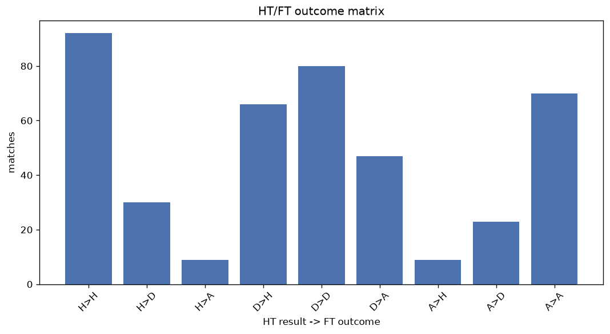
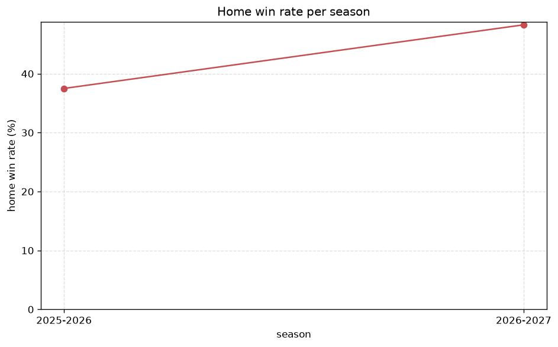

# Match Analysis
- Report: `matches_analysis`
- Generated: 2026-10-29T02:05:55+00:00
- Script: `backend/scripts/analyze_matches.py` v1.0.0
- League: Serie C - Group B (Italy)
- Scope: league `italy3b`

## 1. Overall summary
| metric | value |
|---|---|
| Matches | 2367 |
| Home wins | 957 (40.4%) |
| Draws | 723 (30.5%) |
| Away wins | 687 (29.0%) |
| Total goals | 5600 |
| Average goals per match | 2.366 |
| Goalless matches | 254 (10.7%) |

## 2. Per-season breakdown
| season | matches | home wins | draws | away wins | total goals | avg goals | goalless |
|---|---|---|---|---|---|---|---|
| 2020-2021 | 380 | 156 (41.1%) | 116 (30.5%) | 108 (28.4%) | 924 | 2.432 | 40 (10.5%) |
| 2021-2022 | 380 | 163 (42.9%) | 123 (32.4%) | 94 (24.7%) | 925 | 2.434 | 49 (12.9%) |
| 2022-2023 | 380 | 135 (35.5%) | 120 (31.6%) | 125 (32.9%) | 859 | 2.261 | 43 (11.3%) |
| 2023-2024 | 380 | 172 (45.3%) | 106 (27.9%) | 102 (26.8%) | 915 | 2.408 | 36 (9.5%) |
| 2024-2025 | 380 | 147 (38.7%) | 114 (30.0%) | 119 (31.3%) | 897 | 2.361 | 42 (11.1%) |
| 2025-2026 | 357 | 134 (37.5%) | 113 (31.7%) | 110 (30.8%) | 802 | 2.246 | 35 (9.8%) |
| 2026-2027 | 110 | 50 (45.5%) | 31 (28.2%) | 29 (26.4%) | 278 | 2.527 | 9 (8.2%) |

## 3. HT/FT outcome matrix
| HT result \ FT result | Home | Draw | Away | total |
|---|---|---|---|---|
| HT home lead | 571 (76.0%) | 134 (17.8%) | 46 (6.1%) | 751 |
| HT draw | 338 (31.5%) | 472 (43.9%) | 264 (24.6%) | 1074 |
| HT away lead | 47 (8.7%) | 117 (21.7%) | 375 (69.6%) | 539 |
- *3 match(es) excluded (no HT score recorded).*

## 4. Comeback matches
- Home comebacks (trailing at HT, won at FT): **47** (2.0%)
- Away comebacks (trailing at HT, won at FT): **46** (1.9%)

### Home comebacks
| season | home | away | HT | FT |
|---|---|---|---|---|
| 2020-2021 | Vis Pesaro | Matelica | 0-1 | 2-1 |
| 2020-2021 | Vis Pesaro | Carpi | 1-2 | 3-2 |
| 2020-2021 | Mantova | Ravenna | 0-1 | 2-1 |
| 2020-2021 | Carpi | Ravenna | 0-1 | 4-2 |
| 2020-2021 | Triestina | Vis Pesaro | 0-2 | 3-2 |
| 2020-2021 | Gubbio | Perugia | 0-1 | 3-2 |
| 2020-2021 | Mantova | Virtus Verona | 1-2 | 3-2 |
| 2020-2021 | Virtus Verona | Fano | 0-1 | 3-1 |
| 2021-2022 | Carrarese | Grosseto | 0-1 | 2-1 |
| 2021-2022 | Lucchese | Olbia | 0-1 | 2-1 |
| 2021-2022 | Modena | Lucchese | 0-1 | 2-1 |
| 2021-2022 | Ancona | Siena | 0-1 | 3-2 |
| 2021-2022 | Carrarese | Siena | 0-1 | 3-1 |
| 2021-2022 | Vis Pesaro | Entella | 0-1 | 2-1 |
| 2021-2022 | Entella | Pistoiese | 0-1 | 3-1 |
| 2021-2022 | Entella | Viterbese | 0-1 | 2-1 |
| 2022-2023 | Entella | Ancona | 0-2 | 3-2 |
| 2022-2023 | Recanatese | Siena | 0-1 | 2-1 |
| 2022-2023 | Ancona | Lucchese | 0-1 | 2-1 |
| 2022-2023 | Lucchese | Carrarese | 1-2 | 3-2 |
| 2022-2023 | Montevarchi | Gubbio | 0-1 | 2-1 |
| 2022-2023 | Entella | Alessandria | 1-2 | 4-2 |
| 2023-2024 | Rimini | Juventus U23 | 1-2 | 4-3 |
| 2023-2024 | Olbia | Fermana | 0-1 | 2-1 |
| 2023-2024 | Sestri Levante | Ancona | 0-2 | 3-2 |
| 2023-2024 | Perugia | Spal | 0-1 | 3-1 |
| 2023-2024 | Rimini | Pontedera | 0-1 | 3-1 |
| 2023-2024 | Sestri Levante | Vis Pesaro | 1-2 | 3-2 |
| 2023-2024 | Arezzo | Sestri Levante | 0-1 | 2-1 |
| 2024-2025 | Pescara | Pianese | 0-1 | 2-1 |
| 2024-2025 | Arezzo | Spal | 0-1 | 2-1 |
| 2024-2025 | Ternana | Spal | 0-1 | 4-1 |
| 2024-2025 | Spal | Pineto | 0-1 | 2-1 |
| 2024-2025 | Torres | Campobasso | 0-1 | 2-1 |
| 2024-2025 | Ternana | Vis Pesaro | 0-1 | 2-1 |
| 2024-2025 | Lucchese | Perugia | 0-1 | 2-1 |
| 2024-2025 | Pineto | AC Milan U23 | 0-1 | 2-1 |
| 2024-2025 | Campobasso | Carpi | 0-1 | 2-1 |
| 2025-2026 | Ravenna | Perugia | 1-2 | 3-2 |
| 2025-2026 | Vis Pesaro | Guidonia | 0-1 | 2-1 |
| 2025-2026 | Perugia | Vis Pesaro | 0-1 | 2-1 |
| 2025-2026 | Ravenna | Pontedera | 0-1 | 2-1 |
| 2025-2026 | Campobasso | Pontedera | 0-1 | 3-2 |
| 2025-2026 | Campobasso | Juventus U23 | 0-1 | 2-1 |
| 2025-2026 | Ascoli | Vis Pesaro | 0-1 | 2-1 |
| 2026-2027 | Torres | Ostiamare | 0-1 | 3-2 |
| 2026-2027 | Livorno | Vado | 1-2 | 3-2 |

### Away comebacks
| season | home | away | HT | FT |
|---|---|---|---|---|
| 2020-2021 | Fano | Imolese | 1-0 | 1-2 |
| 2020-2021 | Legnago Salus | Matelica | 1-0 | 1-2 |
| 2020-2021 | Modena | Sudtirol | 1-0 | 1-2 |
| 2020-2021 | Fano | Virtus Verona | 1-0 | 1-2 |
| 2020-2021 | Imolese | Vis Pesaro | 1-0 | 1-2 |
| 2020-2021 | Sambenedettese | Matelica | 1-0 | 2-3 |
| 2020-2021 | Sudtirol | Triestina | 1-0 | 1-2 |
| 2020-2021 | Gubbio | Sambenedettese | 1-0 | 1-2 |
| 2020-2021 | Fano | Cesena | 1-0 | 1-2 |
| 2021-2022 | Lucchese | Cesena | 1-0 | 1-2 |
| 2021-2022 | Teramo | Vis Pesaro | 1-0 | 1-2 |
| 2021-2022 | Imolese | Modena | 1-0 | 1-2 |
| 2021-2022 | Pontedera | Modena | 1-0 | 1-2 |
| 2021-2022 | Viterbese | Teramo | 2-1 | 2-3 |
| 2021-2022 | Lucchese | Pontedera | 1-0 | 1-2 |
| 2021-2022 | Siena | Gubbio | 1-0 | 1-2 |
| 2021-2022 | Olbia | Pescara | 1-0 | 1-2 |
| 2021-2022 | Gubbio | Viterbese | 1-0 | 1-2 |
| 2021-2022 | Carrarese | Viterbese | 1-0 | 1-3 |
| 2022-2023 | Cesena | Carrarese | 1-0 | 1-2 |
| 2022-2023 | Torres | San Donato | 1-0 | 1-2 |
| 2022-2023 | San Donato | Pontedera | 1-0 | 1-2 |
| 2022-2023 | Imolese | Entella | 1-0 | 1-2 |
| 2022-2023 | Olbia | Imolese | 1-0 | 1-2 |
| 2022-2023 | Montevarchi | San Donato | 1-0 | 1-3 |
| 2023-2024 | Pescara | Recanatese | 1-0 | 2-3 |
| 2023-2024 | Vis Pesaro | Torres | 1-0 | 1-2 |
| 2023-2024 | Ancona | Rimini | 1-0 | 1-3 |
| 2023-2024 | Sestri Levante | Spal | 1-0 | 2-3 |
| 2024-2025 | Legnago Salus | Pontedera | 2-1 | 2-3 |
| 2024-2025 | AC Milan U23 | Legnago Salus | 1-0 | 1-3 |
| 2024-2025 | Arezzo | Pineto | 1-0 | 1-2 |
| 2024-2025 | Sestri Levante | Pianese | 1-0 | 2-3 |
| 2024-2025 | Pescara | Ascoli | 1-0 | 1-2 |
| 2024-2025 | Vis Pesaro | Rimini | 1-0 | 1-2 |
| 2024-2025 | Sestri Levante | AC Milan U23 | 1-0 | 1-2 |
| 2025-2026 | Guidonia | Ravenna | 1-0 | 1-2 |
| 2025-2026 | Juventus U23 | Arezzo | 2-1 | 2-3 |
| 2025-2026 | Pianese | Arezzo | 2-0 | 2-4 |
| 2025-2026 | Forli | Campobasso | 2-0 | 2-3 |
| 2025-2026 | Forli | Arezzo | 1-0 | 1-2 |
| 2025-2026 | Bra | Ascoli | 1-0 | 1-3 |
| 2025-2026 | Vis Pesaro | Campobasso | 1-0 | 1-2 |
| 2025-2026 | Ternana | Pianese | 1-0 | 1-3 |
| 2026-2027 | Sambenedettese | Spezia | 1-0 | 1-2 |
| 2026-2027 | Perugia | Pescara | 1-0 | 1-2 |

## 5. HT lead conversion
| HT state | matches | converted to win | held as draw | collapsed to loss |
|---|---|---|---|---|
| Home lead | 751 | 571 (76.0%) | 134 (17.8%) | 46 (6.1%) |
| Away lead | 539 | 375 (69.6%) | 117 (21.7%) | 47 (8.7%) |

### Matches level at half-time
| FT result | count | pct |
|---|---|---|
| Home win | 338 | 31.5% |
| Draw | 472 | 43.9% |
| Away win | 264 | 24.6% |
- *3 match(es) excluded (no HT score recorded).*

## 6. First-goal timing
- Matches with a first-goal time recorded: `2110` of `2367` (89.1%)

Outcome distribution by first-goal timing bucket:
| bucket | matches | % of matches | home | draw | away |
|---|---|---|---|---|---|
| 1-15 | 636 | 26.9% | 290 (45.6%) | 149 (23.4%) | 197 (31.0%) |
| 16-30 | 512 | 21.6% | 237 (46.3%) | 109 (21.3%) | 166 (32.4%) |
| 31-45 | 349 | 14.7% | 147 (42.1%) | 94 (26.9%) | 108 (30.9%) |
| 46-60 | 289 | 12.2% | 123 (42.6%) | 70 (24.2%) | 96 (33.2%) |
| 61-75 | 184 | 7.8% | 86 (46.7%) | 32 (17.4%) | 66 (35.9%) |
| 76-90 | 102 | 4.3% | 53 (52.0%) | 13 (12.7%) | 36 (35.3%) |
| 91-120 | 38 | 1.6% | 20 (52.6%) | 2 (5.3%) | 16 (42.1%) |

## 7. Goalless matches
- Overall: **254** of `2367` (10.7%)

| season | matches | goalless | pct |
|---|---|---|---|
| 2020-2021 | 380 | 40 | 10.5% |
| 2021-2022 | 380 | 49 | 12.9% |
| 2022-2023 | 380 | 43 | 11.3% |
| 2023-2024 | 380 | 36 | 9.5% |
| 2024-2025 | 380 | 42 | 11.1% |
| 2025-2026 | 357 | 35 | 9.8% |
| 2026-2027 | 110 | 9 | 8.2% |

---
*All statistics are computed from PostgreSQL tables (read-only). Run with `python backend/scripts/analyze_matches.py` to regenerate.*

## Charts

