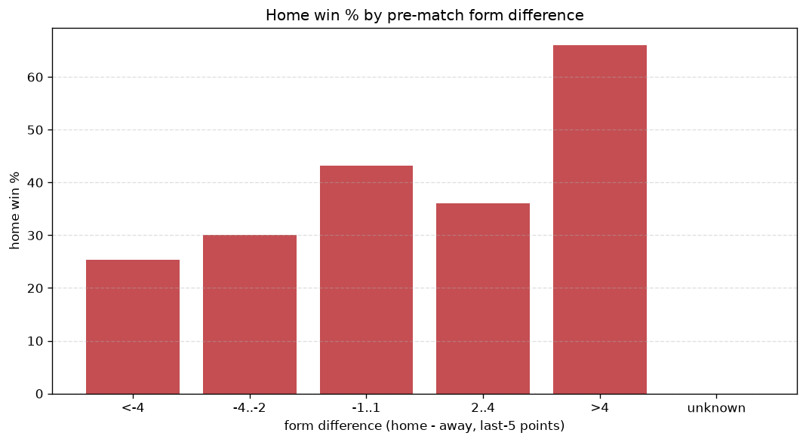
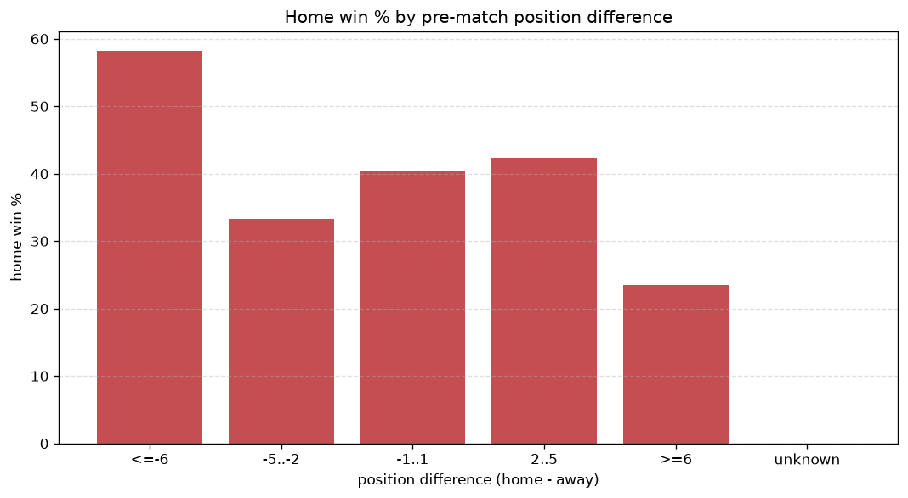

# Relationships Analysis
- Report: `relationships`
- Generated: 2026-10-27T01:58:25+00:00
- Script: `backend/scripts/analyze_relationships.py` v1.0.0
- League: Serie C - Group B (Italy)
- Scope: league `italy3b`

- Matches analysed: **2257** (23 leakage-safe pre-match features).

## 1. Correlation matrix
_Pearson correlation of each pre-match feature with observed goals; sorted by |corr(total goals)|._

| feature | corr(home) | corr(away) | corr(total) |
|---|---|---|---|
| home_rest_days | 0.015 | 0.057 | 0.050 |
| away_team_goals_conceded_last_5 | 0.117 | -0.066 | 0.046 |
| home_points_before_match | 0.125 | -0.079 | 0.043 |
| position_difference | -0.215 | 0.196 | -0.035 |
| points_difference | 0.212 | -0.194 | 0.034 |
| away_team_away_conceded_avg | 0.093 | -0.058 | 0.032 |
| rest_days_difference | 0.015 | 0.031 | 0.032 |
| home_team_home_goals_avg | 0.123 | -0.093 | 0.032 |
| home_team_wins_last_5 | 0.116 | -0.086 | 0.032 |
| home_team_points_last_5 | 0.116 | -0.089 | 0.030 |
| away_rest_days | 0.005 | 0.037 | 0.029 |
| away_position_before_match | 0.132 | -0.115 | 0.025 |
| home_team_goals_scored_last_5 | 0.090 | -0.068 | 0.024 |
| away_team_goals_scored_last_5 | -0.030 | 0.070 | 0.023 |
| home_position_before_match | -0.167 | 0.157 | -0.023 |
| home_team_home_win_rate | 0.104 | -0.089 | 0.021 |
| away_team_away_win_rate | -0.090 | 0.077 | -0.018 |
| away_points_before_match | -0.034 | 0.066 | 0.018 |
| home_team_home_conceded_avg | -0.063 | 0.093 | 0.014 |
| away_team_away_goals_avg | -0.082 | 0.077 | -0.012 |
| home_team_goals_conceded_last_5 | -0.075 | 0.103 | 0.011 |
| away_team_wins_last_5 | -0.073 | 0.092 | 0.005 |
| away_team_points_last_5 | -0.076 | 0.094 | 0.004 |

## 2. Form vs outcome
_Home win/draw/away % per bucket of `home_team_points_last_5 - away_team_points_last_5`._

| bucket | matches | home | draw | away | home % | draw % | away % |
|---|---|---|---|---|---|---|---|
| <-4 | 339 | 92 | 110 | 137 | 27.1% | 32.4% | 40.4% |
| -4..-2 | 540 | 185 | 162 | 193 | 34.3% | 30.0% | 35.7% |
| -1..1 | 625 | 266 | 183 | 176 | 42.6% | 29.3% | 28.2% |
| 2..4 | 431 | 189 | 141 | 101 | 43.9% | 32.7% | 23.4% |
| >4 | 322 | 175 | 96 | 51 | 54.3% | 29.8% | 15.8% |
| unknown | 0 | 0 | 0 | 0 | - | - | - |

## 3. Position vs outcome
_Home win/draw/away % per bucket of `position_difference` (home position - away position; negative favours the home team)._

| bucket | matches | home | draw | away | home % | draw % | away % |
|---|---|---|---|---|---|---|---|
| <=-6 | 572 | 315 | 160 | 97 | 55.1% | 28.0% | 17.0% |
| -5..-2 | 366 | 160 | 121 | 85 | 43.7% | 33.1% | 23.2% |
| -1..1 | 310 | 121 | 103 | 86 | 39.0% | 33.2% | 27.7% |
| 2..5 | 407 | 156 | 128 | 123 | 38.3% | 31.4% | 30.2% |
| >=6 | 602 | 155 | 180 | 267 | 25.7% | 29.9% | 44.4% |
| unknown | 0 | 0 | 0 | 0 | - | - | - |

## 4. Rest advantage
_Home win/draw/away % per bucket of `rest_days_difference` (home rest - away rest). Matches with unknown rest are bucketed separately._

| bucket | matches | home | draw | away | home % | draw % | away % |
|---|---|---|---|---|---|---|---|
| <-1 | 145 | 62 | 44 | 39 | 42.8% | 30.3% | 26.9% |
| -1..0 | 324 | 138 | 97 | 89 | 42.6% | 29.9% | 27.5% |
| 0 | 1280 | 509 | 393 | 378 | 39.8% | 30.7% | 29.5% |
| 1..2 | 377 | 139 | 121 | 117 | 36.9% | 32.1% | 31.0% |
| >2 | 71 | 32 | 16 | 23 | 45.1% | 22.5% | 32.4% |
| unknown | 60 | 27 | 21 | 12 | 45.0% | 35.0% | 20.0% |
- *60 match(es) had unknown rest difference (missing rest data on at least one side).*

## 5. Home team quality
_Home win rate by `home_team_home_win_rate` tier (split at 0.5)._

- `< 0.5` tier: **35.5%** home win (531/1495)
- `>= 0.5` tier: **49.3%** home win (376/762)
- Home-win gap (>= split minus < split): **+13.8 pp**

| tier | label | matches | home | draw | away | home % |
|---|---|---|---|---|---|---|
| low | < 0.5 | 1495 | 531 | 475 | 489 | 35.5% |
| high | >= 0.5 | 762 | 376 | 217 | 169 | 49.3% |

## 6. Feature averages by result
_Mean feature value per outcome; `range` is home-minus-away spread of the group means._

| feature | home mean | draw mean | away mean | range |
|---|---|---|---|---|
| points_difference | 3.655 | -0.779 | -4.778 | 8.433 |
| home_points_before_match | 27.494 | 23.954 | 21.720 | 5.774 |
| position_difference | -2.074 | 0.292 | 3.108 | 5.182 |
| home_position_before_match | 9.299 | 11.053 | 12.123 | 2.824 |
| away_points_before_match | 23.839 | 24.733 | 26.498 | 2.659 |
| away_position_before_match | 11.373 | 10.762 | 9.015 | 2.357 |
| away_team_points_last_5 | 5.907 | 6.158 | 6.957 | 1.050 |
| home_team_points_last_5 | 6.612 | 5.939 | 5.581 | 1.031 |
| away_team_goals_conceded_last_5 | 5.668 | 5.260 | 4.824 | 0.844 |
| home_team_goals_conceded_last_5 | 5.099 | 5.514 | 5.845 | 0.746 |
| home_team_goals_scored_last_5 | 5.647 | 5.227 | 4.954 | 0.693 |
| away_team_goals_scored_last_5 | 5.237 | 5.283 | 5.854 | 0.617 |
| home_team_wins_last_5 | 1.741 | 1.507 | 1.371 | 0.370 |
| away_team_wins_last_5 | 1.495 | 1.581 | 1.856 | 0.361 |
| home_team_home_goals_avg | 1.304 | 1.177 | 1.101 | 0.203 |
| home_rest_days | 6.366 | 6.332 | 6.519 | 0.186 |
| away_team_away_conceded_avg | 1.261 | 1.223 | 1.111 | 0.151 |
| away_team_away_goals_avg | 0.943 | 0.972 | 1.077 | 0.133 |
| home_team_home_conceded_avg | 0.937 | 0.993 | 1.051 | 0.113 |
| rest_days_difference | -0.027 | -0.067 | 0.034 | 0.101 |
| away_rest_days | 6.393 | 6.399 | 6.485 | 0.091 |
| home_team_home_win_rate | 0.414 | 0.362 | 0.342 | 0.072 |
| away_team_away_win_rate | 0.263 | 0.276 | 0.330 | 0.067 |

---
*All features are leakage-safe pre-match values built by `ml.features.build_features.build_rows` from strictly prior matches. Run with `python backend/scripts/analyze_relationships.py` to regenerate.*

## Charts

