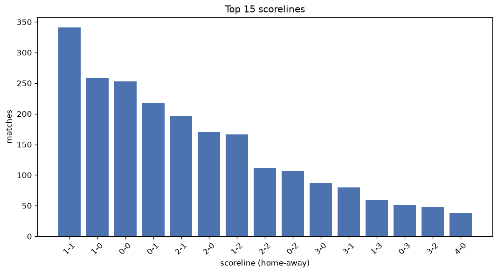
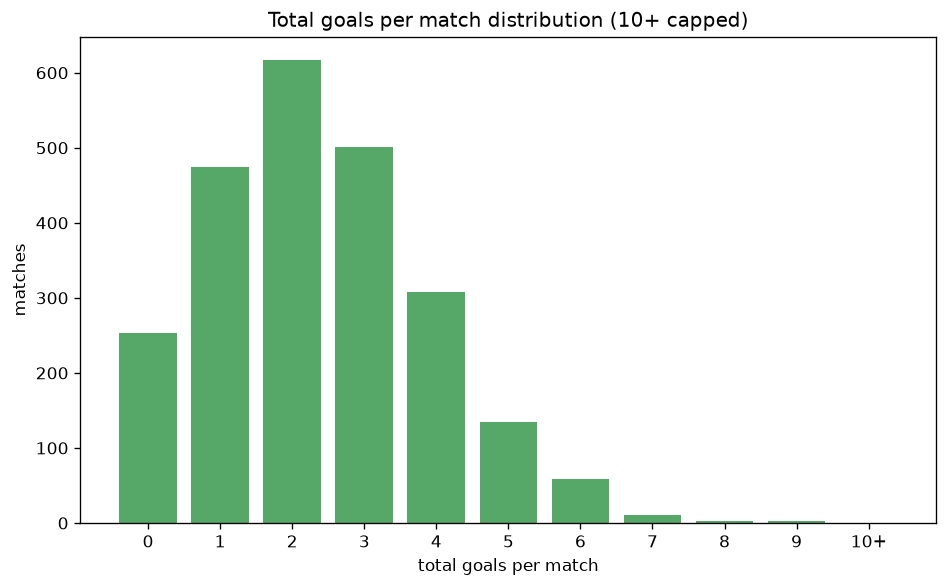

# Scoreline Analysis
- Report: `scoreline_analysis`
- Generated: 2026-10-26T01:38:48+00:00
- Script: `backend/scripts/analyze_scorelines.py` v1.0.0
- League: Serie C - Group B (Italy)
- Scope: league `italy3b`

## 1. Scoreline frequency
- Matches analysed: **2364** across **7** seasons.
- Distinct scorelines seen: **39**.

| scoreline | count | pct |
|---|---|---|
| 1-1 | 341 | 14.4% |
| 1-0 | 258 | 10.9% |
| 0-0 | 253 | 10.7% |
| 0-1 | 217 | 9.2% |
| 2-1 | 197 | 8.3% |
| 2-0 | 170 | 7.2% |
| 1-2 | 166 | 7.0% |
| 2-2 | 112 | 4.7% |
| 0-2 | 106 | 4.5% |
| 3-0 | 87 | 3.7% |
| 3-1 | 80 | 3.4% |
| 1-3 | 59 | 2.5% |
| 0-3 | 51 | 2.2% |
| 3-2 | 48 | 2.0% |
| 4-0 | 38 | 1.6% |
| 2-3 | 37 | 1.6% |
| 4-1 | 27 | 1.1% |
| 0-4 | 19 | 0.8% |
| 4-2 | 16 | 0.7% |
| 3-3 | 15 | 0.6% |

## 2. Scoreline frequency per season

### 2020-2021
| scoreline | count | pct |
|---|---|---|
| 1-1 | 58 | 15.3% |
| 0-0 | 40 | 10.5% |
| 0-1 | 36 | 9.5% |
| 1-0 | 35 | 9.2% |
| 2-1 | 30 | 7.9% |

### 2021-2022
| scoreline | count | pct |
|---|---|---|
| 0-0 | 49 | 12.9% |
| 1-1 | 48 | 12.6% |
| 2-0 | 38 | 10.0% |
| 2-1 | 34 | 8.9% |
| 1-0 | 34 | 8.9% |

### 2022-2023
| scoreline | count | pct |
|---|---|---|
| 1-1 | 63 | 16.6% |
| 0-1 | 45 | 11.8% |
| 0-0 | 43 | 11.3% |
| 1-0 | 35 | 9.2% |
| 1-2 | 34 | 8.9% |

### 2023-2024
| scoreline | count | pct |
|---|---|---|
| 1-0 | 60 | 15.8% |
| 1-1 | 48 | 12.6% |
| 0-0 | 36 | 9.5% |
| 2-0 | 31 | 8.2% |
| 1-2 | 28 | 7.4% |

### 2024-2025
| scoreline | count | pct |
|---|---|---|
| 1-1 | 53 | 13.9% |
| 0-0 | 42 | 11.1% |
| 0-1 | 42 | 11.1% |
| 2-1 | 39 | 10.3% |
| 1-0 | 38 | 10.0% |

### 2025-2026
| scoreline | count | pct |
|---|---|---|
| 1-1 | 55 | 15.4% |
| 1-0 | 45 | 12.6% |
| 0-1 | 38 | 10.6% |
| 2-1 | 36 | 10.1% |
| 0-0 | 35 | 9.8% |

### 2026-2027
| scoreline | count | pct |
|---|---|---|
| 1-1 | 16 | 15.0% |
| 2-0 | 14 | 13.1% |
| 1-0 | 11 | 10.3% |
| 2-1 | 11 | 10.3% |
| 1-2 | 9 | 8.4% |

## 3. Total-goal histogram
_10+ groups all matches with 10 or more total goals._

| total goals | matches | pct |
|---|---|---|
| 0 | 253 | 10.7% |
| 1 | 475 | 20.1% |
| 2 | 617 | 26.1% |
| 3 | 501 | 21.2% |
| 4 | 308 | 13.0% |
| 5 | 134 | 5.7% |
| 6 | 59 | 2.5% |
| 7 | 11 | 0.5% |
| 8 | 3 | 0.1% |
| 9 | 3 | 0.1% |
| 10+ | 0 | 0.0% |

## 4. Extreme scorelines
- Matches with 7+ total goals: **17**

| season | date | scoreline | total goals |
|---|---|---|---|
| 2022-2023 | 2022-12-23 | 5-4 | 9 |
| 2023-2024 | 2024-02-04 | 4-5 | 9 |
| 2026-2027 | 2026-08-29 | 6-3 | 9 |
| 2020-2021 | 2020-11-29 | 5-3 | 8 |
| 2024-2025 | 2024-09-25 | 8-0 | 8 |
| 2026-2027 | 2026-10-16 | 4-4 | 8 |
| 2020-2021 | 2020-10-21 | 5-2 | 7 |
| 2020-2021 | 2021-04-18 | 6-1 | 7 |
| 2021-2022 | 2021-11-28 | 6-1 | 7 |
| 2021-2022 | 2021-12-05 | 2-5 | 7 |
| 2021-2022 | 2022-02-02 | 6-1 | 7 |
| 2021-2022 | 2022-03-27 | 5-2 | 7 |
| 2022-2023 | 2023-04-06 | 1-6 | 7 |
| 2023-2024 | 2023-09-15 | 4-3 | 7 |
| 2023-2024 | 2023-10-01 | 5-2 | 7 |
| 2023-2024 | 2023-11-19 | 5-2 | 7 |
| 2023-2024 | 2024-01-07 | 4-3 | 7 |

## 5. Margin-of-victory distribution (decided matches)
- Decided matches: **1642** (draws: **722**)
- Average winning margin: **1.67**

| margin | matches | pct |
|---|---|---|
| 1 | 927 | 56.5% |
| 2 | 443 | 27.0% |
| 3+ | 272 | 16.6% |

## 6. Margin by outcome

### Home wins
- Matches: **955** | avg margin: **1.75** | max margin: **8**
| margin | matches | pct |
|---|---|---|
| 1 | 506 | 53.0% |
| 2 | 267 | 28.0% |
| 3+ | 182 | 19.1% |
- *Full match-by-match list available in `scoreline_analysis.json`.*

### Away wins
- Matches: **687** | avg margin: **1.57** | max margin: **6**
| margin | matches | pct |
|---|---|---|
| 1 | 421 | 61.3% |
| 2 | 176 | 25.6% |
| 3+ | 90 | 13.1% |
- *Full match-by-match list available in `scoreline_analysis.json`.*

## 7. Most common exact score by outcome type
| outcome | matches | most common score | count | pct |
|---|---|---|---|---|
| home | 955 | 1-0 | 258 | 27.0% |
| draw | 722 | 1-1 | 341 | 47.2% |
| away | 687 | 0-1 | 217 | 31.6% |

---
*All statistics are computed from PostgreSQL tables (read-only). Run with `python backend/scripts/analyze_scorelines.py` to regenerate.*

## Charts

