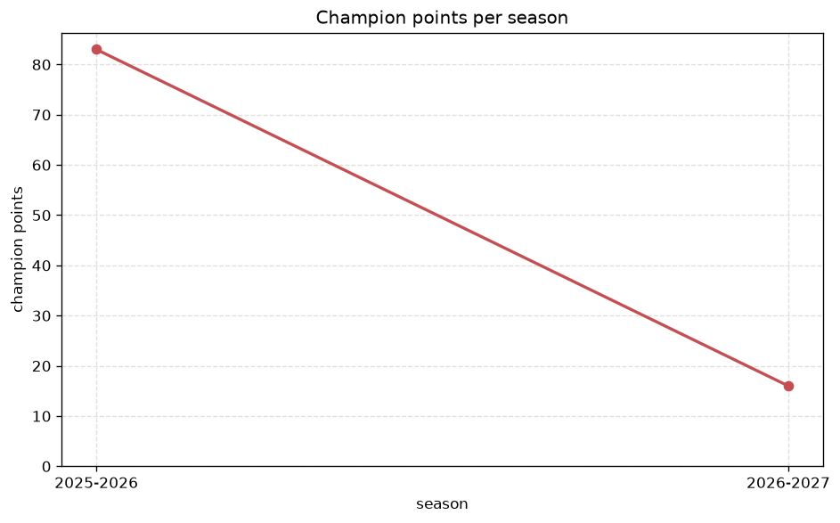
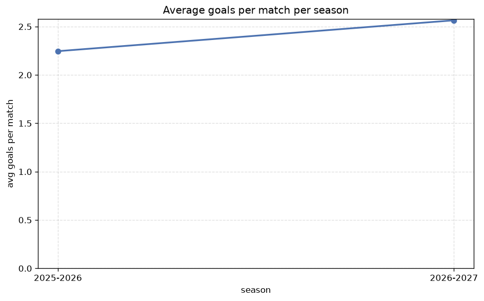

# Season Trends Analysis
- Report: `season_trends`
- Generated: 2026-10-29T02:06:01+00:00
- Script: `backend/scripts/analyze_seasons.py` v1.0.0
- League: Serie C - Group B (Italy)
- Scope: league `italy3b`

## 1. Champions per season
| season | champion | pts | runner-up | margin |
|---|---|---|---|---|
| 2020-2021 | Padova | 79 | Perugia | 0 pts |
| 2021-2022 | Modena | 88 | Reggiana | 2 pts |
| 2022-2023 | Reggiana | 81 | Cesena | 2 pts |
| 2023-2024 | Cesena | 96 | Torres | 21 pts |
| 2024-2025 | Entella | 83 | Ternana | 7 pts |
| 2025-2026 | Arezzo | 83 | Ascoli | 3 pts |
| 2026-2027 | Spezia | 29 | Ravenna | 6 pts |

## 2. Title-race tightness
- Tight races (margin <= 3 pts): **4** of 7 seasons
- Tightest race: **2020-2021** - Padova beat Perugia by **0** pts

| season | margin | tight |
|---|---|---|
| 2020-2021 | 0 pts | yes |
| 2021-2022 | 2 pts | yes |
| 2022-2023 | 2 pts | yes |
| 2023-2024 | 21 pts |  |
| 2024-2025 | 7 pts |  |
| 2025-2026 | 3 pts | yes |
| 2026-2027 | 6 pts |  |

## 3. Points thresholds
_Position-specific points per season. Key: 1 = champion, 2 = runner-up, 4 = CL line, 6 = Europa, 17 = last safe, 20 = bottom._

| season | pos 1 | pos 2 | pos 4 | pos 6 | pos 17 | pos 20 |
|---|---|---|---|---|---|---|
| 2020-2021 | 79 | 79 | 70 | 59 | 35 | 29 |
| 2021-2022 | 88 | 86 | 65 | 57 | 37 | 30 |
| 2022-2023 | 81 | 79 | 62 | 60 | 38 | 28 |
| 2023-2024 | 96 | 75 | 63 | 55 | 39 | 26 |
| 2024-2025 | 83 | 76 | 67 | 58 | 38 | 29 |
| 2025-2026 | 83 | 80 | 62 | 56 | 36 | 11 |
| 2026-2027 | 29 | 23 | 18 | 17 | 9 | 4 |

## 4. Relegation battle
| season | safe pos | safe pts | drop pos | drop pts | gap |
|---|---|---|---|---|---|
| 2020-2021 | 17 | 35 | 18 | 33 | 2 pts |
| 2021-2022 | 17 | 37 | 18 | 36 | 1 pts |
| 2022-2023 | 17 | 38 | 18 | 37 | 1 pts |
| 2023-2024 | 17 | 39 | 18 | 38 | 1 pts |
| 2024-2025 | 17 | 38 | 18 | 34 | 4 pts |
| 2025-2026 | 17 | 36 | 18 | 35 | 1 pts |
| 2026-2027 | 17 | 9 | 18 | 9 | 0 pts |

## 5. League-level trends
| season | matches | total goals | avg goals | home win | draw | away win | goalless | avg pts/team |
|---|---|---|---|---|---|---|---|---|
| 2020-2021 | 380 | 924 | 2.432 | 41.1% | 30.5% | 28.4% | 10.5% | 51.2 |
| 2021-2022 | 380 | 925 | 2.434 | 42.9% | 32.4% | 24.7% | 12.9% | 50.85 |
| 2022-2023 | 380 | 859 | 2.261 | 35.5% | 31.6% | 32.9% | 11.3% | 51.0 |
| 2023-2024 | 380 | 915 | 2.408 | 45.3% | 27.9% | 26.8% | 9.5% | 51.7 |
| 2024-2025 | 380 | 897 | 2.361 | 38.7% | 30.0% | 31.3% | 11.1% | 51.3 |
| 2025-2026 | 357 | 802 | 2.246 | 37.5% | 31.7% | 30.8% | 9.8% | 47.9 |
| 2026-2027 | 110 | 278 | 2.527 | 45.5% | 28.2% | 26.4% | 8.2% | 14.95 |

## 6. View divergence
- Largest divergence: **2024-2025** (goals view, avg abs position diff = 7.800)

_Avg absolute position difference between classic view and alternative view per season._

| season | classic vs luck | classic vs goals |
|---|---|---|
| 2020-2021 | 1.100 | 6.500 |
| 2021-2022 | 1.700 | 4.800 |
| 2022-2023 | 2.900 | 6.400 |
| 2023-2024 | 3.700 | 6.900 |
| 2024-2025 | 2.900 | 7.800 |
| 2025-2026 | 2.500 | 6.600 |
| 2026-2027 | 1.500 | 7.400 |

---
*All statistics are computed from PostgreSQL tables (read-only). Run with `python backend/scripts/analyze_seasons.py` to regenerate.*

## Charts

