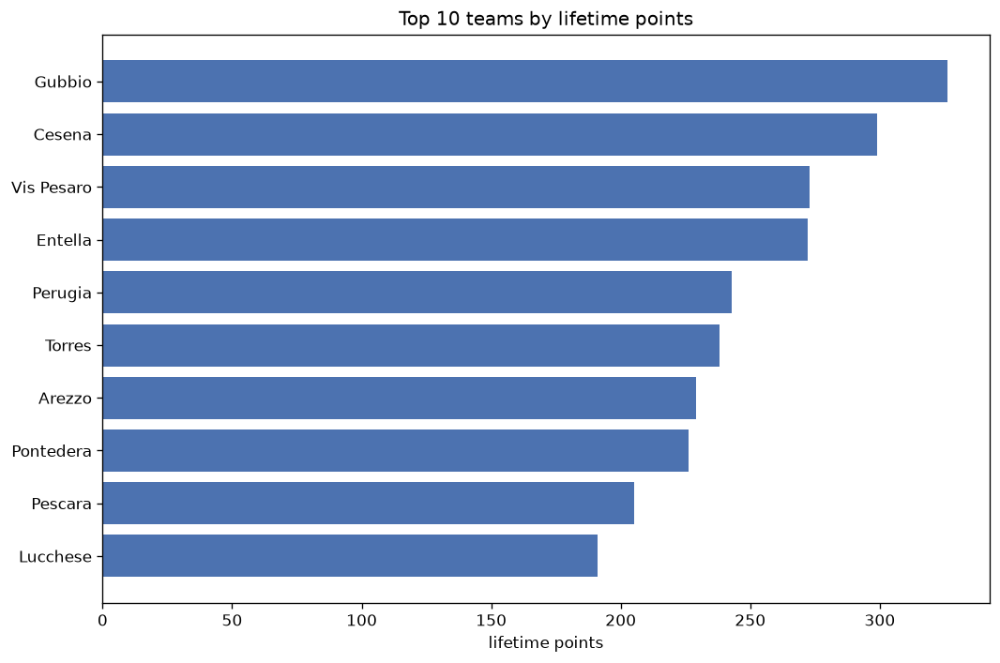
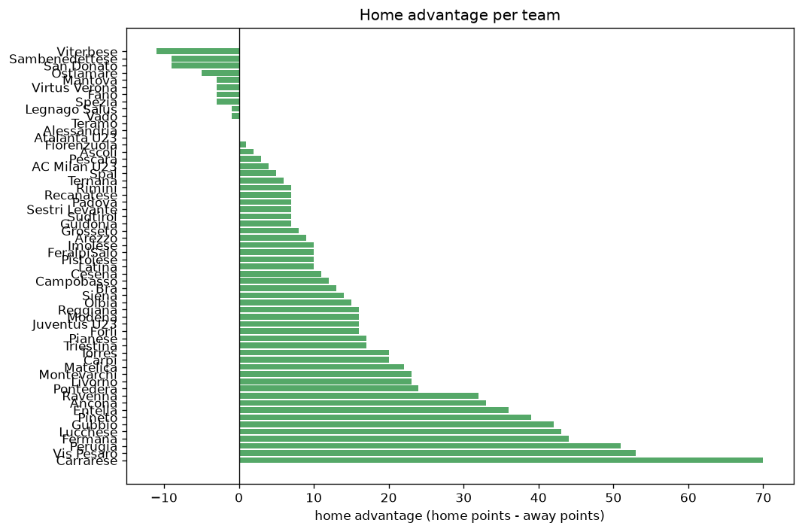

# Team Analysis
- Report: `teams_analysis`
- Generated: 2026-10-27T01:58:16+00:00
- Script: `backend/scripts/analyze_teams.py` v1.0.0
- League: Serie C - Group B (Italy)
- Scope: league `italy3b`

- Teams: **58** | Seasons: **7** | Matches: **2367**

## 1. Team standings (lifetime)
| team | seasons | played | W | D | L | pts | GF | GA | GD | avg pts/season | best pos | worst pos | titles |
|---|---|---|---|---|---|---|---|---|---|---|---|---|---|
| Gubbio | 7 | 238 | 84 | 74 | 80 | 326 | 267 | 256 | 11 | 46.57 | 5 | 19 | 0 |
| Cesena | 4 | 152 | 86 | 41 | 25 | 299 | 250 | 116 | 134 | 74.75 | 1 | 7 | 1 |
| Vis Pesaro | 7 | 237 | 66 | 75 | 96 | 273 | 231 | 309 | -78 | 39.0 | 6 | 20 | 0 |
| Entella | 4 | 152 | 76 | 44 | 32 | 272 | 216 | 130 | 86 | 68.0 | 1 | 12 | 1 |
| Perugia | 5 | 162 | 64 | 51 | 47 | 243 | 207 | 168 | 39 | 48.6 | 2 | 15 | 0 |
| Torres | 5 | 161 | 60 | 58 | 43 | 238 | 189 | 167 | 22 | 47.6 | 2 | 17 | 0 |
| Arezzo | 4 | 151 | 63 | 40 | 48 | 229 | 196 | 171 | 25 | 57.25 | 1 | 20 | 1 |
| Pontedera | 5 | 189 | 58 | 52 | 79 | 226 | 222 | 266 | -44 | 45.2 | 6 | 19 | 0 |
| Pescara | 4 | 125 | 57 | 34 | 34 | 205 | 186 | 144 | 42 | 51.25 | 4 | 6 | 0 |
| Lucchese | 4 | 152 | 45 | 56 | 51 | 191 | 156 | 178 | -22 | 47.75 | 8 | 14 | 0 |
| Reggiana | 3 | 88 | 54 | 22 | 12 | 184 | 149 | 66 | 83 | 61.33 | 1 | 6 | 1 |
| Carrarese | 3 | 114 | 49 | 33 | 32 | 180 | 144 | 127 | 17 | 60.0 | 3 | 11 | 0 |
| Pineto | 4 | 125 | 41 | 46 | 38 | 169 | 138 | 149 | -11 | 42.25 | 7 | 13 | 0 |
| Rimini | 4 | 129 | 41 | 38 | 50 | 161 | 149 | 150 | -1 | 40.25 | 8 | 20 | 0 |
| Modena | 2 | 76 | 48 | 14 | 14 | 158 | 120 | 53 | 67 | 79.0 | 1 | 4 | 1 |
| Ancona | 3 | 114 | 42 | 31 | 41 | 157 | 157 | 145 | 12 | 52.33 | 6 | 16 | 0 |
| Fermana | 4 | 152 | 31 | 59 | 62 | 152 | 135 | 201 | -66 | 38.0 | 12 | 19 | 0 |
| Ternana | 2 | 75 | 37 | 21 | 17 | 132 | 112 | 64 | 48 | 66.0 | 2 | 5 | 0 |
| Carpi | 3 | 113 | 32 | 32 | 49 | 128 | 123 | 159 | -36 | 42.67 | 12 | 15 | 0 |
| Ravenna | 3 | 85 | 35 | 21 | 29 | 126 | 102 | 98 | 4 | 42.0 | 2 | 19 | 0 |
| Ascoli | 2 | 75 | 33 | 21 | 21 | 120 | 102 | 69 | 33 | 60.0 | 2 | 16 | 0 |
| Campobasso | 3 | 86 | 32 | 24 | 30 | 120 | 102 | 104 | -2 | 40.0 | 4 | 15 | 0 |
| Pianese | 3 | 86 | 28 | 31 | 27 | 115 | 92 | 92 | 0 | 38.33 | 7 | 18 | 0 |
| Olbia | 3 | 114 | 26 | 35 | 53 | 113 | 112 | 164 | -52 | 37.67 | 9 | 20 | 0 |
| Juventus U23 | 2 | 75 | 30 | 20 | 25 | 110 | 98 | 87 | 11 | 55.0 | 6 | 7 | 0 |
| Imolese | 3 | 114 | 26 | 30 | 58 | 108 | 105 | 166 | -61 | 36.0 | 17 | 19 | 0 |
| Sambenedettese | 3 | 85 | 24 | 29 | 32 | 101 | 89 | 98 | -9 | 33.67 | 9 | 16 | 0 |
| Siena | 2 | 76 | 21 | 31 | 24 | 94 | 80 | 81 | -1 | 47.0 | 9 | 13 | 0 |
| Spal | 2 | 76 | 21 | 24 | 31 | 87 | 82 | 101 | -19 | 43.5 | 11 | 17 | 0 |
| Recanatese | 2 | 76 | 21 | 22 | 33 | 85 | 86 | 108 | -22 | 42.5 | 11 | 18 | 0 |
| Padova | 1 | 38 | 24 | 7 | 7 | 79 | 68 | 26 | 42 | 79.0 | 1 | 1 | 1 |
| Sudtirol | 1 | 38 | 21 | 12 | 5 | 75 | 66 | 29 | 37 | 75.0 | 3 | 3 | 0 |
| Sestri Levante | 2 | 76 | 18 | 21 | 37 | 75 | 76 | 109 | -33 | 37.5 | 15 | 19 | 0 |
| Montevarchi | 2 | 76 | 18 | 19 | 39 | 73 | 73 | 114 | -41 | 36.5 | 10 | 20 | 0 |
| Legnago Salus | 2 | 76 | 14 | 25 | 37 | 67 | 65 | 110 | -45 | 33.5 | 16 | 20 | 0 |
| FeralpiSalo | 1 | 38 | 17 | 9 | 12 | 60 | 54 | 46 | 8 | 60.0 | 5 | 5 | 0 |
| Triestina | 1 | 38 | 15 | 14 | 9 | 59 | 48 | 40 | 8 | 59.0 | 6 | 6 | 0 |
| Livorno | 2 | 47 | 16 | 11 | 20 | 59 | 55 | 67 | -12 | 29.5 | 9 | 11 | 0 |
| Guidonia | 2 | 48 | 13 | 18 | 17 | 57 | 45 | 48 | -3 | 28.5 | 8 | 13 | 0 |
| Matelica | 1 | 38 | 16 | 8 | 14 | 56 | 59 | 62 | -3 | 56.0 | 8 | 8 | 0 |
| Grosseto | 2 | 49 | 11 | 19 | 19 | 52 | 53 | 60 | -7 | 26.0 | 3 | 20 | 0 |
| Forli | 2 | 48 | 12 | 16 | 20 | 52 | 57 | 69 | -12 | 26.0 | 14 | 14 | 0 |
| Virtus Verona | 1 | 38 | 11 | 16 | 11 | 49 | 43 | 44 | -1 | 49.0 | 10 | 10 | 0 |
| Mantova | 1 | 38 | 12 | 13 | 13 | 49 | 47 | 49 | -2 | 49.0 | 11 | 11 | 0 |
| Teramo | 1 | 38 | 10 | 12 | 16 | 42 | 36 | 57 | -21 | 42.0 | 15 | 15 | 0 |
| Fiorenzuola | 1 | 38 | 11 | 8 | 19 | 41 | 31 | 44 | -13 | 41.0 | 15 | 15 | 0 |
| Viterbese | 1 | 38 | 8 | 15 | 15 | 39 | 44 | 51 | -7 | 39.0 | 16 | 16 | 0 |
| Alessandria | 1 | 38 | 9 | 11 | 18 | 38 | 33 | 52 | -19 | 38.0 | 17 | 17 | 0 |
| San Donato | 1 | 38 | 8 | 13 | 17 | 37 | 40 | 62 | -22 | 37.0 | 18 | 18 | 0 |
| Pistoiese | 1 | 38 | 8 | 12 | 18 | 36 | 40 | 59 | -19 | 36.0 | 18 | 18 | 0 |
| Bra | 1 | 37 | 7 | 14 | 16 | 35 | 39 | 55 | -16 | 35.0 | 18 | 18 | 0 |
| AC Milan U23 | 1 | 38 | 7 | 13 | 18 | 34 | 36 | 57 | -21 | 34.0 | 18 | 18 | 0 |
| Fano | 1 | 38 | 5 | 18 | 15 | 33 | 32 | 47 | -15 | 33.0 | 18 | 18 | 0 |
| Spezia | 1 | 11 | 9 | 2 | 0 | 29 | 19 | 5 | 14 | 29.0 | 1 | 1 | 1 |
| Vado | 1 | 11 | 4 | 3 | 4 | 15 | 12 | 11 | 1 | 15.0 | 11 | 11 | 0 |
| Latina | 1 | 11 | 3 | 5 | 3 | 14 | 11 | 11 | 0 | 14.0 | 13 | 13 | 0 |
| Atalanta U23 | 1 | 10 | 4 | 0 | 6 | 12 | 11 | 15 | -4 | 12.0 | 15 | 15 | 0 |
| Ostiamare | 1 | 11 | 2 | 3 | 6 | 9 | 10 | 14 | -4 | 9.0 | 17 | 17 | 0 |

## 2. Home vs away split
| team | home P | H-W | H-D | H-L | H-pts | away P | A-W | A-D | A-L | A-pts | adv |
|---|---|---|---|---|---|---|---|---|---|---|---|
| Carrarese | 57 | 38 | 11 | 8 | 125 | 57 | 11 | 22 | 24 | 55 | 70 |
| Vis Pesaro | 120 | 43 | 34 | 43 | 163 | 117 | 23 | 41 | 53 | 110 | 53 |
| Perugia | 82 | 41 | 24 | 17 | 147 | 80 | 23 | 27 | 30 | 96 | 51 |
| Fermana | 76 | 23 | 29 | 24 | 98 | 76 | 8 | 30 | 38 | 54 | 44 |
| Lucchese | 76 | 30 | 27 | 19 | 117 | 76 | 15 | 29 | 32 | 74 | 43 |
| Gubbio | 118 | 48 | 40 | 30 | 184 | 120 | 36 | 34 | 50 | 142 | 42 |
| Pineto | 64 | 27 | 23 | 14 | 104 | 61 | 14 | 23 | 24 | 65 | 39 |
| Entella | 76 | 45 | 19 | 12 | 154 | 76 | 31 | 25 | 20 | 118 | 36 |
| Ancona | 57 | 27 | 14 | 16 | 95 | 57 | 15 | 17 | 25 | 62 | 33 |
| Ravenna | 42 | 23 | 10 | 9 | 79 | 43 | 12 | 11 | 20 | 47 | 32 |
| Pontedera | 95 | 33 | 26 | 36 | 125 | 94 | 25 | 26 | 43 | 101 | 24 |
| Montevarchi | 38 | 12 | 12 | 14 | 48 | 38 | 6 | 7 | 25 | 25 | 23 |
| Livorno | 24 | 12 | 5 | 7 | 41 | 23 | 4 | 6 | 13 | 18 | 23 |
| Matelica | 19 | 11 | 6 | 2 | 39 | 19 | 5 | 2 | 12 | 17 | 22 |
| Torres | 81 | 33 | 30 | 18 | 129 | 80 | 27 | 28 | 25 | 109 | 20 |
| Carpi | 57 | 17 | 23 | 17 | 74 | 56 | 15 | 9 | 32 | 54 | 20 |
| Pianese | 43 | 17 | 15 | 11 | 66 | 43 | 11 | 16 | 16 | 49 | 17 |
| Triestina | 19 | 11 | 5 | 3 | 38 | 19 | 4 | 9 | 6 | 21 | 17 |
| Reggiana | 43 | 30 | 10 | 3 | 100 | 45 | 24 | 12 | 9 | 84 | 16 |
| Modena | 38 | 27 | 6 | 5 | 87 | 38 | 21 | 8 | 9 | 71 | 16 |
| Juventus U23 | 37 | 18 | 9 | 10 | 63 | 38 | 12 | 11 | 15 | 47 | 16 |
| Forli | 23 | 8 | 10 | 5 | 34 | 25 | 4 | 6 | 15 | 18 | 16 |
| Olbia | 57 | 16 | 16 | 25 | 64 | 57 | 10 | 19 | 28 | 49 | 15 |
| Siena | 38 | 12 | 18 | 8 | 54 | 38 | 9 | 13 | 16 | 40 | 14 |
| Bra | 18 | 6 | 6 | 6 | 24 | 19 | 1 | 8 | 10 | 11 | 13 |
| Campobasso | 43 | 18 | 12 | 13 | 66 | 43 | 14 | 12 | 17 | 54 | 12 |
| Cesena | 76 | 45 | 20 | 11 | 155 | 76 | 41 | 21 | 14 | 144 | 11 |
| Imolese | 57 | 14 | 17 | 26 | 59 | 57 | 12 | 13 | 32 | 49 | 10 |
| FeralpiSalo | 19 | 11 | 2 | 6 | 35 | 19 | 6 | 7 | 6 | 25 | 10 |
| Pistoiese | 19 | 6 | 5 | 8 | 23 | 19 | 2 | 7 | 10 | 13 | 10 |
| Latina | 6 | 3 | 3 | 0 | 12 | 5 | 0 | 2 | 3 | 2 | 10 |
| Arezzo | 75 | 33 | 20 | 22 | 119 | 76 | 30 | 20 | 26 | 110 | 9 |
| Grosseto | 25 | 6 | 12 | 7 | 30 | 24 | 5 | 7 | 12 | 22 | 8 |
| Rimini | 64 | 22 | 18 | 24 | 84 | 65 | 19 | 20 | 26 | 77 | 7 |
| Recanatese | 38 | 12 | 10 | 16 | 46 | 38 | 9 | 12 | 17 | 39 | 7 |
| Padova | 19 | 13 | 4 | 2 | 43 | 19 | 11 | 3 | 5 | 36 | 7 |
| Sestri Levante | 38 | 10 | 11 | 17 | 41 | 38 | 8 | 10 | 20 | 34 | 7 |
| Sudtirol | 19 | 12 | 5 | 2 | 41 | 19 | 9 | 7 | 3 | 34 | 7 |
| Guidonia | 25 | 7 | 11 | 7 | 32 | 23 | 6 | 7 | 10 | 25 | 7 |
| Ternana | 37 | 20 | 9 | 8 | 69 | 38 | 17 | 12 | 9 | 63 | 6 |
| Spal | 38 | 11 | 13 | 14 | 46 | 38 | 10 | 11 | 17 | 41 | 5 |
| AC Milan U23 | 19 | 4 | 7 | 8 | 19 | 19 | 3 | 6 | 10 | 15 | 4 |
| Pescara | 63 | 27 | 23 | 13 | 104 | 62 | 30 | 11 | 21 | 101 | 3 |
| Ascoli | 37 | 17 | 10 | 10 | 61 | 38 | 16 | 11 | 11 | 59 | 2 |
| Fiorenzuola | 19 | 6 | 3 | 10 | 21 | 19 | 5 | 5 | 9 | 20 | 1 |
| Teramo | 19 | 5 | 6 | 8 | 21 | 19 | 5 | 6 | 8 | 21 | 0 |
| Alessandria | 19 | 4 | 7 | 8 | 19 | 19 | 5 | 4 | 10 | 19 | 0 |
| Atalanta U23 | 4 | 2 | 0 | 2 | 6 | 6 | 2 | 0 | 4 | 6 | 0 |
| Legnago Salus | 38 | 8 | 9 | 21 | 33 | 38 | 6 | 16 | 16 | 34 | -1 |
| Vado | 5 | 2 | 1 | 2 | 7 | 6 | 2 | 2 | 2 | 8 | -1 |
| Mantova | 19 | 6 | 5 | 8 | 23 | 19 | 6 | 8 | 5 | 26 | -3 |
| Virtus Verona | 19 | 4 | 11 | 4 | 23 | 19 | 7 | 5 | 7 | 26 | -3 |
| Fano | 19 | 2 | 9 | 8 | 15 | 19 | 3 | 9 | 7 | 18 | -3 |
| Spezia | 5 | 4 | 1 | 0 | 13 | 6 | 5 | 1 | 0 | 16 | -3 |
| Ostiamare | 5 | 0 | 2 | 3 | 2 | 6 | 2 | 1 | 3 | 7 | -5 |
| Sambenedettese | 43 | 11 | 13 | 19 | 46 | 42 | 13 | 16 | 13 | 55 | -9 |
| San Donato | 19 | 2 | 8 | 9 | 14 | 19 | 6 | 5 | 8 | 23 | -9 |
| Viterbese | 19 | 2 | 8 | 9 | 14 | 19 | 6 | 7 | 6 | 25 | -11 |

## 3. Top performers
### Best points per game (PPG)
| rank | team | PPG |
|---|---|---|
| 1 | Spezia | 2.64 |
| 2 | Reggiana | 2.09 |
| 3 | Modena | 2.08 |
| 4 | Padova | 2.08 |
| 5 | Sudtirol | 1.97 |

### Most goals scored
| rank | team | goals |
|---|---|---|
| 1 | Gubbio | 267 |
| 2 | Cesena | 250 |
| 3 | Vis Pesaro | 231 |
| 4 | Pontedera | 222 |
| 5 | Entella | 216 |

### Best goal difference
| rank | team | GD |
|---|---|---|
| 1 | Cesena | 134 |
| 2 | Entella | 86 |
| 3 | Reggiana | 83 |
| 4 | Modena | 67 |
| 5 | Ternana | 48 |

### Best defence (goals against per match, standings)
| rank | team | GA/match |
|---|---|---|
| 1 | Spezia | 0.455 |
| 2 | Padova | 0.684 |
| 3 | Modena | 0.697 |
| 4 | Reggiana | 0.750 |
| 5 | Sudtirol | 0.763 |

## 4. Team consistency
- Teams present in all **7** seasons: **2**

Gubbio, Vis Pesaro

## 5. Head-to-head dominance
- Distinct fixtures: **814** (showing the 15 most frequent)

| fixture | meetings | home wins | draws | away wins | home pct | draw pct | away pct |
|---|---|---|---|---|---|---|---|
| Gubbio vs Vis Pesaro | 12 | 6 | 3 | 3 | 50.0% | 25.0% | 25.0% |
| Pontedera vs Gubbio | 10 | 4 | 5 | 1 | 40.0% | 50.0% | 10.0% |
| Pontedera vs Vis Pesaro | 10 | 1 | 6 | 3 | 10.0% | 60.0% | 30.0% |
| Perugia vs Gubbio | 9 | 3 | 3 | 3 | 33.3% | 33.3% | 33.3% |
| Perugia vs Vis Pesaro | 9 | 3 | 3 | 3 | 33.3% | 33.3% | 33.3% |
| Entella vs Pontedera | 8 | 6 | 1 | 1 | 75.0% | 12.5% | 12.5% |
| Arezzo vs Vis Pesaro | 8 | 5 | 2 | 1 | 62.5% | 25.0% | 12.5% |
| Arezzo vs Gubbio | 8 | 4 | 2 | 2 | 50.0% | 25.0% | 25.0% |
| Cesena vs Fermana | 8 | 4 | 3 | 1 | 50.0% | 37.5% | 12.5% |
| Cesena vs Gubbio | 8 | 4 | 3 | 1 | 50.0% | 37.5% | 12.5% |
| Entella vs Gubbio | 8 | 4 | 3 | 1 | 50.0% | 37.5% | 12.5% |
| Lucchese vs Vis Pesaro | 8 | 4 | 0 | 4 | 50.0% | 0.0% | 50.0% |
| Perugia vs Arezzo | 8 | 4 | 3 | 1 | 50.0% | 37.5% | 12.5% |
| Cesena vs Vis Pesaro | 8 | 3 | 1 | 4 | 37.5% | 12.5% | 50.0% |
| Entella vs Lucchese | 8 | 3 | 5 | 0 | 37.5% | 62.5% | 0.0% |

## 6. Position per season (classic view)
_Cells show final position; '-' when the team was absent from that season._

| team | 2020-2021 | 2021-2022 | 2022-2023 | 2023-2024 | 2024-2025 | 2025-2026 | 2026-2027 |
|---|---|---|---|---|---|---|---|
| Gubbio | 12 | 7 | 5 | 5 | 11 | 8 | 19 |
| Cesena | 7 | 3 | 2 | 1 | - | - | - |
| Vis Pesaro | 14 | 12 | 16 | 17 | 6 | 10 | 20 |
| Entella | - | 4 | 3 | 12 | 1 | - | - |
| Perugia | 2 | - | - | 4 | 12 | 15 | 10 |
| Torres | - | - | 13 | 2 | 3 | 17 | 5 |
| Arezzo | 20 | - | - | 8 | 5 | 1 | - |
| Pontedera | - | 14 | 6 | 9 | 10 | 19 | - |
| Pescara | - | 5 | - | 6 | 4 | - | 4 |
| Lucchese | - | 8 | 8 | 14 | 13 | - | - |
| Reggiana | - | 2 | 1 | - | - | - | 6 |
| Carrarese | - | 11 | 4 | 3 | - | - | - |
| Pineto | - | - | - | 13 | 7 | 9 | 7 |
| Rimini | - | - | 10 | 10 | 8 | 20 | - |
| Modena | 4 | 1 | - | - | - | - | - |
| Ancona | - | 6 | 7 | 16 | - | - | - |
| Fermana | 13 | 19 | 12 | 19 | - | - | - |
| Ternana | - | - | - | - | 2 | 5 | - |
| Carpi | 15 | - | - | - | 14 | 12 | - |
| Ravenna | 19 | - | - | - | - | 3 | 2 |
| Ascoli | - | - | - | - | 16 | 2 | - |
| Campobasso | - | - | - | - | 15 | 4 | 12 |
| Pianese | - | - | - | - | 9 | 7 | 18 |
| Olbia | - | 9 | 14 | 20 | - | - | - |
| Juventus U23 | - | - | - | 7 | - | 6 | - |
| Imolese | 17 | 17 | 19 | - | - | - | - |
| Sambenedettese | 9 | - | - | - | - | 16 | 16 |
| Siena | - | 13 | 9 | - | - | - | - |
| Spal | - | - | - | 11 | 17 | - | - |
| Recanatese | - | - | 11 | 18 | - | - | - |
| Padova | 1 | - | - | - | - | - | - |
| Sudtirol | 3 | - | - | - | - | - | - |
| Sestri Levante | - | - | - | 15 | 19 | - | - |
| Montevarchi | - | 10 | 20 | - | - | - | - |
| Legnago Salus | 16 | - | - | - | 20 | - | - |
| FeralpiSalo | 5 | - | - | - | - | - | - |
| Triestina | 6 | - | - | - | - | - | - |
| Livorno | - | - | - | - | - | 11 | 9 |
| Guidonia | - | - | - | - | - | 13 | 8 |
| Matelica | 8 | - | - | - | - | - | - |
| Grosseto | - | 20 | - | - | - | - | 3 |
| Forli | - | - | - | - | - | 14 | 14 |
| Virtus Verona | 10 | - | - | - | - | - | - |
| Mantova | 11 | - | - | - | - | - | - |
| Teramo | - | 15 | - | - | - | - | - |
| Fiorenzuola | - | - | 15 | - | - | - | - |
| Viterbese | - | 16 | - | - | - | - | - |
| Alessandria | - | - | 17 | - | - | - | - |
| San Donato | - | - | 18 | - | - | - | - |
| Pistoiese | - | 18 | - | - | - | - | - |
| Bra | - | - | - | - | - | 18 | - |
| AC Milan U23 | - | - | - | - | 18 | - | - |
| Fano | 18 | - | - | - | - | - | - |
| Spezia | - | - | - | - | - | - | 1 |
| Vado | - | - | - | - | - | - | 11 |
| Latina | - | - | - | - | - | - | 13 |
| Atalanta U23 | - | - | - | - | - | - | 15 |
| Ostiamare | - | - | - | - | - | - | 17 |

---
*All statistics are computed from PostgreSQL tables (read-only). Run with `python backend/scripts/analyze_teams.py` to regenerate.*

## Charts

