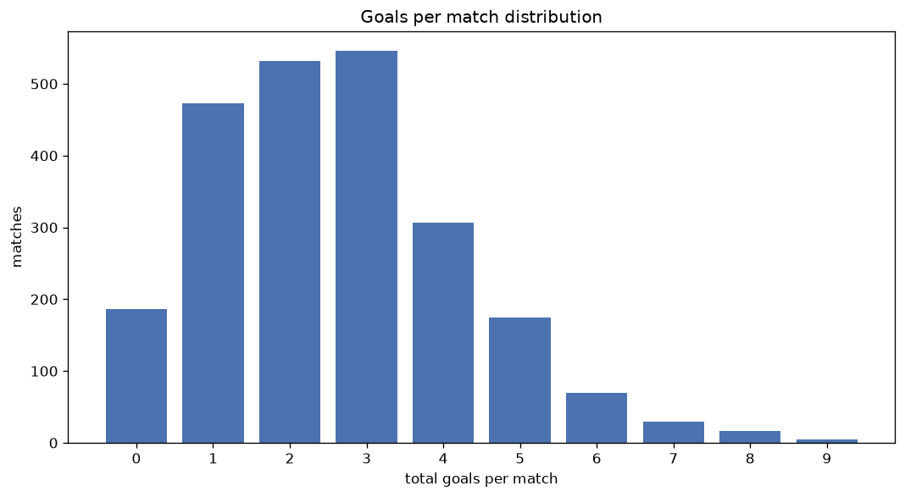
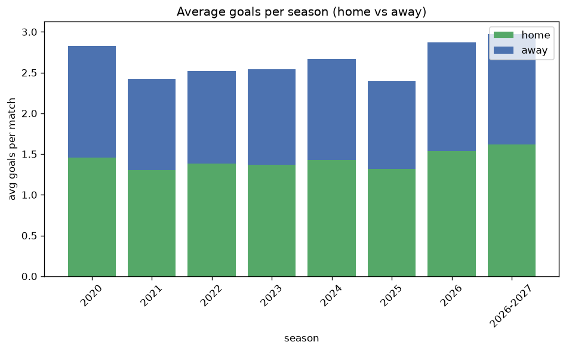

# Goal Analysis
- Report: `goals_analysis`
- Generated: 2026-10-27T01:58:45+00:00
- Script: `backend/scripts/analyze_goals.py` v1.0.0
- League: J1 League (Japan)
- Scope: league `japan1`

## 1. Goals per match distribution
| goals | matches | pct |
|---|---|---|
| 0 | 186 | 8.0% |
| 1 | 473 | 20.2% |
| 2 | 532 | 22.7% |
| 3 | 546 | 23.3% |
| 4 | 306 | 13.1% |
| 5 | 175 | 7.5% |
| 6 | 70 | 3.0% |
| 7 | 30 | 1.3% |
| 8 | 16 | 0.7% |
| 9 | 5 | 0.2% |

## 2. Goals per match per season
| season | matches | total goals | avg home | avg away | avg total |
|---|---|---|---|---|---|
| 2020 | 306 | 866 | 1.454 | 1.376 | 2.83 |
| 2021 | 380 | 920 | 1.3 | 1.121 | 2.421 |
| 2022 | 306 | 771 | 1.386 | 1.134 | 2.52 |
| 2023 | 306 | 777 | 1.366 | 1.173 | 2.539 |
| 2024 | 380 | 1013 | 1.424 | 1.242 | 2.666 |
| 2025 | 380 | 911 | 1.316 | 1.082 | 2.397 |
| 2026 | 161 | 462 | 1.54 | 1.329 | 2.87 |
| 2026-2027 | 120 | 357 | 1.617 | 1.358 | 2.975 |

## 3. Home vs away goal share
- Home goals: **3264** (53.7%)
- Away goals: **2813** (46.3%)
- Home/away ratio: **1.16**

| season | home goals | away goals | total | home pct | away pct |
|---|---|---|---|---|---|
| 2020 | 445 | 421 | 866 | 51.4% | 48.6% |
| 2021 | 494 | 426 | 920 | 53.7% | 46.3% |
| 2022 | 424 | 347 | 771 | 55.0% | 45.0% |
| 2023 | 418 | 359 | 777 | 53.8% | 46.2% |
| 2024 | 541 | 472 | 1013 | 53.4% | 46.6% |
| 2025 | 500 | 411 | 911 | 54.9% | 45.1% |
| 2026 | 248 | 214 | 462 | 53.7% | 46.3% |
| 2026-2027 | 194 | 163 | 357 | 54.3% | 45.7% |

## 4. BTTS (Both Teams To Score)
- Overall: **1193** of `2339` (51.0%)

| season | matches | BTTS | pct |
|---|---|---|---|
| 2020 | 306 | 169 | 55.2% |
| 2021 | 380 | 174 | 45.8% |
| 2022 | 306 | 150 | 49.0% |
| 2023 | 306 | 163 | 53.3% |
| 2024 | 380 | 202 | 53.2% |
| 2025 | 380 | 178 | 46.8% |
| 2026 | 161 | 89 | 55.3% |
| 2026-2027 | 120 | 68 | 56.7% |

## 5. Clean sheets
- Home clean sheets: **726** (31.0%)
- Away clean sheets: **606** (25.9%)
- Total clean sheets recorded: **1332**
- Matches with at least one clean sheet: **1146** (49.0%)
- Both teams kept clean sheets (0-0): **186**

| season | matches | home CS | away CS | total CS | matches w/ CS |
|---|---|---|---|---|---|
| 2020 | 306 | 80 | 77 | 157 | 137 (44.8%) |
| 2021 | 380 | 132 | 108 | 240 | 206 (54.2%) |
| 2022 | 306 | 103 | 89 | 192 | 156 (51.0%) |
| 2023 | 306 | 92 | 75 | 167 | 143 (46.7%) |
| 2024 | 380 | 111 | 99 | 210 | 178 (46.8%) |
| 2025 | 380 | 131 | 104 | 235 | 202 (53.2%) |
| 2026 | 161 | 45 | 27 | 72 | 72 (44.7%) |
| 2026-2027 | 120 | 32 | 27 | 59 | 52 (43.3%) |

## 6. Scoring intensity
- First-half goals: **2536** (41.8%)
- Second-half goals: **3538** (58.2%)
- Avg first-half goals per match: **1.085**
- Avg second-half goals per match: **1.513**
- Second-half-only scoring (HT 0-0, FT goals >= 1): **645** (27.6%)
- *1 match(es) excluded (no HT score recorded).*

| season | matches | 1st half | 2nd half | 1st half pct | 2nd half pct |
|---|---|---|---|---|---|
| 2020 | 306 | 357 | 509 | 41.2% | 58.8% |
| 2021 | 380 | 407 | 510 | 44.4% | 55.6% |
| 2022 | 306 | 306 | 465 | 39.7% | 60.3% |
| 2023 | 306 | 352 | 425 | 45.3% | 54.7% |
| 2024 | 380 | 418 | 595 | 41.3% | 58.7% |
| 2025 | 380 | 384 | 527 | 42.2% | 57.8% |
| 2026 | 161 | 175 | 287 | 37.9% | 62.1% |
| 2026-2027 | 120 | 137 | 220 | 38.4% | 61.6% |

## 7. First-goal timing
- Matches with first-goal time recorded: `2152` of `2339` (92.0%)
- Goalless matches: `187`
- Min `1` | Max `103` | Mean `33.63` | Median (p50) `29.0`

| bucket | count | % of matches | % of scoring matches |
|---|---|---|---|
| 1-15 | 653 | 27.9% | 30.3% |
| 16-30 | 470 | 20.1% | 21.8% |
| 31-45 | 356 | 15.2% | 16.5% |
| 46-60 | 322 | 13.8% | 15.0% |
| 61-75 | 206 | 8.8% | 9.6% |
| 76-90 | 111 | 4.7% | 5.2% |
| 91-120 | 34 | 1.5% | 1.6% |

---
*All statistics are computed from PostgreSQL tables (read-only). Run with `python backend/scripts/analyze_goals.py` to regenerate.*

## Charts

