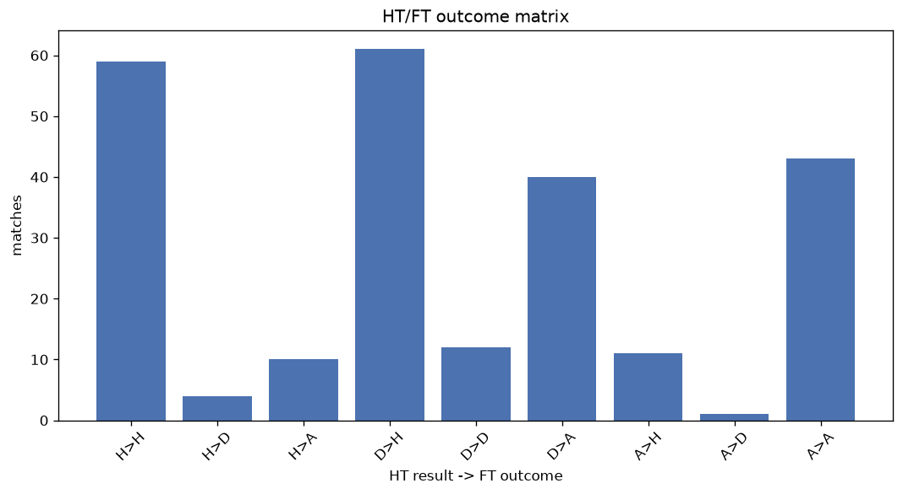
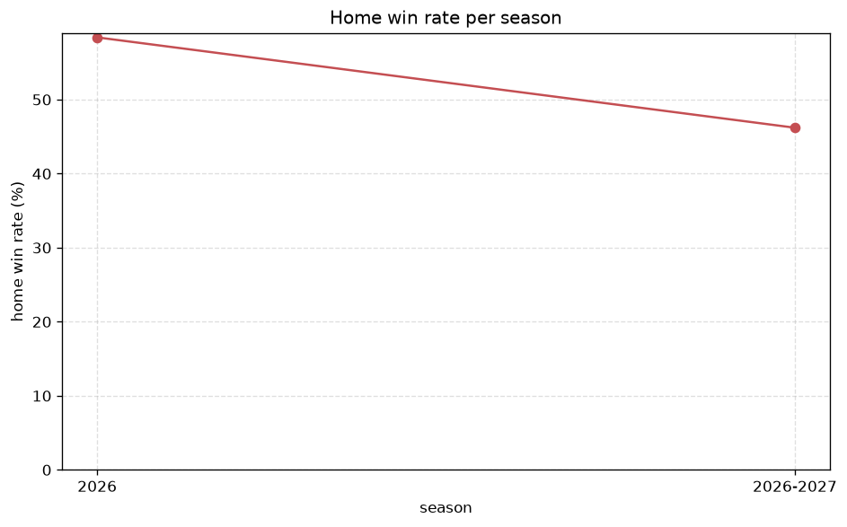

# Match Analysis
- Report: `matches_analysis`
- Generated: 2026-10-29T02:06:14+00:00
- Script: `backend/scripts/analyze_matches.py` v1.0.0
- League: J1 League (Japan)
- Scope: league `japan1`

## 1. Overall summary
| metric | value |
|---|---|
| Matches | 2339 |
| Home wins | 990 (42.3%) |
| Draws | 567 (24.2%) |
| Away wins | 782 (33.4%) |
| Total goals | 6077 |
| Average goals per match | 2.598 |
| Goalless matches | 186 (8.0%) |

## 2. Per-season breakdown
| season | matches | home wins | draws | away wins | total goals | avg goals | goalless |
|---|---|---|---|---|---|---|---|
| 2020 | 306 | 118 (38.6%) | 68 (22.2%) | 120 (39.2%) | 866 | 2.83 | 20 (6.5%) |
| 2021 | 380 | 160 (42.1%) | 94 (24.7%) | 126 (33.2%) | 920 | 2.421 | 34 (8.9%) |
| 2022 | 306 | 122 (39.9%) | 97 (31.7%) | 87 (28.4%) | 771 | 2.52 | 36 (11.8%) |
| 2023 | 306 | 129 (42.2%) | 78 (25.5%) | 99 (32.4%) | 777 | 2.539 | 24 (7.8%) |
| 2024 | 380 | 146 (38.4%) | 104 (27.4%) | 130 (34.2%) | 1013 | 2.666 | 32 (8.4%) |
| 2025 | 380 | 168 (44.2%) | 97 (25.5%) | 115 (30.3%) | 911 | 2.397 | 33 (8.7%) |
| 2026 | 161 | 94 (58.4%) | 0 (0.0%) | 67 (41.6%) | 462 | 2.87 | 0 (0.0%) |
| 2026-2027 | 120 | 53 (44.2%) | 29 (24.2%) | 38 (31.7%) | 357 | 2.975 | 7 (5.8%) |

## 3. HT/FT outcome matrix
| HT result \ FT result | Home | Draw | Away | total |
|---|---|---|---|---|
| HT home lead | 538 (76.6%) | 112 (16.0%) | 52 (7.4%) | 702 |
| HT draw | 388 (36.4%) | 359 (33.7%) | 318 (29.9%) | 1065 |
| HT away lead | 64 (11.2%) | 96 (16.8%) | 411 (72.0%) | 571 |
- *1 match(es) excluded (no HT score recorded).*

## 4. Comeback matches
- Home comebacks (trailing at HT, won at FT): **64** (2.7%)
- Away comebacks (trailing at HT, won at FT): **52** (2.2%)

### Home comebacks
| season | home | away | HT | FT |
|---|---|---|---|---|
| 2020 | Gamba Osaka | Nagoya Grampus | 0-1 | 2-1 |
| 2020 | Kashima Antlers | Yokohama FC | 0-2 | 3-2 |
| 2020 | Shimizu S-Pulse | Vissel Kobe | 0-1 | 3-1 |
| 2020 | Kawasaki Frontale | Urawa Reds | 0-1 | 3-1 |
| 2021 | Kawasaki Frontale | Cerezo Osaka | 1-2 | 3-2 |
| 2021 | FC Tokyo | Cerezo Osaka | 0-1 | 3-2 |
| 2021 | Hokkaido Consadole Sapporo | Vegalta Sendai | 0-1 | 2-1 |
| 2021 | Urawa Reds | Oita Trinita | 1-2 | 3-2 |
| 2021 | Sagan Tosu | Kashima Antlers | 0-1 | 2-1 |
| 2021 | Avispa Fukuoka | Shonan Bellmare | 0-1 | 2-1 |
| 2021 | Sagan Tosu | Nagoya Grampus | 0-1 | 3-1 |
| 2021 | Hokkaido Consadole Sapporo | FC Tokyo | 1-2 | 3-2 |
| 2021 | Kawasaki Frontale | Shonan Bellmare | 0-1 | 2-1 |
| 2021 | Kawasaki Frontale | Vissel Kobe | 0-1 | 3-1 |
| 2021 | Yokohama F. Marinos | Hokkaido Consadole Sapporo | 0-1 | 2-1 |
| 2022 | Yokohama F. Marinos | Kawasaki Frontale | 0-1 | 4-2 |
| 2022 | Kawasaki Frontale | Urawa Reds | 0-1 | 2-1 |
| 2022 | Kashima Antlers | Shonan Bellmare | 0-1 | 2-1 |
| 2022 | FC Tokyo | Vissel Kobe | 0-1 | 3-1 |
| 2022 | Nagoya Grampus | Shonan Bellmare | 0-1 | 2-1 |
| 2022 | Iwata | Nagoya Grampus | 0-1 | 2-1 |
| 2022 | Cerezo Osaka | Gamba Osaka | 0-1 | 3-1 |
| 2022 | Cerezo Osaka | Kawasaki Frontale | 0-1 | 2-1 |
| 2022 | Sanfrecce Hiroshima | Gamba Osaka | 1-2 | 5-2 |
| 2022 | Shonan Bellmare | Kawasaki Frontale | 0-1 | 2-1 |
| 2023 | Urawa Reds | Cerezo Osaka | 0-1 | 2-1 |
| 2023 | Albirex Niigata | Avispa Fukuoka | 0-2 | 3-2 |
| 2023 | Sanfrecce Hiroshima | Avispa Fukuoka | 0-1 | 3-1 |
| 2023 | Albirex Niigata | Yokohama F. Marinos | 0-1 | 2-1 |
| 2023 | Avispa Fukuoka | Hokkaido Consadole Sapporo | 0-1 | 2-1 |
| 2023 | Sagan Tosu | Cerezo Osaka | 0-1 | 2-1 |
| 2023 | Sanfrecce Hiroshima | Urawa Reds | 0-1 | 2-1 |
| 2023 | FC Tokyo | Sagan Tosu | 0-2 | 3-2 |
| 2024 | Kashima Antlers | Kawasaki Frontale | 0-1 | 2-1 |
| 2024 | Urawa Reds | Avispa Fukuoka | 0-1 | 2-1 |
| 2024 | FC Tokyo | Urawa Reds | 0-1 | 2-1 |
| 2024 | Albirex Niigata | Yokohama F. Marinos | 0-1 | 3-1 |
| 2024 | Iwata | Shonan Bellmare | 1-2 | 3-2 |
| 2024 | Kashima Antlers | Yokohama F. Marinos | 0-1 | 3-2 |
| 2024 | Nagoya Grampus | Kashiwa Reysol | 0-1 | 2-1 |
| 2024 | Kyoto | Nagoya Grampus | 0-2 | 3-2 |
| 2024 | Iwata | Kashima Antlers | 0-1 | 2-1 |
| 2024 | Shonan Bellmare | Kashima Antlers | 1-2 | 3-2 |
| 2024 | Gamba Osaka | Hokkaido Consadole Sapporo | 0-1 | 2-1 |
| 2024 | Shonan Bellmare | Sanfrecce Hiroshima | 0-1 | 2-1 |
| 2024 | Verdy | Urawa Reds | 0-1 | 2-1 |
| 2025 | Kashiwa Reysol | Cerezo Osaka | 0-1 | 2-1 |
| 2025 | Verdy | Nagoya Grampus | 0-1 | 2-1 |
| 2025 | Urawa Reds | Yokohama FC | 0-1 | 2-1 |
| 2025 | FC Tokyo | Yokohama FC | 0-1 | 2-1 |
| 2025 | FC Tokyo | Urawa Reds | 1-2 | 3-2 |
| 2025 | Kashiwa Reysol | Urawa Reds | 0-2 | 4-2 |
| 2025 | Vissel Kobe | Shimizu S-Pulse | 0-1 | 2-1 |
| 2026 | Avispa Fukuoka | Okayama | 0-1 | 2-1 |
| 2026 | Kawasaki Frontale | Mito | 0-2 | 3-2 |
| 2026 | Gamba Osaka | V-Varen Nagasaki | 1-2 | 3-2 |
| 2026 | Avispa Fukuoka | Gamba Osaka | 1-2 | 3-2 |
| 2026 | Kyoto | Nagoya Grampus | 0-1 | 2-1 |
| 2026 | Nagoya Grampus | Avispa Fukuoka | 0-2 | 3-2 |
| 2026 | Sanfrecce Hiroshima | Cerezo Osaka | 0-1 | 2-1 |
| 2026 | Avispa Fukuoka | Sanfrecce Hiroshima | 1-2 | 3-2 |
| 2026 | Shimizu S-Pulse | Cerezo Osaka | 0-1 | 2-1 |
| 2026 | Avispa Fukuoka | Kyoto | 0-1 | 2-1 |
| 2026-2027 | Shimizu S-Pulse | Chiba | 0-1 | 2-1 |

### Away comebacks
| season | home | away | HT | FT |
|---|---|---|---|---|
| 2020 | Sanfrecce Hiroshima | Oita Trinita | 1-0 | 1-2 |
| 2020 | Vegalta Sendai | Kawasaki Frontale | 2-0 | 2-3 |
| 2020 | Vissel Kobe | Kashiwa Reysol | 1-0 | 2-3 |
| 2020 | FC Tokyo | Kashima Antlers | 1-0 | 1-2 |
| 2020 | Kashiwa Reysol | Yokohama F. Marinos | 1-0 | 1-3 |
| 2020 | Yokohama F. Marinos | Kashima Antlers | 2-1 | 2-3 |
| 2020 | Yokohama FC | Oita Trinita | 2-1 | 2-3 |
| 2020 | Kashiwa Reysol | Kawasaki Frontale | 1-0 | 2-3 |
| 2021 | Tokushima | Avispa Fukuoka | 1-0 | 1-2 |
| 2021 | Hokkaido Consadole Sapporo | Vissel Kobe | 2-0 | 3-4 |
| 2021 | Tokushima | Hokkaido Consadole Sapporo | 1-0 | 1-2 |
| 2021 | Shonan Bellmare | Kashiwa Reysol | 1-0 | 2-4 |
| 2021 | Oita Trinita | Gamba Osaka | 2-1 | 2-3 |
| 2021 | Sanfrecce Hiroshima | FC Tokyo | 1-0 | 1-2 |
| 2022 | Sanfrecce Hiroshima | Kashiwa Reysol | 1-0 | 1-2 |
| 2022 | Gamba Osaka | Yokohama F. Marinos | 1-0 | 1-2 |
| 2022 | Gamba Osaka | Cerezo Osaka | 1-0 | 1-2 |
| 2022 | Sanfrecce Hiroshima | FC Tokyo | 1-0 | 1-2 |
| 2022 | Hokkaido Consadole Sapporo | Sagan Tosu | 1-0 | 1-2 |
| 2022 | Hokkaido Consadole Sapporo | Avispa Fukuoka | 1-0 | 1-2 |
| 2023 | Kashima Antlers | Kawasaki Frontale | 1-0 | 1-2 |
| 2023 | Albirex Niigata | Nagoya Grampus | 1-0 | 1-3 |
| 2023 | FC Tokyo | Yokohama F. Marinos | 2-1 | 2-3 |
| 2023 | Kashiwa Reysol | Avispa Fukuoka | 1-0 | 1-3 |
| 2023 | Gamba Osaka | Avispa Fukuoka | 1-0 | 1-2 |
| 2023 | FC Tokyo | Hokkaido Consadole Sapporo | 1-0 | 1-3 |
| 2024 | Verdy | Yokohama F. Marinos | 1-0 | 1-2 |
| 2024 | Shonan Bellmare | Verdy | 1-0 | 1-2 |
| 2024 | Hokkaido Consadole Sapporo | Nagoya Grampus | 1-0 | 1-2 |
| 2024 | Sagan Tosu | Kashiwa Reysol | 1-0 | 1-4 |
| 2024 | Iwata | Kyoto | 1-0 | 1-2 |
| 2024 | Albirex Niigata | Vissel Kobe | 2-1 | 2-3 |
| 2024 | Shonan Bellmare | Yokohama F. Marinos | 1-0 | 2-3 |
| 2025 | Machida | Sanfrecce Hiroshima | 1-0 | 1-2 |
| 2025 | Kashima Antlers | Kyoto | 2-0 | 3-4 |
| 2025 | Yokohama F. Marinos | Shimizu S-Pulse | 1-0 | 2-3 |
| 2025 | Albirex Niigata | Kyoto | 1-0 | 1-2 |
| 2025 | Okayama | Kashima Antlers | 1-0 | 1-2 |
| 2025 | Machida | Kyoto | 1-0 | 1-2 |
| 2025 | Kashima Antlers | Okayama | 1-0 | 1-2 |
| 2025 | Shonan Bellmare | Gamba Osaka | 3-1 | 4-5 |
| 2025 | Avispa Fukuoka | Cerezo Osaka | 1-0 | 2-4 |
| 2026 | Kashiwa Reysol | Verdy | 1-0 | 1-2 |
| 2026 | Sanfrecce Hiroshima | Kyoto | 1-0 | 1-2 |
| 2026 | Urawa Reds | Kashima Antlers | 2-1 | 2-3 |
| 2026 | Chiba | Yokohama F. Marinos | 1-0 | 2-3 |
| 2026 | Kyoto | Shimizu S-Pulse | 1-0 | 1-2 |
| 2026 | Sanfrecce Hiroshima | Vissel Kobe | 1-0 | 1-2 |
| 2026-2027 | Yokohama F. Marinos | Kashima Antlers | 2-1 | 3-4 |
| 2026-2027 | Avispa Fukuoka | Urawa Reds | 2-1 | 2-3 |
| 2026-2027 | Kyoto | Kashiwa Reysol | 2-0 | 2-3 |
| 2026-2027 | Machida | Kashiwa Reysol | 1-0 | 2-4 |

## 5. HT lead conversion
| HT state | matches | converted to win | held as draw | collapsed to loss |
|---|---|---|---|---|
| Home lead | 702 | 538 (76.6%) | 112 (16.0%) | 52 (7.4%) |
| Away lead | 571 | 411 (72.0%) | 96 (16.8%) | 64 (11.2%) |

### Matches level at half-time
| FT result | count | pct |
|---|---|---|
| Home win | 388 | 36.4% |
| Draw | 359 | 33.7% |
| Away win | 318 | 29.9% |
- *1 match(es) excluded (no HT score recorded).*

## 6. First-goal timing
- Matches with a first-goal time recorded: `2152` of `2339` (92.0%)

Outcome distribution by first-goal timing bucket:
| bucket | matches | % of matches | home | draw | away |
|---|---|---|---|---|---|
| 1-15 | 653 | 27.9% | 315 (48.2%) | 105 (16.1%) | 233 (35.7%) |
| 16-30 | 470 | 20.1% | 200 (42.6%) | 97 (20.6%) | 173 (36.8%) |
| 31-45 | 356 | 15.2% | 169 (47.5%) | 64 (18.0%) | 123 (34.6%) |
| 46-60 | 322 | 13.8% | 144 (44.7%) | 53 (16.5%) | 125 (38.8%) |
| 61-75 | 206 | 8.8% | 94 (45.6%) | 48 (23.3%) | 64 (31.1%) |
| 76-90 | 111 | 4.7% | 54 (48.6%) | 12 (10.8%) | 45 (40.5%) |
| 91-120 | 34 | 1.5% | 14 (41.2%) | 2 (5.9%) | 18 (52.9%) |

## 7. Goalless matches
- Overall: **186** of `2339` (8.0%)

| season | matches | goalless | pct |
|---|---|---|---|
| 2020 | 306 | 20 | 6.5% |
| 2021 | 380 | 34 | 8.9% |
| 2022 | 306 | 36 | 11.8% |
| 2023 | 306 | 24 | 7.8% |
| 2024 | 380 | 32 | 8.4% |
| 2025 | 380 | 33 | 8.7% |
| 2026 | 161 | 0 | 0.0% |
| 2026-2027 | 120 | 7 | 5.8% |

---
*All statistics are computed from PostgreSQL tables (read-only). Run with `python backend/scripts/analyze_matches.py` to regenerate.*

## Charts

