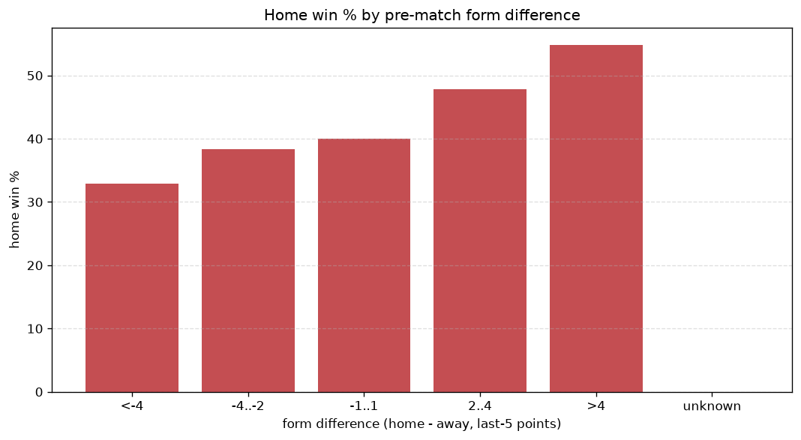
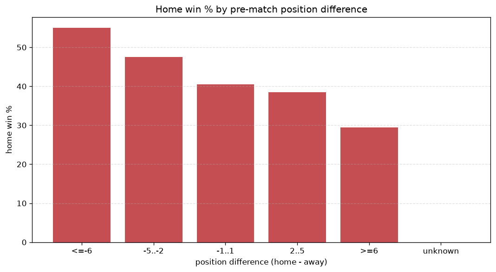

# Relationships Analysis
- Report: `relationships`
- Generated: 2026-10-26T01:39:09+00:00
- Script: `backend/scripts/analyze_relationships.py` v1.0.0
- League: J1 League (Japan)
- Scope: league `japan1`

- Matches analysed: **2219** (23 leakage-safe pre-match features).

## 1. Correlation matrix
_Pearson correlation of each pre-match feature with observed goals; sorted by |corr(total goals)|._

| feature | corr(home) | corr(away) | corr(total) |
|---|---|---|---|
| away_team_away_conceded_avg | 0.108 | -0.029 | 0.060 |
| home_team_home_goals_avg | 0.095 | -0.016 | 0.059 |
| away_team_goals_conceded_last_5 | 0.090 | -0.031 | 0.045 |
| away_team_goals_scored_last_5 | -0.014 | 0.079 | 0.043 |
| home_team_goals_scored_last_5 | 0.083 | -0.029 | 0.042 |
| away_team_away_goals_avg | -0.028 | 0.090 | 0.041 |
| rest_days_difference | -0.025 | -0.013 | -0.028 |
| home_rest_days | -0.034 | -0.000 | -0.025 |
| home_team_wins_last_5 | 0.076 | -0.055 | 0.018 |
| home_team_points_last_5 | 0.074 | -0.054 | 0.018 |
| home_position_before_match | -0.113 | 0.100 | -0.015 |
| away_rest_days | -0.024 | 0.005 | -0.014 |
| position_difference | -0.160 | 0.152 | -0.014 |
| home_team_home_conceded_avg | -0.020 | 0.042 | 0.014 |
| home_team_home_win_rate | 0.091 | -0.078 | 0.014 |
| points_difference | 0.152 | -0.148 | 0.011 |
| away_team_points_last_5 | -0.065 | 0.061 | -0.006 |
| away_team_away_win_rate | -0.073 | 0.070 | -0.005 |
| away_position_before_match | 0.112 | -0.113 | 0.005 |
| away_team_wins_last_5 | -0.070 | 0.069 | -0.004 |
| away_points_before_match | -0.036 | 0.033 | -0.004 |
| home_points_before_match | 0.073 | -0.073 | 0.004 |
| home_team_goals_conceded_last_5 | -0.026 | 0.026 | -0.001 |

## 2. Form vs outcome
_Home win/draw/away % per bucket of `home_team_points_last_5 - away_team_points_last_5`._

| bucket | matches | home | draw | away | home % | draw % | away % |
|---|---|---|---|---|---|---|---|
| <-4 | 365 | 120 | 98 | 147 | 32.9% | 26.8% | 40.3% |
| -4..-2 | 458 | 176 | 117 | 165 | 38.4% | 25.5% | 36.0% |
| -1..1 | 642 | 257 | 171 | 214 | 40.0% | 26.6% | 33.3% |
| 2..4 | 418 | 200 | 96 | 122 | 47.8% | 23.0% | 29.2% |
| >4 | 336 | 184 | 56 | 96 | 54.8% | 16.7% | 28.6% |
| unknown | 0 | 0 | 0 | 0 | - | - | - |

## 3. Position vs outcome
_Home win/draw/away % per bucket of `position_difference` (home position - away position; negative favours the home team)._

| bucket | matches | home | draw | away | home % | draw % | away % |
|---|---|---|---|---|---|---|---|
| <=-6 | 569 | 313 | 114 | 142 | 55.0% | 20.0% | 25.0% |
| -5..-2 | 385 | 183 | 87 | 115 | 47.5% | 22.6% | 29.9% |
| -1..1 | 301 | 122 | 80 | 99 | 40.5% | 26.6% | 32.9% |
| 2..5 | 390 | 150 | 102 | 138 | 38.5% | 26.2% | 35.4% |
| >=6 | 574 | 169 | 155 | 250 | 29.4% | 27.0% | 43.6% |
| unknown | 0 | 0 | 0 | 0 | - | - | - |

## 4. Rest advantage
_Home win/draw/away % per bucket of `rest_days_difference` (home rest - away rest). Matches with unknown rest are bucketed separately._

| bucket | matches | home | draw | away | home % | draw % | away % |
|---|---|---|---|---|---|---|---|
| <-1 | 178 | 80 | 42 | 56 | 44.9% | 23.6% | 31.5% |
| -1..0 | 268 | 127 | 59 | 82 | 47.4% | 22.0% | 30.6% |
| 0 | 1266 | 521 | 310 | 435 | 41.2% | 24.5% | 34.4% |
| 1..2 | 281 | 126 | 64 | 91 | 44.8% | 22.8% | 32.4% |
| >2 | 159 | 62 | 44 | 53 | 39.0% | 27.7% | 33.3% |
| unknown | 67 | 21 | 19 | 27 | 31.3% | 28.4% | 40.3% |
- *67 match(es) had unknown rest difference (missing rest data on at least one side).*

## 5. Home team quality
_Home win rate by `home_team_home_win_rate` tier (split at 0.5)._

- `< 0.5` tier: **37.6%** home win (532/1414)
- `>= 0.5` tier: **50.3%** home win (405/805)
- Home-win gap (>= split minus < split): **+12.7 pp**

| tier | label | matches | home | draw | away | home % |
|---|---|---|---|---|---|---|
| low | < 0.5 | 1414 | 532 | 366 | 516 | 37.6% |
| high | >= 0.5 | 805 | 405 | 172 | 228 | 50.3% |

## 6. Feature averages by result
_Mean feature value per outcome; `range` is home-minus-away spread of the group means._

| feature | home mean | draw mean | away mean | range |
|---|---|---|---|---|
| points_difference | 2.631 | -1.390 | -2.610 | 5.241 |
| position_difference | -1.844 | 0.913 | 1.672 | 3.516 |
| home_points_before_match | 24.489 | 23.097 | 21.347 | 3.142 |
| away_points_before_match | 21.858 | 24.487 | 23.957 | 2.629 |
| home_position_before_match | 9.359 | 10.541 | 11.136 | 1.777 |
| away_position_before_match | 11.203 | 9.628 | 9.464 | 1.739 |
| home_team_points_last_5 | 6.637 | 5.894 | 5.946 | 0.743 |
| away_team_goals_conceded_last_5 | 6.197 | 5.487 | 5.637 | 0.710 |
| away_rest_days | 7.828 | 7.740 | 8.449 | 0.709 |
| home_rest_days | 7.706 | 7.807 | 8.354 | 0.648 |
| home_team_goals_scored_last_5 | 6.153 | 5.539 | 5.698 | 0.614 |
| away_team_points_last_5 | 5.972 | 6.578 | 6.565 | 0.606 |
| away_team_goals_scored_last_5 | 5.686 | 6.032 | 6.099 | 0.413 |
| home_team_wins_last_5 | 1.859 | 1.567 | 1.609 | 0.292 |
| home_team_goals_conceded_last_5 | 5.829 | 5.864 | 6.071 | 0.242 |
| away_team_wins_last_5 | 1.617 | 1.812 | 1.836 | 0.219 |
| rest_days_difference | -0.121 | 0.067 | -0.095 | 0.189 |
| away_team_away_conceded_avg | 1.348 | 1.183 | 1.215 | 0.165 |
| home_team_home_goals_avg | 1.319 | 1.203 | 1.232 | 0.115 |
| away_team_away_goals_avg | 1.088 | 1.122 | 1.184 | 0.096 |
| home_team_home_conceded_avg | 1.129 | 1.095 | 1.183 | 0.088 |
| home_team_home_win_rate | 0.417 | 0.350 | 0.350 | 0.067 |
| away_team_away_win_rate | 0.295 | 0.326 | 0.340 | 0.045 |

---
*All features are leakage-safe pre-match values built by `ml.features.build_features.build_rows` from strictly prior matches. Run with `python backend/scripts/analyze_relationships.py` to regenerate.*

## Charts

