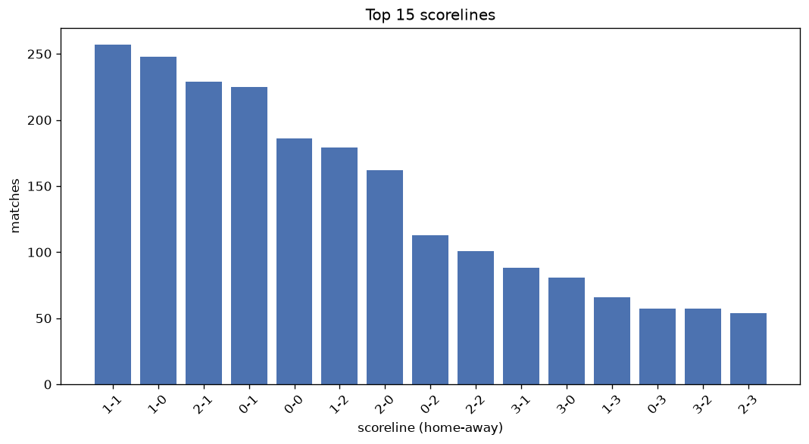
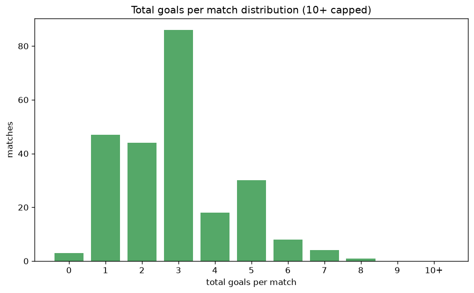

# Scoreline Analysis
- Report: `scoreline_analysis`
- Generated: 2026-10-29T02:06:21+00:00
- Script: `backend/scripts/analyze_scorelines.py` v1.0.0
- League: J1 League (Japan)
- Scope: league `japan1`

## 1. Scoreline frequency
- Matches analysed: **2339** across **8** seasons.
- Distinct scorelines seen: **41**.

| scoreline | count | pct |
|---|---|---|
| 1-1 | 257 | 11.0% |
| 1-0 | 248 | 10.6% |
| 2-1 | 229 | 9.8% |
| 0-1 | 225 | 9.6% |
| 0-0 | 186 | 8.0% |
| 1-2 | 179 | 7.7% |
| 2-0 | 162 | 6.9% |
| 0-2 | 113 | 4.8% |
| 2-2 | 101 | 4.3% |
| 3-1 | 88 | 3.8% |
| 3-0 | 81 | 3.5% |
| 1-3 | 66 | 2.8% |
| 0-3 | 57 | 2.4% |
| 3-2 | 57 | 2.4% |
| 2-3 | 54 | 2.3% |
| 4-0 | 33 | 1.4% |
| 1-4 | 23 | 1.0% |
| 4-1 | 23 | 1.0% |
| 3-3 | 20 | 0.9% |
| 0-4 | 18 | 0.8% |

## 2. Scoreline frequency per season

### 2020
| scoreline | count | pct |
|---|---|---|
| 1-1 | 32 | 10.5% |
| 1-0 | 32 | 10.5% |
| 0-1 | 26 | 8.5% |
| 1-2 | 24 | 7.8% |
| 0-0 | 20 | 6.5% |

### 2021
| scoreline | count | pct |
|---|---|---|
| 1-0 | 48 | 12.6% |
| 1-1 | 45 | 11.8% |
| 0-1 | 37 | 9.7% |
| 2-1 | 34 | 8.9% |
| 0-0 | 34 | 8.9% |

### 2022
| scoreline | count | pct |
|---|---|---|
| 1-1 | 40 | 13.1% |
| 0-0 | 36 | 11.8% |
| 0-1 | 27 | 8.8% |
| 2-1 | 27 | 8.8% |
| 1-0 | 25 | 8.2% |

### 2023
| scoreline | count | pct |
|---|---|---|
| 1-1 | 35 | 11.4% |
| 2-1 | 34 | 11.1% |
| 0-1 | 32 | 10.5% |
| 1-0 | 31 | 10.1% |
| 2-0 | 25 | 8.2% |

### 2024
| scoreline | count | pct |
|---|---|---|
| 1-1 | 48 | 12.6% |
| 0-1 | 36 | 9.5% |
| 2-1 | 33 | 8.7% |
| 0-0 | 32 | 8.4% |
| 1-2 | 32 | 8.4% |

### 2025
| scoreline | count | pct |
|---|---|---|
| 1-0 | 54 | 14.2% |
| 0-1 | 45 | 11.8% |
| 1-1 | 44 | 11.6% |
| 2-1 | 40 | 10.5% |
| 0-0 | 33 | 8.7% |

### 2026
| scoreline | count | pct |
|---|---|---|
| 2-1 | 30 | 18.6% |
| 1-2 | 27 | 16.8% |
| 1-0 | 21 | 13.0% |
| 2-0 | 16 | 9.9% |
| 3-2 | 14 | 8.7% |

### 2026-2027
| scoreline | count | pct |
|---|---|---|
| 1-1 | 13 | 10.8% |
| 2-1 | 12 | 10.0% |
| 0-1 | 10 | 8.3% |
| 2-0 | 9 | 7.5% |
| 2-2 | 8 | 6.7% |

## 3. Total-goal histogram
_10+ groups all matches with 10 or more total goals._

| total goals | matches | pct |
|---|---|---|
| 0 | 186 | 8.0% |
| 1 | 473 | 20.2% |
| 2 | 532 | 22.7% |
| 3 | 546 | 23.3% |
| 4 | 306 | 13.1% |
| 5 | 175 | 7.5% |
| 6 | 70 | 3.0% |
| 7 | 30 | 1.3% |
| 8 | 16 | 0.7% |
| 9 | 5 | 0.2% |
| 10+ | 0 | 0.0% |

## 4. Extreme scorelines
- Matches with 7+ total goals: **51**

| season | date | scoreline | total goals |
|---|---|---|---|
| 2022 | 2022-08-27 | 3-6 | 9 |
| 2023 | 2023-06-03 | 4-5 | 9 |
| 2024 | 2024-03-01 | 4-5 | 9 |
| 2024 | 2024-11-30 | 4-5 | 9 |
| 2025 | 2025-08-31 | 4-5 | 9 |
| 2020 | 2020-08-08 | 6-2 | 8 |
| 2020 | 2020-11-14 | 6-2 | 8 |
| 2021 | 2021-05-15 | 5-3 | 8 |
| 2021 | 2021-10-16 | 5-3 | 8 |
| 2021 | 2021-11-06 | 8-0 | 8 |
| 2022 | 2022-05-25 | 4-4 | 8 |
| 2022 | 2022-07-02 | 3-5 | 8 |
| 2024 | 2024-03-17 | 4-4 | 8 |
| 2024 | 2024-06-02 | 5-3 | 8 |
| 2024 | 2024-08-16 | 5-3 | 8 |
| 2024 | 2024-08-17 | 3-5 | 8 |
| 2024 | 2024-09-22 | 6-2 | 8 |
| 2025 | 2025-08-31 | 5-3 | 8 |
| 2025 | 2025-09-28 | 4-4 | 8 |
| 2025 | 2025-10-18 | 5-3 | 8 |
| 2026 | 2026-02-08 | 5-3 | 8 |
| 2020 | 2020-08-15 | 1-6 | 7 |
| 2020 | 2020-08-19 | 5-2 | 7 |
| 2020 | 2020-08-19 | 3-4 | 7 |
| 2020 | 2020-09-13 | 3-4 | 7 |
| 2020 | 2020-09-23 | 4-3 | 7 |
| 2020 | 2020-10-10 | 4-3 | 7 |
| 2021 | 2021-03-20 | 3-4 | 7 |
| 2022 | 2022-05-25 | 1-6 | 7 |
| 2022 | 2022-06-18 | 5-2 | 7 |
| 2022 | 2022-08-20 | 5-2 | 7 |
| 2022 | 2022-10-01 | 4-3 | 7 |
| 2022 | 2022-11-05 | 4-3 | 7 |
| 2023 | 2023-04-01 | 3-4 | 7 |
| 2023 | 2023-06-10 | 4-3 | 7 |
| 2023 | 2023-08-06 | 3-4 | 7 |
| 2024 | 2024-03-30 | 6-1 | 7 |
| 2024 | 2024-05-15 | 5-2 | 7 |
| 2024 | 2024-07-06 | 3-4 | 7 |
| 2024 | 2024-07-20 | 3-4 | 7 |
| 2024 | 2024-11-09 | 3-4 | 7 |
| 2024 | 2024-11-16 | 3-4 | 7 |
| 2025 | 2025-02-14 | 2-5 | 7 |
| 2025 | 2025-04-06 | 3-4 | 7 |
| 2025 | 2025-08-09 | 2-5 | 7 |
| 2025 | 2025-08-23 | 3-4 | 7 |
| 2025 | 2025-11-08 | 5-2 | 7 |
| 2026 | 2026-04-24 | 5-2 | 7 |
| 2026-2027 | 2026-08-07 | 3-4 | 7 |
| 2026-2027 | 2026-08-07 | 4-3 | 7 |
| 2026-2027 | 2026-09-12 | 6-1 | 7 |

## 5. Margin-of-victory distribution (decided matches)
- Decided matches: **1772** (draws: **567**)
- Average winning margin: **1.67**

| margin | matches | pct |
|---|---|---|
| 1 | 1014 | 57.2% |
| 2 | 462 | 26.1% |
| 3+ | 296 | 16.7% |

## 6. Margin by outcome

### Home wins
- Matches: **990** | avg margin: **1.72** | max margin: **8**
| margin | matches | pct |
|---|---|---|
| 1 | 540 | 54.5% |
| 2 | 273 | 27.6% |
| 3+ | 177 | 17.9% |
- *Full match-by-match list available in `scoreline_analysis.json`.*

### Away wins
- Matches: **782** | avg margin: **1.61** | max margin: **6**
| margin | matches | pct |
|---|---|---|
| 1 | 474 | 60.6% |
| 2 | 189 | 24.2% |
| 3+ | 119 | 15.2% |
- *Full match-by-match list available in `scoreline_analysis.json`.*

## 7. Most common exact score by outcome type
| outcome | matches | most common score | count | pct |
|---|---|---|---|---|
| home | 990 | 1-0 | 248 | 25.1% |
| draw | 567 | 1-1 | 257 | 45.3% |
| away | 782 | 0-1 | 225 | 28.8% |

---
*All statistics are computed from PostgreSQL tables (read-only). Run with `python backend/scripts/analyze_scorelines.py` to regenerate.*

## Charts

