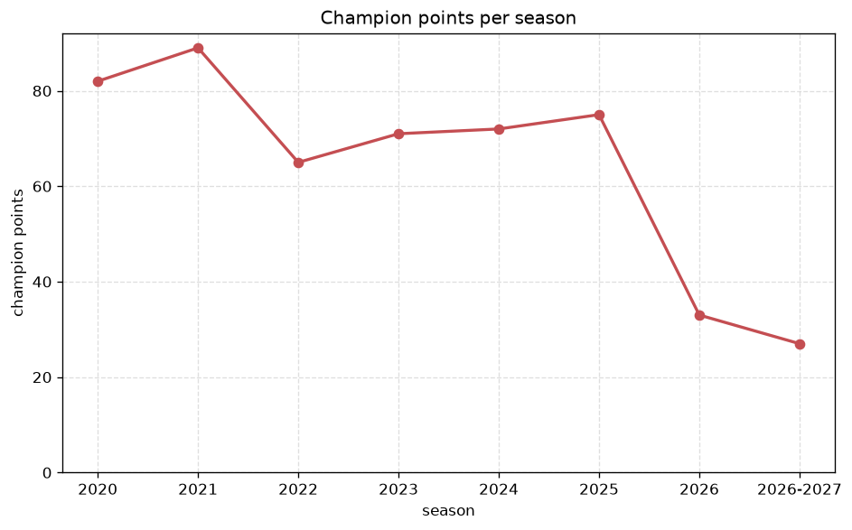
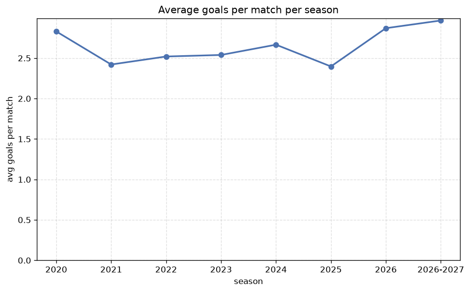

# Season Trends Analysis
- Report: `season_trends`
- Generated: 2026-10-26T01:39:06+00:00
- Script: `backend/scripts/analyze_seasons.py` v1.0.0
- League: J1 League (Japan)
- Scope: league `japan1`

## 1. Champions per season
| season | champion | pts | runner-up | margin |
|---|---|---|---|---|
| 2020 | Kawasaki Frontale | 82 | Gamba Osaka | 20 pts |
| 2021 | Kawasaki Frontale | 89 | Yokohama F. Marinos | 11 pts |
| 2022 | Yokohama F. Marinos | 65 | Kawasaki Frontale | 2 pts |
| 2023 | Vissel Kobe | 71 | Yokohama F. Marinos | 7 pts |
| 2024 | Vissel Kobe | 72 | Sanfrecce Hiroshima | 4 pts |
| 2025 | Kashima Antlers | 75 | Kashiwa Reysol | 3 pts |
| 2026 | Kashima Antlers | 33 | FC Tokyo | 6 pts |
| 2026-2027 | Machida | 27 | Sanfrecce Hiroshima | 1 pts |

## 2. Title-race tightness
- Tight races (margin <= 3 pts): **3** of 8 seasons
- Tightest race: **2026-2027** - Machida beat Sanfrecce Hiroshima by **1** pts

| season | margin | tight |
|---|---|---|
| 2020 | 20 pts |  |
| 2021 | 11 pts |  |
| 2022 | 2 pts | yes |
| 2023 | 7 pts |  |
| 2024 | 4 pts |  |
| 2025 | 3 pts | yes |
| 2026 | 6 pts |  |
| 2026-2027 | 1 pts | yes |

## 3. Points thresholds
_Position-specific points per season. Key: 1 = champion, 2 = runner-up, 4 = CL line, 6 = Europa, 17 = last safe, 20 = bottom._

| season | pos 1 | pos 2 | pos 4 | pos 6 | pos 17 | pos 20 |
|---|---|---|---|---|---|---|
| 2020 | 82 | 62 | 60 | 54 | 25 | - |
| 2021 | 89 | 78 | 66 | 60 | 33 | 21 |
| 2022 | 65 | 63 | 49 | 46 | 29 | - |
| 2023 | 71 | 64 | 57 | 52 | 33 | - |
| 2024 | 72 | 68 | 66 | 56 | 41 | 35 |
| 2025 | 75 | 72 | 65 | 59 | 35 | 24 |
| 2026 | 33 | 27 | 21 | 18 | 9 | - |
| 2026-2027 | 27 | 26 | 24 | 20 | 9 | 6 |

## 4. Relegation battle
| season | safe pos | safe pts | drop pos | drop pts | gap |
|---|---|---|---|---|---|
| 2020 | 17 | 25 | 18 | - | - |
| 2021 | 17 | 33 | 18 | 28 | 5 pts |
| 2022 | 17 | 29 | 18 | 19 | 10 pts |
| 2023 | 17 | 33 | 18 | 29 | 4 pts |
| 2024 | 17 | 41 | 18 | 38 | 3 pts |
| 2025 | 17 | 35 | 18 | 32 | 3 pts |
| 2026 | 17 | 9 | 18 | 9 | 0 pts |
| 2026-2027 | 17 | 9 | 18 | 8 | 1 pts |

## 5. League-level trends
| season | matches | total goals | avg goals | home win | draw | away win | goalless | avg pts/team |
|---|---|---|---|---|---|---|---|---|
| 2020 | 306 | 866 | 2.83 | 38.6% | 22.2% | 39.2% | 6.5% | 44.56 |
| 2021 | 380 | 920 | 2.421 | 42.1% | 24.7% | 33.2% | 8.9% | 49.75 |
| 2022 | 306 | 771 | 2.52 | 39.9% | 31.7% | 28.4% | 11.8% | 43.22 |
| 2023 | 306 | 777 | 2.539 | 42.2% | 25.5% | 32.4% | 7.8% | 46.67 |
| 2024 | 380 | 1013 | 2.666 | 38.4% | 27.4% | 34.2% | 8.4% | 51.8 |
| 2025 | 380 | 911 | 2.397 | 44.2% | 25.5% | 30.3% | 8.7% | 49.65 |
| 2026 | 161 | 462 | 2.87 | 58.4% | 0.0% | 41.6% | 0.0% | 15.6 |
| 2026-2027 | 115 | 341 | 2.965 | 43.5% | 23.5% | 33.0% | 6.1% | 15.9 |

## 6. View divergence
- Largest divergence: **2020** (goals view, avg abs position diff = 14.500)

_Avg absolute position difference between classic view and alternative view per season._

| season | classic vs luck | classic vs goals |
|---|---|---|
| 2020 | 10.667 | 14.500 |
| 2021 | 12.150 | 10.150 |
| 2022 | 11.833 | 10.056 |
| 2023 | 3.444 | 7.333 |
| 2024 | 4.400 | 7.400 |
| 2025 | 12.150 | 12.050 |
| 2026 | 12.950 | 7.800 |
| 2026-2027 | 2.100 | 5.600 |

---
*All statistics are computed from PostgreSQL tables (read-only). Run with `python backend/scripts/analyze_seasons.py` to regenerate.*

## Charts

