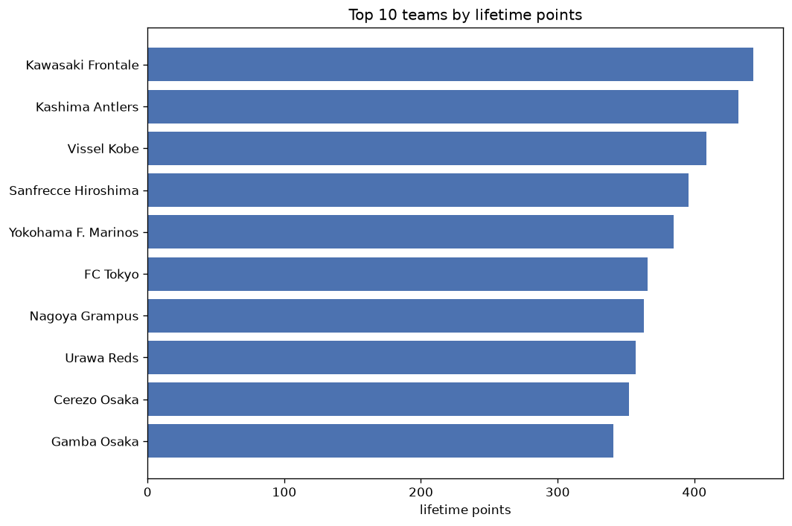
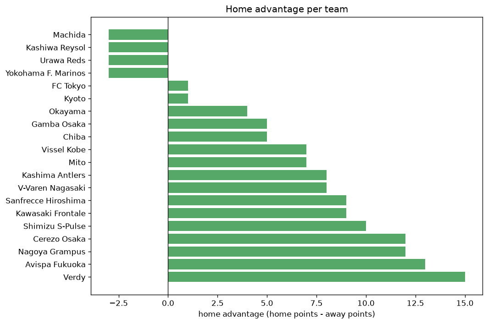

# Team Analysis
- Report: `teams_analysis`
- Generated: 2026-10-30T03:59:55+00:00
- Script: `backend/scripts/analyze_teams.py` v1.0.0
- League: J1 League (Japan)
- Scope: league `japan1`

- Teams: **29** | Seasons: **8** | Matches: **2339**

## 1. Team standings (lifetime)
| team | seasons | played | W | D | L | pts | GF | GA | GD | avg pts/season | best pos | worst pos | titles |
|---|---|---|---|---|---|---|---|---|---|---|---|---|---|
| Kawasaki Frontale | 8 | 244 | 130 | 56 | 58 | 446 | 464 | 304 | 160 | 55.75 | 1 | 8 | 2 |
| Kashima Antlers | 8 | 244 | 126 | 54 | 64 | 432 | 378 | 260 | 118 | 54.0 | 1 | 8 | 2 |
| Vissel Kobe | 8 | 244 | 118 | 55 | 71 | 409 | 358 | 267 | 91 | 51.12 | 1 | 13 | 2 |
| Sanfrecce Hiroshima | 8 | 244 | 112 | 60 | 72 | 396 | 354 | 250 | 104 | 49.5 | 2 | 11 | 0 |
| Yokohama F. Marinos | 8 | 244 | 113 | 47 | 84 | 386 | 429 | 320 | 109 | 48.25 | 1 | 15 | 1 |
| FC Tokyo | 8 | 244 | 106 | 51 | 87 | 369 | 336 | 308 | 28 | 46.12 | 2 | 11 | 0 |
| Nagoya Grampus | 8 | 244 | 103 | 55 | 86 | 364 | 292 | 271 | 21 | 45.5 | 3 | 16 | 0 |
| Urawa Reds | 8 | 244 | 98 | 66 | 80 | 360 | 318 | 287 | 31 | 45.0 | 4 | 13 | 0 |
| Cerezo Osaka | 8 | 244 | 98 | 59 | 87 | 353 | 314 | 304 | 10 | 44.12 | 4 | 12 | 0 |
| Gamba Osaka | 8 | 245 | 96 | 53 | 96 | 341 | 295 | 331 | -36 | 42.62 | 2 | 16 | 0 |
| Kashiwa Reysol | 8 | 244 | 89 | 62 | 93 | 329 | 314 | 319 | -5 | 41.12 | 2 | 17 | 0 |
| Avispa Fukuoka | 7 | 211 | 71 | 56 | 84 | 269 | 209 | 245 | -36 | 38.43 | 7 | 19 | 0 |
| Kyoto | 6 | 172 | 60 | 42 | 70 | 222 | 211 | 225 | -14 | 37.0 | 4 | 16 | 0 |
| Shonan Bellmare | 6 | 216 | 51 | 63 | 102 | 216 | 225 | 305 | -80 | 36.0 | 12 | 18 | 0 |
| Hokkaido Consadole Sapporo | 5 | 178 | 54 | 50 | 74 | 212 | 239 | 290 | -51 | 42.4 | 8 | 19 | 0 |
| Sagan Tosu | 5 | 178 | 51 | 57 | 70 | 210 | 216 | 237 | -21 | 42.0 | 7 | 20 | 0 |
| Machida | 4 | 104 | 56 | 21 | 27 | 189 | 162 | 102 | 60 | 47.25 | 1 | 6 | 1 |
| Shimizu S-Pulse | 6 | 172 | 47 | 44 | 81 | 185 | 202 | 270 | -68 | 30.83 | 13 | 21 | 0 |
| Verdy | 4 | 104 | 35 | 29 | 40 | 134 | 104 | 133 | -29 | 33.5 | 6 | 18 | 0 |
| Yokohama FC | 4 | 144 | 31 | 31 | 82 | 124 | 128 | 240 | -112 | 31.0 | 15 | 19 | 0 |
| Albirex Niigata | 3 | 110 | 25 | 36 | 49 | 111 | 116 | 166 | -50 | 37.0 | 10 | 20 | 0 |
| Okayama | 3 | 66 | 24 | 10 | 32 | 82 | 71 | 86 | -15 | 27.33 | 10 | 14 | 0 |
| Oita Trinita | 2 | 72 | 20 | 18 | 34 | 78 | 67 | 100 | -33 | 39.0 | 10 | 16 | 0 |
| Iwata | 2 | 72 | 16 | 20 | 36 | 68 | 79 | 125 | -46 | 34.0 | 17 | 18 | 0 |
| Vegalta Sendai | 2 | 72 | 11 | 23 | 38 | 56 | 67 | 123 | -56 | 28.0 | 17 | 18 | 0 |
| Tokushima | 1 | 38 | 10 | 6 | 22 | 36 | 34 | 55 | -21 | 36.0 | 17 | 17 | 0 |
| V-Varen Nagasaki | 2 | 28 | 9 | 3 | 16 | 30 | 33 | 45 | -12 | 15.0 | 14 | 17 | 0 |
| Mito | 2 | 28 | 8 | 3 | 17 | 27 | 34 | 57 | -23 | 13.5 | 17 | 22 | 0 |
| Chiba | 2 | 28 | 4 | 4 | 20 | 16 | 28 | 52 | -24 | 8.0 | 19 | 20 | 0 |

## 2. Home vs away split
| team | home P | H-W | H-D | H-L | H-pts | away P | A-W | A-D | A-L | A-pts | adv |
|---|---|---|---|---|---|---|---|---|---|---|---|
| Nagoya Grampus | 123 | 62 | 32 | 29 | 218 | 121 | 41 | 23 | 57 | 146 | 72 |
| Kawasaki Frontale | 123 | 77 | 24 | 22 | 255 | 121 | 53 | 32 | 36 | 191 | 64 |
| Urawa Reds | 122 | 60 | 30 | 32 | 210 | 122 | 38 | 36 | 48 | 150 | 60 |
| Avispa Fukuoka | 106 | 44 | 25 | 37 | 157 | 105 | 27 | 31 | 47 | 112 | 45 |
| Cerezo Osaka | 123 | 56 | 30 | 37 | 198 | 121 | 42 | 29 | 50 | 155 | 43 |
| Kashima Antlers | 122 | 68 | 33 | 21 | 237 | 122 | 58 | 21 | 43 | 195 | 42 |
| Sanfrecce Hiroshima | 122 | 64 | 26 | 32 | 218 | 122 | 48 | 34 | 40 | 178 | 40 |
| FC Tokyo | 124 | 61 | 21 | 42 | 204 | 120 | 45 | 30 | 45 | 165 | 39 |
| Yokohama F. Marinos | 121 | 62 | 25 | 34 | 211 | 123 | 51 | 22 | 50 | 175 | 36 |
| Yokohama FC | 72 | 21 | 15 | 36 | 78 | 72 | 10 | 16 | 46 | 46 | 32 |
| Sagan Tosu | 89 | 30 | 28 | 31 | 118 | 89 | 21 | 29 | 39 | 92 | 26 |
| Verdy | 54 | 22 | 13 | 19 | 79 | 50 | 13 | 16 | 21 | 55 | 24 |
| Hokkaido Consadole Sapporo | 89 | 31 | 23 | 35 | 116 | 89 | 23 | 27 | 39 | 96 | 20 |
| Vissel Kobe | 122 | 62 | 27 | 33 | 213 | 122 | 56 | 28 | 38 | 196 | 17 |
| Gamba Osaka | 122 | 52 | 23 | 47 | 179 | 123 | 44 | 30 | 49 | 162 | 17 |
| Oita Trinita | 36 | 12 | 10 | 14 | 46 | 36 | 8 | 8 | 20 | 32 | 14 |
| Iwata | 36 | 10 | 11 | 15 | 41 | 36 | 6 | 9 | 21 | 27 | 14 |
| Okayama | 32 | 14 | 5 | 13 | 47 | 34 | 10 | 5 | 19 | 35 | 12 |
| Shimizu S-Pulse | 87 | 24 | 26 | 37 | 98 | 85 | 23 | 18 | 44 | 87 | 11 |
| V-Varen Nagasaki | 14 | 6 | 2 | 6 | 20 | 14 | 3 | 1 | 10 | 10 | 10 |
| Mito | 13 | 5 | 2 | 6 | 17 | 15 | 3 | 1 | 11 | 10 | 7 |
| Chiba | 13 | 3 | 2 | 8 | 11 | 15 | 1 | 2 | 12 | 5 | 6 |
| Kyoto | 84 | 31 | 20 | 33 | 113 | 88 | 29 | 22 | 37 | 109 | 4 |
| Shonan Bellmare | 108 | 25 | 35 | 48 | 110 | 108 | 26 | 28 | 54 | 106 | 4 |
| Albirex Niigata | 55 | 12 | 21 | 22 | 57 | 55 | 13 | 15 | 27 | 54 | 3 |
| Tokushima | 19 | 4 | 5 | 10 | 17 | 19 | 6 | 1 | 12 | 19 | -2 |
| Machida | 51 | 27 | 8 | 16 | 89 | 53 | 29 | 13 | 11 | 100 | -11 |
| Vegalta Sendai | 36 | 3 | 13 | 20 | 22 | 36 | 8 | 10 | 18 | 34 | -12 |
| Kashiwa Reysol | 121 | 42 | 32 | 47 | 158 | 123 | 47 | 30 | 46 | 171 | -13 |

## 3. Top performers
### Best points per game (PPG)
| rank | team | PPG |
|---|---|---|
| 1 | Kawasaki Frontale | 1.83 |
| 2 | Machida | 1.82 |
| 3 | Kashima Antlers | 1.77 |
| 4 | Vissel Kobe | 1.68 |
| 5 | Sanfrecce Hiroshima | 1.62 |

### Most goals scored
| rank | team | goals |
|---|---|---|
| 1 | Kawasaki Frontale | 464 |
| 2 | Yokohama F. Marinos | 429 |
| 3 | Kashima Antlers | 378 |
| 4 | Vissel Kobe | 358 |
| 5 | Sanfrecce Hiroshima | 354 |

### Best goal difference
| rank | team | GD |
|---|---|---|
| 1 | Kawasaki Frontale | 160 |
| 2 | Kashima Antlers | 118 |
| 3 | Yokohama F. Marinos | 109 |
| 4 | Sanfrecce Hiroshima | 104 |
| 5 | Vissel Kobe | 91 |

### Best defence (goals against per match, standings)
| rank | team | GA/match |
|---|---|---|
| 1 | Machida | 0.938 |
| 2 | Sanfrecce Hiroshima | 0.996 |
| 3 | Kashima Antlers | 1.068 |
| 4 | Vissel Kobe | 1.077 |
| 5 | Avispa Fukuoka | 1.111 |

## 4. Team consistency
- Teams present in all **8** seasons: **11**

Cerezo Osaka, FC Tokyo, Gamba Osaka, Kashima Antlers, Kashiwa Reysol, Kawasaki Frontale, Nagoya Grampus, Sanfrecce Hiroshima, Urawa Reds, Vissel Kobe, Yokohama F. Marinos

## 5. Head-to-head dominance
- Distinct fixtures: **344** (showing the 15 most frequent)

| fixture | meetings | home wins | draws | away wins | home pct | draw pct | away pct |
|---|---|---|---|---|---|---|---|
| Kashima Antlers vs Yokohama F. Marinos | 15 | 9 | 0 | 6 | 60.0% | 0.0% | 40.0% |
| Yokohama F. Marinos vs Urawa Reds | 15 | 9 | 4 | 2 | 60.0% | 26.7% | 13.3% |
| Gamba Osaka vs Nagoya Grampus | 15 | 8 | 1 | 6 | 53.3% | 6.7% | 40.0% |
| Gamba Osaka vs Vissel Kobe | 15 | 8 | 2 | 5 | 53.3% | 13.3% | 33.3% |
| Kawasaki Frontale vs Kashima Antlers | 15 | 8 | 2 | 5 | 53.3% | 13.3% | 33.3% |
| Gamba Osaka vs Sanfrecce Hiroshima | 15 | 7 | 3 | 5 | 46.7% | 20.0% | 33.3% |
| Cerezo Osaka vs Vissel Kobe | 15 | 6 | 4 | 5 | 40.0% | 26.7% | 33.3% |
| Kashima Antlers vs Kashiwa Reysol | 15 | 6 | 2 | 7 | 40.0% | 13.3% | 46.7% |
| Cerezo Osaka vs Sanfrecce Hiroshima | 15 | 5 | 3 | 7 | 33.3% | 20.0% | 46.7% |
| Kashima Antlers vs Urawa Reds | 15 | 5 | 7 | 3 | 33.3% | 46.7% | 20.0% |
| FC Tokyo vs Kashiwa Reysol | 15 | 3 | 5 | 7 | 20.0% | 33.3% | 46.7% |
| Nagoya Grampus vs Cerezo Osaka | 14 | 10 | 2 | 2 | 71.4% | 14.3% | 14.3% |
| Nagoya Grampus vs Sanfrecce Hiroshima | 14 | 10 | 1 | 3 | 71.4% | 7.1% | 21.4% |
| FC Tokyo vs Urawa Reds | 14 | 8 | 3 | 3 | 57.1% | 21.4% | 21.4% |
| Kashiwa Reysol vs Yokohama F. Marinos | 14 | 8 | 2 | 4 | 57.1% | 14.3% | 28.6% |

## 6. Position per season (classic view)
_Cells show final position; '-' when the team was absent from that season._

| team | 2020 | 2021 | 2022 | 2023 | 2024 | 2025 | 2026 | 2026-2027 |
|---|---|---|---|---|---|---|---|---|
| Kawasaki Frontale | 1 | 1 | 2 | 8 | 8 | 8 | 8 | 6 |
| Kashima Antlers | 5 | 4 | 4 | 5 | 5 | 1 | 1 | 8 |
| Vissel Kobe | 13 | 3 | 13 | 1 | 1 | 5 | 3 | 5 |
| Sanfrecce Hiroshima | 8 | 11 | 3 | 3 | 2 | 3 | 10 | 3 |
| Yokohama F. Marinos | 9 | 2 | 1 | 2 | 9 | 15 | 12 | 9 |
| FC Tokyo | 6 | 9 | 6 | 11 | 7 | 11 | 2 | 2 |
| Nagoya Grampus | 3 | 5 | 9 | 6 | 11 | 16 | 6 | 11 |
| Urawa Reds | 11 | 6 | 10 | 4 | 13 | 7 | 4 | 7 |
| Cerezo Osaka | 4 | 12 | 5 | 9 | 10 | 10 | 9 | 12 |
| Gamba Osaka | 2 | 13 | 16 | 16 | 4 | 9 | 13 | 15 |
| Kashiwa Reysol | 7 | 14 | 7 | 17 | 17 | 2 | 14 | 4 |
| Avispa Fukuoka | - | 8 | 14 | 7 | 12 | 12 | 18 | 19 |
| Kyoto | - | - | 15 | 13 | 14 | 4 | 16 | 16 |
| Shonan Bellmare | 16 | 15 | 12 | 15 | 15 | 18 | - | - |
| Hokkaido Consadole Sapporo | 12 | 10 | 8 | 12 | 19 | - | - | - |
| Sagan Tosu | 14 | 7 | 11 | 14 | 20 | - | - | - |
| Machida | - | - | - | - | 3 | 6 | 5 | 1 |
| Shimizu S-Pulse | 19 | 20 | 18 | - | - | 21 | 21 | 13 |
| Verdy | - | - | - | - | 6 | 13 | 7 | 18 |
| Yokohama FC | 15 | 19 | - | 18 | - | 17 | - | - |
| Albirex Niigata | - | - | - | 10 | 16 | 20 | - | - |
| Okayama | - | - | - | - | - | 14 | 11 | 10 |
| Oita Trinita | 10 | 16 | - | - | - | - | - | - |
| Iwata | - | - | 17 | - | 18 | - | - | - |
| Vegalta Sendai | 17 | 18 | - | - | - | - | - | - |
| Tokushima | - | 17 | - | - | - | - | - | - |
| V-Varen Nagasaki | - | - | - | - | - | - | 17 | 14 |
| Mito | - | - | - | - | - | - | 22 | 17 |
| Chiba | - | - | - | - | - | - | 19 | 20 |

---
*All statistics are computed from PostgreSQL tables (read-only). Run with `python backend/scripts/analyze_teams.py` to regenerate.*

## Charts

