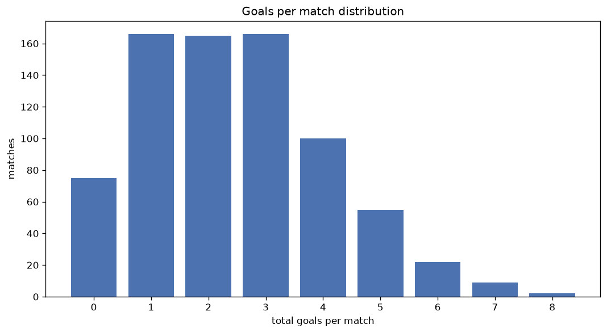
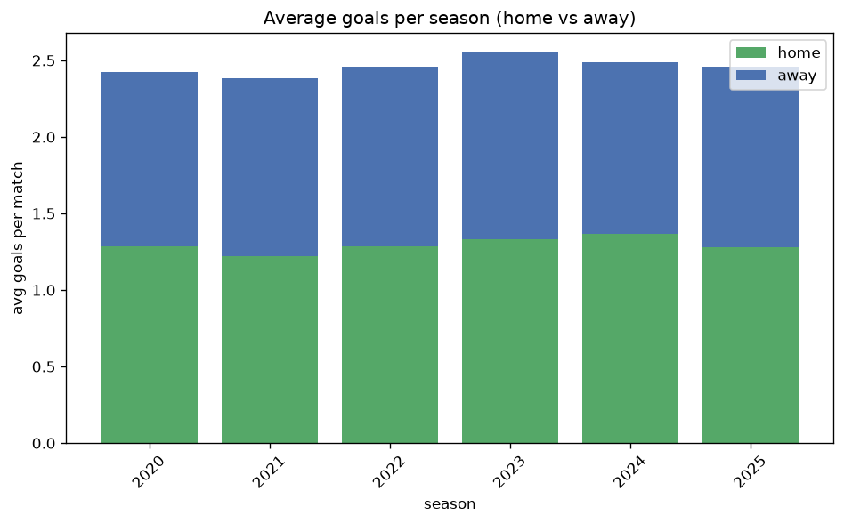

# Goal Analysis
- Report: `goals_analysis`
- Generated: 2026-10-30T04:00:13+00:00
- Script: `backend/scripts/analyze_goals.py` v1.0.0
- League: J2 League (Japan)
- Scope: league `japan2`

## 1. Goals per match distribution
| goals | matches | pct |
|---|---|---|
| 0 | 242 | 9.3% |
| 1 | 584 | 22.4% |
| 2 | 607 | 23.3% |
| 3 | 548 | 21.0% |
| 4 | 324 | 12.4% |
| 5 | 185 | 7.1% |
| 6 | 83 | 3.2% |
| 7 | 27 | 1.0% |
| 8 | 7 | 0.3% |
| 9 | 0 | 0.0% |
| 10 | 1 | 0.0% |

## 2. Goals per match per season
| season | matches | total goals | avg home | avg away | avg total |
|---|---|---|---|---|---|
| 2020 | 462 | 1119 | 1.286 | 1.136 | 2.422 |
| 2021 | 462 | 1102 | 1.219 | 1.167 | 2.385 |
| 2022 | 462 | 1136 | 1.284 | 1.175 | 2.459 |
| 2023 | 462 | 1179 | 1.333 | 1.219 | 2.552 |
| 2024 | 380 | 946 | 1.368 | 1.121 | 2.489 |
| 2025 | 380 | 934 | 1.282 | 1.176 | 2.458 |

## 3. Home vs away goal share
- Home goals: **3373** (52.6%)
- Away goals: **3043** (47.4%)
- Home/away ratio: **1.108**

| season | home goals | away goals | total | home pct | away pct |
|---|---|---|---|---|---|
| 2020 | 594 | 525 | 1119 | 53.1% | 46.9% |
| 2021 | 563 | 539 | 1102 | 51.1% | 48.9% |
| 2022 | 593 | 543 | 1136 | 52.2% | 47.8% |
| 2023 | 616 | 563 | 1179 | 52.2% | 47.8% |
| 2024 | 520 | 426 | 946 | 55.0% | 45.0% |
| 2025 | 487 | 447 | 934 | 52.1% | 47.9% |

## 4. BTTS (Both Teams To Score)
- Overall: **1302** of `2608` (49.9%)

| season | matches | BTTS | pct |
|---|---|---|---|
| 2020 | 462 | 223 | 48.3% |
| 2021 | 462 | 229 | 49.6% |
| 2022 | 462 | 236 | 51.1% |
| 2023 | 462 | 236 | 51.1% |
| 2024 | 380 | 183 | 48.2% |
| 2025 | 380 | 195 | 51.3% |

## 5. Clean sheets
- Home clean sheets: **814** (31.2%)
- Away clean sheets: **734** (28.1%)
- Total clean sheets recorded: **1548**
- Matches with at least one clean sheet: **1306** (50.1%)
- Both teams kept clean sheets (0-0): **242**

| season | matches | home CS | away CS | total CS | matches w/ CS |
|---|---|---|---|---|---|
| 2020 | 462 | 155 | 126 | 281 | 239 (51.7%) |
| 2021 | 462 | 134 | 146 | 280 | 233 (50.4%) |
| 2022 | 462 | 136 | 128 | 264 | 226 (48.9%) |
| 2023 | 462 | 138 | 128 | 266 | 226 (48.9%) |
| 2024 | 380 | 135 | 99 | 234 | 197 (51.8%) |
| 2025 | 380 | 116 | 107 | 223 | 185 (48.7%) |

## 6. Scoring intensity
- First-half goals: **2739** (42.7%)
- Second-half goals: **3677** (57.3%)
- Avg first-half goals per match: **1.05**
- Avg second-half goals per match: **1.41**
- Second-half-only scoring (HT 0-0, FT goals >= 1): **644** (24.7%)

| season | matches | 1st half | 2nd half | 1st half pct | 2nd half pct |
|---|---|---|---|---|---|
| 2020 | 462 | 456 | 663 | 40.8% | 59.2% |
| 2021 | 462 | 476 | 626 | 43.2% | 56.8% |
| 2022 | 462 | 488 | 648 | 43.0% | 57.0% |
| 2023 | 462 | 504 | 675 | 42.7% | 57.3% |
| 2024 | 380 | 403 | 543 | 42.6% | 57.4% |
| 2025 | 380 | 412 | 522 | 44.1% | 55.9% |

## 7. First-goal timing
- Matches with first-goal time recorded: `2366` of `2608` (90.7%)
- Goalless matches: `242`
- Min `1` | Max `96` | Mean `33.05` | Median (p50) `28.0`

| bucket | count | % of matches | % of scoring matches |
|---|---|---|---|
| 1-15 | 710 | 27.2% | 30.0% |
| 16-30 | 555 | 21.3% | 23.5% |
| 31-45 | 416 | 16.0% | 17.6% |
| 46-60 | 331 | 12.7% | 14.0% |
| 61-75 | 172 | 6.6% | 7.3% |
| 76-90 | 141 | 5.4% | 6.0% |
| 91-120 | 41 | 1.6% | 1.7% |

---
*All statistics are computed from PostgreSQL tables (read-only). Run with `python backend/scripts/analyze_goals.py` to regenerate.*

## Charts

