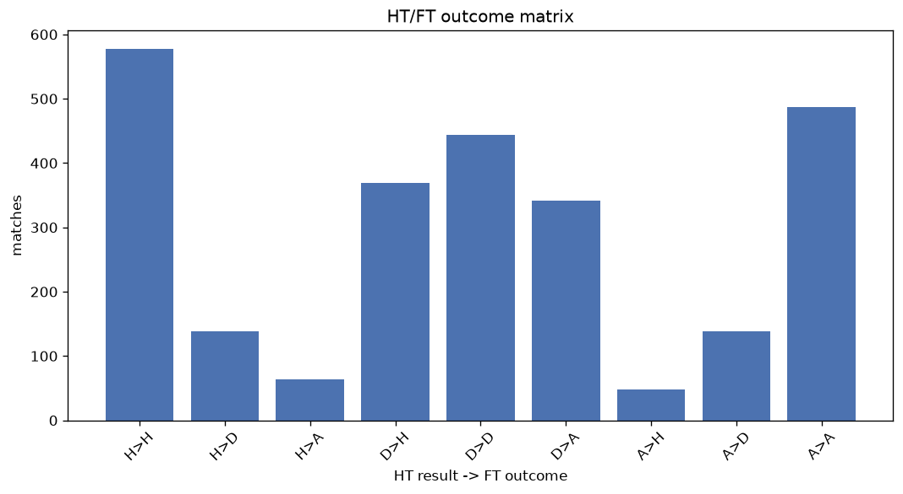
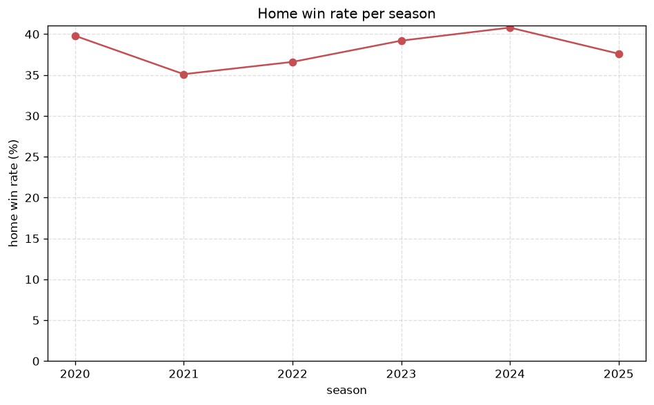

# Match Analysis
- Report: `matches_analysis`
- Generated: 2026-10-26T01:39:18+00:00
- Script: `backend/scripts/analyze_matches.py` v1.0.0
- League: J2 League (Japan)
- Scope: league `japan2`

## 1. Overall summary
| metric | value |
|---|---|
| Matches | 2608 |
| Home wins | 994 (38.1%) |
| Draws | 721 (27.6%) |
| Away wins | 893 (34.2%) |
| Total goals | 6416 |
| Average goals per match | 2.460 |
| Goalless matches | 242 (9.3%) |

## 2. Per-season breakdown
| season | matches | home wins | draws | away wins | total goals | avg goals | goalless |
|---|---|---|---|---|---|---|---|
| 2020 | 462 | 184 (39.8%) | 123 (26.6%) | 155 (33.5%) | 1119 | 2.422 | 42 (9.1%) |
| 2021 | 462 | 162 (35.1%) | 137 (29.7%) | 163 (35.3%) | 1102 | 2.385 | 47 (10.2%) |
| 2022 | 462 | 169 (36.6%) | 134 (29.0%) | 159 (34.4%) | 1136 | 2.459 | 38 (8.2%) |
| 2023 | 462 | 181 (39.2%) | 130 (28.1%) | 151 (32.7%) | 1179 | 2.552 | 40 (8.7%) |
| 2024 | 380 | 155 (40.8%) | 89 (23.4%) | 136 (35.8%) | 946 | 2.489 | 37 (9.7%) |
| 2025 | 380 | 143 (37.6%) | 108 (28.4%) | 129 (33.9%) | 934 | 2.458 | 38 (10.0%) |

## 3. HT/FT outcome matrix
| HT result \ FT result | Home | Draw | Away | total |
|---|---|---|---|---|
| HT home lead | 577 (74.0%) | 139 (17.8%) | 64 (8.2%) | 780 |
| HT draw | 369 (31.9%) | 444 (38.4%) | 342 (29.6%) | 1155 |
| HT away lead | 48 (7.1%) | 138 (20.5%) | 487 (72.4%) | 673 |

## 4. Comeback matches
- Home comebacks (trailing at HT, won at FT): **48** (1.8%)
- Away comebacks (trailing at HT, won at FT): **64** (2.5%)

### Home comebacks
| season | home | away | HT | FT |
|---|---|---|---|---|
| 2020 | Ehime | Tokushima | 0-3 | 4-3 |
| 2020 | Okayama | Mito | 0-1 | 3-1 |
| 2020 | Kanazawa | Ehime | 0-2 | 4-3 |
| 2020 | Omiya Ardija | Mito | 0-1 | 2-1 |
| 2020 | V-Varen Nagasaki | Renofa Yamaguchi | 1-2 | 4-3 |
| 2020 | Okayama | Omiya Ardija | 0-1 | 3-2 |
| 2020 | Ryukyu | Kyoto | 0-1 | 2-1 |
| 2020 | Mito | Kyoto | 0-1 | 2-1 |
| 2020 | Iwata | Machida | 0-2 | 3-2 |
| 2021 | Sagamihara | Omiya Ardija | 0-1 | 2-1 |
| 2021 | Verdy | Tochigi SC | 0-1 | 2-1 |
| 2021 | Machida | Mito | 0-1 | 2-1 |
| 2021 | Kyoto | Verdy | 0-1 | 3-1 |
| 2021 | Yamaga | Giravanz Kitakyushu | 0-1 | 2-1 |
| 2021 | Mito | Ehime | 0-1 | 2-1 |
| 2022 | Yokohama FC | Mito | 0-2 | 3-2 |
| 2022 | Yokohama FC | Vegalta Sendai | 0-1 | 2-1 |
| 2022 | Mito | Renofa Yamaguchi | 0-1 | 3-2 |
| 2022 | Omiya Ardija | Kusatsu | 0-2 | 3-2 |
| 2022 | Oita Trinita | Chiba | 0-1 | 3-2 |
| 2022 | Tokushima | Machida | 1-2 | 3-2 |
| 2023 | V-Varen Nagasaki | Montedio Yamagata | 0-1 | 3-2 |
| 2023 | V-Varen Nagasaki | Kofu | 0-1 | 2-1 |
| 2023 | Blaublitz | Omiya Ardija | 0-1 | 2-1 |
| 2023 | Montedio Yamagata | Fujieda MYFC | 0-2 | 3-2 |
| 2023 | Kusatsu | Mito | 0-1 | 2-1 |
| 2023 | Tokushima | Machida | 0-1 | 2-1 |
| 2023 | Machida | Omiya Ardija | 1-2 | 3-2 |
| 2023 | Mito | Tokushima | 0-1 | 3-1 |
| 2023 | Iwaki | Mito | 1-2 | 4-3 |
| 2023 | Shimizu S-Pulse | Machida | 1-2 | 3-2 |
| 2023 | Kofu | Oita Trinita | 0-2 | 3-2 |
| 2023 | Verdy | Chiba | 0-2 | 3-2 |
| 2024 | Tokushima | Montedio Yamagata | 0-1 | 2-1 |
| 2024 | Yokohama FC | Ehime | 0-1 | 2-1 |
| 2024 | Kagoshima Utd | Montedio Yamagata | 0-1 | 2-1 |
| 2024 | Yokohama FC | Chiba | 0-1 | 2-1 |
| 2024 | Ehime | Oita Trinita | 1-2 | 3-2 |
| 2024 | Tochigi SC | Kagoshima Utd | 0-1 | 2-1 |
| 2025 | V-Varen Nagasaki | Kumamoto | 0-1 | 3-2 |
| 2025 | Hokkaido Consadole Sapporo | Toyama | 0-1 | 2-1 |
| 2025 | Oita Trinita | Kofu | 0-1 | 2-1 |
| 2025 | Hokkaido Consadole Sapporo | Kumamoto | 0-1 | 3-2 |
| 2025 | Kumamoto | Mito | 0-1 | 2-1 |
| 2025 | V-Varen Nagasaki | Hokkaido Consadole Sapporo | 0-1 | 2-1 |
| 2025 | Vegalta Sendai | Montedio Yamagata | 0-1 | 3-1 |
| 2025 | Montedio Yamagata | Renofa Yamaguchi | 0-1 | 2-1 |
| 2025 | Vegalta Sendai | Sagan Tosu | 0-1 | 3-2 |

### Away comebacks
| season | home | away | HT | FT |
|---|---|---|---|---|
| 2020 | Okayama | V-Varen Nagasaki | 1-0 | 1-2 |
| 2020 | Okayama | Ryukyu | 1-0 | 1-2 |
| 2020 | Chiba | Tokushima | 1-0 | 1-2 |
| 2020 | Mito | V-Varen Nagasaki | 2-1 | 2-3 |
| 2020 | Mito | Tochigi SC | 1-0 | 1-2 |
| 2020 | Iwata | Tochigi SC | 1-0 | 2-3 |
| 2020 | Kyoto | Omiya Ardija | 2-0 | 2-4 |
| 2020 | Iwata | Kyoto | 1-0 | 1-2 |
| 2020 | Kusatsu | Tokushima | 2-0 | 2-3 |
| 2020 | Okayama | Tochigi SC | 1-0 | 2-3 |
| 2020 | Albirex Niigata | Kusatsu | 1-0 | 1-2 |
| 2021 | Mito | Omiya Ardija | 1-0 | 1-2 |
| 2021 | Kusatsu | V-Varen Nagasaki | 1-0 | 1-2 |
| 2021 | Okayama | Mito | 1-0 | 1-2 |
| 2021 | V-Varen Nagasaki | Blaublitz | 1-0 | 1-2 |
| 2021 | Tochigi SC | Giravanz Kitakyushu | 1-0 | 1-2 |
| 2021 | Giravanz Kitakyushu | Ryukyu | 1-0 | 1-2 |
| 2021 | Chiba | Iwata | 1-0 | 1-3 |
| 2021 | Renofa Yamaguchi | Verdy | 1-0 | 1-2 |
| 2021 | Omiya Ardija | Iwata | 1-0 | 1-2 |
| 2021 | Montedio Yamagata | Machida | 2-0 | 3-5 |
| 2022 | Omiya Ardija | Kumamoto | 1-0 | 1-2 |
| 2022 | Ryukyu | Grulla Morioka | 1-0 | 1-2 |
| 2022 | Kanazawa | Machida | 1-0 | 1-2 |
| 2022 | Ryukyu | Verdy | 2-1 | 2-5 |
| 2022 | Tochigi SC | V-Varen Nagasaki | 1-0 | 2-3 |
| 2022 | Machida | Mito | 2-0 | 2-3 |
| 2022 | Albirex Niigata | Okayama | 2-1 | 2-3 |
| 2022 | V-Varen Nagasaki | Ryukyu | 2-0 | 2-3 |
| 2022 | Tochigi SC | Mito | 2-1 | 2-3 |
| 2022 | Renofa Yamaguchi | Chiba | 1-0 | 1-3 |
| 2023 | V-Varen Nagasaki | Tochigi SC | 1-0 | 1-2 |
| 2023 | Kumamoto | Iwaki | 2-1 | 2-4 |
| 2023 | Tochigi SC | Blaublitz | 1-0 | 1-2 |
| 2023 | Fujieda MYFC | Omiya Ardija | 1-0 | 2-3 |
| 2024 | Chiba | Montedio Yamagata | 1-0 | 2-3 |
| 2024 | Kumamoto | Shimizu S-Pulse | 1-0 | 1-2 |
| 2024 | Tokushima | Blaublitz | 1-0 | 1-2 |
| 2024 | Yokohama FC | Vegalta Sendai | 1-0 | 1-2 |
| 2024 | Vegalta Sendai | Ehime | 1-0 | 1-2 |
| 2024 | Mito | Fujieda MYFC | 1-0 | 2-3 |
| 2024 | Tochigi SC | Kumamoto | 1-0 | 1-3 |
| 2024 | Kofu | Ehime | 1-0 | 1-2 |
| 2024 | Kusatsu | Fujieda MYFC | 1-0 | 1-2 |
| 2024 | Kofu | Tokushima | 1-0 | 1-3 |
| 2024 | V-Varen Nagasaki | Renofa Yamaguchi | 1-0 | 1-2 |
| 2024 | Montedio Yamagata | Yokohama FC | 1-0 | 1-2 |
| 2024 | Tochigi SC | Mito | 2-1 | 2-3 |
| 2024 | Fujieda MYFC | Shimizu S-Pulse | 1-0 | 2-3 |
| 2024 | Fujieda MYFC | Chiba | 2-1 | 2-3 |
| 2025 | Ehime | Imabari | 1-0 | 2-3 |
| 2025 | Kofu | Chiba | 1-0 | 1-2 |
| 2025 | Renofa Yamaguchi | Imabari | 1-0 | 1-2 |
| 2025 | Toyama | V-Varen Nagasaki | 1-0 | 1-2 |
| 2025 | Kumamoto | Blaublitz | 1-0 | 1-2 |
| 2025 | Oita Trinita | Blaublitz | 1-0 | 1-2 |
| 2025 | Omiya Ardija | Iwaki | 1-0 | 1-2 |
| 2025 | Imabari | Kofu | 2-0 | 2-4 |
| 2025 | Kofu | Sagan Tosu | 1-0 | 2-3 |
| 2025 | Omiya Ardija | Imabari | 2-1 | 2-3 |
| 2025 | Iwaki | Kofu | 1-0 | 2-3 |
| 2025 | Iwata | Omiya Ardija | 2-1 | 3-4 |
| 2025 | Ehime | Mito | 1-0 | 1-3 |
| 2025 | Renofa Yamaguchi | Iwata | 1-0 | 1-2 |

## 5. HT lead conversion
| HT state | matches | converted to win | held as draw | collapsed to loss |
|---|---|---|---|---|
| Home lead | 780 | 577 (74.0%) | 139 (17.8%) | 64 (8.2%) |
| Away lead | 673 | 487 (72.4%) | 138 (20.5%) | 48 (7.1%) |

### Matches level at half-time
| FT result | count | pct |
|---|---|---|
| Home win | 369 | 31.9% |
| Draw | 444 | 38.4% |
| Away win | 342 | 29.6% |

## 6. First-goal timing
- Matches with a first-goal time recorded: `2366` of `2608` (90.7%)

Outcome distribution by first-goal timing bucket:
| bucket | matches | % of matches | home | draw | away |
|---|---|---|---|---|---|
| 1-15 | 710 | 27.2% | 290 (40.8%) | 148 (20.8%) | 272 (38.3%) |
| 16-30 | 555 | 21.3% | 244 (44.0%) | 110 (19.8%) | 201 (36.2%) |
| 31-45 | 416 | 16.0% | 168 (40.4%) | 102 (24.5%) | 146 (35.1%) |
| 46-60 | 331 | 12.7% | 131 (39.6%) | 69 (20.8%) | 131 (39.6%) |
| 61-75 | 172 | 6.6% | 73 (42.4%) | 27 (15.7%) | 72 (41.9%) |
| 76-90 | 141 | 5.4% | 68 (48.2%) | 20 (14.2%) | 53 (37.6%) |
| 91-120 | 41 | 1.6% | 20 (48.8%) | 3 (7.3%) | 18 (43.9%) |

## 7. Goalless matches
- Overall: **242** of `2608` (9.3%)

| season | matches | goalless | pct |
|---|---|---|---|
| 2020 | 462 | 42 | 9.1% |
| 2021 | 462 | 47 | 10.2% |
| 2022 | 462 | 38 | 8.2% |
| 2023 | 462 | 40 | 8.7% |
| 2024 | 380 | 37 | 9.7% |
| 2025 | 380 | 38 | 10.0% |

---
*All statistics are computed from PostgreSQL tables (read-only). Run with `python backend/scripts/analyze_matches.py` to regenerate.*

## Charts

