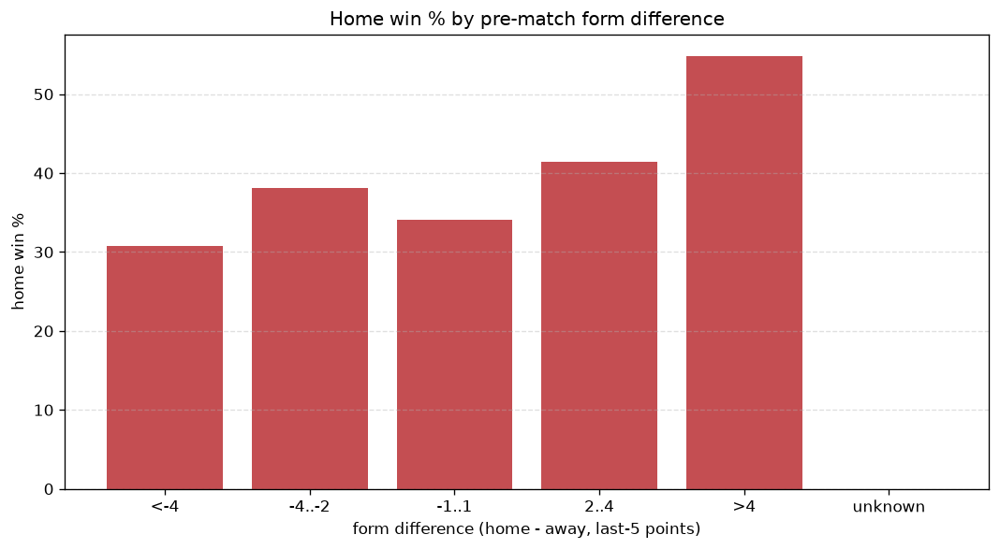
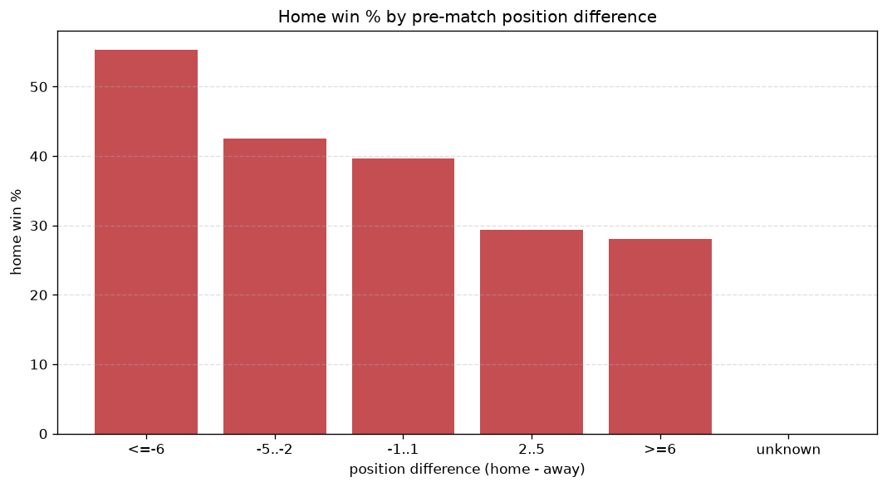

# Relationships Analysis
- Report: `relationships`
- Generated: 2026-10-30T04:00:21+00:00
- Script: `backend/scripts/analyze_relationships.py` v1.0.0
- League: J2 League (Japan)
- Scope: league `japan2`

- Matches analysed: **2608** (23 leakage-safe pre-match features).

## 1. Correlation matrix
_Pearson correlation of each pre-match feature with observed goals; sorted by |corr(total goals)|._

| feature | corr(home) | corr(away) | corr(total) |
|---|---|---|---|
| home_points_before_match | 0.083 | -0.030 | 0.040 |
| home_team_points_last_5 | 0.113 | -0.067 | 0.037 |
| away_team_goals_conceded_last_5 | 0.071 | -0.024 | 0.036 |
| home_team_goals_scored_last_5 | 0.107 | -0.064 | 0.035 |
| home_team_home_conceded_avg | -0.014 | 0.066 | 0.034 |
| home_team_wins_last_5 | 0.112 | -0.072 | 0.034 |
| home_team_home_goals_avg | 0.102 | -0.061 | 0.033 |
| away_points_before_match | -0.028 | 0.077 | 0.032 |
| away_team_away_conceded_avg | 0.065 | -0.032 | 0.026 |
| home_rest_days | 0.011 | 0.026 | 0.025 |
| away_team_goals_scored_last_5 | -0.030 | 0.066 | 0.023 |
| away_rest_days | 0.009 | 0.024 | 0.022 |
| away_team_away_goals_avg | -0.025 | 0.059 | 0.021 |
| rest_days_difference | 0.011 | 0.013 | 0.016 |
| away_team_wins_last_5 | -0.039 | 0.066 | 0.016 |
| away_team_away_win_rate | -0.025 | 0.051 | 0.016 |
| home_team_home_win_rate | 0.084 | -0.069 | 0.015 |
| away_team_points_last_5 | -0.041 | 0.066 | 0.014 |
| points_difference | 0.167 | -0.163 | 0.013 |
| home_position_before_match | -0.113 | 0.116 | -0.004 |
| position_difference | -0.152 | 0.160 | -0.003 |
| home_team_goals_conceded_last_5 | -0.050 | 0.058 | 0.002 |
| away_position_before_match | 0.098 | -0.106 | 0.000 |

## 2. Form vs outcome
_Home win/draw/away % per bucket of `home_team_points_last_5 - away_team_points_last_5`._

| bucket | matches | home | draw | away | home % | draw % | away % |
|---|---|---|---|---|---|---|---|
| <-4 | 388 | 120 | 97 | 171 | 30.9% | 25.0% | 44.1% |
| -4..-2 | 532 | 194 | 139 | 199 | 36.5% | 26.1% | 37.4% |
| -1..1 | 772 | 257 | 231 | 284 | 33.3% | 29.9% | 36.8% |
| 2..4 | 527 | 217 | 155 | 155 | 41.2% | 29.4% | 29.4% |
| >4 | 389 | 206 | 99 | 84 | 53.0% | 25.4% | 21.6% |
| unknown | 0 | 0 | 0 | 0 | - | - | - |

## 3. Position vs outcome
_Home win/draw/away % per bucket of `position_difference` (home position - away position; negative favours the home team)._

| bucket | matches | home | draw | away | home % | draw % | away % |
|---|---|---|---|---|---|---|---|
| <=-6 | 715 | 353 | 181 | 181 | 49.4% | 25.3% | 25.3% |
| -5..-2 | 426 | 187 | 111 | 128 | 43.9% | 26.1% | 30.0% |
| -1..1 | 316 | 120 | 89 | 107 | 38.0% | 28.2% | 33.9% |
| 2..5 | 430 | 131 | 128 | 171 | 30.5% | 29.8% | 39.8% |
| >=6 | 721 | 203 | 212 | 306 | 28.2% | 29.4% | 42.4% |
| unknown | 0 | 0 | 0 | 0 | - | - | - |

## 4. Rest advantage
_Home win/draw/away % per bucket of `rest_days_difference` (home rest - away rest). Matches with unknown rest are bucketed separately._

| bucket | matches | home | draw | away | home % | draw % | away % |
|---|---|---|---|---|---|---|---|
| <-1 | 74 | 23 | 24 | 27 | 31.1% | 32.4% | 36.5% |
| -1..0 | 357 | 135 | 95 | 127 | 37.8% | 26.6% | 35.6% |
| 0 | 1679 | 663 | 451 | 565 | 39.5% | 26.9% | 33.7% |
| 1..2 | 370 | 128 | 112 | 130 | 34.6% | 30.3% | 35.1% |
| >2 | 63 | 21 | 21 | 21 | 33.3% | 33.3% | 33.3% |
| unknown | 65 | 24 | 18 | 23 | 36.9% | 27.7% | 35.4% |
- *65 match(es) had unknown rest difference (missing rest data on at least one side).*

## 5. Home team quality
_Home win rate by `home_team_home_win_rate` tier (split at 0.5)._

- `< 0.5` tier: **34.6%** home win (621/1795)
- `>= 0.5` tier: **45.9%** home win (373/813)
- Home-win gap (>= split minus < split): **+11.3 pp**

| tier | label | matches | home | draw | away | home % |
|---|---|---|---|---|---|---|
| low | < 0.5 | 1795 | 621 | 510 | 664 | 34.6% |
| high | >= 0.5 | 813 | 373 | 211 | 229 | 45.9% |

## 6. Feature averages by result
_Mean feature value per outcome; `range` is home-minus-away spread of the group means._

| feature | home mean | draw mean | away mean | range |
|---|---|---|---|---|
| points_difference | 3.059 | -0.494 | -3.029 | 6.088 |
| position_difference | -1.989 | 0.506 | 1.973 | 3.962 |
| home_points_before_match | 28.784 | 26.495 | 25.639 | 3.144 |
| away_points_before_match | 25.724 | 26.989 | 28.669 | 2.944 |
| home_position_before_match | 10.243 | 11.689 | 12.450 | 2.207 |
| away_position_before_match | 12.232 | 11.183 | 10.477 | 1.755 |
| home_team_points_last_5 | 6.760 | 6.331 | 5.754 | 1.006 |
| home_team_goals_scored_last_5 | 6.025 | 5.524 | 5.317 | 0.708 |
| away_rest_days | 6.727 | 7.283 | 6.688 | 0.595 |
| home_rest_days | 6.718 | 7.298 | 6.708 | 0.590 |
| away_team_points_last_5 | 6.053 | 6.269 | 6.609 | 0.556 |
| home_team_goals_conceded_last_5 | 5.468 | 5.551 | 6.019 | 0.551 |
| away_team_goals_conceded_last_5 | 5.868 | 5.650 | 5.431 | 0.437 |
| away_team_goals_scored_last_5 | 5.533 | 5.621 | 5.925 | 0.392 |
| home_team_wins_last_5 | 1.837 | 1.680 | 1.469 | 0.368 |
| away_team_wins_last_5 | 1.581 | 1.664 | 1.774 | 0.192 |
| home_team_home_goals_avg | 1.292 | 1.164 | 1.140 | 0.152 |
| home_team_home_conceded_avg | 1.053 | 1.073 | 1.130 | 0.077 |
| away_team_away_goals_avg | 1.049 | 1.093 | 1.123 | 0.074 |
| away_team_away_conceded_avg | 1.234 | 1.191 | 1.169 | 0.066 |
| home_team_home_win_rate | 0.394 | 0.357 | 0.329 | 0.065 |
| rest_days_difference | -0.009 | 0.016 | 0.021 | 0.030 |
| away_team_away_win_rate | 0.311 | 0.323 | 0.337 | 0.026 |

---
*All features are leakage-safe pre-match values built by `ml.features.build_features.build_rows` from strictly prior matches. Run with `python backend/scripts/analyze_relationships.py` to regenerate.*

## Charts

