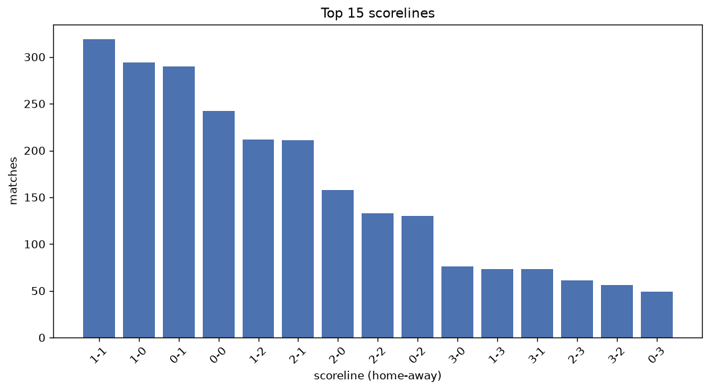
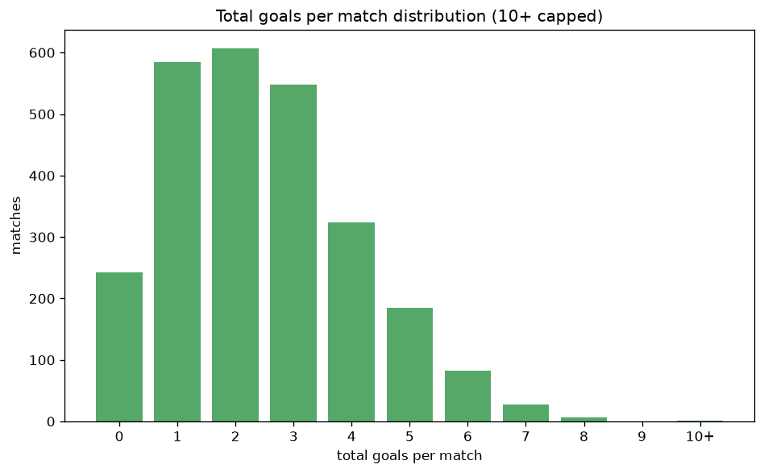

# Scoreline Analysis
- Report: `scoreline_analysis`
- Generated: 2026-10-30T04:00:19+00:00
- Script: `backend/scripts/analyze_scorelines.py` v1.0.0
- League: J2 League (Japan)
- Scope: league `japan2`

## 1. Scoreline frequency
- Matches analysed: **2608** across **6** seasons.
- Distinct scorelines seen: **42**.

| scoreline | count | pct |
|---|---|---|
| 1-1 | 319 | 12.2% |
| 1-0 | 294 | 11.3% |
| 0-1 | 290 | 11.1% |
| 0-0 | 242 | 9.3% |
| 1-2 | 212 | 8.1% |
| 2-1 | 211 | 8.1% |
| 2-0 | 158 | 6.1% |
| 2-2 | 133 | 5.1% |
| 0-2 | 130 | 5.0% |
| 3-0 | 76 | 2.9% |
| 1-3 | 73 | 2.8% |
| 3-1 | 73 | 2.8% |
| 2-3 | 61 | 2.3% |
| 3-2 | 56 | 2.1% |
| 0-3 | 49 | 1.9% |
| 4-1 | 36 | 1.4% |
| 4-0 | 29 | 1.1% |
| 3-3 | 26 | 1.0% |
| 1-4 | 17 | 0.7% |
| 0-4 | 16 | 0.6% |

## 2. Scoreline frequency per season

### 2020
| scoreline | count | pct |
|---|---|---|
| 1-0 | 58 | 12.6% |
| 1-1 | 54 | 11.7% |
| 0-1 | 53 | 11.5% |
| 0-0 | 42 | 9.1% |
| 1-2 | 38 | 8.2% |

### 2021
| scoreline | count | pct |
|---|---|---|
| 0-1 | 58 | 12.6% |
| 1-1 | 56 | 12.1% |
| 0-0 | 47 | 10.2% |
| 1-0 | 45 | 9.7% |
| 2-1 | 41 | 8.9% |

### 2022
| scoreline | count | pct |
|---|---|---|
| 1-1 | 66 | 14.3% |
| 0-1 | 55 | 11.9% |
| 1-0 | 52 | 11.3% |
| 0-0 | 38 | 8.2% |
| 2-1 | 34 | 7.4% |

### 2023
| scoreline | count | pct |
|---|---|---|
| 1-1 | 64 | 13.9% |
| 1-0 | 50 | 10.8% |
| 0-1 | 47 | 10.2% |
| 2-1 | 45 | 9.7% |
| 0-0 | 40 | 8.7% |

### 2024
| scoreline | count | pct |
|---|---|---|
| 1-2 | 44 | 11.6% |
| 1-0 | 41 | 10.8% |
| 0-0 | 37 | 9.7% |
| 1-1 | 36 | 9.5% |
| 0-1 | 35 | 9.2% |

### 2025
| scoreline | count | pct |
|---|---|---|
| 1-0 | 48 | 12.6% |
| 1-1 | 43 | 11.3% |
| 0-1 | 42 | 11.1% |
| 0-0 | 38 | 10.0% |
| 1-2 | 32 | 8.4% |

## 3. Total-goal histogram
_10+ groups all matches with 10 or more total goals._

| total goals | matches | pct |
|---|---|---|
| 0 | 242 | 9.3% |
| 1 | 584 | 22.4% |
| 2 | 607 | 23.3% |
| 3 | 548 | 21.0% |
| 4 | 324 | 12.4% |
| 5 | 185 | 7.1% |
| 6 | 83 | 3.2% |
| 7 | 27 | 1.0% |
| 8 | 7 | 0.3% |
| 9 | 0 | 0.0% |
| 10+ | 1 | 0.0% |

## 4. Extreme scorelines
- Matches with 7+ total goals: **35**

| season | date | scoreline | total goals |
|---|---|---|---|
| 2023 | 2023-05-07 | 9-1 | 10 |
| 2020 | 2020-07-04 | 3-5 | 8 |
| 2021 | 2021-06-27 | 6-2 | 8 |
| 2021 | 2021-10-03 | 4-4 | 8 |
| 2021 | 2021-11-21 | 3-5 | 8 |
| 2023 | 2023-10-21 | 1-7 | 8 |
| 2024 | 2024-04-03 | 8-0 | 8 |
| 2024 | 2024-05-18 | 7-1 | 8 |
| 2020 | 2020-06-27 | 4-3 | 7 |
| 2020 | 2020-08-08 | 3-4 | 7 |
| 2020 | 2020-08-08 | 4-3 | 7 |
| 2020 | 2020-09-23 | 1-6 | 7 |
| 2020 | 2020-10-10 | 4-3 | 7 |
| 2020 | 2020-11-29 | 3-4 | 7 |
| 2021 | 2021-03-21 | 3-4 | 7 |
| 2021 | 2021-03-27 | 7-0 | 7 |
| 2021 | 2021-04-17 | 6-1 | 7 |
| 2022 | 2022-03-30 | 2-5 | 7 |
| 2022 | 2022-05-08 | 4-3 | 7 |
| 2022 | 2022-08-06 | 5-2 | 7 |
| 2022 | 2022-09-24 | 1-6 | 7 |
| 2022 | 2022-10-23 | 3-4 | 7 |
| 2023 | 2023-03-19 | 5-2 | 7 |
| 2023 | 2023-05-07 | 4-3 | 7 |
| 2023 | 2023-07-09 | 4-3 | 7 |
| 2023 | 2023-07-23 | 3-4 | 7 |
| 2024 | 2024-04-07 | 3-4 | 7 |
| 2024 | 2024-04-13 | 6-1 | 7 |
| 2024 | 2024-08-10 | 4-3 | 7 |
| 2024 | 2024-08-25 | 3-4 | 7 |
| 2024 | 2024-11-10 | 5-2 | 7 |
| 2025 | 2025-04-25 | 3-4 | 7 |
| 2025 | 2025-06-15 | 3-4 | 7 |
| 2025 | 2025-09-27 | 3-4 | 7 |
| 2025 | 2025-11-02 | 5-2 | 7 |

## 5. Margin-of-victory distribution (decided matches)
- Decided matches: **1887** (draws: **721**)
- Average winning margin: **1.62**

| margin | matches | pct |
|---|---|---|
| 1 | 1141 | 60.5% |
| 2 | 462 | 24.5% |
| 3+ | 284 | 15.1% |

## 6. Margin by outcome

### Home wins
- Matches: **994** | avg margin: **1.71** | max margin: **8**
| margin | matches | pct |
|---|---|---|
| 1 | 568 | 57.1% |
| 2 | 245 | 24.6% |
| 3+ | 181 | 18.2% |
- *Full match-by-match list available in `scoreline_analysis.json`.*

### Away wins
- Matches: **893** | avg margin: **1.53** | max margin: **6**
| margin | matches | pct |
|---|---|---|
| 1 | 573 | 64.2% |
| 2 | 217 | 24.3% |
| 3+ | 103 | 11.5% |
- *Full match-by-match list available in `scoreline_analysis.json`.*

## 7. Most common exact score by outcome type
| outcome | matches | most common score | count | pct |
|---|---|---|---|---|
| home | 994 | 1-0 | 294 | 29.6% |
| draw | 721 | 1-1 | 319 | 44.2% |
| away | 893 | 0-1 | 290 | 32.5% |

---
*All statistics are computed from PostgreSQL tables (read-only). Run with `python backend/scripts/analyze_scorelines.py` to regenerate.*

## Charts

