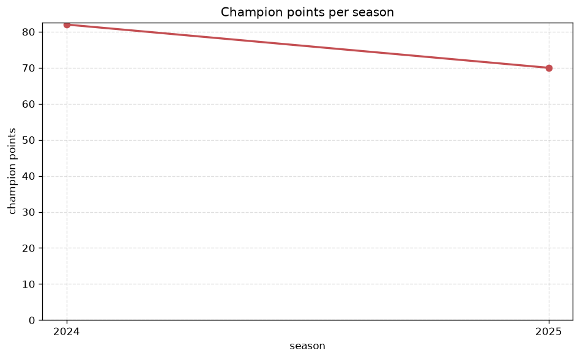
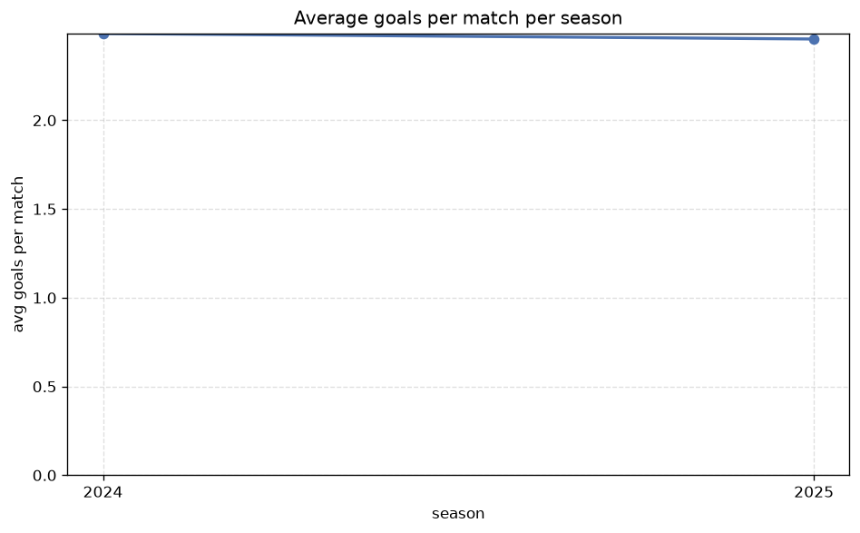

# Season Trends Analysis
- Report: `season_trends`
- Generated: 2026-10-27T01:59:24+00:00
- Script: `backend/scripts/analyze_seasons.py` v1.0.0
- League: J2 League (Japan)
- Scope: league `japan2`

## 1. Champions per season
| season | champion | pts | runner-up | margin |
|---|---|---|---|---|
| 2020 | Tokushima | 84 | Avispa Fukuoka | 0 pts |
| 2021 | Iwata | 91 | Kyoto | 7 pts |
| 2022 | Albirex Niigata | 84 | Yokohama FC | 4 pts |
| 2023 | Machida | 87 | Iwata | 12 pts |
| 2024 | Shimizu S-Pulse | 82 | Yokohama FC | 6 pts |
| 2025 | Mito | 70 | V-Varen Nagasaki | 0 pts |

## 2. Title-race tightness
- Tight races (margin <= 3 pts): **2** of 6 seasons
- Tightest race: **2020** - Tokushima beat Avispa Fukuoka by **0** pts

| season | margin | tight |
|---|---|---|
| 2020 | 0 pts | yes |
| 2021 | 7 pts |  |
| 2022 | 4 pts |  |
| 2023 | 12 pts |  |
| 2024 | 6 pts |  |
| 2025 | 0 pts | yes |

## 3. Points thresholds
_Position-specific points per season. Key: 1 = champion, 2 = runner-up, 4 = CL line, 6 = Europa, 17 = last safe, 20 = bottom._

| season | pos 1 | pos 2 | pos 4 | pos 6 | pos 17 | pos 20 |
|---|---|---|---|---|---|---|
| 2020 | 84 | 84 | 65 | 63 | 50 | 49 |
| 2021 | 91 | 84 | 78 | 68 | 41 | 35 |
| 2022 | 84 | 80 | 67 | 64 | 49 | 42 |
| 2023 | 87 | 75 | 74 | 67 | 47 | 44 |
| 2024 | 82 | 76 | 66 | 64 | 40 | 18 |
| 2025 | 70 | 70 | 65 | 63 | 37 | 22 |

## 4. Relegation battle
| season | safe pos | safe pts | drop pos | drop pts | gap |
|---|---|---|---|---|---|
| 2020 | 17 | 50 | 18 | 49 | 1 pts |
| 2021 | 17 | 41 | 18 | 41 | 0 pts |
| 2022 | 17 | 49 | 18 | 48 | 1 pts |
| 2023 | 17 | 47 | 18 | 47 | 0 pts |
| 2024 | 17 | 40 | 18 | 34 | 6 pts |
| 2025 | 17 | 37 | 18 | 37 | 0 pts |

## 5. League-level trends
| season | matches | total goals | avg goals | home win | draw | away win | goalless | avg pts/team |
|---|---|---|---|---|---|---|---|---|
| 2020 | 462 | 1119 | 2.422 | 39.8% | 26.6% | 33.5% | 9.1% | 57.41 |
| 2021 | 462 | 1102 | 2.385 | 35.1% | 29.7% | 35.3% | 10.2% | 56.77 |
| 2022 | 462 | 1136 | 2.459 | 36.6% | 29.0% | 34.4% | 8.2% | 56.91 |
| 2023 | 462 | 1179 | 2.552 | 39.2% | 28.1% | 32.7% | 8.7% | 57.09 |
| 2024 | 380 | 946 | 2.489 | 40.8% | 23.4% | 35.8% | 9.7% | 52.55 |
| 2025 | 380 | 934 | 2.458 | 37.6% | 28.4% | 33.9% | 10.0% | 51.6 |

## 6. View divergence
- Largest divergence: **2020** (goals view, avg abs position diff = 7.909)

_Avg absolute position difference between classic view and alternative view per season._

| season | classic vs luck | classic vs goals |
|---|---|---|
| 2020 | 4.000 | 7.909 |
| 2021 | 2.273 | 6.364 |
| 2022 | 3.455 | 6.636 |
| 2023 | 3.364 | 5.909 |
| 2024 | 2.700 | 6.400 |
| 2025 | 1.400 | 6.200 |

---
*All statistics are computed from PostgreSQL tables (read-only). Run with `python backend/scripts/analyze_seasons.py` to regenerate.*

## Charts

