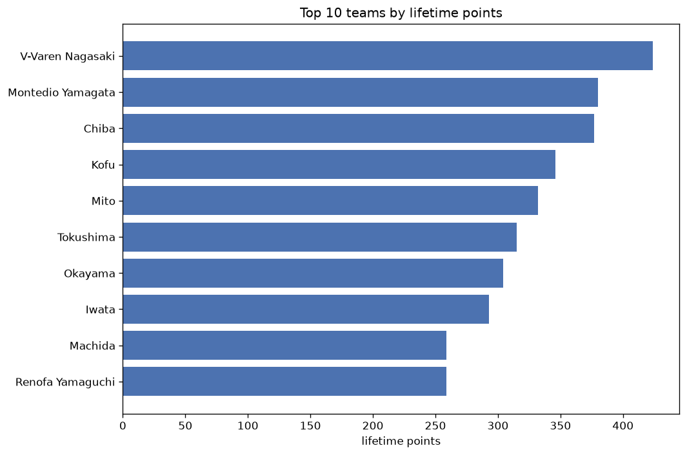
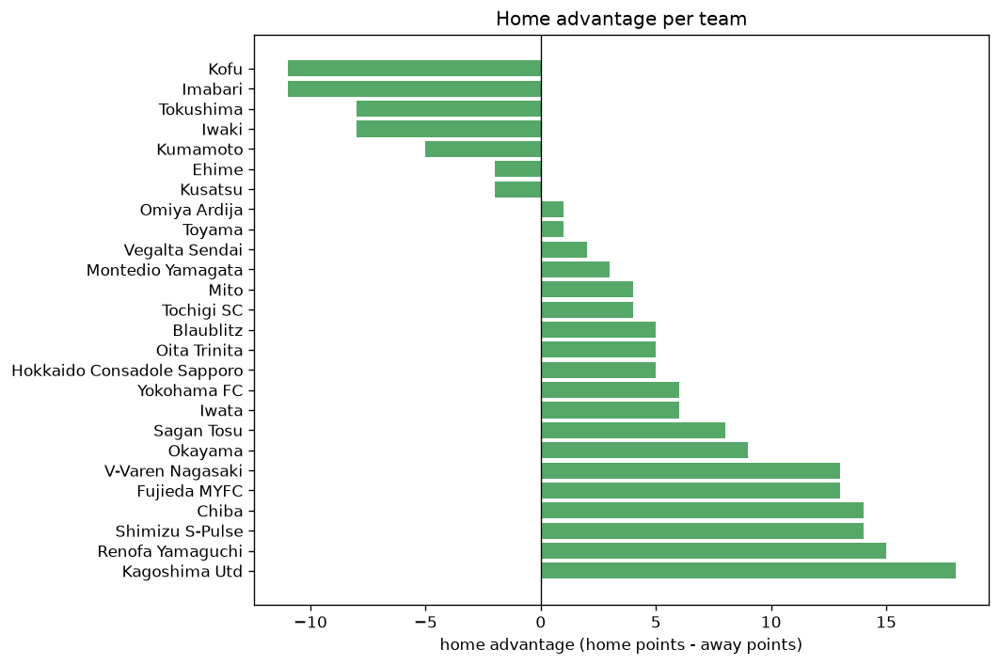

# Team Analysis
- Report: `teams_analysis`
- Generated: 2026-10-29T02:06:36+00:00
- Script: `backend/scripts/analyze_teams.py` v1.0.0
- League: J2 League (Japan)
- Scope: league `japan2`

- Teams: **37** | Seasons: **6** | Matches: **2608**

## 1. Team standings (lifetime)
| team | seasons | played | W | D | L | pts | GF | GA | GD | avg pts/season | best pos | worst pos | titles |
|---|---|---|---|---|---|---|---|---|---|---|---|---|---|
| V-Varen Nagasaki | 6 | 244 | 119 | 67 | 58 | 424 | 392 | 276 | 116 | 70.67 | 2 | 11 | 0 |
| Montedio Yamagata | 6 | 244 | 110 | 50 | 84 | 380 | 359 | 275 | 84 | 63.33 | 4 | 10 | 0 |
| Chiba | 6 | 244 | 107 | 56 | 81 | 377 | 323 | 264 | 59 | 62.83 | 3 | 14 | 0 |
| Kofu | 6 | 244 | 91 | 73 | 80 | 346 | 313 | 285 | 28 | 57.67 | 3 | 18 | 0 |
| Mito | 6 | 244 | 88 | 68 | 88 | 332 | 317 | 309 | 8 | 55.33 | 1 | 17 | 1 |
| Tokushima | 5 | 202 | 82 | 69 | 51 | 315 | 245 | 189 | 56 | 63.0 | 1 | 15 | 1 |
| Okayama | 5 | 206 | 77 | 73 | 56 | 304 | 237 | 205 | 32 | 60.8 | 3 | 17 | 0 |
| Iwata | 4 | 164 | 83 | 44 | 37 | 293 | 266 | 184 | 82 | 73.25 | 1 | 6 | 1 |
| Machida | 4 | 168 | 72 | 43 | 53 | 259 | 235 | 175 | 60 | 64.75 | 1 | 19 | 1 |
| Renofa Yamaguchi | 6 | 244 | 64 | 67 | 113 | 259 | 247 | 337 | -90 | 43.17 | 11 | 22 | 0 |
| Blaublitz | 5 | 202 | 64 | 59 | 79 | 251 | 196 | 237 | -41 | 50.2 | 10 | 14 | 0 |
| Verdy | 4 | 168 | 66 | 50 | 52 | 248 | 229 | 200 | 29 | 62.0 | 3 | 12 | 0 |
| Omiya Ardija | 5 | 206 | 62 | 54 | 90 | 240 | 239 | 282 | -43 | 48.0 | 6 | 21 | 0 |
| Vegalta Sendai | 4 | 160 | 64 | 45 | 51 | 237 | 212 | 200 | 12 | 59.25 | 6 | 16 | 0 |
| Tochigi SC | 5 | 206 | 53 | 71 | 82 | 230 | 182 | 234 | -52 | 46.0 | 10 | 19 | 0 |
| Albirex Niigata | 3 | 126 | 57 | 38 | 31 | 209 | 189 | 130 | 59 | 69.67 | 1 | 11 | 1 |
| Oita Trinita | 4 | 160 | 52 | 53 | 55 | 209 | 176 | 199 | -23 | 52.25 | 5 | 16 | 0 |
| Kusatsu | 5 | 206 | 52 | 51 | 103 | 207 | 179 | 281 | -102 | 41.4 | 11 | 20 | 0 |
| Kumamoto | 4 | 160 | 53 | 40 | 67 | 199 | 204 | 220 | -16 | 49.75 | 4 | 18 | 0 |
| Kanazawa | 4 | 168 | 44 | 45 | 79 | 177 | 193 | 266 | -73 | 44.25 | 14 | 22 | 0 |
| Iwaki | 3 | 118 | 42 | 31 | 45 | 157 | 153 | 154 | -1 | 52.33 | 9 | 18 | 0 |
| Shimizu S-Pulse | 2 | 80 | 46 | 18 | 16 | 156 | 146 | 72 | 74 | 78.0 | 1 | 4 | 1 |
| Yokohama FC | 2 | 80 | 45 | 21 | 14 | 156 | 126 | 76 | 50 | 78.0 | 2 | 2 | 0 |
| Ryukyu | 3 | 126 | 40 | 32 | 54 | 152 | 156 | 173 | -17 | 50.67 | 9 | 21 | 0 |
| Kyoto | 2 | 84 | 40 | 23 | 21 | 143 | 106 | 76 | 30 | 71.5 | 2 | 8 | 0 |
| Fujieda MYFC | 3 | 118 | 37 | 26 | 55 | 137 | 140 | 179 | -39 | 45.67 | 12 | 15 | 0 |
| Ehime | 4 | 160 | 28 | 47 | 85 | 131 | 152 | 275 | -123 | 32.75 | 17 | 21 | 0 |
| Giravanz Kitakyushu | 2 | 84 | 26 | 22 | 36 | 100 | 94 | 117 | -23 | 50.0 | 5 | 21 | 0 |
| Yamaga | 2 | 84 | 20 | 28 | 36 | 88 | 80 | 123 | -43 | 44.0 | 13 | 22 | 0 |
| Avispa Fukuoka | 1 | 42 | 25 | 9 | 8 | 84 | 51 | 29 | 22 | 84.0 | 2 | 2 | 0 |
| Sagan Tosu | 1 | 38 | 16 | 10 | 12 | 58 | 46 | 43 | 3 | 58.0 | 8 | 8 | 0 |
| Imabari | 1 | 38 | 13 | 14 | 11 | 53 | 46 | 46 | 0 | 53.0 | 11 | 11 | 0 |
| Hokkaido Consadole Sapporo | 1 | 38 | 16 | 5 | 17 | 53 | 50 | 63 | -13 | 53.0 | 12 | 12 | 0 |
| Sagamihara | 1 | 42 | 8 | 14 | 20 | 38 | 33 | 54 | -21 | 38.0 | 19 | 19 | 0 |
| Toyama | 1 | 38 | 9 | 10 | 19 | 37 | 34 | 49 | -15 | 37.0 | 17 | 17 | 0 |
| Grulla Morioka | 1 | 42 | 9 | 7 | 26 | 34 | 35 | 80 | -45 | 34.0 | 22 | 22 | 0 |
| Kagoshima Utd | 1 | 38 | 7 | 9 | 22 | 30 | 35 | 59 | -24 | 30.0 | 19 | 19 | 0 |

## 2. Home vs away split
| team | home P | H-W | H-D | H-L | H-pts | away P | A-W | A-D | A-L | A-pts | adv |
|---|---|---|---|---|---|---|---|---|---|---|---|
| Renofa Yamaguchi | 122 | 41 | 32 | 49 | 155 | 122 | 23 | 35 | 64 | 104 | 51 |
| Montedio Yamagata | 122 | 63 | 19 | 40 | 208 | 122 | 47 | 31 | 44 | 172 | 36 |
| Omiya Ardija | 103 | 36 | 28 | 39 | 136 | 103 | 26 | 26 | 51 | 104 | 32 |
| Kyoto | 42 | 25 | 10 | 7 | 85 | 42 | 15 | 13 | 14 | 58 | 27 |
| Shimizu S-Pulse | 40 | 27 | 9 | 4 | 90 | 40 | 19 | 9 | 12 | 66 | 24 |
| Iwata | 82 | 46 | 20 | 16 | 158 | 82 | 37 | 24 | 21 | 135 | 23 |
| Kofu | 122 | 50 | 34 | 38 | 184 | 122 | 41 | 39 | 42 | 162 | 22 |
| Okayama | 103 | 45 | 27 | 31 | 162 | 103 | 32 | 46 | 25 | 142 | 20 |
| V-Varen Nagasaki | 122 | 63 | 32 | 27 | 221 | 122 | 56 | 35 | 31 | 203 | 18 |
| Kagoshima Utd | 19 | 7 | 3 | 9 | 24 | 19 | 0 | 6 | 13 | 6 | 18 |
| Albirex Niigata | 63 | 33 | 14 | 16 | 113 | 63 | 24 | 24 | 15 | 96 | 17 |
| Oita Trinita | 80 | 29 | 26 | 25 | 113 | 80 | 23 | 27 | 30 | 96 | 17 |
| Yamaga | 42 | 12 | 15 | 15 | 51 | 42 | 8 | 13 | 21 | 37 | 14 |
| Fujieda MYFC | 59 | 20 | 15 | 24 | 75 | 59 | 17 | 11 | 31 | 62 | 13 |
| Yokohama FC | 40 | 25 | 9 | 6 | 84 | 40 | 20 | 12 | 8 | 72 | 12 |
| Giravanz Kitakyushu | 42 | 15 | 11 | 16 | 56 | 42 | 11 | 11 | 20 | 44 | 12 |
| Chiba | 122 | 55 | 29 | 38 | 194 | 122 | 52 | 27 | 43 | 183 | 11 |
| Kanazawa | 84 | 23 | 24 | 37 | 93 | 84 | 21 | 21 | 42 | 84 | 9 |
| Ryukyu | 63 | 20 | 20 | 23 | 80 | 63 | 20 | 12 | 31 | 72 | 8 |
| Sagan Tosu | 19 | 9 | 6 | 4 | 33 | 19 | 7 | 4 | 8 | 25 | 8 |
| Kusatsu | 103 | 25 | 31 | 47 | 106 | 103 | 27 | 20 | 56 | 101 | 5 |
| Hokkaido Consadole Sapporo | 19 | 9 | 2 | 8 | 29 | 19 | 7 | 3 | 9 | 24 | 5 |
| Tochigi SC | 103 | 26 | 39 | 38 | 117 | 103 | 27 | 32 | 44 | 113 | 4 |
| Mito | 122 | 43 | 38 | 41 | 167 | 122 | 45 | 30 | 47 | 165 | 2 |
| Sagamihara | 21 | 4 | 8 | 9 | 20 | 21 | 4 | 6 | 11 | 18 | 2 |
| Toyama | 19 | 5 | 4 | 10 | 19 | 19 | 4 | 6 | 9 | 18 | 1 |
| Machida | 84 | 34 | 26 | 24 | 128 | 84 | 38 | 17 | 29 | 131 | -3 |
| Vegalta Sendai | 80 | 32 | 21 | 27 | 117 | 80 | 32 | 24 | 24 | 120 | -3 |
| Verdy | 84 | 33 | 23 | 28 | 122 | 84 | 33 | 27 | 24 | 126 | -4 |
| Avispa Fukuoka | 21 | 12 | 4 | 5 | 40 | 21 | 13 | 5 | 3 | 44 | -4 |
| Grulla Morioka | 21 | 4 | 3 | 14 | 15 | 21 | 5 | 4 | 12 | 19 | -4 |
| Tokushima | 101 | 40 | 34 | 27 | 154 | 101 | 42 | 35 | 24 | 161 | -7 |
| Iwaki | 59 | 19 | 16 | 24 | 73 | 59 | 23 | 15 | 21 | 84 | -11 |
| Imabari | 19 | 4 | 9 | 6 | 21 | 19 | 9 | 5 | 5 | 32 | -11 |
| Kumamoto | 80 | 24 | 18 | 38 | 90 | 80 | 29 | 22 | 29 | 109 | -19 |
| Blaublitz | 101 | 25 | 40 | 36 | 115 | 101 | 39 | 19 | 43 | 136 | -21 |
| Ehime | 80 | 11 | 22 | 47 | 55 | 80 | 17 | 25 | 38 | 76 | -21 |

## 3. Top performers
### Best points per game (PPG)
| rank | team | PPG |
|---|---|---|
| 1 | Avispa Fukuoka | 2.00 |
| 2 | Shimizu S-Pulse | 1.95 |
| 3 | Yokohama FC | 1.95 |
| 4 | Iwata | 1.79 |
| 5 | V-Varen Nagasaki | 1.74 |

### Most goals scored
| rank | team | goals |
|---|---|---|
| 1 | V-Varen Nagasaki | 392 |
| 2 | Montedio Yamagata | 359 |
| 3 | Chiba | 323 |
| 4 | Mito | 317 |
| 5 | Kofu | 313 |

### Best goal difference
| rank | team | GD |
|---|---|---|
| 1 | V-Varen Nagasaki | 116 |
| 2 | Montedio Yamagata | 84 |
| 3 | Iwata | 82 |
| 4 | Shimizu S-Pulse | 74 |
| 5 | Machida | 60 |

### Best defence (goals against per match, standings)
| rank | team | GA/match |
|---|---|---|
| 1 | Avispa Fukuoka | 0.690 |
| 2 | Shimizu S-Pulse | 0.900 |
| 3 | Kyoto | 0.905 |
| 4 | Tokushima | 0.936 |
| 5 | Yokohama FC | 0.950 |

## 4. Team consistency
- Teams present in all **6** seasons: **6**

Chiba, Kofu, Mito, Montedio Yamagata, Renofa Yamaguchi, V-Varen Nagasaki

## 5. Head-to-head dominance
- Distinct fixtures: **530** (showing the 15 most frequent)

| fixture | meetings | home wins | draws | away wins | home pct | draw pct | away pct |
|---|---|---|---|---|---|---|---|
| Montedio Yamagata vs Renofa Yamaguchi | 12 | 8 | 2 | 2 | 66.7% | 16.7% | 16.7% |
| V-Varen Nagasaki vs Montedio Yamagata | 12 | 8 | 2 | 2 | 66.7% | 16.7% | 16.7% |
| V-Varen Nagasaki vs Mito | 12 | 7 | 1 | 4 | 58.3% | 8.3% | 33.3% |
| Chiba vs Kofu | 12 | 5 | 5 | 2 | 41.7% | 41.7% | 16.7% |
| Chiba vs Montedio Yamagata | 12 | 5 | 3 | 4 | 41.7% | 25.0% | 33.3% |
| Kofu vs Renofa Yamaguchi | 12 | 5 | 3 | 4 | 41.7% | 25.0% | 33.3% |
| V-Varen Nagasaki vs Kofu | 12 | 5 | 5 | 2 | 41.7% | 41.7% | 16.7% |
| Chiba vs Mito | 12 | 4 | 3 | 5 | 33.3% | 25.0% | 41.7% |
| Chiba vs Renofa Yamaguchi | 12 | 4 | 3 | 5 | 33.3% | 25.0% | 41.7% |
| Mito vs Kofu | 12 | 4 | 4 | 4 | 33.3% | 33.3% | 33.3% |
| V-Varen Nagasaki vs Chiba | 12 | 4 | 1 | 7 | 33.3% | 8.3% | 58.3% |
| Kofu vs Montedio Yamagata | 12 | 3 | 3 | 6 | 25.0% | 25.0% | 50.0% |
| Mito vs Montedio Yamagata | 12 | 3 | 3 | 6 | 25.0% | 25.0% | 50.0% |
| Mito vs Renofa Yamaguchi | 12 | 3 | 4 | 5 | 25.0% | 33.3% | 41.7% |
| V-Varen Nagasaki vs Renofa Yamaguchi | 12 | 3 | 2 | 7 | 25.0% | 16.7% | 58.3% |

## 6. Position per season (classic view)
_Cells show final position; '-' when the team was absent from that season._

| team | 2020 | 2021 | 2022 | 2023 | 2024 | 2025 |
|---|---|---|---|---|---|---|
| V-Varen Nagasaki | 3 | 4 | 11 | 7 | 3 | 2 |
| Montedio Yamagata | 7 | 7 | 6 | 5 | 4 | 10 |
| Chiba | 14 | 8 | 10 | 6 | 7 | 3 |
| Kofu | 4 | 3 | 18 | 8 | 14 | 13 |
| Mito | 9 | 10 | 13 | 17 | 15 | 1 |
| Tokushima | 1 | - | 8 | 15 | 8 | 4 |
| Okayama | 17 | 11 | 3 | 10 | 5 | - |
| Iwata | 6 | 1 | - | 2 | - | 5 |
| Machida | 19 | 5 | 15 | 1 | - | - |
| Renofa Yamaguchi | 22 | 15 | 16 | 20 | 11 | 19 |
| Blaublitz | - | 13 | 12 | 13 | 10 | 14 |
| Verdy | 12 | 12 | 9 | 3 | - | - |
| Omiya Ardija | 15 | 16 | 19 | 21 | - | 6 |
| Vegalta Sendai | - | - | 7 | 16 | 6 | 7 |
| Tochigi SC | 10 | 14 | 17 | 19 | 18 | - |
| Albirex Niigata | 11 | 6 | 1 | - | - | - |
| Oita Trinita | - | - | 5 | 9 | 16 | 16 |
| Kusatsu | 20 | 18 | 20 | 11 | 20 | - |
| Kumamoto | - | - | 4 | 14 | 12 | 18 |
| Kanazawa | 18 | 17 | 14 | 22 | - | - |
| Iwaki | - | - | - | 18 | 9 | 9 |
| Shimizu S-Pulse | - | - | - | 4 | 1 | - |
| Yokohama FC | - | - | 2 | - | 2 | - |
| Ryukyu | 16 | 9 | 21 | - | - | - |
| Kyoto | 8 | 2 | - | - | - | - |
| Fujieda MYFC | - | - | - | 12 | 13 | 15 |
| Ehime | 21 | 20 | - | - | 17 | 20 |
| Giravanz Kitakyushu | 5 | 21 | - | - | - | - |
| Yamaga | 13 | 22 | - | - | - | - |
| Avispa Fukuoka | 2 | - | - | - | - | - |
| Sagan Tosu | - | - | - | - | - | 8 |
| Imabari | - | - | - | - | - | 11 |
| Hokkaido Consadole Sapporo | - | - | - | - | - | 12 |
| Sagamihara | - | 19 | - | - | - | - |
| Toyama | - | - | - | - | - | 17 |
| Grulla Morioka | - | - | 22 | - | - | - |
| Kagoshima Utd | - | - | - | - | 19 | - |

---
*All statistics are computed from PostgreSQL tables (read-only). Run with `python backend/scripts/analyze_teams.py` to regenerate.*

## Charts

