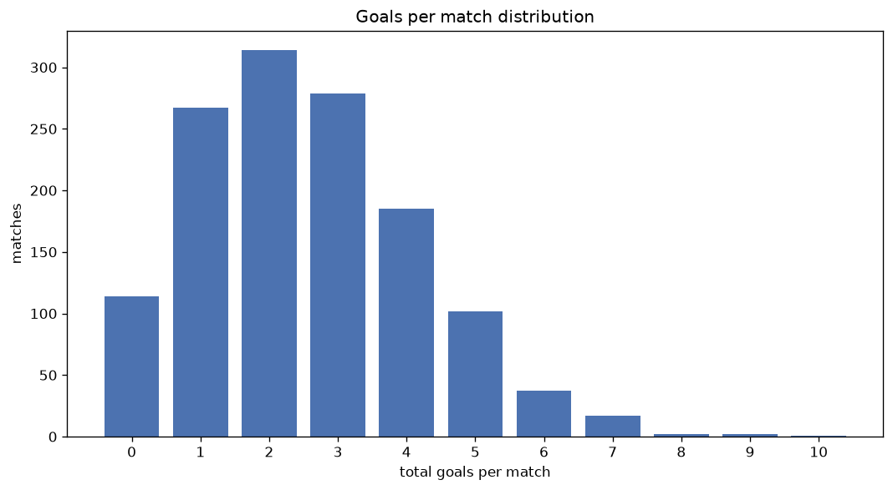
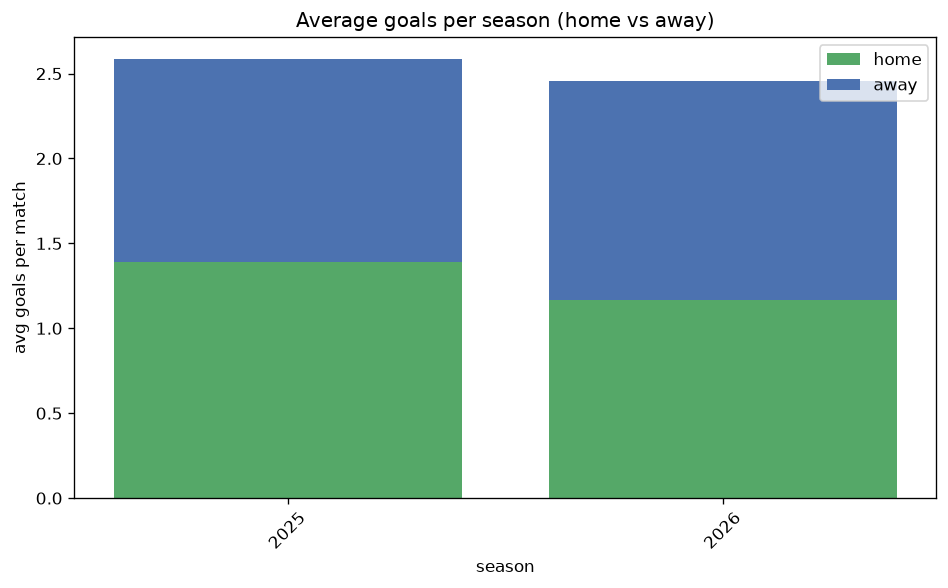

# Goal Analysis
- Report: `goals_analysis`
- Generated: 2026-10-27T01:59:51+00:00
- Script: `backend/scripts/analyze_goals.py` v1.0.0
- League: K League 1 (South Korea)
- Scope: league `korea1`

## 1. Goals per match distribution
| goals | matches | pct |
|---|---|---|
| 0 | 114 | 8.6% |
| 1 | 267 | 20.2% |
| 2 | 314 | 23.8% |
| 3 | 279 | 21.1% |
| 4 | 185 | 14.0% |
| 5 | 102 | 7.7% |
| 6 | 37 | 2.8% |
| 7 | 17 | 1.3% |
| 8 | 2 | 0.2% |
| 9 | 2 | 0.2% |
| 10 | 1 | 0.1% |

## 2. Goals per match per season
| season | matches | total goals | avg home | avg away | avg total |
|---|---|---|---|---|---|
| 2020 | 132 | 338 | 1.295 | 1.265 | 2.561 |
| 2021 | 198 | 482 | 1.258 | 1.177 | 2.434 |
| 2022 | 198 | 508 | 1.359 | 1.207 | 2.566 |
| 2023 | 198 | 498 | 1.348 | 1.167 | 2.515 |
| 2024 | 198 | 533 | 1.5 | 1.192 | 2.692 |
| 2025 | 198 | 512 | 1.389 | 1.197 | 2.586 |
| 2026 | 198 | 496 | 1.217 | 1.288 | 2.505 |

## 3. Home vs away goal share
- Home goals: **1769** (52.5%)
- Away goals: **1598** (47.5%)
- Home/away ratio: **1.107**

| season | home goals | away goals | total | home pct | away pct |
|---|---|---|---|---|---|
| 2020 | 171 | 167 | 338 | 50.6% | 49.4% |
| 2021 | 249 | 233 | 482 | 51.7% | 48.3% |
| 2022 | 269 | 239 | 508 | 53.0% | 47.0% |
| 2023 | 267 | 231 | 498 | 53.6% | 46.4% |
| 2024 | 297 | 236 | 533 | 55.7% | 44.3% |
| 2025 | 275 | 237 | 512 | 53.7% | 46.3% |
| 2026 | 241 | 255 | 496 | 48.6% | 51.4% |

## 4. BTTS (Both Teams To Score)
- Overall: **709** of `1320` (53.7%)

| season | matches | BTTS | pct |
|---|---|---|---|
| 2020 | 132 | 66 | 50.0% |
| 2021 | 198 | 103 | 52.0% |
| 2022 | 198 | 108 | 54.5% |
| 2023 | 198 | 105 | 53.0% |
| 2024 | 198 | 107 | 54.0% |
| 2025 | 198 | 112 | 56.6% |
| 2026 | 198 | 108 | 54.5% |

## 5. Clean sheets
- Home clean sheets: **397** (30.1%)
- Away clean sheets: **328** (24.8%)
- Total clean sheets recorded: **725**
- Matches with at least one clean sheet: **611** (46.3%)
- Both teams kept clean sheets (0-0): **114**

| season | matches | home CS | away CS | total CS | matches w/ CS |
|---|---|---|---|---|---|
| 2020 | 132 | 43 | 35 | 78 | 66 (50.0%) |
| 2021 | 198 | 66 | 52 | 118 | 95 (48.0%) |
| 2022 | 198 | 56 | 47 | 103 | 90 (45.5%) |
| 2023 | 198 | 57 | 52 | 109 | 93 (47.0%) |
| 2024 | 198 | 66 | 37 | 103 | 91 (46.0%) |
| 2025 | 198 | 56 | 46 | 102 | 86 (43.4%) |
| 2026 | 198 | 53 | 59 | 112 | 90 (45.5%) |

## 6. Scoring intensity
- First-half goals: **1313** (39.0%)
- Second-half goals: **2051** (61.0%)
- Avg first-half goals per match: **0.995**
- Avg second-half goals per match: **1.555**
- Second-half-only scoring (HT 0-0, FT goals >= 1): **387** (29.3%)
- *1 match(es) excluded (no HT score recorded).*

| season | matches | 1st half | 2nd half | 1st half pct | 2nd half pct |
|---|---|---|---|---|---|
| 2020 | 132 | 135 | 203 | 39.9% | 60.1% |
| 2021 | 198 | 176 | 303 | 36.7% | 63.3% |
| 2022 | 198 | 191 | 317 | 37.6% | 62.4% |
| 2023 | 198 | 200 | 298 | 40.2% | 59.8% |
| 2024 | 198 | 197 | 336 | 37.0% | 63.0% |
| 2025 | 198 | 211 | 301 | 41.2% | 58.8% |
| 2026 | 198 | 203 | 293 | 40.9% | 59.1% |

## 7. First-goal timing
- Matches with first-goal time recorded: `1205` of `1320` (91.3%)
- Goalless matches: `115`
- Min `1` | Max `100` | Mean `36.21` | Median (p50) `31`

| bucket | count | % of matches | % of scoring matches |
|---|---|---|---|
| 1-15 | 304 | 23.0% | 25.2% |
| 16-30 | 290 | 22.0% | 24.1% |
| 31-45 | 201 | 15.2% | 16.7% |
| 46-60 | 182 | 13.8% | 15.1% |
| 61-75 | 118 | 8.9% | 9.8% |
| 76-90 | 79 | 6.0% | 6.6% |
| 91-120 | 31 | 2.3% | 2.6% |

---
*All statistics are computed from PostgreSQL tables (read-only). Run with `python backend/scripts/analyze_goals.py` to regenerate.*

## Charts

