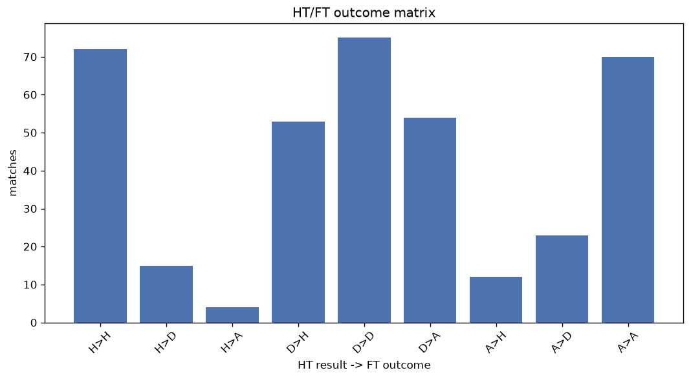
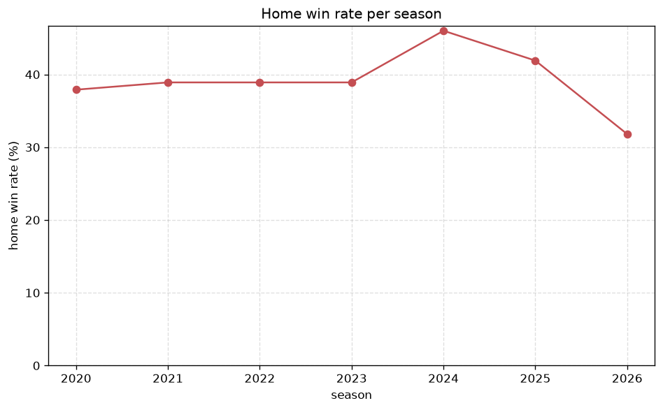

# Match Analysis
- Report: `matches_analysis`
- Generated: 2026-10-29T02:06:49+00:00
- Script: `backend/scripts/analyze_matches.py` v1.0.0
- League: K League 1 (South Korea)
- Scope: league `korea1`

## 1. Overall summary
| metric | value |
|---|---|
| Matches | 1320 |
| Home wins | 518 (39.2%) |
| Draws | 376 (28.5%) |
| Away wins | 426 (32.3%) |
| Total goals | 3367 |
| Average goals per match | 2.551 |
| Goalless matches | 114 (8.6%) |

## 2. Per-season breakdown
| season | matches | home wins | draws | away wins | total goals | avg goals | goalless |
|---|---|---|---|---|---|---|---|
| 2020 | 132 | 50 (37.9%) | 35 (26.5%) | 47 (35.6%) | 338 | 2.561 | 12 (9.1%) |
| 2021 | 198 | 77 (38.9%) | 57 (28.8%) | 64 (32.3%) | 482 | 2.434 | 23 (11.6%) |
| 2022 | 198 | 77 (38.9%) | 59 (29.8%) | 62 (31.3%) | 508 | 2.566 | 13 (6.6%) |
| 2023 | 198 | 77 (38.9%) | 60 (30.3%) | 61 (30.8%) | 498 | 2.515 | 16 (8.1%) |
| 2024 | 198 | 91 (46.0%) | 46 (23.2%) | 61 (30.8%) | 533 | 2.692 | 12 (6.1%) |
| 2025 | 198 | 83 (41.9%) | 52 (26.3%) | 63 (31.8%) | 512 | 2.586 | 16 (8.1%) |
| 2026 | 198 | 63 (31.8%) | 67 (33.8%) | 68 (34.3%) | 496 | 2.505 | 22 (11.1%) |

## 3. HT/FT outcome matrix
| HT result \ FT result | Home | Draw | Away | total |
|---|---|---|---|---|
| HT home lead | 258 (73.5%) | 65 (18.5%) | 28 (8.0%) | 351 |
| HT draw | 218 (33.3%) | 248 (37.9%) | 189 (28.9%) | 655 |
| HT away lead | 42 (13.4%) | 63 (20.1%) | 208 (66.5%) | 313 |
- *1 match(es) excluded (no HT score recorded).*

## 4. Comeback matches
- Home comebacks (trailing at HT, won at FT): **42** (3.2%)
- Away comebacks (trailing at HT, won at FT): **28** (2.1%)

### Home comebacks
| season | home | away | HT | FT |
|---|---|---|---|---|
| 2020 | Gangwon | Seoul | 0-1 | 3-1 |
| 2020 | Gwangju FC | Busan | 0-1 | 3-1 |
| 2020 | Daegu | Suwon Bluewings | 0-1 | 3-1 |
| 2020 | Suwon Bluewings | Busan | 0-1 | 3-1 |
| 2020 | Pohang | Seongnam | 0-1 | 2-1 |
| 2020 | Pohang | Daegu | 1-2 | 3-2 |
| 2021 | Pohang | Incheon | 0-1 | 2-1 |
| 2021 | Jeju SK | Suwon Bluewings | 0-1 | 2-1 |
| 2021 | Suwon FC | Gangwon | 0-1 | 2-1 |
| 2021 | Suwon FC | Gwangju FC | 0-1 | 2-1 |
| 2021 | Suwon Bluewings | Jeju SK | 0-2 | 3-2 |
| 2021 | Incheon | Gwangju FC | 0-1 | 2-1 |
| 2021 | Daegu | Ulsan HD | 0-1 | 2-1 |
| 2022 | Ulsan HD | Seoul | 0-1 | 2-1 |
| 2022 | Ulsan HD | Daegu | 0-1 | 3-1 |
| 2022 | Suwon FC | Seoul | 0-1 | 4-3 |
| 2023 | Suwon FC | Daejeon | 0-2 | 5-3 |
| 2023 | Jeju SK | Pohang | 0-1 | 2-1 |
| 2023 | Gwangju FC | Suwon Bluewings | 0-1 | 2-1 |
| 2024 | Pohang | Daegu | 0-1 | 3-1 |
| 2024 | Gwangju FC | Gangwon | 0-1 | 4-2 |
| 2024 | Suwon FC | Jeju SK | 0-1 | 2-1 |
| 2024 | Gwangju FC | Daejeon | 0-1 | 2-1 |
| 2024 | Daejeon | Gwangju FC | 0-1 | 2-1 |
| 2024 | Seoul | Daejeon | 0-1 | 2-1 |
| 2024 | Gangwon | Gwangju FC | 1-2 | 3-2 |
| 2024 | Ulsan HD | Gimcheon Sangmu | 0-1 | 2-1 |
| 2025 | Daegu | Gangwon | 0-1 | 2-1 |
| 2025 | Gangwon | Pohang | 0-1 | 2-1 |
| 2025 | Gwangju FC | Anyang | 0-1 | 2-1 |
| 2025 | Pohang | Anyang | 0-1 | 2-1 |
| 2025 | Ulsan HD | Gimcheon Sangmu | 0-1 | 3-2 |
| 2025 | Jeju SK | Daegu | 0-1 | 2-1 |
| 2025 | Jeonbuk | Suwon FC | 0-2 | 3-2 |
| 2025 | Daejeon | Suwon FC | 1-2 | 3-2 |
| 2025 | Daegu | Suwon FC | 0-1 | 3-1 |
| 2026 | Jeju SK | Pohang | 0-1 | 2-1 |
| 2026 | Seoul | Daejeon | 0-1 | 4-2 |
| 2026 | Daejeon | Anyang | 0-1 | 3-2 |
| 2026 | Daejeon | Jeonbuk | 0-1 | 2-1 |
| 2026 | Ulsan HD | Bucheon FC 1995 | 0-1 | 2-1 |
| 2026 | Daejeon | Gwangju FC | 0-2 | 3-2 |

### Away comebacks
| season | home | away | HT | FT |
|---|---|---|---|---|
| 2020 | Suwon Bluewings | Ulsan HD | 1-0 | 2-3 |
| 2020 | Pohang | Jeonbuk | 1-0 | 1-2 |
| 2020 | Gwangju FC | Daegu | 1-0 | 2-4 |
| 2020 | Seoul | Pohang | 1-0 | 1-3 |
| 2020 | Incheon | Gwangju FC | 1-0 | 1-3 |
| 2021 | Gangwon | Pohang | 1-0 | 1-3 |
| 2021 | Suwon FC | Seongnam | 1-0 | 1-2 |
| 2021 | Pohang | Daegu | 1-0 | 1-2 |
| 2022 | Suwon FC | Jeju SK | 1-0 | 1-3 |
| 2022 | Suwon FC | Ulsan HD | 1-0 | 1-2 |
| 2022 | Seoul | Ulsan HD | 1-0 | 1-2 |
| 2022 | Gimcheon Sangmu | Jeonbuk | 1-0 | 1-2 |
| 2022 | Seongnam | Pohang | 1-0 | 1-4 |
| 2022 | Pohang | Seoul | 1-0 | 1-2 |
| 2022 | Gimcheon Sangmu | Seoul | 1-0 | 1-2 |
| 2022 | Ulsan HD | Pohang | 1-0 | 1-2 |
| 2022 | Suwon Bluewings | Jeonbuk | 1-0 | 2-3 |
| 2023 | Jeonbuk | Pohang | 1-0 | 1-2 |
| 2023 | Suwon FC | Ulsan HD | 1-0 | 1-3 |
| 2023 | Gangwon | Suwon FC | 1-0 | 1-2 |
| 2024 | Incheon | Seoul | 1-0 | 1-2 |
| 2024 | Jeonbuk | Suwon FC | 2-0 | 2-3 |
| 2024 | Daejeon | Pohang | 1-0 | 1-2 |
| 2024 | Daegu | Incheon | 1-0 | 1-2 |
| 2025 | Jeju SK | Gimcheon Sangmu | 1-0 | 2-3 |
| 2025 | Suwon FC | Anyang | 1-0 | 1-2 |
| 2025 | Daegu | Gimcheon Sangmu | 2-1 | 2-3 |
| 2025 | Pohang | Jeonbuk | 2-0 | 2-3 |

## 5. HT lead conversion
| HT state | matches | converted to win | held as draw | collapsed to loss |
|---|---|---|---|---|
| Home lead | 351 | 258 (73.5%) | 65 (18.5%) | 28 (8.0%) |
| Away lead | 313 | 208 (66.5%) | 63 (20.1%) | 42 (13.4%) |

### Matches level at half-time
| FT result | count | pct |
|---|---|---|
| Home win | 218 | 33.3% |
| Draw | 248 | 37.9% |
| Away win | 189 | 28.9% |
- *1 match(es) excluded (no HT score recorded).*

## 6. First-goal timing
- Matches with a first-goal time recorded: `1205` of `1320` (91.3%)

Outcome distribution by first-goal timing bucket:
| bucket | matches | % of matches | home | draw | away |
|---|---|---|---|---|---|
| 1-15 | 304 | 23.0% | 143 (47.0%) | 72 (23.7%) | 89 (29.3%) |
| 16-30 | 290 | 22.0% | 119 (41.0%) | 58 (20.0%) | 113 (39.0%) |
| 31-45 | 201 | 15.2% | 80 (39.8%) | 48 (23.9%) | 73 (36.3%) |
| 46-60 | 182 | 13.8% | 67 (36.8%) | 47 (25.8%) | 68 (37.4%) |
| 61-75 | 118 | 8.9% | 54 (45.8%) | 25 (21.2%) | 39 (33.1%) |
| 76-90 | 79 | 6.0% | 42 (53.2%) | 11 (13.9%) | 26 (32.9%) |
| 91-120 | 31 | 2.3% | 13 (41.9%) | 1 (3.2%) | 17 (54.8%) |

## 7. Goalless matches
- Overall: **114** of `1320` (8.6%)

| season | matches | goalless | pct |
|---|---|---|---|
| 2020 | 132 | 12 | 9.1% |
| 2021 | 198 | 23 | 11.6% |
| 2022 | 198 | 13 | 6.6% |
| 2023 | 198 | 16 | 8.1% |
| 2024 | 198 | 12 | 6.1% |
| 2025 | 198 | 16 | 8.1% |
| 2026 | 198 | 22 | 11.1% |

---
*All statistics are computed from PostgreSQL tables (read-only). Run with `python backend/scripts/analyze_matches.py` to regenerate.*

## Charts

