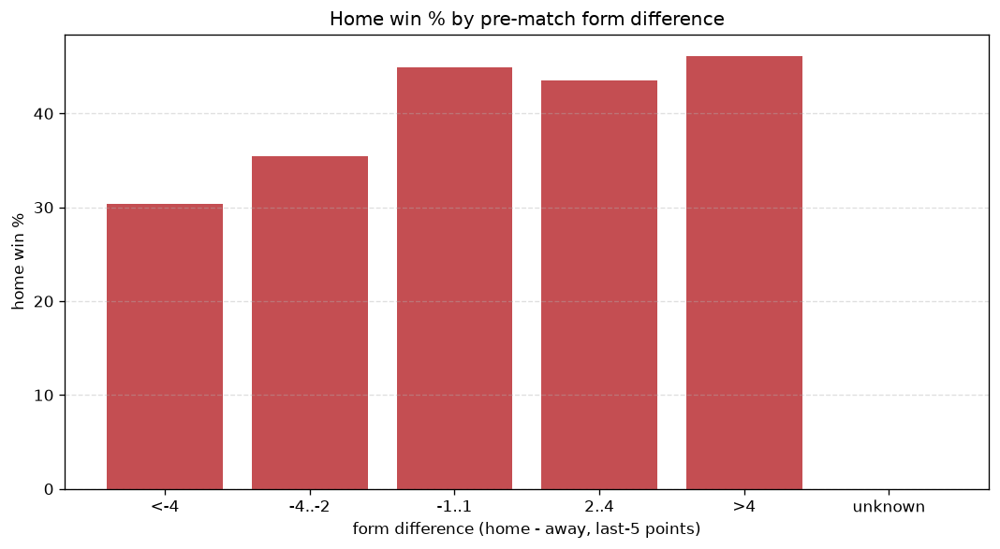
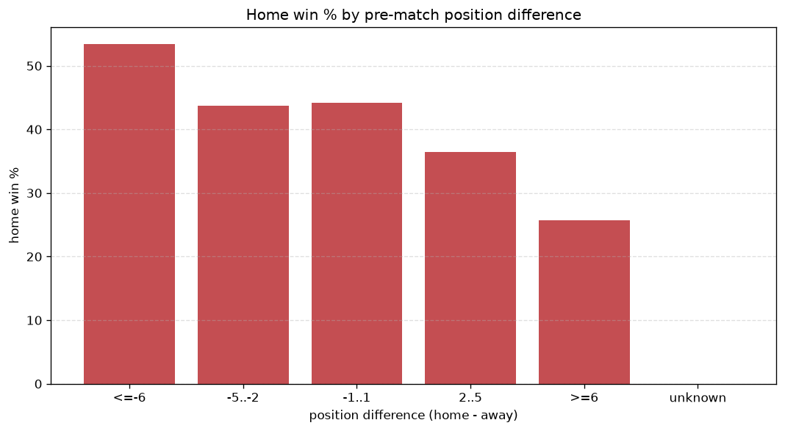

# Relationships Analysis
- Report: `relationships`
- Generated: 2026-10-26T01:39:48+00:00
- Script: `backend/scripts/analyze_relationships.py` v1.0.0
- League: K League 1 (South Korea)
- Scope: league `korea1`

- Matches analysed: **1122** (23 leakage-safe pre-match features).

## 1. Correlation matrix
_Pearson correlation of each pre-match feature with observed goals; sorted by |corr(total goals)|._

| feature | corr(home) | corr(away) | corr(total) |
|---|---|---|---|
| home_team_home_goals_avg | 0.091 | 0.030 | 0.083 |
| away_team_goals_scored_last_5 | 0.023 | 0.087 | 0.074 |
| home_points_before_match | 0.101 | 0.006 | 0.073 |
| home_team_goals_scored_last_5 | 0.082 | 0.007 | 0.061 |
| away_team_points_last_5 | -0.011 | 0.099 | 0.059 |
| home_team_home_win_rate | 0.060 | 0.026 | 0.059 |
| away_team_away_goals_avg | 0.000 | 0.086 | 0.059 |
| away_points_before_match | 0.008 | 0.071 | 0.053 |
| home_team_points_last_5 | 0.080 | -0.004 | 0.052 |
| away_team_wins_last_5 | -0.016 | 0.084 | 0.046 |
| away_team_away_win_rate | -0.051 | 0.115 | 0.043 |
| home_position_before_match | -0.112 | 0.051 | -0.042 |
| away_team_goals_conceded_last_5 | 0.061 | -0.005 | 0.038 |
| home_team_wins_last_5 | 0.068 | -0.013 | 0.038 |
| position_difference | -0.139 | 0.088 | -0.035 |
| away_team_away_conceded_avg | 0.074 | -0.026 | 0.033 |
| away_rest_days | 0.007 | 0.034 | 0.028 |
| points_difference | 0.132 | -0.093 | 0.027 |
| home_team_goals_conceded_last_5 | -0.003 | 0.038 | 0.024 |
| home_rest_days | -0.001 | 0.034 | 0.023 |
| rest_days_difference | -0.010 | -0.001 | -0.008 |
| away_position_before_match | 0.085 | -0.075 | 0.007 |
| home_team_home_conceded_avg | -0.015 | 0.010 | -0.004 |

## 2. Form vs outcome
_Home win/draw/away % per bucket of `home_team_points_last_5 - away_team_points_last_5`._

| bucket | matches | home | draw | away | home % | draw % | away % |
|---|---|---|---|---|---|---|---|
| <-4 | 171 | 52 | 53 | 66 | 30.4% | 31.0% | 38.6% |
| -4..-2 | 240 | 85 | 72 | 83 | 35.4% | 30.0% | 34.6% |
| -1..1 | 336 | 151 | 74 | 111 | 44.9% | 22.0% | 33.0% |
| 2..4 | 223 | 97 | 60 | 66 | 43.5% | 26.9% | 29.6% |
| >4 | 152 | 70 | 50 | 32 | 46.1% | 32.9% | 21.1% |
| unknown | 0 | 0 | 0 | 0 | - | - | - |

## 3. Position vs outcome
_Home win/draw/away % per bucket of `position_difference` (home position - away position; negative favours the home team)._

| bucket | matches | home | draw | away | home % | draw % | away % |
|---|---|---|---|---|---|---|---|
| <=-6 | 146 | 78 | 38 | 30 | 53.4% | 26.0% | 20.5% |
| -5..-2 | 279 | 122 | 76 | 81 | 43.7% | 27.2% | 29.0% |
| -1..1 | 251 | 111 | 66 | 74 | 44.2% | 26.3% | 29.5% |
| 2..5 | 275 | 100 | 72 | 103 | 36.4% | 26.2% | 37.5% |
| >=6 | 171 | 44 | 57 | 70 | 25.7% | 33.3% | 40.9% |
| unknown | 0 | 0 | 0 | 0 | - | - | - |

## 4. Rest advantage
_Home win/draw/away % per bucket of `rest_days_difference` (home rest - away rest). Matches with unknown rest are bucketed separately._

| bucket | matches | home | draw | away | home % | draw % | away % |
|---|---|---|---|---|---|---|---|
| <-1 | 61 | 18 | 20 | 23 | 29.5% | 32.8% | 37.7% |
| -1..0 | 246 | 98 | 72 | 76 | 39.8% | 29.3% | 30.9% |
| 0 | 502 | 198 | 135 | 169 | 39.4% | 26.9% | 33.7% |
| 1..2 | 243 | 109 | 63 | 71 | 44.9% | 25.9% | 29.2% |
| >2 | 34 | 12 | 11 | 11 | 35.3% | 32.4% | 32.4% |
| unknown | 36 | 20 | 8 | 8 | 55.6% | 22.2% | 22.2% |
- *36 match(es) had unknown rest difference (missing rest data on at least one side).*

## 5. Home team quality
_Home win rate by `home_team_home_win_rate` tier (split at 0.5)._

- `< 0.5` tier: **38.8%** home win (280/722)
- `>= 0.5` tier: **43.8%** home win (175/400)
- Home-win gap (>= split minus < split): **+5.0 pp**

| tier | label | matches | home | draw | away | home % |
|---|---|---|---|---|---|---|
| low | < 0.5 | 722 | 280 | 216 | 226 | 38.8% |
| high | >= 0.5 | 400 | 175 | 93 | 132 | 43.8% |

## 6. Feature averages by result
_Mean feature value per outcome; `range` is home-minus-away spread of the group means._

| feature | home mean | draw mean | away mean | range |
|---|---|---|---|---|
| points_difference | 1.767 | -0.828 | -2.154 | 3.921 |
| home_points_before_match | 22.053 | 20.201 | 19.581 | 2.472 |
| position_difference | -0.769 | 0.453 | 1.123 | 1.892 |
| away_points_before_match | 20.286 | 21.029 | 21.735 | 1.449 |
| home_position_before_match | 6.237 | 6.848 | 7.257 | 1.020 |
| away_position_before_match | 7.007 | 6.395 | 6.134 | 0.873 |
| away_team_points_last_5 | 5.963 | 6.100 | 6.525 | 0.563 |
| home_team_points_last_5 | 6.369 | 6.074 | 5.835 | 0.534 |
| away_rest_days | 6.841 | 7.302 | 7.117 | 0.461 |
| home_team_goals_scored_last_5 | 6.000 | 5.621 | 5.545 | 0.455 |
| home_rest_days | 6.720 | 7.150 | 7.126 | 0.430 |
| home_team_goals_conceded_last_5 | 5.800 | 5.605 | 5.983 | 0.378 |
| away_team_goals_scored_last_5 | 5.721 | 5.660 | 6.017 | 0.357 |
| home_team_wins_last_5 | 1.708 | 1.625 | 1.506 | 0.202 |
| away_team_goals_conceded_last_5 | 5.862 | 5.715 | 5.659 | 0.202 |
| away_team_wins_last_5 | 1.585 | 1.628 | 1.749 | 0.164 |
| rest_days_difference | -0.122 | -0.153 | 0.009 | 0.161 |
| home_team_home_goals_avg | 1.275 | 1.186 | 1.212 | 0.090 |
| away_team_away_goals_avg | 1.021 | 1.051 | 1.103 | 0.082 |
| away_team_away_conceded_avg | 1.254 | 1.232 | 1.181 | 0.073 |
| away_team_away_win_rate | 0.264 | 0.295 | 0.325 | 0.061 |
| home_team_home_conceded_avg | 1.045 | 1.063 | 1.051 | 0.018 |
| home_team_home_win_rate | 0.390 | 0.375 | 0.380 | 0.015 |

---
*All features are leakage-safe pre-match values built by `ml.features.build_features.build_rows` from strictly prior matches. Run with `python backend/scripts/analyze_relationships.py` to regenerate.*

## Charts

