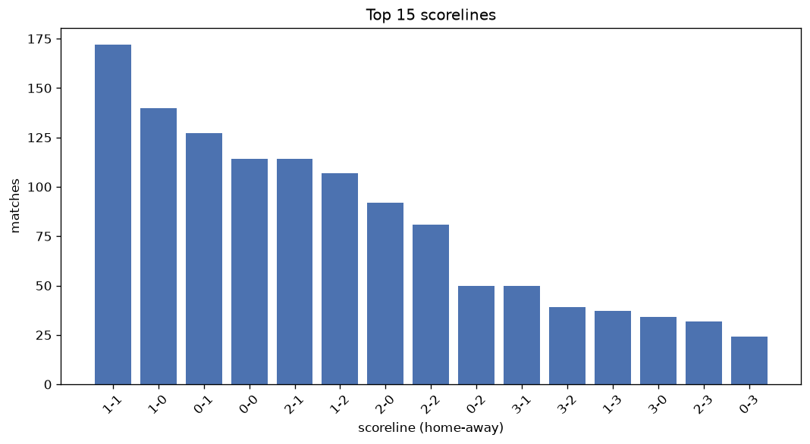
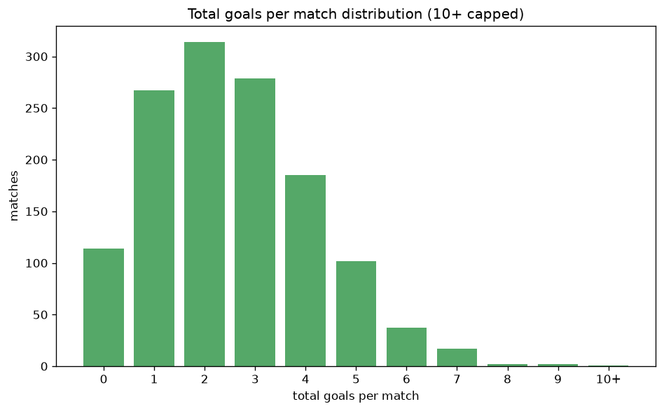

# Scoreline Analysis
- Report: `scoreline_analysis`
- Generated: 2026-10-26T01:39:45+00:00
- Script: `backend/scripts/analyze_scorelines.py` v1.0.0
- League: K League 1 (South Korea)
- Scope: league `korea1`

## 1. Scoreline frequency
- Matches analysed: **1320** across **7** seasons.
- Distinct scorelines seen: **37**.

| scoreline | count | pct |
|---|---|---|
| 1-1 | 172 | 13.0% |
| 1-0 | 140 | 10.6% |
| 0-1 | 127 | 9.6% |
| 0-0 | 114 | 8.6% |
| 2-1 | 114 | 8.6% |
| 1-2 | 107 | 8.1% |
| 2-0 | 92 | 7.0% |
| 2-2 | 81 | 6.1% |
| 0-2 | 50 | 3.8% |
| 3-1 | 50 | 3.8% |
| 3-2 | 39 | 3.0% |
| 1-3 | 37 | 2.8% |
| 3-0 | 34 | 2.6% |
| 2-3 | 32 | 2.4% |
| 0-3 | 24 | 1.8% |
| 1-4 | 11 | 0.8% |
| 2-4 | 11 | 0.8% |
| 4-0 | 10 | 0.8% |
| 4-1 | 10 | 0.8% |
| 3-3 | 9 | 0.7% |

## 2. Scoreline frequency per season

### 2020
| scoreline | count | pct |
|---|---|---|
| 1-1 | 16 | 12.1% |
| 1-0 | 15 | 11.4% |
| 0-0 | 12 | 9.1% |
| 2-0 | 11 | 8.3% |
| 1-2 | 11 | 8.3% |

### 2021
| scoreline | count | pct |
|---|---|---|
| 1-0 | 24 | 12.1% |
| 0-0 | 23 | 11.6% |
| 1-1 | 22 | 11.1% |
| 2-1 | 21 | 10.6% |
| 0-1 | 20 | 10.1% |

### 2022
| scoreline | count | pct |
|---|---|---|
| 1-1 | 27 | 13.6% |
| 1-0 | 23 | 11.6% |
| 0-1 | 21 | 10.6% |
| 2-2 | 18 | 9.1% |
| 1-2 | 16 | 8.1% |

### 2023
| scoreline | count | pct |
|---|---|---|
| 1-1 | 30 | 15.2% |
| 0-1 | 20 | 10.1% |
| 1-0 | 19 | 9.6% |
| 0-0 | 16 | 8.1% |
| 2-0 | 16 | 8.1% |

### 2024
| scoreline | count | pct |
|---|---|---|
| 1-0 | 26 | 13.1% |
| 1-1 | 20 | 10.1% |
| 2-1 | 19 | 9.6% |
| 2-0 | 18 | 9.1% |
| 1-2 | 18 | 9.1% |

### 2025
| scoreline | count | pct |
|---|---|---|
| 1-1 | 25 | 12.6% |
| 0-1 | 20 | 10.1% |
| 2-1 | 19 | 9.6% |
| 1-0 | 19 | 9.6% |
| 0-0 | 16 | 8.1% |

### 2026
| scoreline | count | pct |
|---|---|---|
| 1-1 | 32 | 16.2% |
| 0-0 | 22 | 11.1% |
| 0-1 | 19 | 9.6% |
| 1-2 | 17 | 8.6% |
| 2-1 | 16 | 8.1% |

## 3. Total-goal histogram
_10+ groups all matches with 10 or more total goals._

| total goals | matches | pct |
|---|---|---|
| 0 | 114 | 8.6% |
| 1 | 267 | 20.2% |
| 2 | 314 | 23.8% |
| 3 | 279 | 21.1% |
| 4 | 185 | 14.0% |
| 5 | 102 | 7.7% |
| 6 | 37 | 2.8% |
| 7 | 17 | 1.3% |
| 8 | 2 | 0.2% |
| 9 | 2 | 0.2% |
| 10+ | 1 | 0.1% |

## 4. Extreme scorelines
- Matches with 7+ total goals: **22**

| season | date | scoreline | total goals |
|---|---|---|---|
| 2020 | 2020-08-30 | 4-6 | 10 |
| 2023 | 2023-07-12 | 7-2 | 9 |
| 2024 | 2024-08-31 | 5-4 | 9 |
| 2023 | 2023-04-09 | 5-3 | 8 |
| 2025 | 2025-08-17 | 6-2 | 8 |
| 2020 | 2020-09-20 | 4-3 | 7 |
| 2021 | 2021-05-18 | 3-4 | 7 |
| 2021 | 2021-05-23 | 3-4 | 7 |
| 2021 | 2021-07-25 | 2-5 | 7 |
| 2021 | 2021-09-05 | 3-4 | 7 |
| 2022 | 2022-03-20 | 4-3 | 7 |
| 2022 | 2022-04-03 | 3-4 | 7 |
| 2022 | 2022-07-10 | 4-3 | 7 |
| 2023 | 2023-04-16 | 3-4 | 7 |
| 2023 | 2023-08-13 | 4-3 | 7 |
| 2023 | 2023-08-20 | 4-3 | 7 |
| 2024 | 2024-10-06 | 4-3 | 7 |
| 2025 | 2025-09-28 | 3-4 | 7 |
| 2026 | 2026-04-26 | 2-5 | 7 |
| 2026 | 2026-08-22 | 0-7 | 7 |
| 2026 | 2026-08-30 | 2-5 | 7 |
| 2026 | 2026-10-11 | 4-3 | 7 |

## 5. Margin-of-victory distribution (decided matches)
- Decided matches: **944** (draws: **376**)
- Average winning margin: **1.58**

| margin | matches | pct |
|---|---|---|
| 1 | 573 | 60.7% |
| 2 | 250 | 26.5% |
| 3+ | 121 | 12.8% |

## 6. Margin by outcome

### Home wins
- Matches: **518** | avg margin: **1.61** | max margin: **6**
| margin | matches | pct |
|---|---|---|
| 1 | 301 | 58.1% |
| 2 | 151 | 29.2% |
| 3+ | 66 | 12.7% |
- *Full match-by-match list available in `scoreline_analysis.json`.*

### Away wins
- Matches: **426** | avg margin: **1.55** | max margin: **7**
| margin | matches | pct |
|---|---|---|
| 1 | 272 | 63.8% |
| 2 | 99 | 23.2% |
| 3+ | 55 | 12.9% |
- *Full match-by-match list available in `scoreline_analysis.json`.*

## 7. Most common exact score by outcome type
| outcome | matches | most common score | count | pct |
|---|---|---|---|---|
| home | 518 | 1-0 | 140 | 27.0% |
| draw | 376 | 1-1 | 172 | 45.7% |
| away | 426 | 0-1 | 127 | 29.8% |

---
*All statistics are computed from PostgreSQL tables (read-only). Run with `python backend/scripts/analyze_scorelines.py` to regenerate.*

## Charts

