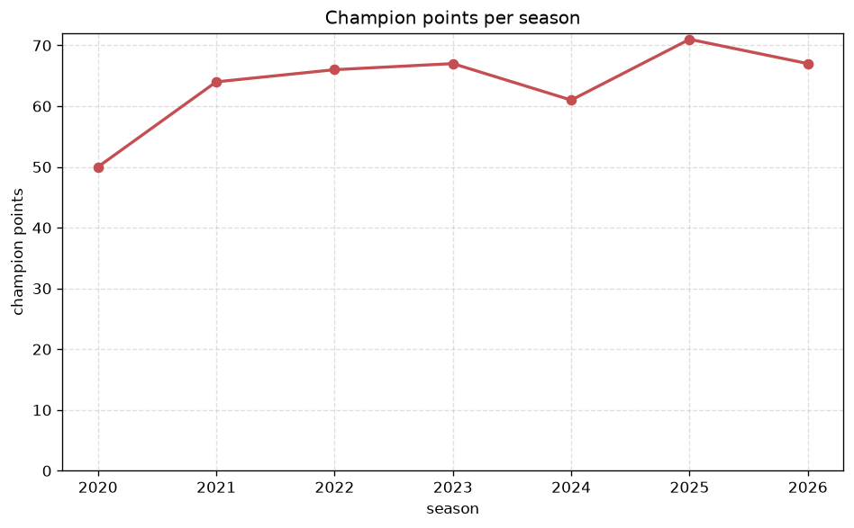
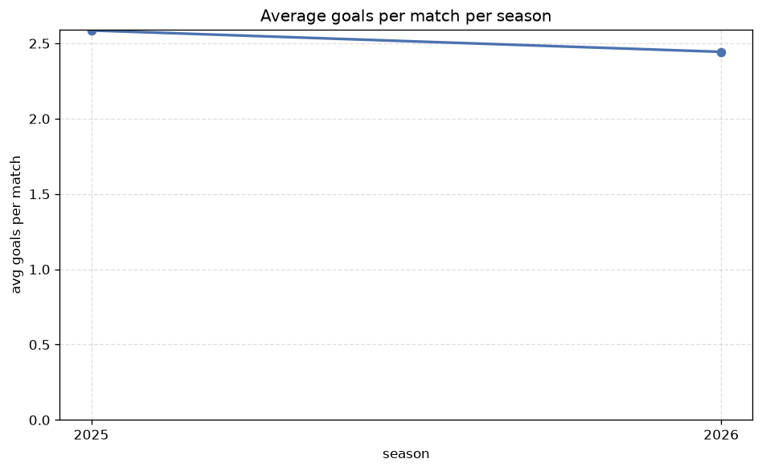

# Season Trends Analysis
- Report: `season_trends`
- Generated: 2026-10-27T01:59:57+00:00
- Script: `backend/scripts/analyze_seasons.py` v1.0.0
- League: K League 1 (South Korea)
- Scope: league `korea1`

## 1. Champions per season
| season | champion | pts | runner-up | margin |
|---|---|---|---|---|
| 2020 | Ulsan HD | 50 | Jeonbuk | 2 pts |
| 2021 | Jeonbuk | 64 | Ulsan HD | 0 pts |
| 2022 | Ulsan HD | 66 | Jeonbuk | 5 pts |
| 2023 | Ulsan HD | 67 | Pohang | 9 pts |
| 2024 | Ulsan HD | 61 | Gimcheon Sangmu | 5 pts |
| 2025 | Jeonbuk | 71 | Gimcheon Sangmu | 16 pts |
| 2026 | Seoul | 67 | Ulsan HD | 16 pts |

## 2. Title-race tightness
- Tight races (margin <= 3 pts): **2** of 7 seasons
- Tightest race: **2021** - Jeonbuk beat Ulsan HD by **0** pts

| season | margin | tight |
|---|---|---|
| 2020 | 2 pts | yes |
| 2021 | 0 pts | yes |
| 2022 | 5 pts |  |
| 2023 | 9 pts |  |
| 2024 | 5 pts |  |
| 2025 | 16 pts |  |
| 2026 | 16 pts |  |

## 3. Points thresholds
_Position-specific points per season. Key: 1 = champion, 2 = runner-up, 4 = CL line, 6 = Europa, 9 = last safe, 12 = bottom._

| season | pos 1 | pos 2 | pos 4 | pos 6 | pos 9 | pos 12 |
|---|---|---|---|---|---|---|
| 2020 | 50 | 48 | 38 | 25 | 22 | 18 |
| 2021 | 64 | 64 | 45 | 45 | 37 | 32 |
| 2022 | 66 | 61 | 49 | 45 | 35 | 25 |
| 2023 | 67 | 58 | 49 | 48 | 35 | 25 |
| 2024 | 61 | 56 | 51 | 49 | 38 | 32 |
| 2025 | 71 | 55 | 51 | 44 | 40 | 27 |
| 2026 | 67 | 51 | 48 | 46 | 42 | 21 |

## 4. Relegation battle
| season | safe pos | safe pts | drop pos | drop pts | gap |
|---|---|---|---|---|---|
| 2020 | 9 | 22 | 10 | 21 | 1 pts |
| 2021 | 9 | 37 | 10 | 37 | 0 pts |
| 2022 | 9 | 35 | 10 | 34 | 1 pts |
| 2023 | 9 | 35 | 10 | 31 | 4 pts |
| 2024 | 9 | 38 | 10 | 37 | 1 pts |
| 2025 | 9 | 40 | 10 | 38 | 2 pts |
| 2026 | 9 | 42 | 10 | 34 | 8 pts |

## 5. League-level trends
| season | matches | total goals | avg goals | home win | draw | away win | goalless | avg pts/team |
|---|---|---|---|---|---|---|---|---|
| 2020 | 132 | 338 | 2.561 | 37.9% | 26.5% | 35.6% | 9.1% | 30.08 |
| 2021 | 198 | 482 | 2.434 | 38.9% | 28.8% | 32.3% | 11.6% | 44.75 |
| 2022 | 198 | 508 | 2.566 | 38.9% | 29.8% | 31.3% | 6.6% | 44.58 |
| 2023 | 198 | 498 | 2.515 | 38.9% | 30.3% | 30.8% | 8.1% | 44.5 |
| 2024 | 198 | 533 | 2.692 | 46.0% | 23.2% | 30.8% | 6.1% | 45.67 |
| 2025 | 198 | 512 | 2.586 | 41.9% | 26.3% | 31.8% | 8.1% | 45.17 |
| 2026 | 198 | 496 | 2.505 | 31.8% | 33.8% | 34.3% | 11.1% | 43.92 |

## 6. View divergence
- Largest divergence: **2022** (goals view, avg abs position diff = 4.833)

_Avg absolute position difference between classic view and alternative view per season._

| season | classic vs luck | classic vs goals |
|---|---|---|
| 2020 | 1.500 | 2.167 |
| 2021 | 2.500 | 2.500 |
| 2022 | 1.500 | 4.833 |
| 2023 | 1.333 | 4.667 |
| 2024 | 1.500 | 2.167 |
| 2025 | 1.667 | 3.333 |
| 2026 | 3.167 | 3.167 |

---
*All statistics are computed from PostgreSQL tables (read-only). Run with `python backend/scripts/analyze_seasons.py` to regenerate.*

## Charts

