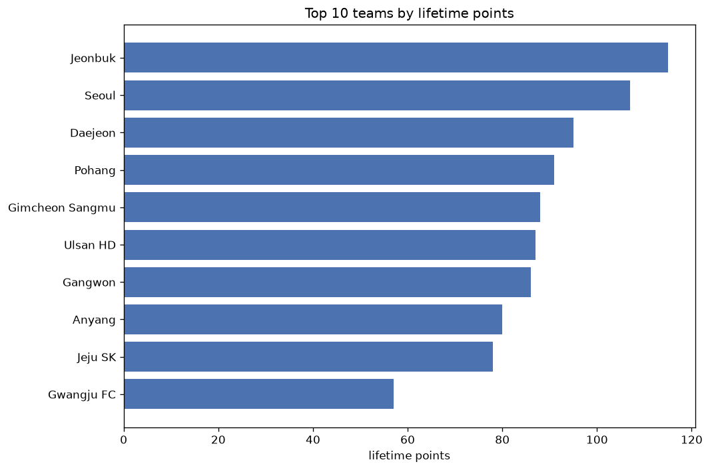
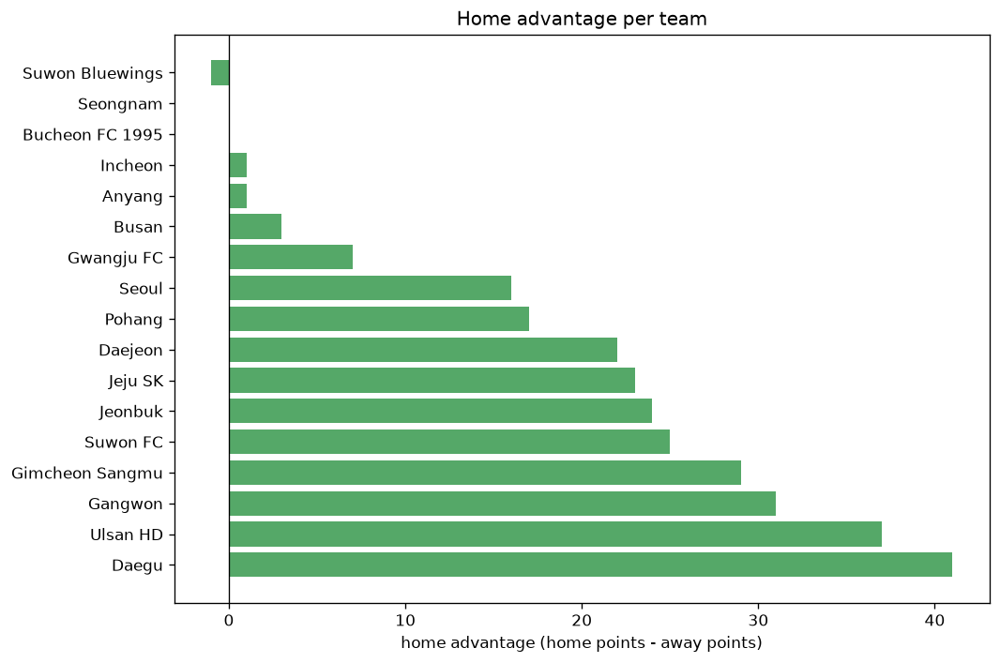

# Team Analysis
- Report: `teams_analysis`
- Generated: 2026-10-29T02:06:53+00:00
- Script: `backend/scripts/analyze_teams.py` v1.0.0
- League: K League 1 (South Korea)
- Scope: league `korea1`

- Teams: **17** | Seasons: **7** | Matches: **1320**

## 1. Team standings (lifetime)
| team | seasons | played | W | D | L | pts | GF | GA | GD | avg pts/season | best pos | worst pos | titles |
|---|---|---|---|---|---|---|---|---|---|---|---|---|---|
| Ulsan HD | 7 | 220 | 115 | 54 | 51 | 399 | 347 | 240 | 107 | 57.0 | 1 | 9 | 4 |
| Jeonbuk | 7 | 220 | 106 | 60 | 54 | 378 | 327 | 227 | 100 | 54.0 | 1 | 10 | 2 |
| Pohang | 7 | 220 | 92 | 61 | 67 | 337 | 292 | 261 | 31 | 48.14 | 2 | 9 | 0 |
| Seoul | 7 | 220 | 83 | 63 | 74 | 312 | 302 | 270 | 32 | 44.57 | 1 | 9 | 1 |
| Gangwon | 7 | 220 | 70 | 69 | 81 | 279 | 264 | 280 | -16 | 39.86 | 3 | 11 | 0 |
| Jeju SK | 6 | 198 | 64 | 53 | 81 | 245 | 233 | 258 | -25 | 40.83 | 4 | 11 | 0 |
| Incheon | 6 | 187 | 58 | 59 | 70 | 233 | 202 | 223 | -21 | 38.83 | 4 | 12 | 0 |
| Daegu | 6 | 187 | 55 | 64 | 68 | 229 | 232 | 258 | -26 | 38.17 | 3 | 12 | 0 |
| Gimcheon Sangmu | 5 | 154 | 56 | 49 | 49 | 217 | 204 | 182 | 22 | 43.4 | 2 | 10 | 0 |
| Gwangju FC | 6 | 187 | 58 | 43 | 86 | 217 | 211 | 262 | -51 | 36.17 | 3 | 12 | 0 |
| Suwon FC | 5 | 165 | 56 | 39 | 70 | 207 | 228 | 270 | -42 | 41.4 | 6 | 10 | 0 |
| Daejeon | 4 | 132 | 47 | 43 | 42 | 184 | 186 | 179 | 7 | 46.0 | 3 | 11 | 0 |
| Suwon Bluewings | 4 | 121 | 31 | 32 | 58 | 125 | 125 | 163 | -38 | 31.25 | 5 | 12 | 0 |
| Anyang | 2 | 66 | 22 | 19 | 25 | 85 | 82 | 89 | -7 | 42.5 | 7 | 8 | 0 |
| Seongnam | 3 | 88 | 20 | 24 | 44 | 84 | 79 | 127 | -48 | 28.0 | 9 | 12 | 0 |
| Bucheon FC 1995 | 1 | 33 | 7 | 11 | 15 | 32 | 32 | 47 | -15 | 32.0 | 11 | 11 | 0 |
| Busan | 1 | 22 | 4 | 9 | 9 | 21 | 21 | 31 | -10 | 21.0 | 11 | 11 | 0 |

## 2. Home vs away split
| team | home P | H-W | H-D | H-L | H-pts | away P | A-W | A-D | A-L | A-pts | adv |
|---|---|---|---|---|---|---|---|---|---|---|---|
| Daegu | 93 | 34 | 33 | 26 | 135 | 94 | 21 | 31 | 42 | 94 | 41 |
| Ulsan HD | 110 | 64 | 26 | 20 | 218 | 110 | 51 | 28 | 31 | 181 | 37 |
| Gangwon | 111 | 38 | 41 | 32 | 155 | 109 | 32 | 28 | 49 | 124 | 31 |
| Gimcheon Sangmu | 77 | 34 | 21 | 22 | 123 | 77 | 22 | 28 | 27 | 94 | 29 |
| Suwon FC | 81 | 33 | 17 | 31 | 116 | 84 | 23 | 22 | 39 | 91 | 25 |
| Jeonbuk | 110 | 57 | 30 | 23 | 201 | 110 | 49 | 30 | 31 | 177 | 24 |
| Jeju SK | 99 | 35 | 29 | 35 | 134 | 99 | 29 | 24 | 46 | 111 | 23 |
| Daejeon | 66 | 28 | 19 | 19 | 103 | 66 | 19 | 24 | 23 | 81 | 22 |
| Pohang | 108 | 49 | 30 | 29 | 177 | 112 | 43 | 31 | 38 | 160 | 17 |
| Seoul | 110 | 45 | 29 | 36 | 164 | 110 | 38 | 34 | 38 | 148 | 16 |
| Gwangju FC | 93 | 31 | 19 | 43 | 112 | 94 | 27 | 24 | 43 | 105 | 7 |
| Busan | 11 | 2 | 6 | 3 | 12 | 11 | 2 | 3 | 6 | 9 | 3 |
| Incheon | 94 | 29 | 30 | 35 | 117 | 93 | 29 | 29 | 35 | 116 | 1 |
| Anyang | 33 | 11 | 10 | 12 | 43 | 33 | 11 | 9 | 13 | 42 | 1 |
| Seongnam | 44 | 10 | 12 | 22 | 42 | 44 | 10 | 12 | 22 | 42 | 0 |
| Bucheon FC 1995 | 18 | 3 | 7 | 8 | 16 | 15 | 4 | 4 | 7 | 16 | 0 |
| Suwon Bluewings | 62 | 15 | 17 | 30 | 62 | 59 | 16 | 15 | 28 | 63 | -1 |

## 3. Top performers
### Best points per game (PPG)
| rank | team | PPG |
|---|---|---|
| 1 | Ulsan HD | 1.81 |
| 2 | Jeonbuk | 1.72 |
| 3 | Pohang | 1.53 |
| 4 | Seoul | 1.42 |
| 5 | Gimcheon Sangmu | 1.41 |

### Most goals scored
| rank | team | goals |
|---|---|---|
| 1 | Ulsan HD | 347 |
| 2 | Jeonbuk | 327 |
| 3 | Seoul | 302 |
| 4 | Pohang | 292 |
| 5 | Gangwon | 264 |

### Best goal difference
| rank | team | GD |
|---|---|---|
| 1 | Ulsan HD | 107 |
| 2 | Jeonbuk | 100 |
| 3 | Seoul | 32 |
| 4 | Pohang | 31 |
| 5 | Gimcheon Sangmu | 22 |

### Best defence (goals against per match, standings)
| rank | team | GA/match |
|---|---|---|
| 1 | Jeonbuk | 1.032 |
| 2 | Ulsan HD | 1.091 |
| 3 | Gimcheon Sangmu | 1.182 |
| 4 | Pohang | 1.186 |
| 5 | Incheon | 1.193 |

## 4. Team consistency
- Teams present in all **7** seasons: **5**

Gangwon, Jeonbuk, Pohang, Seoul, Ulsan HD

## 5. Head-to-head dominance
- Distinct fixtures: **124** (showing the 15 most frequent)

| fixture | meetings | home wins | draws | away wins | home pct | draw pct | away pct |
|---|---|---|---|---|---|---|---|
| Ulsan HD vs Gangwon | 20 | 12 | 3 | 5 | 60.0% | 15.0% | 25.0% |
| Pohang vs Gangwon | 20 | 10 | 7 | 3 | 50.0% | 35.0% | 15.0% |
| Ulsan HD vs Jeonbuk | 20 | 10 | 4 | 6 | 50.0% | 20.0% | 30.0% |
| Jeonbuk vs Pohang | 20 | 9 | 3 | 8 | 45.0% | 15.0% | 40.0% |
| Seoul vs Gangwon | 20 | 9 | 7 | 4 | 45.0% | 35.0% | 20.0% |
| Ulsan HD vs Pohang | 20 | 8 | 6 | 6 | 40.0% | 30.0% | 30.0% |
| Ulsan HD vs Seoul | 20 | 8 | 5 | 7 | 40.0% | 25.0% | 35.0% |
| Jeonbuk vs Gangwon | 20 | 6 | 4 | 10 | 30.0% | 20.0% | 50.0% |
| Jeonbuk vs Seoul | 20 | 5 | 7 | 8 | 25.0% | 35.0% | 40.0% |
| Pohang vs Seoul | 20 | 5 | 6 | 9 | 25.0% | 30.0% | 45.0% |
| Pohang vs Jeju SK | 18 | 10 | 3 | 5 | 55.6% | 16.7% | 27.8% |
| Seoul vs Jeju SK | 18 | 9 | 2 | 7 | 50.0% | 11.1% | 38.9% |
| Ulsan HD vs Jeju SK | 18 | 8 | 4 | 6 | 44.4% | 22.2% | 33.3% |
| Jeonbuk vs Jeju SK | 18 | 7 | 7 | 4 | 38.9% | 38.9% | 22.2% |
| Gangwon vs Jeju SK | 18 | 3 | 11 | 4 | 16.7% | 61.1% | 22.2% |

## 6. Position per season (classic view)
_Cells show final position; '-' when the team was absent from that season._

| team | 2020 | 2021 | 2022 | 2023 | 2024 | 2025 | 2026 |
|---|---|---|---|---|---|---|---|
| Ulsan HD | 1 | 2 | 1 | 1 | 1 | 9 | 2 |
| Jeonbuk | 2 | 1 | 2 | 4 | 10 | 1 | 4 |
| Pohang | 3 | 7 | 3 | 2 | 4 | 4 | 9 |
| Seoul | 7 | 9 | 8 | 7 | 5 | 5 | 1 |
| Gangwon | 8 | 10 | 6 | 11 | 3 | 6 | 5 |
| Jeju SK | - | 4 | 5 | 9 | 8 | 11 | 7 |
| Incheon | 12 | 8 | 4 | 6 | 12 | - | 6 |
| Daegu | 5 | 3 | 9 | 5 | 9 | 12 | - |
| Gimcheon Sangmu | 4 | - | 10 | - | 2 | 2 | 10 |
| Gwangju FC | 6 | 12 | - | 3 | 7 | 8 | 12 |
| Suwon FC | - | 6 | 7 | 10 | 6 | 10 | - |
| Daejeon | - | - | - | 8 | 11 | 3 | 3 |
| Suwon Bluewings | 10 | 5 | 11 | 12 | - | - | - |
| Anyang | - | - | - | - | - | 7 | 8 |
| Seongnam | 9 | 11 | 12 | - | - | - | - |
| Bucheon FC 1995 | - | - | - | - | - | - | 11 |
| Busan | 11 | - | - | - | - | - | - |

---
*All statistics are computed from PostgreSQL tables (read-only). Run with `python backend/scripts/analyze_teams.py` to regenerate.*

## Charts

