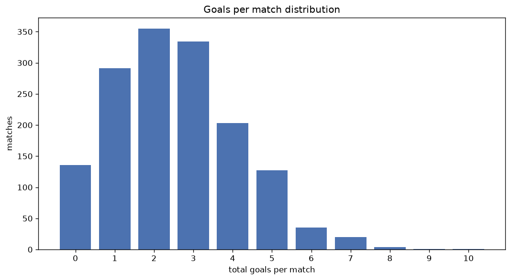
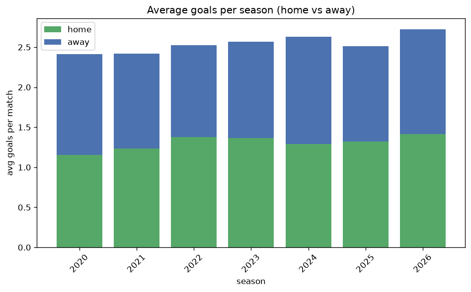

# Goal Analysis
- Report: `goals_analysis`
- Generated: 2026-10-26T01:39:59+00:00
- Script: `backend/scripts/analyze_goals.py` v1.0.0
- League: K League 2 (South Korea)
- Scope: league `korea2`

## 1. Goals per match distribution
| goals | matches | pct |
|---|---|---|
| 0 | 136 | 9.0% |
| 1 | 291 | 19.3% |
| 2 | 355 | 23.6% |
| 3 | 334 | 22.2% |
| 4 | 203 | 13.5% |
| 5 | 127 | 8.4% |
| 6 | 35 | 2.3% |
| 7 | 20 | 1.3% |
| 8 | 4 | 0.3% |
| 9 | 1 | 0.1% |
| 10 | 1 | 0.1% |

## 2. Goals per match per season
| season | matches | total goals | avg home | avg away | avg total |
|---|---|---|---|---|---|
| 2020 | 135 | 326 | 1.156 | 1.259 | 2.415 |
| 2021 | 173 | 418 | 1.237 | 1.179 | 2.416 |
| 2022 | 220 | 556 | 1.377 | 1.15 | 2.527 |
| 2023 | 234 | 601 | 1.363 | 1.205 | 2.568 |
| 2024 | 234 | 616 | 1.291 | 1.342 | 2.632 |
| 2025 | 273 | 686 | 1.319 | 1.194 | 2.513 |
| 2026 | 238 | 648 | 1.416 | 1.307 | 2.723 |

## 3. Home vs away goal share
- Home goals: **1991** (51.7%)
- Away goals: **1860** (48.3%)
- Home/away ratio: **1.07**

| season | home goals | away goals | total | home pct | away pct |
|---|---|---|---|---|---|
| 2020 | 156 | 170 | 326 | 47.9% | 52.1% |
| 2021 | 214 | 204 | 418 | 51.2% | 48.8% |
| 2022 | 303 | 253 | 556 | 54.5% | 45.5% |
| 2023 | 319 | 282 | 601 | 53.1% | 46.9% |
| 2024 | 302 | 314 | 616 | 49.0% | 51.0% |
| 2025 | 360 | 326 | 686 | 52.5% | 47.5% |
| 2026 | 337 | 311 | 648 | 52.0% | 48.0% |

## 4. BTTS (Both Teams To Score)
- Overall: **801** of `1507` (53.2%)

| season | matches | BTTS | pct |
|---|---|---|---|
| 2020 | 135 | 65 | 48.1% |
| 2021 | 173 | 93 | 53.8% |
| 2022 | 220 | 113 | 51.4% |
| 2023 | 234 | 114 | 48.7% |
| 2024 | 234 | 134 | 57.3% |
| 2025 | 273 | 135 | 49.5% |
| 2026 | 238 | 147 | 61.8% |

## 5. Clean sheets
- Home clean sheets: **433** (28.7%)
- Away clean sheets: **409** (27.1%)
- Total clean sheets recorded: **842**
- Matches with at least one clean sheet: **706** (46.8%)
- Both teams kept clean sheets (0-0): **136**

| season | matches | home CS | away CS | total CS | matches w/ CS |
|---|---|---|---|---|---|
| 2020 | 135 | 38 | 43 | 81 | 70 (51.9%) |
| 2021 | 173 | 48 | 51 | 99 | 80 (46.2%) |
| 2022 | 220 | 70 | 57 | 127 | 107 (48.6%) |
| 2023 | 234 | 78 | 66 | 144 | 120 (51.3%) |
| 2024 | 234 | 62 | 57 | 119 | 100 (42.7%) |
| 2025 | 273 | 78 | 86 | 164 | 138 (50.5%) |
| 2026 | 238 | 59 | 49 | 108 | 91 (38.2%) |

## 6. Scoring intensity
- First-half goals: **1544** (40.1%)
- Second-half goals: **2307** (59.9%)
- Avg first-half goals per match: **1.025**
- Avg second-half goals per match: **1.531**
- Second-half-only scoring (HT 0-0, FT goals >= 1): **412** (27.3%)

| season | matches | 1st half | 2nd half | 1st half pct | 2nd half pct |
|---|---|---|---|---|---|
| 2020 | 135 | 121 | 205 | 37.1% | 62.9% |
| 2021 | 173 | 157 | 261 | 37.6% | 62.4% |
| 2022 | 220 | 248 | 308 | 44.6% | 55.4% |
| 2023 | 234 | 240 | 361 | 39.9% | 60.1% |
| 2024 | 234 | 231 | 385 | 37.5% | 62.5% |
| 2025 | 273 | 283 | 403 | 41.3% | 58.7% |
| 2026 | 238 | 264 | 384 | 40.7% | 59.3% |

## 7. First-goal timing
- Matches with first-goal time recorded: `1371` of `1507` (91.0%)
- Goalless matches: `136`
- Min `1` | Max `112` | Mean `35.69` | Median (p50) `32`

| bucket | count | % of matches | % of scoring matches |
|---|---|---|---|
| 1-15 | 361 | 24.0% | 26.3% |
| 16-30 | 300 | 19.9% | 21.9% |
| 31-45 | 263 | 17.5% | 19.2% |
| 46-60 | 201 | 13.3% | 14.7% |
| 61-75 | 130 | 8.6% | 9.5% |
| 76-90 | 85 | 5.6% | 6.2% |
| 91-120 | 31 | 2.1% | 2.3% |

---
*All statistics are computed from PostgreSQL tables (read-only). Run with `python backend/scripts/analyze_goals.py` to regenerate.*

## Charts

