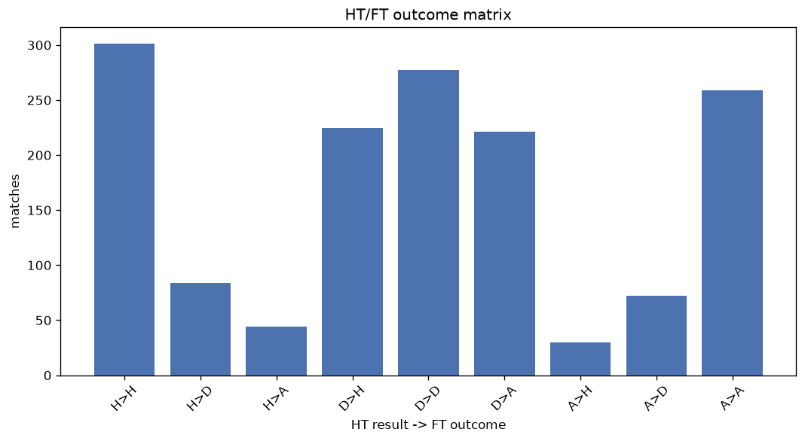
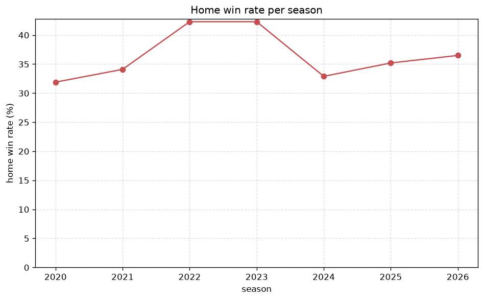

# Match Analysis
- Report: `matches_analysis`
- Generated: 2026-10-30T04:00:54+00:00
- Script: `backend/scripts/analyze_matches.py` v1.0.0
- League: K League 2 (South Korea)
- Scope: league `korea2`

## 1. Overall summary
| metric | value |
|---|---|
| Matches | 1513 |
| Home wins | 556 (36.7%) |
| Draws | 433 (28.6%) |
| Away wins | 524 (34.6%) |
| Total goals | 3866 |
| Average goals per match | 2.555 |
| Goalless matches | 136 (9.0%) |

## 2. Per-season breakdown
| season | matches | home wins | draws | away wins | total goals | avg goals | goalless |
|---|---|---|---|---|---|---|---|
| 2020 | 135 | 43 (31.9%) | 35 (25.9%) | 57 (42.2%) | 326 | 2.415 | 11 (8.1%) |
| 2021 | 173 | 59 (34.1%) | 49 (28.3%) | 65 (37.6%) | 418 | 2.416 | 19 (11.0%) |
| 2022 | 220 | 93 (42.3%) | 65 (29.5%) | 62 (28.2%) | 556 | 2.527 | 20 (9.1%) |
| 2023 | 234 | 99 (42.3%) | 57 (24.4%) | 78 (33.3%) | 601 | 2.568 | 24 (10.3%) |
| 2024 | 234 | 77 (32.9%) | 70 (29.9%) | 87 (37.2%) | 616 | 2.632 | 19 (8.1%) |
| 2025 | 273 | 96 (35.2%) | 80 (29.3%) | 97 (35.5%) | 686 | 2.513 | 26 (9.5%) |
| 2026 | 244 | 89 (36.5%) | 77 (31.6%) | 78 (32.0%) | 663 | 2.717 | 17 (7.0%) |

## 3. HT/FT outcome matrix
| HT result \ FT result | Home | Draw | Away | total |
|---|---|---|---|---|
| HT home lead | 301 (70.2%) | 84 (19.6%) | 44 (10.3%) | 429 |
| HT draw | 225 (31.1%) | 277 (38.3%) | 221 (30.6%) | 723 |
| HT away lead | 30 (8.3%) | 72 (19.9%) | 259 (71.7%) | 361 |

## 4. Comeback matches
- Home comebacks (trailing at HT, won at FT): **30** (2.0%)
- Away comebacks (trailing at HT, won at FT): **44** (2.9%)

### Home comebacks
| season | home | away | HT | FT |
|---|---|---|---|---|
| 2020 | Anyang | Seoul E-Land | 0-1 | 2-1 |
| 2020 | Gyeongnam | Asan | 0-1 | 3-1 |
| 2020 | Jeju SK | Anyang | 0-1 | 4-1 |
| 2021 | Asan | Busan | 1-2 | 3-2 |
| 2021 | Gimcheon Sangmu | Jeonnam | 0-1 | 3-1 |
| 2022 | Bucheon FC 1995 | Ansan Greeners | 0-1 | 2-1 |
| 2022 | Gyeongnam | Busan | 0-2 | 3-2 |
| 2022 | Daejeon | Busan | 0-2 | 4-3 |
| 2022 | Gwangju FC | Asan | 0-1 | 3-2 |
| 2022 | Ansan Greeners | Gimpo FC | 0-1 | 3-1 |
| 2022 | Gyeongnam | Daejeon | 0-1 | 2-1 |
| 2022 | Gwangju FC | Gimpo FC | 0-1 | 2-1 |
| 2023 | Seoul E-Land | Cheonan City | 0-1 | 3-2 |
| 2023 | Gimcheon Sangmu | Busan | 0-1 | 2-1 |
| 2023 | Cheongju | Seoul E-Land | 0-1 | 2-1 |
| 2023 | Busan | Bucheon FC 1995 | 0-1 | 2-1 |
| 2024 | Asan | Jeonnam | 0-1 | 2-1 |
| 2024 | Jeonnam | Bucheon FC 1995 | 0-1 | 3-1 |
| 2024 | Suwon Bluewings | Asan | 0-1 | 2-1 |
| 2025 | Suwon Bluewings | Jeonnam | 0-1 | 2-1 |
| 2025 | Incheon | Cheongju | 0-1 | 2-1 |
| 2025 | Suwon Bluewings | Bucheon FC 1995 | 0-1 | 4-1 |
| 2025 | Cheongju | Seoul E-Land | 0-1 | 2-1 |
| 2025 | Jeonnam | Cheonan City | 0-1 | 4-1 |
| 2025 | Bucheon FC 1995 | Cheonan City | 0-1 | 2-1 |
| 2026 | Ansan Greeners | Jeonnam | 0-1 | 2-1 |
| 2026 | Suwon FC | Suwon Bluewings | 0-1 | 3-1 |
| 2026 | Gyeongnam | Suwon FC | 1-2 | 3-2 |
| 2026 | Ansan Greeners | Suwon Bluewings | 0-1 | 2-1 |
| 2026 | Paju Frontier | Seongnam | 0-1 | 2-1 |

### Away comebacks
| season | home | away | HT | FT |
|---|---|---|---|---|
| 2020 | Jeju SK | Daejeon | 1-0 | 2-3 |
| 2020 | Bucheon FC 1995 | Seoul E-Land | 1-0 | 2-3 |
| 2020 | Gyeongnam | Seoul E-Land | 1-0 | 1-2 |
| 2020 | Daejeon | Gyeongnam | 2-0 | 2-3 |
| 2020 | Bucheon FC 1995 | Gyeongnam | 2-1 | 3-4 |
| 2021 | Anyang | Ansan Greeners | 1-0 | 1-2 |
| 2021 | Daejeon | Gimcheon Sangmu | 1-0 | 1-2 |
| 2021 | Gimcheon Sangmu | Gyeongnam | 1-0 | 1-2 |
| 2021 | Busan | Gyeongnam | 2-0 | 2-3 |
| 2021 | Jeonnam | Bucheon FC 1995 | 1-0 | 1-2 |
| 2021 | Gyeongnam | Gimcheon Sangmu | 2-1 | 2-3 |
| 2021 | Asan | Daejeon | 2-1 | 3-4 |
| 2022 | Gyeongnam | Gwangju FC | 1-0 | 1-2 |
| 2022 | Busan | Seoul E-Land | 1-0 | 1-2 |
| 2023 | Seongnam | Anyang | 1-0 | 1-2 |
| 2023 | Seoul E-Land | Anyang | 1-0 | 1-2 |
| 2023 | Seongnam | Gimpo FC | 1-0 | 2-4 |
| 2023 | Seoul E-Land | Ansan Greeners | 1-0 | 3-4 |
| 2024 | Cheonan City | Cheongju | 1-0 | 1-2 |
| 2024 | Seongnam | Cheongju | 1-0 | 1-2 |
| 2024 | Gyeongnam | Seongnam | 1-0 | 1-2 |
| 2024 | Busan | Cheonan City | 2-1 | 2-3 |
| 2024 | Suwon Bluewings | Seoul E-Land | 1-0 | 1-3 |
| 2024 | Anyang | Jeonnam | 2-0 | 2-3 |
| 2024 | Gimpo FC | Jeonnam | 1-0 | 1-2 |
| 2024 | Bucheon FC 1995 | Anyang | 1-0 | 1-2 |
| 2024 | Cheonan City | Suwon Bluewings | 1-0 | 1-2 |
| 2024 | Seongnam | Jeonnam | 1-0 | 1-2 |
| 2024 | Cheongju | Seoul E-Land | 1-0 | 1-2 |
| 2024 | Jeonnam | Busan | 1-0 | 1-2 |
| 2024 | Seongnam | Suwon Bluewings | 1-0 | 1-2 |
| 2025 | Cheongju | Gyeongnam | 1-0 | 1-2 |
| 2025 | Gyeongnam | Jeonnam | 1-0 | 2-3 |
| 2025 | Hwaseong | Suwon Bluewings | 1-0 | 2-3 |
| 2026 | Gimhae | Ansan Greeners | 1-0 | 1-4 |
| 2026 | Seoul E-Land | Busan | 1-0 | 2-3 |
| 2026 | Ansan Greeners | Asan | 1-0 | 1-3 |
| 2026 | Daegu | Cheonan City | 1-0 | 1-2 |
| 2026 | Paju Frontier | Gyeongnam | 2-1 | 2-3 |
| 2026 | Hwaseong | Suwon Bluewings | 1-0 | 1-2 |
| 2026 | Seoul E-Land | Cheongju | 1-0 | 1-2 |
| 2026 | Ansan Greeners | Suwon FC | 1-0 | 1-3 |
| 2026 | Ansan Greeners | Seongnam | 1-0 | 1-2 |
| 2026 | Ansan Greeners | Daegu | 1-0 | 1-2 |

## 5. HT lead conversion
| HT state | matches | converted to win | held as draw | collapsed to loss |
|---|---|---|---|---|
| Home lead | 429 | 301 (70.2%) | 84 (19.6%) | 44 (10.3%) |
| Away lead | 361 | 259 (71.7%) | 72 (19.9%) | 30 (8.3%) |

### Matches level at half-time
| FT result | count | pct |
|---|---|---|
| Home win | 225 | 31.1% |
| Draw | 277 | 38.3% |
| Away win | 221 | 30.6% |

## 6. First-goal timing
- Matches with a first-goal time recorded: `1377` of `1513` (91.0%)

Outcome distribution by first-goal timing bucket:
| bucket | matches | % of matches | home | draw | away |
|---|---|---|---|---|---|
| 1-15 | 364 | 24.1% | 139 (38.2%) | 79 (21.7%) | 146 (40.1%) |
| 16-30 | 303 | 20.0% | 125 (41.3%) | 70 (23.1%) | 108 (35.6%) |
| 31-45 | 263 | 17.4% | 118 (44.9%) | 57 (21.7%) | 88 (33.5%) |
| 46-60 | 201 | 13.3% | 78 (38.8%) | 48 (23.9%) | 75 (37.3%) |
| 61-75 | 130 | 8.6% | 51 (39.2%) | 27 (20.8%) | 52 (40.0%) |
| 76-90 | 85 | 5.6% | 33 (38.8%) | 15 (17.6%) | 37 (43.5%) |
| 91-120 | 31 | 2.0% | 12 (38.7%) | 1 (3.2%) | 18 (58.1%) |

## 7. Goalless matches
- Overall: **136** of `1513` (9.0%)

| season | matches | goalless | pct |
|---|---|---|---|
| 2020 | 135 | 11 | 8.1% |
| 2021 | 173 | 19 | 11.0% |
| 2022 | 220 | 20 | 9.1% |
| 2023 | 234 | 24 | 10.3% |
| 2024 | 234 | 19 | 8.1% |
| 2025 | 273 | 26 | 9.5% |
| 2026 | 244 | 17 | 7.0% |

---
*All statistics are computed from PostgreSQL tables (read-only). Run with `python backend/scripts/analyze_matches.py` to regenerate.*

## Charts

