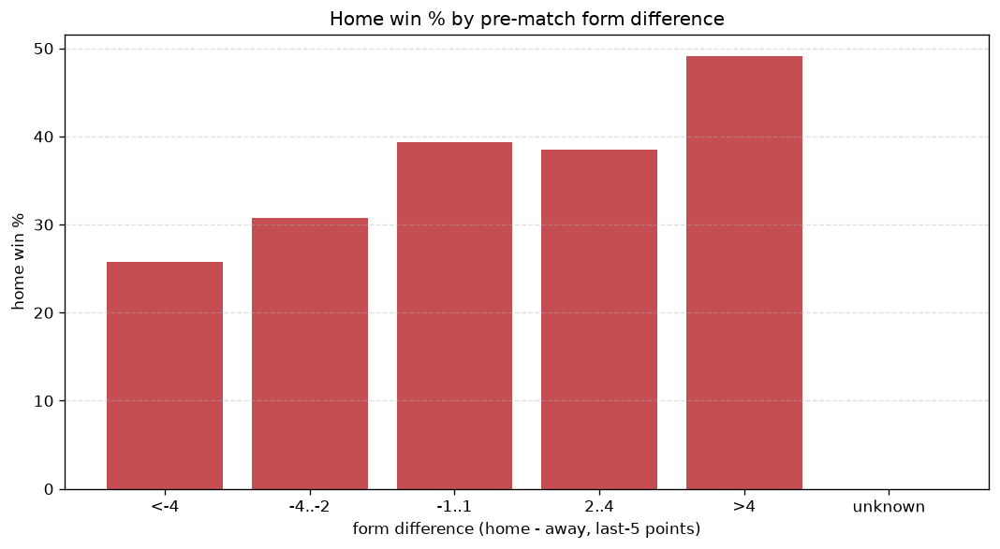
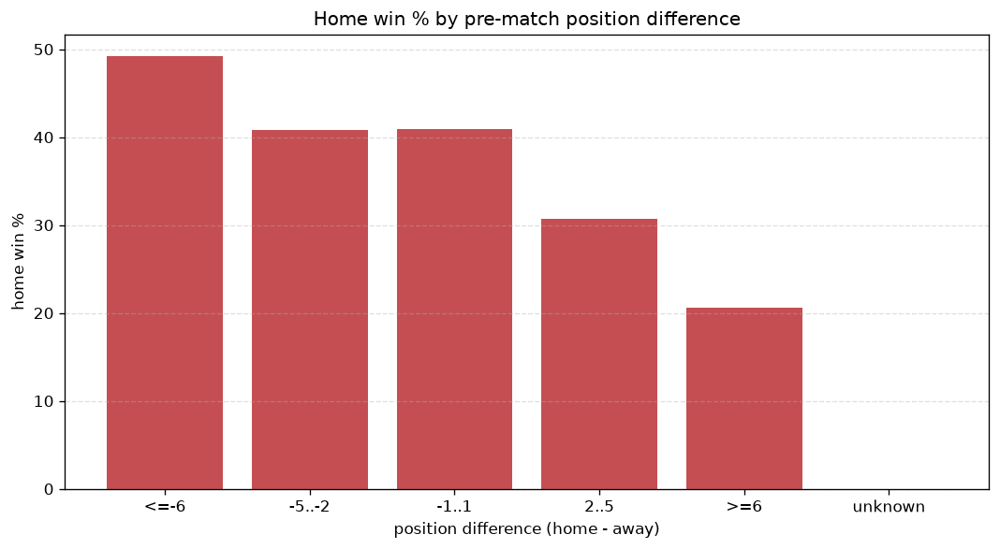

# Relationships Analysis
- Report: `relationships`
- Generated: 2026-10-29T02:07:16+00:00
- Script: `backend/scripts/analyze_relationships.py` v1.0.0
- League: K League 2 (South Korea)
- Scope: league `korea2`

- Matches analysed: **1269** (23 leakage-safe pre-match features).

## 1. Correlation matrix
_Pearson correlation of each pre-match feature with observed goals; sorted by |corr(total goals)|._

| feature | corr(home) | corr(away) | corr(total) |
|---|---|---|---|
| home_team_goals_scored_last_5 | 0.113 | -0.002 | 0.078 |
| home_rest_days | 0.095 | 0.002 | 0.068 |
| away_team_goals_scored_last_5 | -0.005 | 0.102 | 0.066 |
| away_team_points_last_5 | -0.032 | 0.127 | 0.064 |
| home_team_points_last_5 | 0.117 | -0.037 | 0.058 |
| away_team_wins_last_5 | -0.039 | 0.120 | 0.054 |
| home_team_wins_last_5 | 0.104 | -0.039 | 0.047 |
| away_team_away_win_rate | -0.011 | 0.070 | 0.040 |
| away_rest_days | 0.071 | -0.017 | 0.038 |
| away_points_before_match | -0.006 | 0.061 | 0.037 |
| away_team_away_goals_avg | -0.018 | 0.065 | 0.032 |
| rest_days_difference | 0.022 | 0.024 | 0.032 |
| away_position_before_match | 0.089 | -0.139 | -0.031 |
| home_points_before_match | 0.119 | -0.080 | 0.029 |
| away_team_away_conceded_avg | 0.075 | -0.035 | 0.029 |
| position_difference | -0.160 | 0.194 | 0.019 |
| points_difference | 0.171 | -0.192 | -0.010 |
| home_team_home_goals_avg | 0.083 | -0.070 | 0.010 |
| home_team_home_win_rate | 0.105 | -0.100 | 0.006 |
| home_team_goals_conceded_last_5 | -0.045 | 0.054 | 0.005 |
| home_position_before_match | -0.133 | 0.131 | -0.004 |
| home_team_home_conceded_avg | -0.067 | 0.070 | 0.000 |
| away_team_goals_conceded_last_5 | 0.066 | -0.068 | 0.000 |

## 2. Form vs outcome
_Home win/draw/away % per bucket of `home_team_points_last_5 - away_team_points_last_5`._

| bucket | matches | home | draw | away | home % | draw % | away % |
|---|---|---|---|---|---|---|---|
| <-4 | 178 | 46 | 54 | 78 | 25.8% | 30.3% | 43.8% |
| -4..-2 | 263 | 81 | 74 | 108 | 30.8% | 28.1% | 41.1% |
| -1..1 | 368 | 145 | 102 | 121 | 39.4% | 27.7% | 32.9% |
| 2..4 | 291 | 112 | 82 | 97 | 38.5% | 28.2% | 33.3% |
| >4 | 169 | 83 | 44 | 42 | 49.1% | 26.0% | 24.9% |
| unknown | 0 | 0 | 0 | 0 | - | - | - |

## 3. Position vs outcome
_Home win/draw/away % per bucket of `position_difference` (home position - away position; negative favours the home team)._

| bucket | matches | home | draw | away | home % | draw % | away % |
|---|---|---|---|---|---|---|---|
| <=-6 | 193 | 95 | 58 | 40 | 49.2% | 30.1% | 20.7% |
| -5..-2 | 316 | 129 | 96 | 91 | 40.8% | 30.4% | 28.8% |
| -1..1 | 269 | 110 | 71 | 88 | 40.9% | 26.4% | 32.7% |
| 2..5 | 316 | 97 | 87 | 132 | 30.7% | 27.5% | 41.8% |
| >=6 | 175 | 36 | 44 | 95 | 20.6% | 25.1% | 54.3% |
| unknown | 0 | 0 | 0 | 0 | - | - | - |

## 4. Rest advantage
_Home win/draw/away % per bucket of `rest_days_difference` (home rest - away rest). Matches with unknown rest are bucketed separately._

| bucket | matches | home | draw | away | home % | draw % | away % |
|---|---|---|---|---|---|---|---|
| <-1 | 102 | 39 | 32 | 31 | 38.2% | 31.4% | 30.4% |
| -1..0 | 177 | 73 | 46 | 58 | 41.2% | 26.0% | 32.8% |
| 0 | 596 | 218 | 174 | 204 | 36.6% | 29.2% | 34.2% |
| 1..2 | 285 | 89 | 85 | 111 | 31.2% | 29.8% | 38.9% |
| >2 | 72 | 35 | 12 | 25 | 48.6% | 16.7% | 34.7% |
| unknown | 37 | 13 | 7 | 17 | 35.1% | 18.9% | 45.9% |
- *37 match(es) had unknown rest difference (missing rest data on at least one side).*

## 5. Home team quality
_Home win rate by `home_team_home_win_rate` tier (split at 0.5)._

- `< 0.5` tier: **34.2%** home win (319/934)
- `>= 0.5` tier: **44.2%** home win (148/335)
- Home-win gap (>= split minus < split): **+10.0 pp**

| tier | label | matches | home | draw | away | home % |
|---|---|---|---|---|---|---|
| low | < 0.5 | 934 | 319 | 253 | 362 | 34.2% |
| high | >= 0.5 | 335 | 148 | 103 | 84 | 44.2% |

## 6. Feature averages by result
_Mean feature value per outcome; `range` is home-minus-away spread of the group means._

| feature | home mean | draw mean | away mean | range |
|---|---|---|---|---|
| points_difference | 3.191 | 0.110 | -3.496 | 6.686 |
| home_points_before_match | 26.520 | 23.913 | 21.179 | 5.341 |
| position_difference | -1.278 | -0.275 | 1.365 | 2.644 |
| home_position_before_match | 5.989 | 6.573 | 7.448 | 1.459 |
| away_points_before_match | 23.330 | 23.803 | 24.675 | 1.345 |
| away_position_before_match | 7.268 | 6.848 | 6.083 | 1.185 |
| home_team_points_last_5 | 6.668 | 6.160 | 5.839 | 0.830 |
| away_team_points_last_5 | 5.816 | 6.337 | 6.534 | 0.718 |
| away_team_goals_conceded_last_5 | 5.985 | 5.885 | 5.350 | 0.635 |
| home_team_goals_scored_last_5 | 6.096 | 5.713 | 5.520 | 0.576 |
| home_team_goals_conceded_last_5 | 5.522 | 5.902 | 6.029 | 0.507 |
| away_team_goals_scored_last_5 | 5.505 | 5.972 | 5.901 | 0.467 |
| away_rest_days | 7.279 | 6.851 | 6.911 | 0.428 |
| home_rest_days | 7.292 | 6.865 | 7.065 | 0.426 |
| home_team_wins_last_5 | 1.777 | 1.638 | 1.518 | 0.259 |
| away_team_wins_last_5 | 1.497 | 1.685 | 1.740 | 0.243 |
| home_team_home_goals_avg | 1.258 | 1.205 | 1.108 | 0.149 |
| rest_days_difference | 0.004 | 0.014 | 0.154 | 0.149 |
| home_team_home_conceded_avg | 1.099 | 1.126 | 1.226 | 0.127 |
| away_team_away_conceded_avg | 1.232 | 1.185 | 1.129 | 0.103 |
| home_team_home_win_rate | 0.367 | 0.350 | 0.289 | 0.078 |
| away_team_away_goals_avg | 1.124 | 1.163 | 1.177 | 0.054 |
| away_team_away_win_rate | 0.334 | 0.352 | 0.357 | 0.023 |

---
*All features are leakage-safe pre-match values built by `ml.features.build_features.build_rows` from strictly prior matches. Run with `python backend/scripts/analyze_relationships.py` to regenerate.*

## Charts

