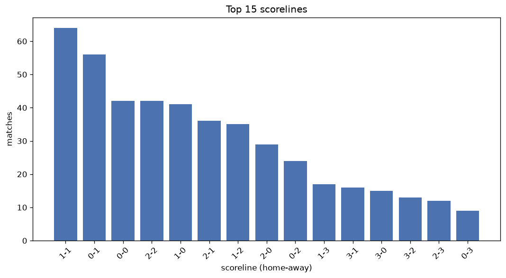
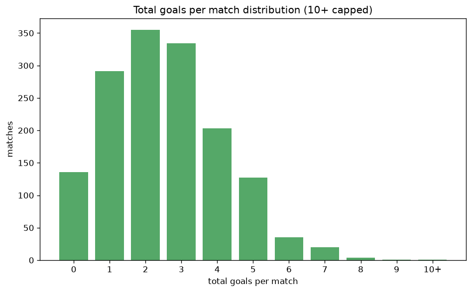

# Scoreline Analysis
- Report: `scoreline_analysis`
- Generated: 2026-10-29T02:07:14+00:00
- Script: `backend/scripts/analyze_scorelines.py` v1.0.0
- League: K League 2 (South Korea)
- Scope: league `korea2`

## 1. Scoreline frequency
- Matches analysed: **1513** across **7** seasons.
- Distinct scorelines seen: **39**.

| scoreline | count | pct |
|---|---|---|
| 1-1 | 197 | 13.0% |
| 0-1 | 149 | 9.8% |
| 1-0 | 143 | 9.5% |
| 0-0 | 136 | 9.0% |
| 1-2 | 128 | 8.5% |
| 2-1 | 126 | 8.3% |
| 2-2 | 86 | 5.7% |
| 2-0 | 84 | 5.6% |
| 0-2 | 77 | 5.1% |
| 3-1 | 54 | 3.6% |
| 2-3 | 47 | 3.1% |
| 3-0 | 46 | 3.0% |
| 3-2 | 35 | 2.3% |
| 0-3 | 34 | 2.2% |
| 1-3 | 34 | 2.2% |
| 4-1 | 22 | 1.5% |
| 4-0 | 19 | 1.3% |
| 1-4 | 16 | 1.1% |
| 3-3 | 13 | 0.9% |
| 0-4 | 12 | 0.8% |

## 2. Scoreline frequency per season

### 2020
| scoreline | count | pct |
|---|---|---|
| 1-1 | 17 | 12.6% |
| 1-2 | 17 | 12.6% |
| 0-1 | 14 | 10.4% |
| 0-2 | 14 | 10.4% |
| 1-0 | 13 | 9.6% |

### 2021
| scoreline | count | pct |
|---|---|---|
| 1-1 | 25 | 14.5% |
| 1-2 | 23 | 13.3% |
| 0-0 | 19 | 11.0% |
| 0-1 | 19 | 11.0% |
| 1-0 | 15 | 8.7% |

### 2022
| scoreline | count | pct |
|---|---|---|
| 1-1 | 28 | 12.7% |
| 1-0 | 24 | 10.9% |
| 2-1 | 23 | 10.5% |
| 0-0 | 20 | 9.1% |
| 0-1 | 19 | 8.6% |

### 2023
| scoreline | count | pct |
|---|---|---|
| 1-0 | 27 | 11.5% |
| 0-0 | 24 | 10.3% |
| 1-1 | 23 | 9.8% |
| 2-1 | 22 | 9.4% |
| 0-1 | 19 | 8.1% |

### 2024
| scoreline | count | pct |
|---|---|---|
| 1-1 | 37 | 15.8% |
| 1-2 | 24 | 10.3% |
| 1-0 | 21 | 9.0% |
| 2-1 | 20 | 8.5% |
| 0-1 | 20 | 8.5% |

### 2025
| scoreline | count | pct |
|---|---|---|
| 0-1 | 35 | 12.8% |
| 1-1 | 33 | 12.1% |
| 0-0 | 26 | 9.5% |
| 1-0 | 22 | 8.1% |
| 2-1 | 20 | 7.3% |

### 2026
| scoreline | count | pct |
|---|---|---|
| 1-1 | 34 | 13.9% |
| 2-2 | 24 | 9.8% |
| 0-1 | 23 | 9.4% |
| 1-0 | 21 | 8.6% |
| 1-2 | 20 | 8.2% |

## 3. Total-goal histogram
_10+ groups all matches with 10 or more total goals._

| total goals | matches | pct |
|---|---|---|
| 0 | 136 | 9.0% |
| 1 | 292 | 19.3% |
| 2 | 358 | 23.7% |
| 3 | 334 | 22.1% |
| 4 | 205 | 13.5% |
| 5 | 127 | 8.4% |
| 6 | 35 | 2.3% |
| 7 | 20 | 1.3% |
| 8 | 4 | 0.3% |
| 9 | 1 | 0.1% |
| 10+ | 1 | 0.1% |

## 4. Extreme scorelines
- Matches with 7+ total goals: **26**

| season | date | scoreline | total goals |
|---|---|---|---|
| 2023 | 2023-10-22 | 3-7 | 10 |
| 2021 | 2021-06-20 | 4-5 | 9 |
| 2022 | 2022-05-09 | 4-4 | 8 |
| 2022 | 2022-09-14 | 1-7 | 8 |
| 2025 | 2025-07-20 | 5-3 | 8 |
| 2026 | 2026-10-18 | 6-2 | 8 |
| 2020 | 2020-10-18 | 3-4 | 7 |
| 2020 | 2020-10-25 | 3-4 | 7 |
| 2021 | 2021-08-08 | 4-3 | 7 |
| 2021 | 2021-10-16 | 3-4 | 7 |
| 2022 | 2022-05-17 | 4-3 | 7 |
| 2022 | 2022-06-04 | 6-1 | 7 |
| 2023 | 2023-05-07 | 5-2 | 7 |
| 2023 | 2023-07-19 | 5-2 | 7 |
| 2023 | 2023-09-17 | 4-3 | 7 |
| 2023 | 2023-09-24 | 3-4 | 7 |
| 2024 | 2024-04-13 | 3-4 | 7 |
| 2024 | 2024-05-12 | 3-4 | 7 |
| 2024 | 2024-07-21 | 3-4 | 7 |
| 2024 | 2024-07-24 | 2-5 | 7 |
| 2024 | 2024-09-01 | 4-3 | 7 |
| 2025 | 2025-07-19 | 3-4 | 7 |
| 2025 | 2025-08-10 | 3-4 | 7 |
| 2025 | 2025-08-31 | 2-5 | 7 |
| 2025 | 2025-09-13 | 3-4 | 7 |
| 2026 | 2026-07-24 | 4-3 | 7 |

## 5. Margin-of-victory distribution (decided matches)
- Decided matches: **1080** (draws: **433**)
- Average winning margin: **1.62**

| margin | matches | pct |
|---|---|---|
| 1 | 644 | 59.6% |
| 2 | 265 | 24.5% |
| 3+ | 171 | 15.8% |

## 6. Margin by outcome

### Home wins
- Matches: **556** | avg margin: **1.69** | max margin: **6**
| margin | matches | pct |
|---|---|---|
| 1 | 309 | 55.6% |
| 2 | 147 | 26.4% |
| 3+ | 100 | 18.0% |
- *Full match-by-match list available in `scoreline_analysis.json`.*

### Away wins
- Matches: **524** | avg margin: **1.55** | max margin: **6**
| margin | matches | pct |
|---|---|---|
| 1 | 335 | 63.9% |
| 2 | 118 | 22.5% |
| 3+ | 71 | 13.5% |
- *Full match-by-match list available in `scoreline_analysis.json`.*

## 7. Most common exact score by outcome type
| outcome | matches | most common score | count | pct |
|---|---|---|---|---|
| home | 556 | 1-0 | 143 | 25.7% |
| draw | 433 | 1-1 | 197 | 45.5% |
| away | 524 | 0-1 | 149 | 28.4% |

---
*All statistics are computed from PostgreSQL tables (read-only). Run with `python backend/scripts/analyze_scorelines.py` to regenerate.*

## Charts

