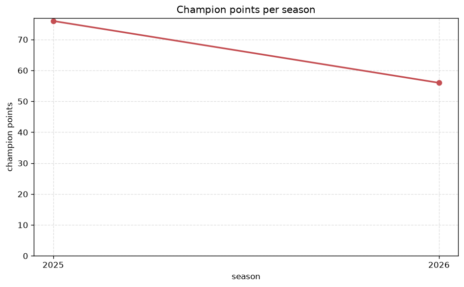
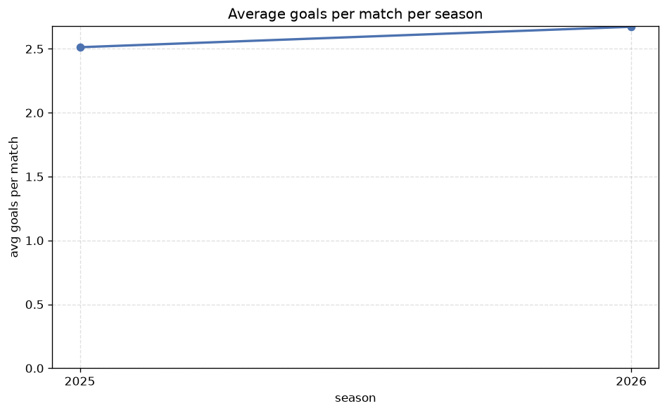

# Season Trends Analysis
- Report: `season_trends`
- Generated: 2026-10-29T02:07:13+00:00
- Script: `backend/scripts/analyze_seasons.py` v1.0.0
- League: K League 2 (South Korea)
- Scope: league `korea2`

## 1. Champions per season
| season | champion | pts | runner-up | margin |
|---|---|---|---|---|
| 2020 | Jeju SK | 60 | Suwon FC | 6 pts |
| 2021 | Gimcheon Sangmu | 69 | Anyang | 13 pts |
| 2022 | Gwangju FC | 82 | Daejeon | 11 pts |
| 2023 | Gimcheon Sangmu | 68 | Busan | 1 pts |
| 2024 | Anyang | 60 | Asan | 3 pts |
| 2025 | Incheon | 76 | Suwon Bluewings | 7 pts |
| 2026 | Suwon Bluewings | 65 | Suwon FC | 10 pts |

## 2. Title-race tightness
- Tight races (margin <= 3 pts): **2** of 7 seasons
- Tightest race: **2023** - Gimcheon Sangmu beat Busan by **1** pts

| season | margin | tight |
|---|---|---|
| 2020 | 6 pts |  |
| 2021 | 13 pts |  |
| 2022 | 11 pts |  |
| 2023 | 1 pts | yes |
| 2024 | 3 pts | yes |
| 2025 | 7 pts |  |
| 2026 | 10 pts |  |

## 3. Points thresholds
_Position-specific points per season. Key: 1 = champion, 2 = runner-up, 4 = CL line, 6 = Europa, 14 = last safe, 17 = bottom._

| season | pos 1 | pos 2 | pos 4 | pos 6 | pos 14 | pos 17 |
|---|---|---|---|---|---|---|
| 2020 | 60 | 54 | 39 | 38 | - | - |
| 2021 | 69 | 56 | 50 | 38 | - | - |
| 2022 | 82 | 71 | 60 | 51 | - | - |
| 2023 | 68 | 67 | 57 | 51 | - | - |
| 2024 | 60 | 57 | 56 | 50 | 26 | - |
| 2025 | 76 | 69 | 61 | 54 | 28 | - |
| 2026 | 65 | 55 | 52 | 46 | 30 | 18 |

## 4. Relegation battle
| season | safe pos | safe pts | drop pos | drop pts | gap |
|---|---|---|---|---|---|
| 2020 | 14 | - | 15 | - | - |
| 2021 | 14 | - | 15 | - | - |
| 2022 | 14 | - | 15 | - | - |
| 2023 | 14 | - | 15 | - | - |
| 2024 | 14 | 26 | 15 | - | - |
| 2025 | 14 | 28 | 15 | 26 | 2 pts |
| 2026 | 14 | 30 | 15 | 25 | 5 pts |

## 5. League-level trends
| season | matches | total goals | avg goals | home win | draw | away win | goalless | avg pts/team |
|---|---|---|---|---|---|---|---|---|
| 2020 | 135 | 326 | 2.415 | 31.9% | 25.9% | 42.2% | 8.1% | 37.0 |
| 2021 | 173 | 418 | 2.416 | 34.1% | 28.3% | 37.6% | 11.0% | 42.2 |
| 2022 | 220 | 556 | 2.527 | 42.3% | 29.5% | 28.2% | 9.1% | 49.36 |
| 2023 | 234 | 601 | 2.568 | 42.3% | 24.4% | 33.3% | 10.3% | 45.54 |
| 2024 | 234 | 616 | 2.632 | 32.9% | 29.9% | 37.2% | 8.1% | 44.69 |
| 2025 | 273 | 686 | 2.513 | 35.2% | 29.3% | 35.5% | 9.5% | 49.21 |
| 2026 | 244 | 663 | 2.717 | 36.5% | 31.6% | 32.0% | 7.0% | 38.53 |

## 6. View divergence
- Largest divergence: **2024** (goals view, avg abs position diff = 8.846)

_Avg absolute position difference between classic view and alternative view per season._

| season | classic vs luck | classic vs goals |
|---|---|---|
| 2020 | 1.400 | 2.000 |
| 2021 | 5.100 | 3.500 |
| 2022 | 5.818 | 6.273 |
| 2023 | 7.692 | 7.231 |
| 2024 | 7.692 | 8.846 |
| 2025 | 8.500 | 7.714 |
| 2026 | 2.118 | 5.412 |

---
*All statistics are computed from PostgreSQL tables (read-only). Run with `python backend/scripts/analyze_seasons.py` to regenerate.*

## Charts

