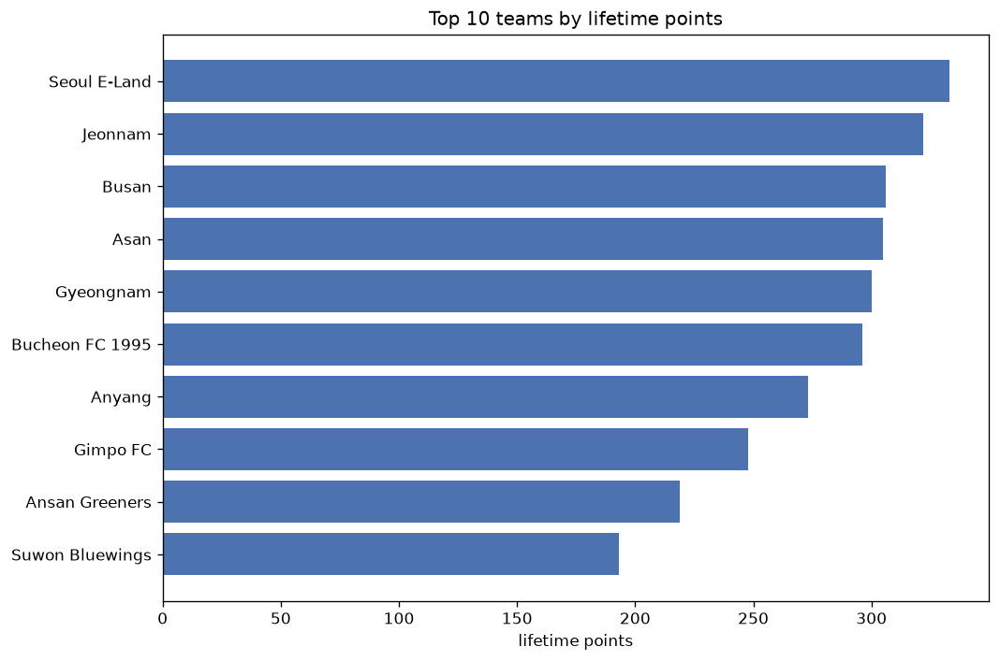
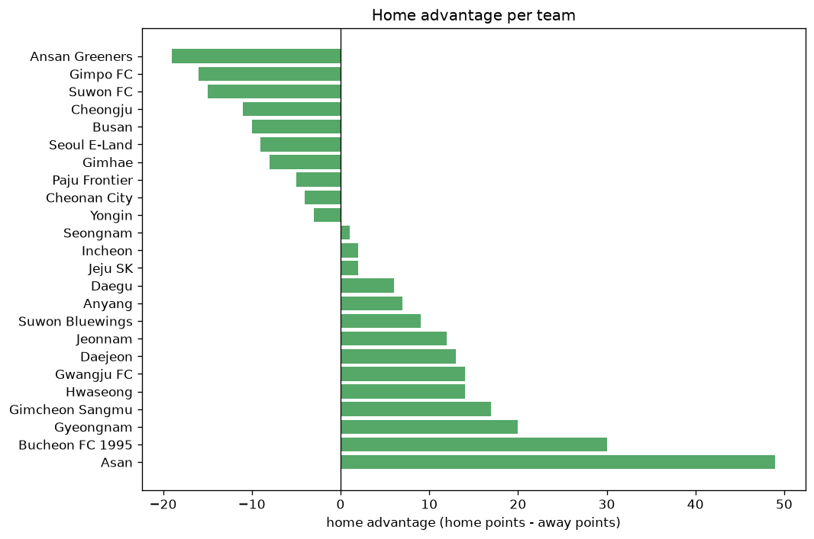

# Team Analysis
- Report: `teams_analysis`
- Generated: 2026-10-27T02:00:26+00:00
- Script: `backend/scripts/analyze_teams.py` v1.0.0
- League: K League 2 (South Korea)
- Scope: league `korea2`

- Teams: **24** | Seasons: **7** | Matches: **1513**

## 1. Team standings (lifetime)
| team | seasons | played | W | D | L | pts | GF | GA | GD | avg pts/season | best pos | worst pos | titles |
|---|---|---|---|---|---|---|---|---|---|---|---|---|---|
| Seoul E-Land | 7 | 240 | 89 | 66 | 85 | 333 | 329 | 288 | 41 | 47.57 | 3 | 13 | 0 |
| Jeonnam | 7 | 242 | 81 | 79 | 82 | 322 | 328 | 323 | 5 | 46.0 | 4 | 15 | 0 |
| Busan | 6 | 214 | 84 | 54 | 76 | 306 | 276 | 263 | 13 | 51.0 | 2 | 10 | 0 |
| Asan | 7 | 241 | 80 | 65 | 96 | 305 | 281 | 295 | -14 | 43.57 | 2 | 10 | 0 |
| Gyeongnam | 7 | 240 | 76 | 72 | 92 | 300 | 304 | 338 | -34 | 42.86 | 3 | 11 | 0 |
| Bucheon FC 1995 | 6 | 213 | 80 | 56 | 77 | 296 | 251 | 262 | -11 | 49.33 | 3 | 8 | 0 |
| Anyang | 5 | 175 | 75 | 48 | 52 | 273 | 239 | 203 | 36 | 54.6 | 1 | 9 | 1 |
| Gimpo FC | 5 | 179 | 63 | 59 | 57 | 248 | 206 | 202 | 4 | 49.6 | 3 | 8 | 0 |
| Ansan Greeners | 7 | 241 | 52 | 63 | 126 | 219 | 234 | 381 | -147 | 31.29 | 5 | 16 | 0 |
| Suwon Bluewings | 3 | 104 | 55 | 28 | 21 | 193 | 172 | 108 | 64 | 64.33 | 1 | 3 | 1 |
| Daejeon | 3 | 102 | 49 | 24 | 29 | 171 | 159 | 127 | 32 | 57.0 | 2 | 5 | 0 |
| Seongnam | 4 | 139 | 40 | 45 | 54 | 165 | 153 | 185 | -32 | 41.25 | 4 | 14 | 0 |
| Cheongju | 4 | 140 | 34 | 53 | 53 | 155 | 134 | 193 | -59 | 38.75 | 8 | 14 | 0 |
| Gimcheon Sangmu | 2 | 71 | 42 | 15 | 14 | 141 | 129 | 69 | 60 | 70.5 | 1 | 1 | 2 |
| Cheonan City | 4 | 140 | 29 | 41 | 70 | 128 | 157 | 228 | -71 | 32.0 | 8 | 14 | 0 |
| Suwon FC | 2 | 56 | 32 | 13 | 11 | 109 | 106 | 60 | 46 | 54.5 | 2 | 2 | 0 |
| Gwangju FC | 1 | 40 | 25 | 11 | 4 | 86 | 68 | 32 | 36 | 86.0 | 1 | 1 | 1 |
| Hwaseong | 2 | 69 | 21 | 23 | 25 | 86 | 81 | 83 | -2 | 43.0 | 6 | 10 | 0 |
| Incheon | 1 | 39 | 23 | 9 | 7 | 78 | 66 | 30 | 36 | 78.0 | 1 | 1 | 1 |
| Jeju SK | 1 | 27 | 18 | 6 | 3 | 60 | 50 | 23 | 27 | 60.0 | 1 | 1 | 1 |
| Daegu | 1 | 28 | 15 | 7 | 6 | 52 | 55 | 38 | 17 | 52.0 | 4 | 4 | 0 |
| Paju Frontier | 1 | 28 | 8 | 7 | 13 | 31 | 27 | 34 | -7 | 31.0 | 13 | 13 | 0 |
| Yongin | 1 | 29 | 6 | 13 | 10 | 31 | 35 | 42 | -7 | 31.0 | 11 | 11 | 0 |
| Gimhae | 1 | 29 | 3 | 9 | 17 | 18 | 26 | 59 | -33 | 18.0 | 17 | 17 | 0 |

## 2. Home vs away split
| team | home P | H-W | H-D | H-L | H-pts | away P | A-W | A-D | A-L | A-pts | adv |
|---|---|---|---|---|---|---|---|---|---|---|---|
| Asan | 121 | 48 | 33 | 40 | 177 | 120 | 32 | 32 | 56 | 128 | 49 |
| Bucheon FC 1995 | 105 | 44 | 31 | 30 | 163 | 108 | 36 | 25 | 47 | 133 | 30 |
| Gyeongnam | 121 | 43 | 31 | 47 | 160 | 119 | 33 | 41 | 45 | 140 | 20 |
| Gimcheon Sangmu | 35 | 24 | 7 | 4 | 79 | 36 | 18 | 8 | 10 | 62 | 17 |
| Gwangju FC | 20 | 16 | 2 | 2 | 50 | 20 | 9 | 9 | 2 | 36 | 14 |
| Hwaseong | 35 | 13 | 11 | 11 | 50 | 34 | 8 | 12 | 14 | 36 | 14 |
| Daejeon | 51 | 26 | 14 | 11 | 92 | 51 | 23 | 10 | 18 | 79 | 13 |
| Jeonnam | 120 | 43 | 38 | 39 | 167 | 122 | 38 | 41 | 43 | 155 | 12 |
| Suwon Bluewings | 53 | 29 | 14 | 10 | 101 | 51 | 26 | 14 | 11 | 92 | 9 |
| Anyang | 87 | 37 | 29 | 21 | 140 | 88 | 38 | 19 | 31 | 133 | 7 |
| Daegu | 14 | 9 | 2 | 3 | 29 | 14 | 6 | 5 | 3 | 23 | 6 |
| Incheon | 19 | 12 | 4 | 3 | 40 | 20 | 11 | 5 | 4 | 38 | 2 |
| Jeju SK | 14 | 9 | 4 | 1 | 31 | 13 | 9 | 2 | 2 | 29 | 2 |
| Seongnam | 69 | 20 | 23 | 26 | 83 | 70 | 20 | 22 | 28 | 82 | 1 |
| Yongin | 15 | 2 | 8 | 5 | 14 | 14 | 4 | 5 | 5 | 17 | -3 |
| Cheonan City | 70 | 13 | 23 | 34 | 62 | 70 | 16 | 18 | 36 | 66 | -4 |
| Paju Frontier | 14 | 3 | 4 | 7 | 13 | 14 | 5 | 3 | 6 | 18 | -5 |
| Gimhae | 14 | 0 | 5 | 9 | 5 | 15 | 3 | 4 | 8 | 13 | -8 |
| Seoul E-Land | 120 | 44 | 30 | 46 | 162 | 120 | 45 | 36 | 39 | 171 | -9 |
| Busan | 108 | 39 | 31 | 38 | 148 | 106 | 45 | 23 | 38 | 158 | -10 |
| Cheongju | 71 | 16 | 24 | 31 | 72 | 69 | 18 | 29 | 22 | 83 | -11 |
| Suwon FC | 26 | 13 | 8 | 5 | 47 | 30 | 19 | 5 | 6 | 62 | -15 |
| Gimpo FC | 89 | 29 | 29 | 31 | 116 | 90 | 34 | 30 | 26 | 132 | -16 |
| Ansan Greeners | 122 | 24 | 28 | 70 | 100 | 119 | 28 | 35 | 56 | 119 | -19 |

## 3. Top performers
### Best points per game (PPG)
| rank | team | PPG |
|---|---|---|
| 1 | Jeju SK | 2.22 |
| 2 | Gwangju FC | 2.15 |
| 3 | Incheon | 2.00 |
| 4 | Gimcheon Sangmu | 1.99 |
| 5 | Suwon FC | 1.95 |

### Most goals scored
| rank | team | goals |
|---|---|---|
| 1 | Seoul E-Land | 329 |
| 2 | Jeonnam | 328 |
| 3 | Gyeongnam | 304 |
| 4 | Asan | 281 |
| 5 | Busan | 276 |

### Best goal difference
| rank | team | GD |
|---|---|---|
| 1 | Suwon Bluewings | 64 |
| 2 | Gimcheon Sangmu | 60 |
| 3 | Suwon FC | 46 |
| 4 | Seoul E-Land | 41 |
| 5 | Anyang | 36 |

### Best defence (goals against per match, standings)
| rank | team | GA/match |
|---|---|---|
| 1 | Gwangju FC | 0.789 |
| 2 | Incheon | 0.811 |
| 3 | Jeju SK | 0.852 |
| 4 | Gimcheon Sangmu | 0.956 |
| 5 | Suwon Bluewings | 1.000 |

## 4. Team consistency
- Teams present in all **7** seasons: **5**

Ansan Greeners, Asan, Gyeongnam, Jeonnam, Seoul E-Land

## 5. Head-to-head dominance
- Distinct fixtures: **217** (showing the 15 most frequent)

| fixture | meetings | home wins | draws | away wins | home pct | draw pct | away pct |
|---|---|---|---|---|---|---|---|
| Gyeongnam vs Asan | 22 | 11 | 7 | 4 | 50.0% | 31.8% | 18.2% |
| Gyeongnam vs Ansan Greeners | 22 | 10 | 7 | 5 | 45.5% | 31.8% | 22.7% |
| Jeonnam vs Asan | 22 | 8 | 9 | 5 | 36.4% | 40.9% | 22.7% |
| Ansan Greeners vs Asan | 22 | 7 | 6 | 9 | 31.8% | 27.3% | 40.9% |
| Gyeongnam vs Jeonnam | 22 | 3 | 9 | 10 | 13.6% | 40.9% | 45.5% |
| Gyeongnam vs Seoul E-Land | 21 | 7 | 7 | 7 | 33.3% | 33.3% | 33.3% |
| Seoul E-Land vs Ansan Greeners | 21 | 4 | 7 | 10 | 19.0% | 33.3% | 47.6% |
| Seoul E-Land vs Jeonnam | 21 | 4 | 11 | 6 | 19.0% | 52.4% | 28.6% |
| Bucheon FC 1995 vs Seoul E-Land | 20 | 10 | 6 | 4 | 50.0% | 30.0% | 20.0% |
| Bucheon FC 1995 vs Ansan Greeners | 20 | 9 | 4 | 7 | 45.0% | 20.0% | 35.0% |
| Bucheon FC 1995 vs Jeonnam | 20 | 9 | 6 | 5 | 45.0% | 30.0% | 25.0% |
| Seoul E-Land vs Asan | 20 | 9 | 5 | 6 | 45.0% | 25.0% | 30.0% |
| Bucheon FC 1995 vs Gyeongnam | 20 | 8 | 3 | 9 | 40.0% | 15.0% | 45.0% |
| Jeonnam vs Ansan Greeners | 20 | 8 | 6 | 6 | 40.0% | 30.0% | 30.0% |
| Bucheon FC 1995 vs Asan | 19 | 9 | 6 | 4 | 47.4% | 31.6% | 21.1% |

## 6. Position per season (classic view)
_Cells show final position; '-' when the team was absent from that season._

| team | 2020 | 2021 | 2022 | 2023 | 2024 | 2025 | 2026 |
|---|---|---|---|---|---|---|---|
| Seoul E-Land | 4 | 11 | 12 | 13 | 12 | 11 | 3 |
| Jeonnam | 6 | 4 | 8 | 7 | 5 | 5 | 15 |
| Busan | - | 7 | 10 | 2 | 4 | 8 | 5 |
| Asan | 10 | 9 | 6 | 9 | 2 | 7 | 7 |
| Gyeongnam | 3 | 6 | 5 | 5 | 11 | 9 | 9 |
| Bucheon FC 1995 | 8 | 8 | 4 | 4 | 7 | 3 | - |
| Anyang | 9 | 2 | 3 | 6 | 1 | - | - |
| Gimpo FC | - | - | 7 | 3 | 6 | 6 | 8 |
| Ansan Greeners | 7 | 5 | 9 | 11 | 10 | 15 | 16 |
| Suwon Bluewings | - | - | - | - | 3 | 2 | 1 |
| Daejeon | 5 | 3 | 2 | - | - | - | - |
| Seongnam | - | - | - | 10 | 14 | 4 | 12 |
| Cheongju | - | - | - | 8 | 9 | 14 | 10 |
| Gimcheon Sangmu | - | 1 | - | 1 | - | - | - |
| Cheonan City | - | - | - | 12 | 8 | 13 | 14 |
| Suwon FC | 2 | - | - | - | - | - | 2 |
| Gwangju FC | - | - | 1 | - | - | - | - |
| Hwaseong | - | - | - | - | - | 10 | 6 |
| Incheon | - | - | - | - | - | 1 | - |
| Jeju SK | 1 | - | - | - | - | - | - |
| Daegu | - | - | - | - | - | - | 4 |
| Paju Frontier | - | - | - | - | - | - | 13 |
| Yongin | - | - | - | - | - | - | 11 |
| Gimhae | - | - | - | - | - | - | 17 |

---
*All statistics are computed from PostgreSQL tables (read-only). Run with `python backend/scripts/analyze_teams.py` to regenerate.*

## Charts

