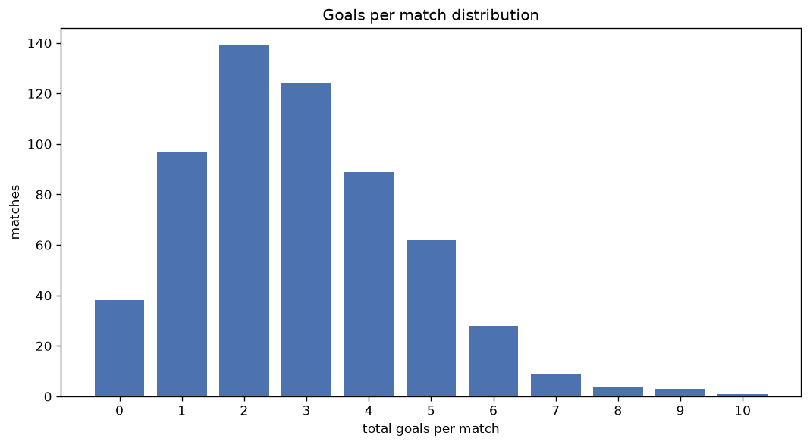
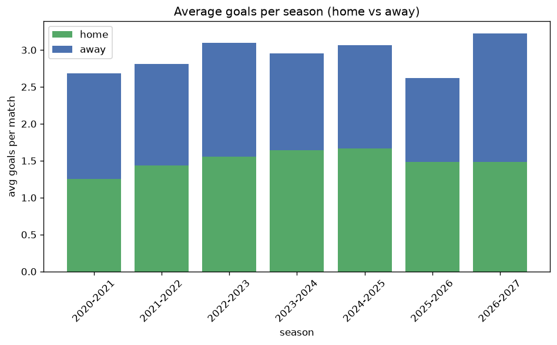

# Goal Analysis
- Report: `goals_analysis`
- Generated: 2026-10-30T04:01:19+00:00
- Script: `backend/scripts/analyze_goals.py` v1.0.0
- League: Premier League (Kuwait)
- Scope: league `kuwait`

## 1. Goals per match distribution
| goals | matches | pct |
|---|---|---|
| 0 | 38 | 6.4% |
| 1 | 97 | 16.3% |
| 2 | 139 | 23.4% |
| 3 | 124 | 20.9% |
| 4 | 89 | 15.0% |
| 5 | 62 | 10.4% |
| 6 | 28 | 4.7% |
| 7 | 9 | 1.5% |
| 8 | 4 | 0.7% |
| 9 | 3 | 0.5% |
| 10 | 1 | 0.2% |

## 2. Goals per match per season
| season | matches | total goals | avg home | avg away | avg total |
|---|---|---|---|---|---|
| 2020-2021 | 105 | 282 | 1.257 | 1.429 | 2.686 |
| 2021-2022 | 90 | 253 | 1.433 | 1.378 | 2.811 |
| 2022-2023 | 90 | 279 | 1.556 | 1.544 | 3.1 |
| 2023-2024 | 90 | 266 | 1.644 | 1.311 | 2.956 |
| 2024-2025 | 90 | 276 | 1.667 | 1.4 | 3.067 |
| 2025-2026 | 98 | 257 | 1.48 | 1.143 | 2.622 |
| 2026-2027 | 31 | 100 | 1.484 | 1.742 | 3.226 |

## 3. Home vs away goal share
- Home goals: **890** (52.0%)
- Away goals: **823** (48.0%)
- Home/away ratio: **1.081**

| season | home goals | away goals | total | home pct | away pct |
|---|---|---|---|---|---|
| 2020-2021 | 132 | 150 | 282 | 46.8% | 53.2% |
| 2021-2022 | 129 | 124 | 253 | 51.0% | 49.0% |
| 2022-2023 | 140 | 139 | 279 | 50.2% | 49.8% |
| 2023-2024 | 148 | 118 | 266 | 55.6% | 44.4% |
| 2024-2025 | 150 | 126 | 276 | 54.3% | 45.7% |
| 2025-2026 | 145 | 112 | 257 | 56.4% | 43.6% |
| 2026-2027 | 46 | 54 | 100 | 46.0% | 54.0% |

## 4. BTTS (Both Teams To Score)
- Overall: **318** of `594` (53.5%)

| season | matches | BTTS | pct |
|---|---|---|---|
| 2020-2021 | 105 | 56 | 53.3% |
| 2021-2022 | 90 | 46 | 51.1% |
| 2022-2023 | 90 | 58 | 64.4% |
| 2023-2024 | 90 | 45 | 50.0% |
| 2024-2025 | 90 | 49 | 54.4% |
| 2025-2026 | 98 | 47 | 48.0% |
| 2026-2027 | 31 | 17 | 54.8% |

## 5. Clean sheets
- Home clean sheets: **160** (26.9%)
- Away clean sheets: **154** (25.9%)
- Total clean sheets recorded: **314**
- Matches with at least one clean sheet: **276** (46.5%)
- Both teams kept clean sheets (0-0): **38**

| season | matches | home CS | away CS | total CS | matches w/ CS |
|---|---|---|---|---|---|
| 2020-2021 | 105 | 25 | 33 | 58 | 49 (46.7%) |
| 2021-2022 | 90 | 27 | 22 | 49 | 44 (48.9%) |
| 2022-2023 | 90 | 17 | 20 | 37 | 32 (35.6%) |
| 2023-2024 | 90 | 27 | 25 | 52 | 45 (50.0%) |
| 2024-2025 | 90 | 28 | 17 | 45 | 41 (45.6%) |
| 2025-2026 | 98 | 29 | 29 | 58 | 51 (52.0%) |
| 2026-2027 | 31 | 7 | 8 | 15 | 14 (45.2%) |

## 6. Scoring intensity
- First-half goals: **716** (42.4%)
- Second-half goals: **974** (57.6%)
- Avg first-half goals per match: **1.222**
- Avg second-half goals per match: **1.662**
- Second-half-only scoring (HT 0-0, FT goals >= 1): **126** (21.2%)
- *8 match(es) excluded (no HT score recorded).*

| season | matches | 1st half | 2nd half | 1st half pct | 2nd half pct |
|---|---|---|---|---|---|
| 2020-2021 | 105 | 108 | 154 | 41.2% | 58.8% |
| 2021-2022 | 90 | 108 | 145 | 42.7% | 57.3% |
| 2022-2023 | 90 | 114 | 162 | 41.3% | 58.7% |
| 2023-2024 | 90 | 111 | 155 | 41.7% | 58.3% |
| 2024-2025 | 90 | 117 | 159 | 42.4% | 57.6% |
| 2025-2026 | 98 | 112 | 145 | 43.6% | 56.4% |
| 2026-2027 | 31 | 46 | 54 | 46.0% | 54.0% |

## 7. First-goal timing
- Matches with first-goal time recorded: `555` of `594` (93.4%)
- Goalless matches: `39`
- Min `1` | Max `99` | Mean `31.03` | Median (p50) `26`

| bucket | count | % of matches | % of scoring matches |
|---|---|---|---|
| 1-15 | 179 | 30.1% | 32.3% |
| 16-30 | 137 | 23.1% | 24.7% |
| 31-45 | 100 | 16.8% | 18.0% |
| 46-60 | 74 | 12.5% | 13.3% |
| 61-75 | 39 | 6.6% | 7.0% |
| 76-90 | 19 | 3.2% | 3.4% |
| 91-120 | 7 | 1.2% | 1.3% |

---
*All statistics are computed from PostgreSQL tables (read-only). Run with `python backend/scripts/analyze_goals.py` to regenerate.*

## Charts

