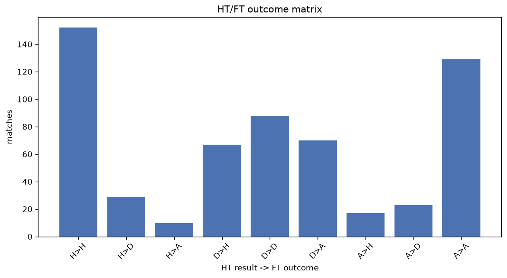
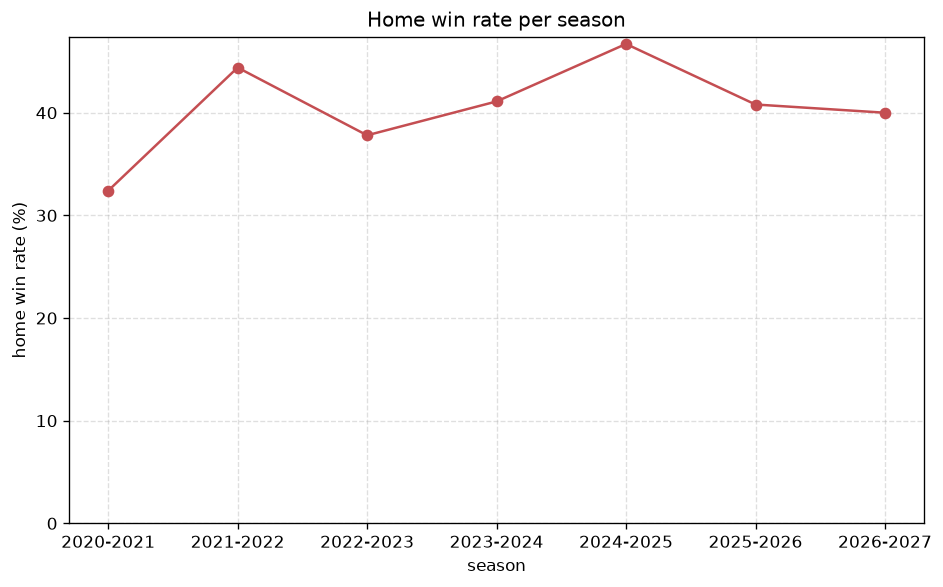

# Match Analysis
- Report: `matches_analysis`
- Generated: 2026-10-29T02:07:25+00:00
- Script: `backend/scripts/analyze_matches.py` v1.0.0
- League: Premier League (Kuwait)
- Scope: league `kuwait`

## 1. Overall summary
| metric | value |
|---|---|
| Matches | 593 |
| Home wins | 239 (40.3%) |
| Draws | 140 (23.6%) |
| Away wins | 214 (36.1%) |
| Total goals | 1709 |
| Average goals per match | 2.882 |
| Goalless matches | 38 (6.4%) |

## 2. Per-season breakdown
| season | matches | home wins | draws | away wins | total goals | avg goals | goalless |
|---|---|---|---|---|---|---|---|
| 2020-2021 | 105 | 34 (32.4%) | 24 (22.9%) | 47 (44.8%) | 282 | 2.686 | 9 (8.6%) |
| 2021-2022 | 90 | 40 (44.4%) | 18 (20.0%) | 32 (35.6%) | 253 | 2.811 | 5 (5.6%) |
| 2022-2023 | 90 | 34 (37.8%) | 28 (31.1%) | 28 (31.1%) | 279 | 3.1 | 5 (5.6%) |
| 2023-2024 | 90 | 37 (41.1%) | 21 (23.3%) | 32 (35.6%) | 266 | 2.956 | 7 (7.8%) |
| 2024-2025 | 90 | 42 (46.7%) | 18 (20.0%) | 30 (33.3%) | 276 | 3.067 | 4 (4.4%) |
| 2025-2026 | 98 | 40 (40.8%) | 25 (25.5%) | 33 (33.7%) | 257 | 2.622 | 7 (7.1%) |
| 2026-2027 | 30 | 12 (40.0%) | 6 (20.0%) | 12 (40.0%) | 96 | 3.2 | 1 (3.3%) |

## 3. HT/FT outcome matrix
| HT result \ FT result | Home | Draw | Away | total |
|---|---|---|---|---|
| HT home lead | 152 (79.6%) | 29 (15.2%) | 10 (5.2%) | 191 |
| HT draw | 67 (29.8%) | 88 (39.1%) | 70 (31.1%) | 225 |
| HT away lead | 17 (10.1%) | 23 (13.6%) | 129 (76.3%) | 169 |
- *8 match(es) excluded (no HT score recorded).*

## 4. Comeback matches
- Home comebacks (trailing at HT, won at FT): **17** (2.9%)
- Away comebacks (trailing at HT, won at FT): **10** (1.7%)

### Home comebacks
| season | home | away | HT | FT |
|---|---|---|---|---|
| 2020-2021 | Al Kuwait | Al Sulaibikhat | 0-1 | 3-1 |
| 2020-2021 | Kazma SC | Al Tadamon | 0-1 | 2-1 |
| 2020-2021 | Al Shabab | Al Jahra | 0-1 | 2-1 |
| 2021-2022 | Al Naser | Al Salmiya | 0-2 | 3-2 |
| 2022-2023 | Al Kuwait | Al-Fahaheel | 0-1 | 2-1 |
| 2022-2023 | Al Arabi | Al-Fahaheel | 0-1 | 2-1 |
| 2022-2023 | Al Naser | Al Sahel | 0-1 | 4-1 |
| 2022-2023 | Al Kuwait | Al Sahel | 0-1 | 2-1 |
| 2022-2023 | Al Jahra | Al Arabi | 0-1 | 2-1 |
| 2023-2024 | Al Salmiya | Al Naser | 0-1 | 3-2 |
| 2023-2024 | Kazma SC | Al Jahra | 0-1 | 2-1 |
| 2023-2024 | Al Jahra | Khaitan | 0-1 | 2-1 |
| 2024-2025 | Al Qadisiya | Al Tadamon | 0-1 | 3-1 |
| 2024-2025 | Al-Fahaheel | Al Naser | 0-1 | 3-1 |
| 2024-2025 | Al Qadisiya | Kazma SC | 0-1 | 3-2 |
| 2025-2026 | Kazma SC | Al Qadisiya | 1-2 | 4-2 |
| 2026-2027 | Al Jahra | Al Arabi | 0-1 | 2-1 |

### Away comebacks
| season | home | away | HT | FT |
|---|---|---|---|---|
| 2020-2021 | Al Jahra | Al Salmiya | 1-0 | 1-2 |
| 2020-2021 | Al Arabi | Al Salmiya | 1-0 | 1-3 |
| 2022-2023 | Al Naser | Al-Fahaheel | 1-0 | 1-3 |
| 2022-2023 | Al Jahra | Al Naser | 1-0 | 1-2 |
| 2023-2024 | Al Jahra | Al Qadisiya | 1-0 | 1-2 |
| 2023-2024 | Al Jahra | Al Salmiya | 1-0 | 1-2 |
| 2023-2024 | Al Shabab | Khaitan | 1-0 | 1-2 |
| 2024-2025 | Yarmouk | Al Salmiya | 1-0 | 1-2 |
| 2024-2025 | Al Qadisiya | Al Arabi | 2-0 | 2-4 |
| 2024-2025 | Al Salmiya | Al Qadisiya | 1-0 | 1-2 |

## 5. HT lead conversion
| HT state | matches | converted to win | held as draw | collapsed to loss |
|---|---|---|---|---|
| Home lead | 191 | 152 (79.6%) | 29 (15.2%) | 10 (5.2%) |
| Away lead | 169 | 129 (76.3%) | 23 (13.6%) | 17 (10.1%) |

### Matches level at half-time
| FT result | count | pct |
|---|---|---|
| Home win | 67 | 29.8% |
| Draw | 88 | 39.1% |
| Away win | 70 | 31.1% |
- *8 match(es) excluded (no HT score recorded).*

## 6. First-goal timing
- Matches with a first-goal time recorded: `554` of `593` (93.4%)

Outcome distribution by first-goal timing bucket:
| bucket | matches | % of matches | home | draw | away |
|---|---|---|---|---|---|
| 1-15 | 179 | 30.2% | 87 (48.6%) | 28 (15.6%) | 64 (35.8%) |
| 16-30 | 136 | 22.9% | 54 (39.7%) | 29 (21.3%) | 53 (39.0%) |
| 31-45 | 100 | 16.9% | 43 (43.0%) | 18 (18.0%) | 39 (39.0%) |
| 46-60 | 74 | 12.5% | 25 (33.8%) | 16 (21.6%) | 33 (44.6%) |
| 61-75 | 39 | 6.6% | 14 (35.9%) | 8 (20.5%) | 17 (43.6%) |
| 76-90 | 19 | 3.2% | 11 (57.9%) | 3 (15.8%) | 5 (26.3%) |
| 91-120 | 7 | 1.2% | 5 (71.4%) | 0 (0.0%) | 2 (28.6%) |

## 7. Goalless matches
- Overall: **38** of `593` (6.4%)

| season | matches | goalless | pct |
|---|---|---|---|
| 2020-2021 | 105 | 9 | 8.6% |
| 2021-2022 | 90 | 5 | 5.6% |
| 2022-2023 | 90 | 5 | 5.6% |
| 2023-2024 | 90 | 7 | 7.8% |
| 2024-2025 | 90 | 4 | 4.4% |
| 2025-2026 | 98 | 7 | 7.1% |
| 2026-2027 | 30 | 1 | 3.3% |

---
*All statistics are computed from PostgreSQL tables (read-only). Run with `python backend/scripts/analyze_matches.py` to regenerate.*

## Charts

