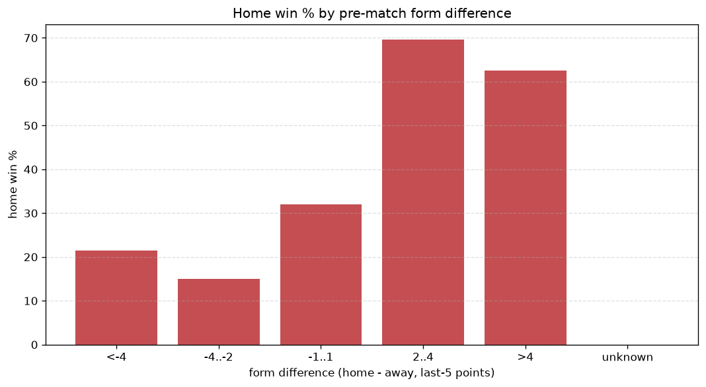
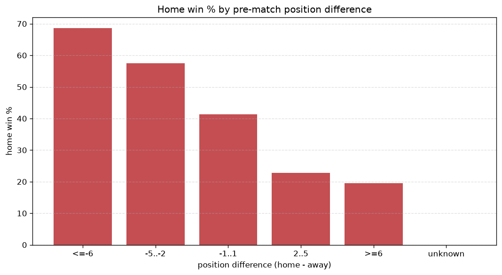

# Relationships Analysis
- Report: `relationships`
- Generated: 2026-10-29T02:07:34+00:00
- Script: `backend/scripts/analyze_relationships.py` v1.0.0
- League: Premier League (Kuwait)
- Scope: league `kuwait`

- Matches analysed: **563** (23 leakage-safe pre-match features).

## 1. Correlation matrix
_Pearson correlation of each pre-match feature with observed goals; sorted by |corr(total goals)|._

| feature | corr(home) | corr(away) | corr(total) |
|---|---|---|---|
| points_difference | 0.339 | -0.281 | 0.076 |
| away_team_goals_conceded_last_5 | 0.182 | -0.103 | 0.075 |
| home_points_before_match | 0.196 | -0.133 | 0.065 |
| away_team_away_goals_avg | -0.028 | 0.106 | 0.052 |
| home_team_home_conceded_avg | -0.162 | 0.128 | -0.042 |
| away_team_away_conceded_avg | 0.110 | -0.077 | 0.034 |
| away_team_goals_scored_last_5 | -0.108 | 0.172 | 0.033 |
| away_position_before_match | 0.131 | -0.194 | -0.029 |
| home_team_home_goals_avg | 0.166 | -0.149 | 0.029 |
| home_position_before_match | -0.234 | 0.236 | -0.024 |
| home_team_goals_scored_last_5 | 0.153 | -0.153 | 0.017 |
| rest_days_difference | -0.047 | 0.034 | -0.014 |
| away_team_points_last_5 | -0.174 | 0.180 | -0.014 |
| home_team_goals_conceded_last_5 | -0.144 | 0.146 | -0.014 |
| home_rest_days | -0.047 | 0.039 | -0.011 |
| home_team_home_win_rate | 0.181 | -0.195 | 0.009 |
| home_team_points_last_5 | 0.156 | -0.167 | 0.009 |
| home_team_wins_last_5 | 0.152 | -0.166 | 0.006 |
| away_rest_days | -0.030 | 0.026 | -0.006 |
| position_difference | -0.280 | 0.329 | 0.004 |
| away_points_before_match | -0.104 | 0.116 | -0.003 |
| away_team_wins_last_5 | -0.151 | 0.176 | 0.001 |
| away_team_away_win_rate | -0.068 | 0.079 | -0.000 |

## 2. Form vs outcome
_Home win/draw/away % per bucket of `home_team_points_last_5 - away_team_points_last_5`._

| bucket | matches | home | draw | away | home % | draw % | away % |
|---|---|---|---|---|---|---|---|
| <-4 | 88 | 16 | 18 | 54 | 18.2% | 20.5% | 61.4% |
| -4..-2 | 119 | 33 | 33 | 53 | 27.7% | 27.7% | 44.5% |
| -1..1 | 176 | 67 | 47 | 62 | 38.1% | 26.7% | 35.2% |
| 2..4 | 94 | 48 | 23 | 23 | 51.1% | 24.5% | 24.5% |
| >4 | 86 | 63 | 13 | 10 | 73.3% | 15.1% | 11.6% |
| unknown | 0 | 0 | 0 | 0 | - | - | - |

## 3. Position vs outcome
_Home win/draw/away % per bucket of `position_difference` (home position - away position; negative favours the home team)._

| bucket | matches | home | draw | away | home % | draw % | away % |
|---|---|---|---|---|---|---|---|
| <=-6 | 51 | 35 | 9 | 7 | 68.6% | 17.6% | 13.7% |
| -5..-2 | 146 | 84 | 30 | 32 | 57.5% | 20.5% | 21.9% |
| -1..1 | 143 | 59 | 39 | 45 | 41.3% | 27.3% | 31.5% |
| 2..5 | 167 | 38 | 43 | 86 | 22.8% | 25.7% | 51.5% |
| >=6 | 56 | 11 | 13 | 32 | 19.6% | 23.2% | 57.1% |
| unknown | 0 | 0 | 0 | 0 | - | - | - |

## 4. Rest advantage
_Home win/draw/away % per bucket of `rest_days_difference` (home rest - away rest). Matches with unknown rest are bucketed separately._

| bucket | matches | home | draw | away | home % | draw % | away % |
|---|---|---|---|---|---|---|---|
| <-1 | 61 | 21 | 14 | 26 | 34.4% | 23.0% | 42.6% |
| -1..0 | 113 | 50 | 31 | 32 | 44.2% | 27.4% | 28.3% |
| 0 | 154 | 64 | 37 | 53 | 41.6% | 24.0% | 34.4% |
| 1..2 | 179 | 69 | 36 | 74 | 38.5% | 20.1% | 41.3% |
| >2 | 23 | 6 | 8 | 9 | 26.1% | 34.8% | 39.1% |
| unknown | 33 | 17 | 8 | 8 | 51.5% | 24.2% | 24.2% |
- *33 match(es) had unknown rest difference (missing rest data on at least one side).*

## 5. Home team quality
_Home win rate by `home_team_home_win_rate` tier (split at 0.5)._

- `< 0.5` tier: **34.3%** home win (122/356)
- `>= 0.5` tier: **50.7%** home win (105/207)
- Home-win gap (>= split minus < split): **+16.4 pp**

| tier | label | matches | home | draw | away | home % |
|---|---|---|---|---|---|---|
| low | < 0.5 | 356 | 122 | 88 | 146 | 34.3% |
| high | >= 0.5 | 207 | 105 | 46 | 56 | 50.7% |

## 6. Feature averages by result
_Mean feature value per outcome; `range` is home-minus-away spread of the group means._

| feature | home mean | draw mean | away mean | range |
|---|---|---|---|---|
| points_difference | 3.621 | -1.657 | -3.703 | 7.324 |
| home_points_before_match | 13.537 | 10.925 | 9.495 | 4.042 |
| position_difference | -1.608 | 0.537 | 2.050 | 3.657 |
| away_points_before_match | 9.916 | 12.582 | 13.198 | 3.282 |
| home_position_before_match | 5.062 | 6.201 | 7.297 | 2.235 |
| away_team_points_last_5 | 4.727 | 6.119 | 6.738 | 2.011 |
| home_team_goals_scored_last_5 | 6.797 | 5.396 | 5.040 | 1.758 |
| home_team_points_last_5 | 6.515 | 5.500 | 4.792 | 1.723 |
| away_team_goals_scored_last_5 | 5.048 | 6.134 | 6.634 | 1.585 |
| home_team_goals_conceded_last_5 | 5.176 | 5.724 | 6.693 | 1.517 |
| away_position_before_match | 6.670 | 5.664 | 5.248 | 1.422 |
| away_team_goals_conceded_last_5 | 6.515 | 5.515 | 5.158 | 1.357 |
| away_rest_days | 11.300 | 10.032 | 11.124 | 1.268 |
| home_rest_days | 11.162 | 10.205 | 11.211 | 1.007 |
| away_team_wins_last_5 | 1.278 | 1.701 | 1.891 | 0.614 |
| home_team_wins_last_5 | 1.815 | 1.507 | 1.257 | 0.558 |
| home_team_home_conceded_avg | 1.012 | 1.215 | 1.409 | 0.398 |
| rest_days_difference | -0.138 | 0.222 | 0.088 | 0.360 |
| home_team_home_goals_avg | 1.510 | 1.189 | 1.159 | 0.351 |
| away_team_away_goals_avg | 1.103 | 1.283 | 1.346 | 0.243 |
| away_team_away_conceded_avg | 1.425 | 1.239 | 1.183 | 0.241 |
| home_team_home_win_rate | 0.447 | 0.339 | 0.268 | 0.179 |
| away_team_away_win_rate | 0.273 | 0.350 | 0.349 | 0.077 |

---
*All features are leakage-safe pre-match values built by `ml.features.build_features.build_rows` from strictly prior matches. Run with `python backend/scripts/analyze_relationships.py` to regenerate.*

## Charts

