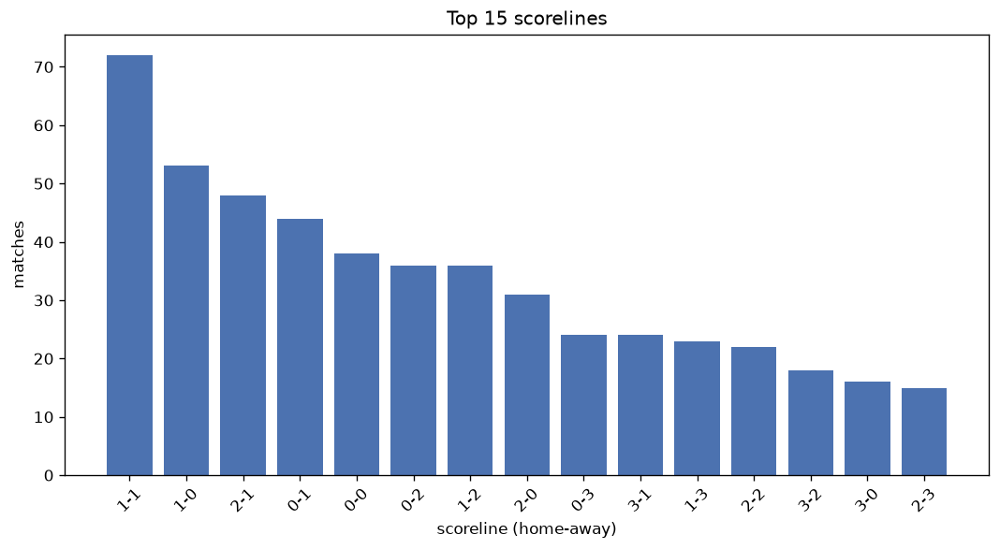
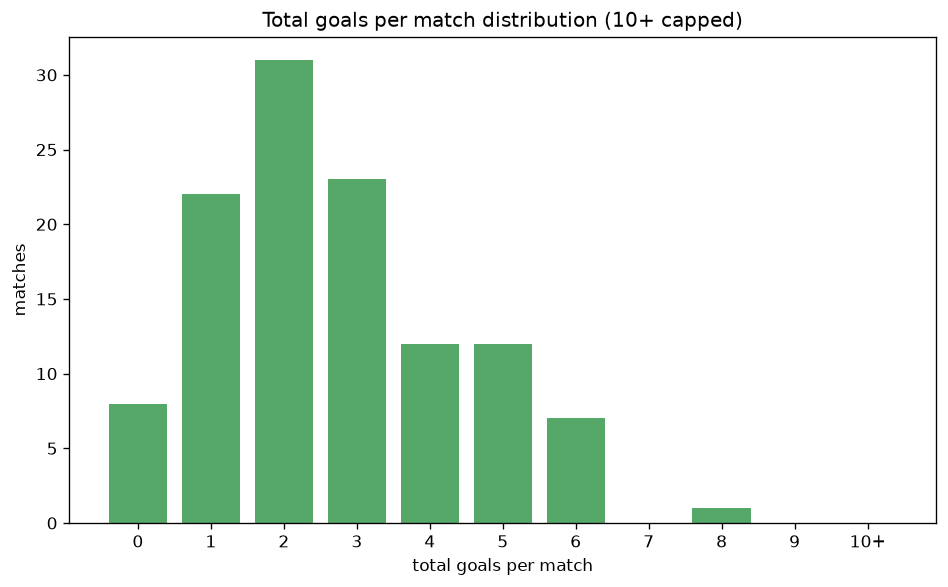

# Scoreline Analysis
- Report: `scoreline_analysis`
- Generated: 2026-10-27T02:01:05+00:00
- Script: `backend/scripts/analyze_scorelines.py` v1.0.0
- League: Premier League (Kuwait)
- Scope: league `kuwait`

## 1. Scoreline frequency
- Matches analysed: **593** across **7** seasons.
- Distinct scorelines seen: **41**.

| scoreline | count | pct |
|---|---|---|
| 1-1 | 72 | 12.1% |
| 1-0 | 53 | 8.9% |
| 2-1 | 48 | 8.1% |
| 0-1 | 44 | 7.4% |
| 0-0 | 38 | 6.4% |
| 0-2 | 36 | 6.1% |
| 1-2 | 36 | 6.1% |
| 2-0 | 31 | 5.2% |
| 0-3 | 24 | 4.0% |
| 3-1 | 24 | 4.0% |
| 1-3 | 23 | 3.9% |
| 2-2 | 22 | 3.7% |
| 3-2 | 18 | 3.0% |
| 3-0 | 16 | 2.7% |
| 2-3 | 15 | 2.5% |
| 4-1 | 12 | 2.0% |
| 4-0 | 11 | 1.9% |
| 1-4 | 11 | 1.9% |
| 0-4 | 8 | 1.3% |
| 3-3 | 7 | 1.2% |

## 2. Scoreline frequency per season

### 2020-2021
| scoreline | count | pct |
|---|---|---|
| 1-1 | 13 | 12.4% |
| 0-1 | 13 | 12.4% |
| 2-1 | 9 | 8.6% |
| 0-0 | 9 | 8.6% |
| 1-2 | 9 | 8.6% |

### 2021-2022
| scoreline | count | pct |
|---|---|---|
| 1-0 | 13 | 14.4% |
| 1-1 | 8 | 8.9% |
| 0-1 | 7 | 7.8% |
| 3-2 | 5 | 5.6% |
| 0-2 | 5 | 5.6% |

### 2022-2023
| scoreline | count | pct |
|---|---|---|
| 1-1 | 13 | 14.4% |
| 2-2 | 9 | 10.0% |
| 2-1 | 9 | 10.0% |
| 1-0 | 6 | 6.7% |
| 0-1 | 5 | 5.6% |

### 2023-2024
| scoreline | count | pct |
|---|---|---|
| 1-1 | 11 | 12.2% |
| 1-2 | 8 | 8.9% |
| 2-1 | 8 | 8.9% |
| 0-0 | 7 | 7.8% |
| 0-2 | 7 | 7.8% |

### 2024-2025
| scoreline | count | pct |
|---|---|---|
| 1-0 | 8 | 8.9% |
| 2-0 | 8 | 8.9% |
| 2-1 | 8 | 8.9% |
| 1-1 | 8 | 8.9% |
| 3-1 | 6 | 6.7% |

### 2025-2026
| scoreline | count | pct |
|---|---|---|
| 1-1 | 16 | 16.3% |
| 0-1 | 9 | 9.2% |
| 0-2 | 9 | 9.2% |
| 1-0 | 9 | 9.2% |
| 0-0 | 7 | 7.1% |

### 2026-2027
| scoreline | count | pct |
|---|---|---|
| 1-0 | 4 | 13.3% |
| 2-1 | 4 | 13.3% |
| 1-1 | 3 | 10.0% |
| 0-2 | 3 | 10.0% |
| 3-3 | 2 | 6.7% |

## 3. Total-goal histogram
_10+ groups all matches with 10 or more total goals._

| total goals | matches | pct |
|---|---|---|
| 0 | 38 | 6.4% |
| 1 | 97 | 16.4% |
| 2 | 139 | 23.4% |
| 3 | 124 | 20.9% |
| 4 | 88 | 14.8% |
| 5 | 62 | 10.5% |
| 6 | 28 | 4.7% |
| 7 | 9 | 1.5% |
| 8 | 4 | 0.7% |
| 9 | 3 | 0.5% |
| 10+ | 1 | 0.2% |

## 4. Extreme scorelines
- Matches with 7+ total goals: **17**

| season | date | scoreline | total goals |
|---|---|---|---|
| 2020-2021 | 2020-12-26 | 9-1 | 10 |
| 2022-2023 | 2023-03-04 | 7-2 | 9 |
| 2022-2023 | 2023-03-11 | 3-6 | 9 |
| 2023-2024 | 2024-02-17 | 6-3 | 9 |
| 2024-2025 | 2024-08-09 | 4-4 | 8 |
| 2025-2026 | 2026-01-02 | 7-1 | 8 |
| 2026-2027 | 2026-10-09 | 1-7 | 8 |
| 2026-2027 | 2026-10-23 | 2-6 | 8 |
| 2020-2021 | 2020-12-08 | 2-5 | 7 |
| 2021-2022 | 2022-04-21 | 5-2 | 7 |
| 2022-2023 | 2023-02-25 | 5-2 | 7 |
| 2023-2024 | 2023-08-29 | 2-5 | 7 |
| 2023-2024 | 2023-11-25 | 3-4 | 7 |
| 2023-2024 | 2024-03-07 | 7-0 | 7 |
| 2024-2025 | 2024-08-17 | 4-3 | 7 |
| 2024-2025 | 2024-10-19 | 3-4 | 7 |
| 2026-2027 | 2026-10-19 | 7-0 | 7 |

## 5. Margin-of-victory distribution (decided matches)
- Decided matches: **453** (draws: **140**)
- Average winning margin: **1.94**

| margin | matches | pct |
|---|---|---|
| 1 | 217 | 47.9% |
| 2 | 124 | 27.4% |
| 3+ | 112 | 24.7% |

## 6. Margin by outcome

### Home wins
- Matches: **239** | avg margin: **1.98** | max margin: **8**
| margin | matches | pct |
|---|---|---|
| 1 | 120 | 50.2% |
| 2 | 59 | 24.7% |
| 3+ | 60 | 25.1% |
- *Full match-by-match list available in `scoreline_analysis.json`.*

### Away wins
- Matches: **214** | avg margin: **1.88** | max margin: **6**
| margin | matches | pct |
|---|---|---|
| 1 | 97 | 45.3% |
| 2 | 65 | 30.4% |
| 3+ | 52 | 24.3% |
- *Full match-by-match list available in `scoreline_analysis.json`.*

## 7. Most common exact score by outcome type
| outcome | matches | most common score | count | pct |
|---|---|---|---|---|
| home | 239 | 1-0 | 53 | 22.2% |
| draw | 140 | 1-1 | 72 | 51.4% |
| away | 214 | 0-1 | 44 | 20.6% |

---
*All statistics are computed from PostgreSQL tables (read-only). Run with `python backend/scripts/analyze_scorelines.py` to regenerate.*

## Charts

